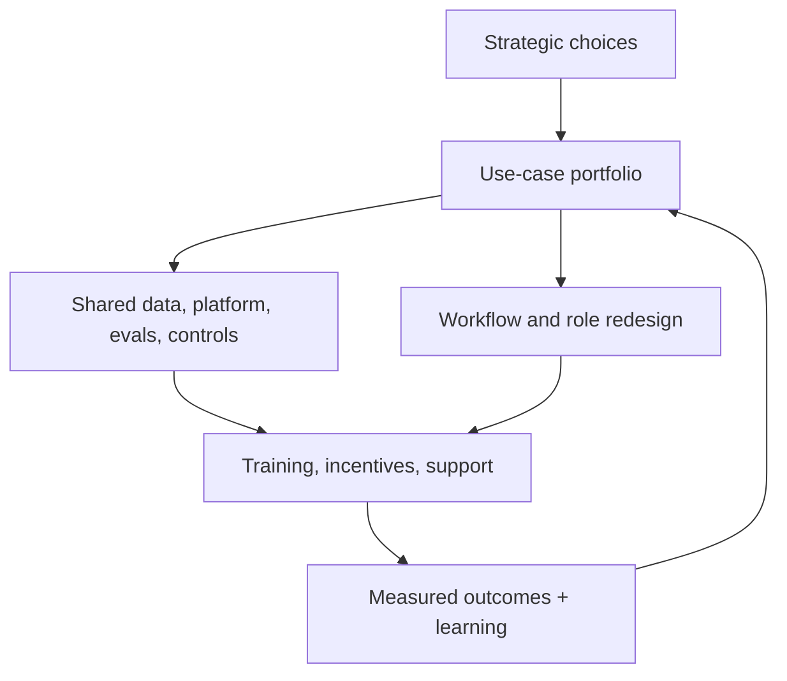

# AI Transformation Lead

> [!abstract] Mission
> Change an organization’s capabilities, operating model, workflows, governance, and habits so AI creates sustained value rather than isolated pilots.

## Responsibilities

- Translate strategy into a portfolio, funding model, sequencing, shared capabilities, and operating model.
- Redesign work with employees and customers; specify retained human judgment, authority, training, and escalation.
- Build coalitions across business, product, data/engineering, security, legal/privacy, risk, HR, finance, procurement, and communications.
- Establish intake, experimentation, evaluation, deployment, monitoring, incident, and retirement patterns.
- Lead adoption through role-specific learning, manager enablement, incentives, communities of practice, and support.
- Measure business outcomes, quality, workforce effects, risk, capability, and adoption; stop theater projects.

## Boundaries

- Broader and longer-term than [[AI Program Manager]]; often sponsors multiple programs and changes the management system.
- More execution/accountability than [[AI Strategy Consultant]], who may recommend but not own adoption.
- Does not replace CIO/CDO/product/risk/HR leaders; defines interfaces and shared direction.

## Levels

| Level | Scope | Evidence |
|---|---|---|
| Change/workstream lead | One function or capability | Adoption and outcome measures, not training attendance alone |
| Transformation lead | Multi-function portfolio and operating change | Shared delivery/governance pattern plus realized workflow outcomes |
| Director / VP | Enterprise investment, structure, workforce, platform | Stops low-value work and reallocates to scalable capabilities |
| Executive | Enterprise accountability and durable institution building | Strategy, incentives, controls, talent, and outcome system survive leadership attention cycles |

## Prerequisites and competencies

- Transformation/change leadership, operating-model design, portfolio management, organization/work design, financial and data literacy, facilitation, communications, and conflict navigation.
- Enough AI literacy to challenge model claims, evaluation, architecture, vendor economics, data constraints, security/privacy, and human-impact assumptions.
- Master narrative + participation, sponsor/manager networks, capability academies, workflow co-design, portfolio governance, value realization, workforce impact, and feedback loops.
- Treat resistance as information about incentives, risk, workload, identity, or poor design—not simply a communications problem.

## Study sequence

1. Diagnose strategy, culture, process, data/platform, governance, skills, incentives, and existing shadow use.
2. Segment opportunities by value, feasibility, risk, shared capability, and learning.
3. Design central/federated/hub-and-spoke roles, decision rights, funding, and product ownership.
4. Co-design two workflows; measure retained judgment, new work, review load, and role changes.
5. Build role-based literacy/practice, manager routines, support, communications, and adoption measures.
6. Operate quarterly portfolio reviews using realized outcomes and incidents; publish stop/scale decisions.

## Tools

- **Free-first:** Obsidian, spreadsheets, Mermaid, survey tools, capability matrices, process maps, open training content, GitHub/knowledge communities.
- **Paid:** portfolio suites, Miro, employee listening/LMS platforms, process mining, enterprise AI platforms, adoption analytics, GRC and service-management systems.
- A transformation dashboard should combine value, use, quality, risk, workforce, and capability—not count licenses or prompts alone.

## Knowledge check

1. Why is tool rollout not transformation?
2. What should a use-case portfolio balance?
3. Name three reasons employees may rationally resist.
4. What is a federated operating model?
5. Why measure new work created by AI?

> [!success]- Answers
> 1. Durable value requires workflow, roles, incentives, capability, ownership, controls, and learning. 2. Value, feasibility, risk, timing, shared capabilities, strategic fit, and learning. 3. Added review workload, unclear accountability, job harm, poor quality, inaccessible design, data risk, misaligned incentives—any three. 4. Central standards/shared capabilities with distributed domain ownership and delivery. 5. Generation may create verification, correction, escalation, data maintenance, and support work that erases benefits or shifts burden.

## Flashcards

Transformation:: A sustained change in how an organization creates value and operates—not deployment of a tool.
Operating model:: The decision rights, structure, processes, capabilities, incentives, technology, and governance through which strategy is executed.
Adoption:: Effective, appropriate use in real work that produces intended outcomes—not login counts.
Change saturation:: When simultaneous changes exceed people’s practical capacity to absorb and perform them.
Shadow AI:: Unapproved or unmanaged AI use that often reveals demand as well as data, security, and quality risk.
Portfolio stop rule:: A predeclared condition for ending or redirecting an initiative when evidence does not justify more investment.

## Interview preparation

- Present a transformation where adoption was low; diagnose system causes before communications tactics.
- Sketch an enterprise AI operating model with clear decision rights and business ownership.
- Explain how you would respond to mass unapproved tool use without driving it further underground.
- Bring a capability assessment, portfolio matrix, workflow redesign, adoption plan, and outcome dashboard.

## Suggested projects

- **Beginner:** transformation diagnosis for a small organization with stakeholder map and prioritized barriers.
- **Intermediate:** two-workflow adoption plan with co-design, new-role/task analysis, training, manager routines, support, measures, and 90-day experiments.
- **Advanced:** enterprise operating model and 18-month portfolio: funding, shared platform/evals/controls, intake/gates, workforce plan, communications, dashboard, incidents, and scale/stop logic.

## Sources

Checked **2026-08-12**.

- [O*NET — Management Analysts](https://www.onetonline.org/link/summary/13-1111.00) — transformation-related occupational analog.
- [NIST — AI RMF Playbook](https://airc.nist.gov/airmf-resources/playbook/).
- [U.S. Department of Labor — AI & Inclusive Hiring Framework announcement](https://www.dol.gov/newsroom/releases/odep/odep20240924) — example of integrating governance, procurement, accessibility, and organizational practices.
- [U.S. Department of Education — AI guidance and workforce education priority](https://www.ed.gov/about/news/press-release/us-department-of-education-issues-guidance-artificial-intelligence-use-schools-proposes-additional-supplemental-priority) — 2025 U.S. skills context.
