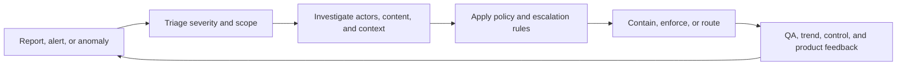

# AI Trust and Safety Operations Specialist

> [!abstract] Mission
> Detect, investigate, contain, and learn from harmful or abusive use of AI products while applying policy consistently, protecting affected people, and preserving defensible evidence.

## Responsibilities

- Review user reports, detection alerts, anomalous activity, and high-risk cases against current policy and escalation rules.
- Investigate actors, accounts, content, devices, transactions, and behavior patterns without collecting more sensitive data than the case requires.
- Contain harm through authorized enforcement, feature restriction, referral, preservation, or emergency escalation; document what was decided and why.
- Run queues, service levels, coverage, quality calibration, appeals, and handoffs across policy, legal, security, support, product, engineering, and communications.
- Convert recurring cases into detection requirements, classifier or evaluation examples, policy clarifications, launch gates, and safer product controls.
- Track false positives, false negatives, recurrence, time to containment, appeal reversals, user harm, and analyst wellbeing—not merely closure volume.

> [!warning] Sensitive work
> Some specializations expose workers to disturbing content, fraud, threats, or urgent incidents. A credible operating model includes need-to-know access, rotation, breaks, wellness support, trauma-informed management, and a way to decline or escalate work. A generalist should not claim authority for child-safety reporting, law-enforcement response, or regulated investigations without role-specific training and counsel.

## Adjacent-role boundaries

- [[Responsible AI Specialist]] shapes lifecycle impact analysis and safeguards; trust and safety operations handles live abuse, reports, investigations, enforcement, and operational feedback.
- [[AI Policy Analyst]] develops and analyzes policy options; this role applies operational policy and surfaces gaps. Legal and policy owners decide authoritative interpretations.
- [[AI Compliance and Privacy Specialist]] maps obligations and evidence; trust and safety handles the case but does not invent retention, disclosure, or reporting rules.
- [[AI Technical Support and User Operations Specialist]] resolves product-use and reliability problems; safety operations takes abuse, harmful behavior, and safety-risk cases.
- [[AI Security Engineer]] protects systems and data from security threats; investigations overlap when misuse, account compromise, or threat actors cross both domains.
- AI red teams conduct authorized testing before or between releases; they do not replace continuous frontline monitoring and response.

## Levels

| Level | Scope | Evidence of readiness |
|---|---|---|
| Associate / analyst | Bounded queue under close escalation rules | Accurate decisions, complete case notes, calibration discipline, safe data handling |
| Specialist | Owns complex investigations and a policy area | Links signals, explains proportional action, handles ambiguity, improves a control |
| Senior / lead | Coordinates incidents, launches, QA, and cross-team escalation | Runs a defensible incident, reduces repeat harm, improves analyst consistency |
| Manager / operations lead | Designs operating model, staffing, metrics, tooling, and accountability | Balances safety, rights, quality, speed, resilience, and workforce health |

## Prerequisites and competencies

- Calm case reasoning, evidence assessment, policy interpretation, concise writing, user empathy, bias awareness, confidentiality, and escalation judgment.
- Familiarity with AI misuse patterns, platform abuse, account/device signals, content and behavior taxonomies, appeals, incident management, and adversarial adaptation.
- Working literacy in logs, SQL or spreadsheets, dashboards, sampling, precision/recall, queue analytics, and secure evidence handling.
- Ability to distinguish observed fact, user allegation, model inference, analyst inference, policy match, and final action in a record.
- Domain-specific training for regulated or high-severity areas; never improvise legal reporting, emergency disclosure, or evidence-retention decisions.

## Study sequence

1. Learn the AI product, its intended uses, access paths, abuse surfaces, data flows, and human escalation routes.
2. Build a harm-and-abuse taxonomy that separates severity, likelihood, affected actors, actor intent, and policy category.
3. Practice case review with synthetic evidence: corroborate signals, record uncertainty, and choose the least excessive authorized action.
4. Learn queue design, quality sampling, inter-rater agreement, appeals, privacy-aware evidence handling, and analyst wellbeing controls.
5. Run a tabletop incident from detection through containment, communications, recovery, after-action review, and control ownership.
6. Turn case trends into one tested detection, policy, product, education, or workflow improvement and measure unintended effects.

## Tools

- **Free-first:** Obsidian, spreadsheets, SQLite/DuckDB, SQL, Python notebooks, Git, Mermaid, synthetic case sets, NIST AI RMF/AIRC resources, and open dashboard tools.
- **Paid:** case-management and ticketing suites, SIEM/fraud platforms, content-moderation tooling, managed labeling/review systems, BI/warehouse platforms, pager/on-call systems, and approved model APIs.
- Tool access should be role-based and audited. Do not paste real case content, personal data, credentials, or contraband into unapproved AI assistants.

## Knowledge check

1. Why is queue closure volume an unsafe primary success metric?
2. What belongs in a defensible case record?
3. How do false positives and false negatives affect trust and safety differently?
4. When should a support case move to trust and safety?
5. Why must an appeals process be measured?
6. What should happen after a severe incident is contained?

> [!success]- Answers
> 1. It rewards speed even when decisions are wrong, rights are harmed, or repeat abuse is not prevented. 2. Sources, timestamps, relevant evidence, uncertainty, policy/version, reasoning, action, authority, and handoffs—subject to retention and access rules. 3. False positives can wrongly restrict legitimate users; false negatives allow harmful activity through. Both must be evaluated by severity and subgroup/context. 4. When evidence indicates abuse, harmful behavior, policy violation, exploitation, or a safety-risk pattern rather than ordinary product use. 5. Reversal reasons reveal inconsistent policy, poor evidence, biased controls, and excessive actions. 6. Preserve required evidence, recover safely, notify authorized stakeholders, review root and contributing causes, assign corrective actions, and verify their effectiveness.

## Flashcards

What is safety triage?:: A time-sensitive classification of severity, scope, confidence, and required escalation—not a final finding.
What is a safety case?:: A controlled record connecting signals and evidence to policy, reasoning, action, ownership, and outcome.
What is calibration?:: Structured comparison of reviewers’ decisions to improve consistent policy application and expose ambiguity.
What is an appeal reversal?:: A changed enforcement decision after review; its reason is a quality and policy signal.
What is time to containment?:: Elapsed time from a qualifying signal to an action that meaningfully limits ongoing harm.
What is proportional enforcement?:: The least excessive authorized action that addresses the evidenced risk and context.
What is a detection feedback loop?:: The process of turning reviewed cases into evaluated improvements to signals, classifiers, rules, and product controls.

## Interview preparation

- Walk through a synthetic ambiguous case: separate facts from inference, state missing evidence, cite the applicable policy version, and explain escalation.
- Explain a metric set that balances speed, accuracy, harm severity, recurrence, appeals, affected-user outcomes, and workforce health.
- Describe a time policy was incomplete. Show how you made a reversible decision and routed the ambiguity rather than inventing policy.
- Prepare a launch-readiness tabletop with monitoring, thresholds, on-call ownership, containment options, communications, and recovery.
- Be ready to discuss privacy minimization and how you would protect analysts from unnecessary sensitive-content exposure.

## Suggested projects

- **Beginner:** Create 30 synthetic cases, a harm taxonomy, decision rubric, escalation matrix, and calibration report with disagreements and revised guidance.
- **Intermediate:** Build a privacy-aware case queue simulator with severity, service levels, QA sampling, appeal outcomes, and a dashboard that avoids volume-only incentives.
- **Advanced:** Run a multi-team abuse incident tabletop and produce an incident record, evidence map, decision log, communications plan, after-action review, and one evaluated control change.

## Sources

All sources were checked **2026-08-12**.

- [OpenAI — Analytics & Automation Lead, User Safety & Risk Operations](https://openai.com/careers/analytics-and-automation-lead-user-safety-and-risk-operations-san-francisco/) — current U.S. posting describing safety/risk queues, case analysis, quality, automation, alerts, dashboards, and human-in-the-loop operations.
- [OpenAI — Strategic Operations Lead, User Safety & Risk Operations](https://openai.com/careers/strategic-operations-lead-user-safety-and-risk-operations-san-francisco/) — current U.S. posting on monitoring, review, escalation, ownership, and cross-functional operating models.
- [OpenAI — Device Safety & Risk Operations Specialist](https://openai.com/careers/device-safety-and-risk-operations-specialist-user-safety-and-risk-operations-san-francisco/) — current U.S. posting on investigation, escalation, decision logging, QA, tabletop exercises, and launch readiness.
- [OpenAI — Abuse Investigator, Child Safety](https://openai.com/careers/abuse-investigator-child-safety-san-francisco/) — current U.S. posting illustrating a specialized, sensitive investigation path; not a generalist authority.
- [NIST — AI RMF Core](https://airc.nist.gov/airmf-resources/airmf/5-sec-core/) — incident/error tracking, response and recovery, affected-actor feedback, third-party risk, and accountability actions.
- [NIST — Generative AI Profile, NIST AI 600-1](https://doi.org/10.6028/NIST.AI.600-1) — GenAI risk actions and misuse considerations.
- [FTC — Artificial Intelligence](https://www.ftc.gov/industry/technology/artificial-intelligence) — current U.S. consumer-protection and enforcement context for AI-enabled conduct.

Related: [[Governance, Risk, Policy and Ethics Careers]] · [[AI Career Atlas]]
