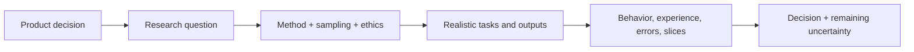

# AI UX Researcher

> [!info] October 13, 2026 update
> Use [[US Career and Governance Update — October 2026]] for current U.S. evidence and a role-family work-product exercise. Pair it with [[Model and Agent Lifecycle Management]] to explain how a technical change affects users, risk, cost, and communication. Older profile claims retain their original verification dates.

> [!abstract] Mission
> Produce ethical, decision-relevant evidence about how people understand, use, supervise, are affected by, and adapt to AI systems over time.

## Responsibilities

- Frame research around a decision and plausible harms/benefits; identify users, non-users, affected people, and operational staff.
- Select qualitative, quantitative, mixed, participatory, evaluative, longitudinal, or field methods.
- Recruit representative participants accessibly and handle consent, privacy, recording, sensitive content, and compensation responsibly.
- Study mental models, task fit, verification, trust/reliance, error detection, accessibility, workload, power, and downstream impact.
- Coordinate model/evaluation sampling so participants encounter realistic variability and failures.
- Communicate evidence, limitations, dissent, uncertainty, and actionable implications to [[AI UX and Product Designer]], product, engineering, and governance.

## Boundaries

- Market research estimates markets and buyer attitudes; UX research studies people’s behavior and experience in context, with overlap.
- Model evaluation measures system behavior; UX research measures human/system interaction and impact. Strong teams connect them.
- [[Responsible AI Specialist]] may conduct impact assessment; researcher supplies empirical human evidence rather than owning all governance.

## Levels

| Level | Scope | Evidence |
|---|---|---|
| Junior | Bounded study under review | Sound protocol, ethical handling, traceable analysis |
| Researcher | End-to-end product decision | Findings change a design, requirement, or use boundary |
| Senior | Ambiguous/mixed-method/high-stakes ecosystem | Includes marginalized/affected groups and longitudinal effects |
| Lead | Research strategy, standards, repository, influence | Portfolio evidence and methodological quality across teams |

## Prerequisites and competencies

- Research design, interviewing/moderation, usability, survey basics, sampling, qualitative coding, descriptive/inferential statistics, ethics, privacy, accessibility, and stakeholder communication.
- AI literacy sufficient to sample outputs, understand model/version/context changes, test prompt/automation effects, and avoid treating one session as stable product behavior.
- Must separate observed behavior, participant report, interpretation, and recommendation.
- Synthetic users and model-generated interview responses can support planning, but are not evidence about real people.

## Study sequence

1. Turn a product request into decision, research questions, assumptions, and risk hypotheses.
2. Create a sampling/recruitment plan including affected non-users and accessibility needs.
3. Pilot a protocol using realistic output sets and an adverse-content support plan.
4. Run and analyze a small study; report disconfirming cases and limitations.
5. Combine interaction data, task outcomes, model-error slices, and interviews.
6. Plan longitudinal/field research for adaptation, deskilling, workarounds, inequity, and outcome persistence.

## Tools

- **Free-first:** Obsidian, spreadsheets/R/Python, Taguette, LimeSurvey/Google Forms where policy permits, Jitsi/meeting tools, WCAG guidance, Mermaid.
- **Paid:** Dovetail/Condens, UserTesting/Lookback, Qualtrics, panel recruitment, transcription, analytics/session replay, accessibility specialists.
- Minimize collection, redact exports, separate identity, enforce retention, and disclose any AI-assisted analysis with human verification.

## Knowledge check

1. Why recruit affected non-users?
2. What is the unit-of-analysis problem with variable AI output?
3. Distinguish stated trust from observed reliance.
4. Why study long-term adaptation?
5. What makes a finding decision-relevant?

> [!success]- Answers
> 1. A system can allocate, deny, burden, or change conditions for people who never interact with its interface. 2. Each participant may encounter different behavior; capture/version outputs and sample systematically. 3. Trust is reported belief; reliance is behavior such as accepting or acting on output. 4. Workarounds, skill change, overreliance, inequity, and workload emerge after novelty. 5. It answers a known choice, identifies evidence and limits, and states an actionable implication with ownership.

## Flashcards

Affected non-user:: A person materially affected by an AI-enabled process without directly operating it.
Ecological validity:: How well study conditions represent the real context in which behavior occurs.
Triangulation:: Using multiple methods or evidence sources to test and enrich an interpretation.
Research debt:: Decisions repeatedly made without adequate user/impact evidence, making later correction harder.
Member checking:: Inviting participants or stakeholders to review interpretations where appropriate; not a substitute for analysis.
Reliance measure:: Observable acceptance, verification, override, or action behavior—not only a rating-scale opinion.

## Interview preparation

- Design a study for an AI assistant whose output changes each run; explain sampling and reproducibility.
- Address pressure to recruit only “power users” for a high-stakes workflow.
- Present a study where stakeholders rejected a finding and how you defended evidence/limitations.
- Bring a decision brief, protocol/consent, sampling plan, analysis trail, report, and product change.

## Suggested projects

- **Beginner:** five-participant mental-model/usability study of a public AI feature with output capture and limitations.
- **Intermediate:** mixed-method comparison of AI-assisted versus baseline task performance, review behavior, workload, trust, and accessibility.
- **Advanced:** participatory longitudinal plan for a workplace deployment, including affected non-users, power/consent, worker outcomes, incident follow-up, and evidence-to-governance loop.

## Sources

Checked **2026-08-12**.

- [NIST — Human-Centered AI](https://www.nist.gov/programs-projects/human-centered-ai).
- [NIST — Human Centered Design](https://www.nist.gov/itl/iad/human-centered-technologies/human-factors-human-centered-design).
- [W3C — WCAG 2 Overview](https://www.w3.org/WAI/standards-guidelines/wcag/).
- [NIST — Identifying and Managing Bias in AI](https://doi.org/10.6028/NIST.SP.1270).
