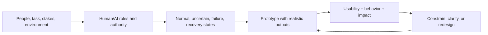

# AI UX and Product Designer

> [!abstract] Mission
> Design useful, understandable, accessible human-AI systems in which people can form an accurate mental model, exercise meaningful control, and recover from failure.

## Responsibilities

- Research users, tasks, environments, ability/access needs, stakes, and existing work with [[AI UX Researcher]].
- Decide the allocation of work and authority: initiation, generation, review, edit, approve, act, override, escalate, and undo.
- Design disclosure, expectation setting, input support, uncertainty/evidence, citations, feedback, correction, consent, failure, recovery, and exit.
- Prototype with realistic variable output—not lorem ipsum or one perfect response.
- Evaluate usability, trust calibration, task success, quality, error detection, accessibility, review burden, and downstream effects.
- Specify states and instrumentation with product/engineering; partner with [[Responsible AI Specialist]] and [[AI Content Designer]].

## Boundaries

- [[AI UX Researcher]] produces evidence about people/context; the designer turns evidence into interaction decisions.
- [[Conversation Designer]] specializes in turn-by-turn dialogue, voice, repair, and escalation.
- [[AI Content Designer]] owns language systems and comprehension; product design owns the broader experience and behavior.
- “AI designer” may also mean a visual generator operator; inspect the portfolio expectations.

## Levels

| Level | Scope | Evidence |
|---|---|---|
| Junior / transitioner | Bounded flow and state design | Accessible prototype with multiple output/failure states |
| Product designer | End-to-end workflow and validation | Research-linked decisions and measurable task improvement |
| Senior | Complex/high-stakes, multi-role ecosystem | Human authority, risk, longitudinal behavior, and service operations |
| Lead | Design principles/system and cross-product quality | Reusable patterns, review standards, and organizational influence |

## Prerequisites and competencies

- Interaction/product design, information architecture, prototyping, usability testing, accessibility, content collaboration, systems/service thinking.
- AI literacy: variability, uncertainty, retrieval/citations, model limits, evaluation, privacy, bias, automation bias, adversarial input, agents/tools.
- Master mental models, calibrated trust, progressive disclosure, verification affordances, safe defaults, reversible action, feedback loops, and longitudinal states.
- Understand that a “human in the loop” without time, context, authority, skill, or an effective interface is not a safeguard.

## Study sequence

1. Analyze five AI experiences for promises, control, evidence, recovery, data disclosure, and accessibility.
2. Map a current task and decide which parts remain human, assistive, automated, or prohibited.
3. Build a state inventory and prototype varied good/weak/uncertain/unsafe/unavailable outputs.
4. Test task completion, comprehension, verification, overreliance, and accessibility with representative participants.
5. Add instrumentation, feedback classification, escalation, and service blueprint.
6. Document design rationale and how findings changed or constrained the system.

## Tools

- **Free-first:** Figma/Penpot, Obsidian, Mermaid, spreadsheets, Storybook, local/model chat tools, WCAG resources and accessibility checkers.
- **Paid:** Figma organization features, UserTesting/Lookback, Dovetail, model APIs, analytics/session replay, accessibility audit services.
- Never use confidential research data in an unapproved generative tool; synthetic personas do not replace research with people.

## Knowledge check

1. What is calibrated trust?
2. Why prototype multiple output states?
3. Name five capabilities needed for meaningful human oversight.
4. When is showing a confidence score harmful?
5. How is an AI usability test different from a deterministic-flow test?

> [!success]- Answers
> 1. Reliance that approximately matches actual capability and limits for the context. 2. AI varies; a perfect sample hides review, recovery, and trust problems. 3. Time, information/context, skill, authority, attention, interface/action, incentive—any five. 4. When it is uncalibrated, misunderstood, not tied to action, or creates false precision. 5. It samples variable behavior and tests verification, error detection, uncertainty, feedback, and downstream effects as well as navigation.

## Flashcards

Calibrated trust:: Reliance aligned with demonstrated system capability and risk in context.
Automation bias:: Tendency to over-rely on automated suggestions or ignore contradictory evidence.
Safe default:: Initial behavior chosen to reduce foreseeable harm without requiring expert configuration.
Reversibility:: Ability to undo or recover from an action within an appropriate time and cost.
State inventory:: The complete set of loading, empty, permission, success, uncertainty, partial, failure, recovery, and escalation states.
Human-AI allocation:: Explicit assignment of tasks and decision authority between people and system.

## Interview preparation

- Redesign an AI recommendation for a high-stakes decision; discuss evidence and appeal, not just confidence.
- Critique a chatbot that hides sources and cannot undo actions.
- Present a finding that caused you to remove automation or narrow the use case.
- Bring research inputs, task/allocation map, state inventory, prototypes, test evidence, accessibility check, and rationale.

## Suggested projects

- **Beginner:** critique and redesign one AI feature with eight essential states and WCAG checks.
- **Intermediate:** interactive assistant prototype tested with variable outputs; report task success, error detection, reliance, and revisions.
- **Advanced:** multi-role agentic workflow with permission preview, confirmation, audit history, interruption/undo, escalation, service blueprint, longitudinal monitoring, and responsible-design review.

## Sources

Checked **2026-08-12**.

- [NIST — Human Centered Design](https://www.nist.gov/itl/iad/human-centered-technologies/human-factors-human-centered-design).
- [NIST — Human-Centered AI](https://www.nist.gov/programs-projects/human-centered-ai).
- [W3C — WCAG 2.2 Overview](https://www.w3.org/WAI/standards-guidelines/wcag/).
- [NIST — Identifying and Managing Bias in AI](https://doi.org/10.6028/NIST.SP.1270).
