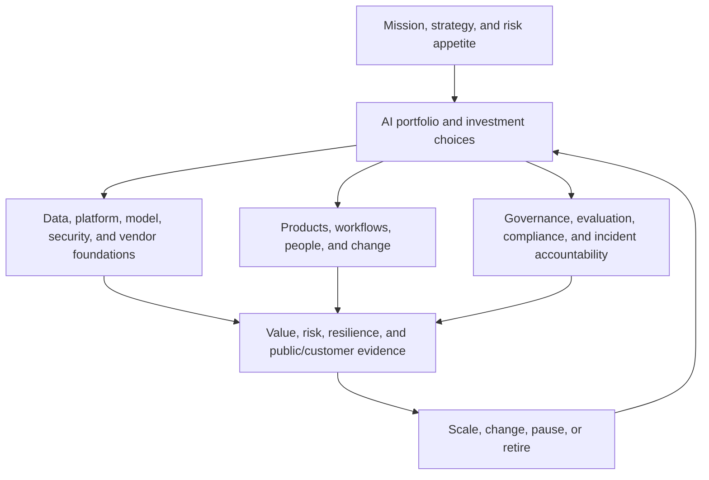

# Chief AI Officer and Head of AI

> [!abstract] Mission
> Establish enterprise direction, authority, capability, investment discipline, and accountability so AI advances the organization’s mission with measurable value, controlled risk, and sustainable operating ownership.

> [!danger] This is not an entry-level role
> “Beginner” in this learning track means learning the executive system and choosing a feeder path—not being ready to serve as CAIO. The U.S. federal CAIO role in OMB M-25-21 is deliberately senior and authority-bearing. Private-sector Head of AI and CAIO titles are not standardized, but they normally require substantial leadership across technology, product/operations, strategy, governance, finance, and organizational change.

## Title reality: federal CAIO versus private Head of AI

- **Federal agencies:** OMB Memorandum M-25-21 requires agencies to retain or designate a CAIO and specifies seniority, authority, innovation/adoption/governance, compliance coordination, senior-advisor, representation, inventory, and related responsibilities. Treat the memorandum and later agency/OMB updates as the source of truth.
- **Private, nonprofit, state, and local organizations:** no single universal role definition applies. “Head of AI” may lead product, engineering, transformation, research, governance, or a combined portfolio. Read the mandate, budget, decision rights, reporting line, and accountable outcomes—not just the title.

## Responsibilities

- Advise the chief executive/agency head and governing bodies on AI opportunity, risk, capability, competitive or mission context, and decisions requiring enterprise authority.
- Set an AI strategy and target operating model connected to organizational strategy; define decision rights across CIO/CTO/CDO/CISO, product, operations, legal, risk, privacy, HR, finance, procurement, and audit.
- Maintain a portfolio and inventory of use cases, models/systems, vendors, owners, expected outcomes, cost, dependencies, evaluations, risk tier, approvals, monitoring, and retirement status.
- Establish common data, platform, architecture, evaluation, security, procurement, governance, incident, and reuse patterns while allowing justified domain variation.
- Allocate capital and talent; build leadership capability, workforce literacy, communities of practice, hiring/upskilling plans, and change ownership near the work.
- Review evidence and make or route scale/change/pause/retire decisions; report value, adoption, cost, risk, incidents, control health, capability, and unresolved decisions honestly.

## Adjacent-role boundaries

- The CAIO sets enterprise direction and accountability; [[AI Product Manager]] and technical/system owners remain accountable for specific products and systems.
- [[AI Transformation Lead]] runs adoption portfolios and operating change; the CAIO supplies enterprise mandate, priorities, resources, architecture/governance, and executive decisions.
- CIO/CTO/CDO/CISO responsibilities do not disappear. The organization must document overlaps in infrastructure, architecture, data, security, engineering, and procurement.
- [[AI Governance Specialist]], [[Responsible AI Specialist]], legal, compliance, privacy, and risk leaders design and operate control systems; the executive ensures authority, integration, resourcing, and escalation.
- [[AI Auditor and Assurance Specialist]] requires independence. The CAIO can sponsor remediation but must not mark their own portfolio independently assured.
- A research or model leader advances technical capability; a CAIO balances the whole enterprise system, including use, value, operations, workforce, procurement, and risk.

## Feeder roles and levels

| Stage | Scope | Evidence of readiness |
|---|---|---|
| Learner / feeder practitioner | Study executive system while succeeding in a real domain | Measurable product, program, platform, transformation, governance, or operating outcomes |
| Functional / portfolio leader | Leads multiple teams or an enterprise capability | Allocates resources, resolves cross-functional decisions, and owns value/risk evidence |
| Head of AI / VP | Owns enterprise or major-business AI strategy, portfolio, foundations, and adoption | Sustained delivery plus governance, talent, economics, and executive/board trust |
| Chief AI Officer | Enterprise authority, accountability, external representation, and executive decisions | Demonstrated organization-wide outcomes and control through changing technology and policy |

Common feeders include [[AI Transformation Lead]], [[Technical AI Product Manager]], [[AI Product Manager]], [[AI Program Manager]], [[AI Strategy Consultant]], [[AI Governance Specialist]], [[Responsible AI Specialist]], data/platform/ML engineering leadership, CIO/CTO/CDO/CISO paths, and senior domain or operations leadership with real AI portfolio accountability.

## Prerequisites and competencies

- Executive strategy, portfolio and capital allocation, organizational design, governance, finance/economics, operating-model design, change leadership, negotiation, crisis leadership, and governing-body communication.
- Sufficient technical depth to challenge architecture, data, evaluation, model/provider, security, reliability, interoperability, and build/buy/partner claims without pretending to be every specialist.
- Evidence judgment: baselines, counterfactuals, adoption, total cost, benefit attribution, risk thresholds, independent challenge, monitoring, and retirement.
- U.S. legal/policy and sector awareness with qualified counsel; ability to maintain a dated obligations register rather than declare blanket “AI compliance.”
- Institutional courage to reject theatrical pilots, pause unsafe deployments, surface bad news, protect independent review, and assign durable owners.

## Study sequence

1. Choose a feeder lane and build depth through delivered outcomes: product/transformation, technology/data, governance/risk, strategy/finance, or domain operations.
2. Learn AI system lifecycles, data/platform architecture, evaluation, security, procurement, third-party risk, incident response, economics, and human/organizational effects.
3. Build an enterprise inventory and maturity baseline; map decision rights, skills, platforms, duplicated efforts, high-impact risks, and evidence gaps.
4. Form a strategy and portfolio with mission outcomes, architectural/governance foundations, scenarios, investment stages, owners, thresholds, and stop/retire logic.
5. Design the operating model: councils, accountable executives, product/system owners, independent challenge, common services, funding, workforce, communications, and escalation.
6. Run quarterly evidence reviews and one crisis tabletop; produce governing-body decisions on scale/change/pause/retire, then verify actions and update the strategy.

## Tools

- **Free-first:** Obsidian, spreadsheets, Mermaid, Git/GitHub, Python/SQL, NIST AIRC, GAO frameworks, public procurement/policy resources, open dashboards, architecture diagrams, and structured decision logs.
- **Paid:** portfolio/strategy management, GRC/model inventory, enterprise architecture, vendor-risk, cloud/model consoles, FinOps, BI, data catalog, observability, security, learning-management, and workforce-planning systems.
- An executive dashboard is not the system of record unless ownership, definitions, lineage, refresh, access, and decisions are governed. Do not upload confidential strategy, employee, customer, regulated, or security information to unapproved tools.

## Knowledge check

1. Why is CAIO not an entry-level position?
2. What is the critical difference between federal CAIO and private Head of AI titles?
3. What makes an AI use-case inventory decision-useful?
4. Why should the CAIO not own every AI project directly?
5. What evidence supports a scale decision?
6. Why must independent assurance remain independent?

> [!success]- Answers
> 1. It requires enterprise authority and demonstrated judgment across strategy, technology, value, risk, finance, people, operations, and crisis decisions. 2. OMB M-25-21 specifies duties and seniority for U.S. federal agencies; private titles vary by organization and mandate. 3. Named owners plus outcome/baseline, users, system/vendor, data, cost, dependencies, evaluation, risk tier, approvals, monitoring, incidents, and lifecycle status. 4. Durable delivery requires accountable product/system/domain owners; centralizing all execution creates bottlenecks and weak local ownership. 5. Representative performance and risk evaluation, adoption/workflow evidence, value against baseline/counterfactual, total cost, operational readiness, control health, resilience, affected-actor feedback, and clear ownership. 6. A portfolio owner evaluating their own claims creates a conflict; governing bodies need credible challenge against defined criteria.

## Flashcards

What is an AI operating model?:: The roles, decision rights, funding, processes, platforms, controls, evidence, and escalation through which the enterprise uses AI.
What is portfolio governance?:: Repeated evidence-based decisions to fund, scale, change, pause, or retire initiatives under defined authority and risk appetite.
What is a use-case inventory?:: A governed record of AI systems and uses, owners, outcomes, dependencies, evaluations, risks, approvals, monitoring, and lifecycle state.
What is a feeder role?:: A role in which a future executive builds the depth, outcomes, and leadership judgment required for broader authority.
What is a stage gate?:: A decision point with predefined evidence, authority, and possible outcomes rather than automatic progression.
What is independent challenge?:: Review by a party with sufficient competence, access, authority, and freedom from ownership of the work being assessed.
What is benefit attribution?:: Evidence separating AI-caused improvement from baseline trends, other interventions, selection effects, and optimistic assumptions.
What is an executive stop condition?:: A predefined signal that requires pausing, narrowing, escalating, or retiring an initiative.

## Interview preparation

- Present a first-90-day listening, inventory, decision-rights, risk, and portfolio plan without promising a technology-first transformation.
- Defend three investments, one pause, and one retirement using mission/value, architecture, talent, cost, risk, and adoption evidence.
- Explain the relationship you would establish with CEO/agency head, board, CIO, CTO, CDO, CISO, legal, privacy, risk, finance, procurement, HR, audit, and domain leaders.
- Run a scenario: a high-visibility AI system causes harm or a material outage while benefit claims remain politically or commercially important.
- Bring an enterprise inventory, maturity baseline, operating model, portfolio, architecture principles, risk/evaluation standards, workforce plan, dashboard definitions, and board memo.

## Suggested projects

- **Beginner (feeder readiness):** Analyze a fictional enterprise’s AI landscape and produce an inventory, decision-rights map, five evidence gaps, and a recommendation for which feeder lane you need to deepen.
- **Intermediate (portfolio leader):** Design a one-year AI portfolio with baseline, staged funding, shared foundations, talent plan, governance, evaluation, total-cost model, adoption measures, and stop/retire gates.
- **Advanced (executive simulation):** Run two quarterly portfolio reviews and a crisis tabletop; deliver governing-body materials, decisions, incident accountability, resource reallocations, independent-review path, and verified follow-through.

## Sources

All sources were checked **2026-08-12**.

- [OMB — M-25-21, Accelerating Federal Use of AI through Innovation, Governance, and Public Trust](https://www.whitehouse.gov/wp-content/uploads/2025/02/M-25-21-Accelerating-Federal-Use-of-AI-through-Innovation-Governance-and-Public-Trust.pdf) — April 2025 official memorandum requiring agency CAIOs and specifying authority and duties; federal context only.
- [U.S. GAO — Artificial Intelligence: Federal Efforts Guided by Requirements and Advisory Groups, GAO-25-107933](https://files.gao.gov/reports/GAO-25-107933/index.html) — 2025 official mapping of federal AI requirements, implementation dates, and advisory structures.
- [NIST — AI RMF Core](https://airc.nist.gov/airmf-resources/airmf/5-sec-core/) — executive responsibility, roles, inventory, lifecycle risk, measurement, monitoring, response, and third-party actions.
- [U.S. GAO — AI Accountability Framework, GAO-21-519SP](https://www.gao.gov/products/gao-21-519sp) — governance, data, performance, and monitoring practices for accountable AI.
- [OPM — FY 2024 Human Capital Reviews: Artificial Intelligence](https://www.opm.gov/policy-data-oversight/oversight-and-effectiveness/human-capital-reviews/fy-2024-human-capital-reviews/artificial-intelligence/) — federal evidence on workforce planning, upskilling, communities, leadership training, and AI talent challenges.
- [OPM — Competencies](https://www.opm.gov/policy-data-oversight/assessment-and-selection/competencies/) — official competency and occupational-analysis resources, including leadership positions.
- [OMB — M-25-22, Driving Efficient Acquisition of Artificial Intelligence in Government](https://www.whitehouse.gov/wp-content/uploads/2025/02/M-25-22-Driving-Efficient-Acquisition-of-Artificial-Intelligence-in-Government.pdf) — April 2025 federal AI acquisition, competition, performance, and risk context.
- [NIST — AI Actor Tasks](https://airc.nist.gov/airmf-resources/airmf/appendices/app-a-descriptions-of-ai-actor-tasks/) — governance, oversight, procurement, operation, and lifecycle actor responsibilities.

Related: [[Product, Program and Business Careers]] · [[AI Transformation Lead]] · [[AI Governance Specialist]]
