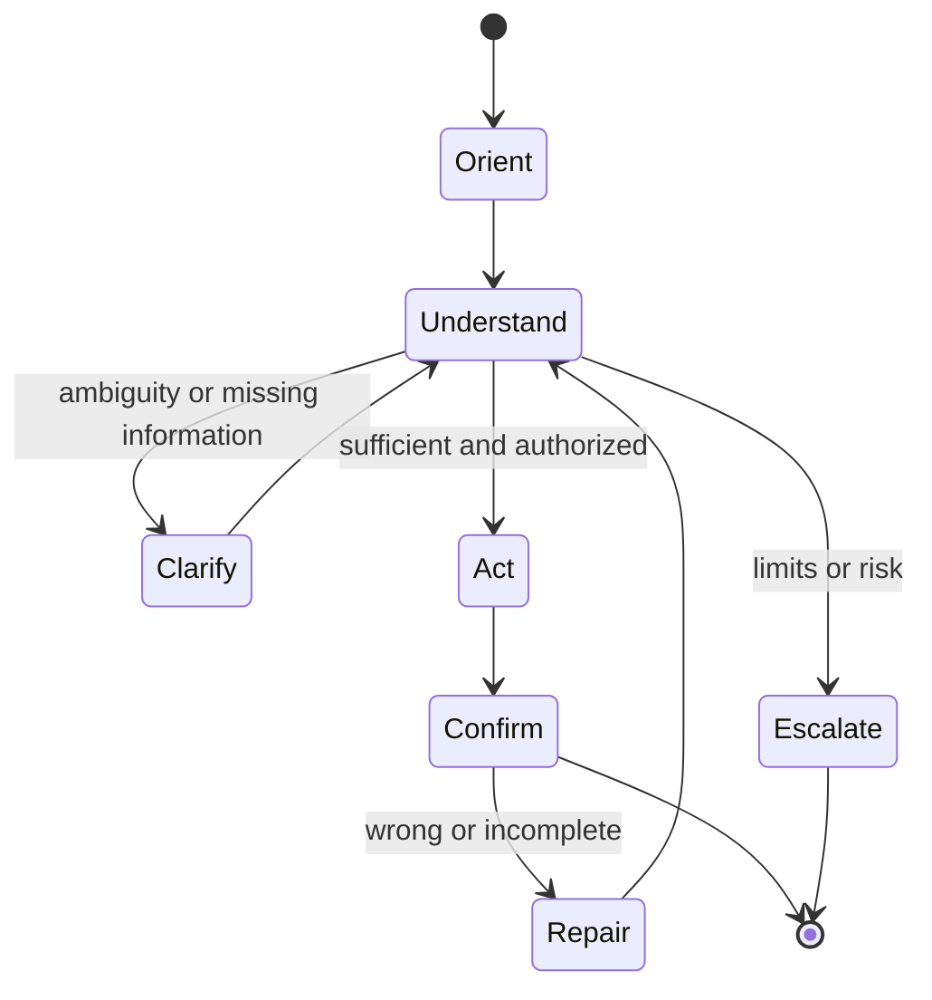

# Conversation Designer

> [!info] October 13, 2026 update
> Use [[US Career and Governance Update — October 2026]] for current U.S. evidence and a role-family work-product exercise. Pair it with [[Model and Agent Lifecycle Management]] to explain how a technical change affects users, risk, cost, and communication. Older profile claims retain their original verification dates.

> [!abstract] Mission
> Design dialogue that helps people accomplish a task clearly, accessibly, safely, and recoverably across variable language and system behavior.

## Responsibilities

- Define conversational purpose, persona/voice, audience, channel, capabilities, limits, disclosure, and data expectations.
- Map intents/jobs, entities/slots, context, initiative, multi-turn state, clarification, confirmation, repair, refusal, escalation, and closure.
- Write prompts, responses, variants, and microcopy with [[AI Content Designer]] and [[Prompt and Context Engineer]].
- Prototype and test realistic conversations, interruptions, accents/language variation, ambiguity, unsafe requests, tool failures, and accessibility needs.
- Annotate transcripts, maintain error taxonomy, and turn failures into content, logic, model, retrieval, tool, or policy changes.
- Design voice-specific latency, turn-taking, barge-in, audio privacy, and fallback where relevant.

## Boundaries

- [[AI UX and Product Designer]] owns the full interaction/service; conversation design specializes in language and turn structure.
- [[Prompt and Context Engineer]] configures model behavior and evaluation; the conversation designer owns human dialogue quality and experience.
- Copywriting persuades; conversation design manages cooperative action, state, and repair.

## Levels

| Level | Scope | Evidence |
|---|---|---|
| Junior | Bounded intent/flow and copy | Complete happy/failure paths and tested transcript |
| Designer | Multi-turn task and repair system | Measurable task success and safe escalation |
| Senior | Open-ended/multimodal/high-stakes ecosystem | Robust state, policy/content integration, longitudinal tuning |
| Lead | Voice standards, tooling, QA, cross-product design | Reusable patterns and transcript-driven improvement system |

## Prerequisites and competencies

- Dialogue/conversation principles, UX writing, information architecture, interaction design, qualitative research, linguistics fundamentals, accessibility, and content governance.
- AI literacy: prompt/context, retrieval, tools, hallucination, safety, evaluation, memory/privacy, and model variability.
- Learn cooperative principles, grounding, adjacency pairs, turn-taking, repair, progressive disclosure, plain language, and localization.
- Do not make the system sound more certain, sentient, human, authorized, or confidential than it is.

## Study sequence

1. Analyze transcripts for user goal, turns, initiative, misunderstanding, repair, and outcome.
2. Create purpose/persona/voice principles with explicit limits and prohibited claims.
3. Map happy, ambiguous, missing-data, refusal, tool-failure, unsafe, and escalation flows.
4. Prototype with a human “wizard” and later a model; capture every variant.
5. Test task success, turns, repair success, abandonment, inappropriate completion, and comprehension.
6. Build transcript annotation and weekly failure-to-change loop.

## Tools

- **Free-first:** Obsidian, Mermaid, spreadsheets, Figma/Penpot, Botpress/Rasa community options, local models, audio recording/editing, WCAG/cognitive accessibility resources.
- **Paid:** Voiceflow, model APIs, speech services, contact-center/conversation analytics, localization/testing platforms.

## Knowledge check

1. What is conversational repair?
2. When should confirmation be explicit?
3. Why minimize anthropomorphic claims?
4. What is mixed initiative?
5. Name four useful transcript labels.

> [!success]- Answers
> 1. Detecting and resolving misunderstanding or failure through clarification, correction, rephrasing, alternatives, or escalation. 2. Before consequential/irreversible actions, ambiguous interpretations, or use of sensitive information. 3. They can distort trust, authority, emotional expectations, and disclosure. 4. Both user and system can appropriately guide the interaction. 5. Intent/job, misunderstanding type, missing entity, repair, refusal, escalation, tool failure, outcome—any four.

## Flashcards

Grounding:: Establishing sufficient mutual understanding to proceed.
Repair:: A conversational process for recognizing and resolving trouble in speaking, hearing, understanding, or action.
Explicit confirmation:: Restating the interpreted action/data and requiring affirmative approval.
Barge-in:: A voice user’s ability to interrupt system speech.
Conversation state:: Information about the current task, prior turns, filled requirements, permissions, and next possible actions.
Escalation:: Transfer to a more appropriate human, channel, or process with enough context and consent.

## Interview preparation

- Whiteboard a flow for an ambiguous, emotional, or high-stakes request; show limits and escalation.
- Rewrite a verbose model response into a short, actionable turn without hiding caveats.
- Diagnose a failed transcript at content, state, retrieval, tool, model, and policy layers.
- Bring voice principles, flow/state model, prompt/response spec, annotated transcripts, test metrics, and iteration.

## Suggested projects

- **Beginner:** FAQ assistant dialogue map with disclosure, three clarifications, refusal, and human handoff.
- **Intermediate:** appointment or support assistant with state, interruption, correction, confirmation, tool failure, accessibility, and 30 transcript tests.
- **Advanced:** multimodal high-stakes assistant spec with policy matrix, adversarial/edge corpus, consent/memory controls, escalation service blueprint, transcript taxonomy, and improvement dashboard.

## Sources

Checked **2026-08-12**.

- [NIST — Human-Centered AI](https://www.nist.gov/programs-projects/human-centered-ai).
- [W3C — Cognitive Accessibility at W3C](https://www.w3.org/WAI/cognitive/) — includes conversational-interface considerations.
- [W3C — WCAG 2.2 Overview](https://www.w3.org/WAI/standards-guidelines/wcag/).
