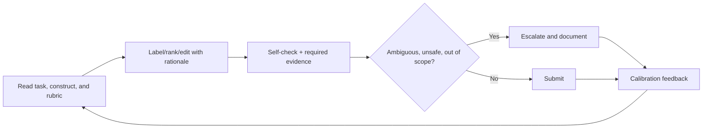

# Data Annotator and AI Rater

> [!abstract] Mission
> Apply a defined rubric consistently to data or model outputs, explain judgment, protect sensitive material, and surface ambiguity or harmful content instead of hiding it.

## Responsibilities

- Understand the construct being labeled, definitions, decision rules, examples/counterexamples, uncertainty and escalation.
- Classify, extract, transcribe, segment, rank, compare, critique, fact-check, rewrite or score data/model output as assigned.
- Cite evidence and rationale where required; distinguish factual correctness, instruction following, relevance, style, safety and preference.
- Follow privacy/security, identity/access, device/location, no-copy and data-retention rules; report exposure or unsafe tasks.
- Participate in calibration and quality review; accept feedback while flagging inconsistent gold labels or rubric conflict.
- Track wellbeing and use approved breaks/escalation for disturbing content; quality targets must not override safety.

## Boundaries and title reality

- Entry-level general annotation differs from specialist medical/legal/scientific/language/coding evaluation; domain roles require verifiable expertise.
- [[Human-Feedback Specialist]] designs rubrics, calibration and experiments; rater applies them and contributes frontline insight.
- [[AI Data Operations Manager]] owns workforce, throughput, QA, lineage and vendors.
- Contract labels vary; verify employee/contractor status, pay terms, task availability, confidentiality, monitoring and support. No salary claims are made here.

## Levels

| Level | Scope | Evidence |
|---|---|---|
| Trainee / generalist | Clear low-context tasks | Calibration pass, consistent rationale, correct escalation |
| Rater / annotator | Multiple task types and nuanced edge cases | Stable quality and useful ambiguity feedback |
| Senior / domain expert | High-stakes or specialized judgments | Expert evidence, adjudication and guide improvement |
| QA / team lead | Review, calibration, coaching | Detects systemic rubric/data problems, not only individual errors |

## Prerequisites and competencies

- Reading comprehension, attention, consistent rule application, digital fluency, concise rationale, research/fact verification, feedback and reliability.
- Role-specific language/domain knowledge; basic AI/data literacy and awareness that labels are judgments, not perfect “ground truth.”
- Understand multi-label versus single-label, span/box/segment, ranking/pairwise rating, uncertainty, skip/escalate, gold items, inter-rater agreement and adjudication.
- Never use outside AI to complete tasks unless explicitly authorized; it can leak data and invalidate human measurement.

## Study sequence

1. Practice classifying 50 public examples from a one-page rubric; record uncertainty.
2. Compare with reference/adjudication; create personal error taxonomy without memorizing only gold items.
3. Write concise evidence-grounded rationales and separate dimensions before overall score.
4. Calibrate with another rater; analyze disagreements as rubric, example, expertise or true ambiguity.
5. Practice harmful-content, privacy, conflict-of-interest and technical escalation protocols.
6. Build portfolio using only public/synthetic data and a self-authored guide—not client work.

## Tools

- **Free-first:** Label Studio, CVAT, Doccano, spreadsheets, browser research with trusted sources, Obsidian, text/image/audio utilities and keyboard shortcuts.
- **Paid/proprietary:** Scale/Labelbox/Appen/TELUS-style platforms and employer tools; specialist data tools; secure VDI/QA systems.
- Do not install extensions, scripts or accelerators on a platform without authorization; they may leak data or violate terms.

## Knowledge check

1. Why is disagreement not always annotator error?
2. What is a gold item?
3. When should a rater skip/escalate?
4. Why separate rating dimensions?
5. What is a concise useful rationale?

> [!success]- Answers
> 1. The construct can be subjective, underspecified, culturally/domain dependent or genuinely ambiguous. 2. An item with an adjudicated/reference label used for training or quality checks; it can itself be wrong and requires governance. 3. Out-of-scope, missing context, conflict, unsafe exposure, inaccessible data, ambiguous rule or insufficient expertise per protocol. 4. A fluent answer can be factually wrong or unsafe; one overall impression hides causal feedback. 5. Decision + exact rule/dimension + specific evidence, noting uncertainty—without irrelevant commentary.

## Flashcards

Annotation construct:: The underlying property the label is intended to represent.
Gold item:: Example with an adjudicated reference answer used for calibration or quality control.
Inter-rater agreement:: Degree to which independent raters applying the same rubric agree; interpretation depends on task and distribution.
Adjudication:: Structured resolution of disagreement by authorized reviewers using evidence and updated guidance.
Preference rating:: Comparative human judgment about which output better meets defined criteria; not universal truth.
Escalation:: Documented routing of uncertainty, harm, missing expertise or policy conflict rather than forced guessing.

## Interview preparation

- Complete a sample carefully; verbalize dimension separation and escalation, not hidden chain-of-thought.
- Explain a disagreement caused by rubric ambiguity and propose a counterexample.
- Describe privacy and harmful-content boundaries.
- Bring a public annotation guide, labeled sample, rationale examples, agreement/error analysis and guide revision.

## Suggested projects

- **Beginner:** label 100 public text items with a self-authored taxonomy; calculate agreement with a partner or second pass.
- **Intermediate:** pairwise-rate 50 public model outputs for correctness/relevance/safety/style with evidence, disagreement analysis and adjudicated guide.
- **Advanced:** domain annotation pilot with expert eligibility, sampling, calibration, gold governance, uncertainty/escalation, QA, privacy, wellbeing and limitations report.

## Sources

Checked **2026-08-12**.

- [NIST — AI Resource Center](https://airc.nist.gov/) — AI testing/evaluation resources, including human-testing context.
- [NIST — AI RMF 1.0](https://doi.org/10.6028/NIST.AI.100-1) — data quality, evaluation and human roles.
- [O*NET — Data Entry Keyers](https://www.onetonline.org/link/summary/43-9021.00) — partial U.S. task/accuracy analog; AI rating is broader and often judgment-intensive.
