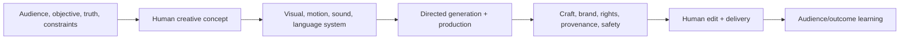

# Generative AI Creative Director

> [!info] October 13, 2026 update
> Use [[US Career and Governance Update — October 2026]] for current U.S. evidence and a role-family work-product exercise. Pair it with [[Model and Agent Lifecycle Management]] to explain how a technical change affects users, risk, cost, and communication. Older profile claims retain their original verification dates.

> [!abstract] Mission
> Turn a strategy into an original, coherent, responsible creative system and lead humans and generative tools from concept through finished multi-channel work.

## Responsibilities

- Clarify audience, objective, proposition, evidence, brand, channels, budget, schedule, rights, and risk.
- Develop the creative concept and governing principles; create references, style frames, story/world rules, and acceptance bar.
- Direct [[AI Image and Graphic Creator]], [[AI Video Producer]], [[AI Audio and Music Specialist]], writers, designers, editors, agencies, and technologists.
- Select tools and production patterns; establish review, asset provenance, permissions, disclosure, security, and vendor-data rules.
- Review for originality, coherence, anatomy/continuity, representation, truthfulness, brand, accessibility, legal clearance, and platform requirements.
- Separate speed of generation from quality of finished work; measure audience and business outcomes.

## Boundaries

- Art direction governs visual expression; creative direction aligns the cross-medium idea and campaign outcome.
- A prompt stylist produces inputs; the director owns strategy, concept, team, critique, and finished system.
- [[AI Product Manager]] owns a product outcome; creative director owns communication/experience concept and craft.

## Levels

| Level | Scope | Evidence |
|---|---|---|
| Emerging / art-director transition | One concept and small asset system | Strong rationale, iterations, edit, and provenance |
| Creative director | Campaign/system across media | Coherent final work tied to brief and audience evidence |
| Senior / group | Multiple teams, brands, high-risk/public work | Review standards, rights/safety judgment, reliable production |
| Executive creative | Creative capability, culture, portfolio, client trust | Distinctive work and responsible scalable operating model |

## Prerequisites and competencies

- Creative strategy, concepting, storytelling, art direction, copy/visual literacy, critique, production, budgeting, leadership, brand, accessibility, and client/stakeholder communication.
- Working knowledge of image/video/audio/text generation, control/reference methods, editing/compositing, provenance, copyright, likeness/voice consent, platform disclosure, and model/vendor data terms.
- Can distinguish inspiration from imitation and require source/license records.
- Human authorship matters for U.S. copyrightability; document human selection, arrangement, modification, direction, and editing rather than assuming prompts alone establish rights.

## Study sequence

1. Analyze ten campaigns for strategy, concept, system, craft, and audience—not tool novelty.
2. Write three briefs and generate at least ten distinct concepts per brief before selecting.
3. Build a multi-medium style/story bible including what the system must never imitate or claim.
4. Direct image, motion, sound, and copy iterations; maintain prompt/reference/version and rights/provenance logs.
5. Run critique and clearance: truth, representation, accessibility, likeness/voice, sources, platform rules, and disclosure.
6. Finish a campaign, test with audience, and publish case study showing human decisions and revisions.

## Tools

- **Free-first:** Obsidian, PureRef, Krita/GIMP/Inkscape, Blender, DaVinci Resolve free, Audacity, Figma/Canva free tiers, local/open models where practical, C2PA/Content Credentials inspection tools.
- **Paid:** Adobe Creative Cloud/Firefly, Canva Pro, image/video/audio model services, Runway, professional asset libraries, Frame.io, DAM and brand-management systems.
- Tool availability, licensing, indemnity, training-data claims, and content rules change; verify official terms per project.

## Knowledge check

1. What makes a creative system more than a style prompt?
2. Why keep a provenance/rights log?
3. What does the Copyright Office say about prompts alone?
4. When should realistic synthetic media be disclosed on YouTube?
5. Why review representations across a whole campaign?

> [!success]- Answers
> 1. It links strategy, concept, audience, narrative, visual/language/audio principles, variants, constraints, and review criteria. 2. To trace sources, permissions, tools, versions, authorship/edit decisions, disclosure, and clearance. 3. Mere prompting does not provide sufficient human control by itself for copyrightability; protectable human-authored elements can exist through selection, arrangement, or modification. 4. When meaningfully altered/generated content appears realistic under the platform’s stated categories, such as making a real person do something they did not. 5. Bias, stereotyping, tokenism, inconsistency, or harmful pattern may emerge across the set, not one asset.

## Flashcards

Creative concept:: The central human idea that connects an audience insight to a memorable expression and action.
Style bible:: A governed reference for visual, verbal, motion, sound, continuity, and prohibited choices.
Digital replica:: A realistic synthetic representation of a person’s identity; permission and applicable law/platform rules require review.
Provenance:: Traceable information about an asset’s origins, contributors, tools, and changes.
Human authorship record:: Evidence of human creative selection, arrangement, modification, and expression in the finished work.
Creative clearance:: Review of claims, rights, licenses, releases, trademarks, privacy, disclosure, and other distribution conditions.

## Interview preparation

- Present a case beginning with insight and concept, not a tool montage.
- Critique a synthetic celebrity campaign for consent, endorsement implication, disclosure, brand, and harm.
- Explain how you preserved coherence across inconsistent generated assets.
- Bring brief, rejected concepts, style bible, iterations, direction notes, clearance/provenance log, final work, and outcome evidence.

## Suggested projects

- **Beginner:** three-channel campaign for a fictional public-service message with concept rationale, style frames, disclosure choices, and provenance.
- **Intermediate:** direct a human/AI mini-team to produce image, 20-second video, audio, and copy from one system; run audience and accessibility review.
- **Advanced:** enterprise creative-AI operating model plus flagship campaign: intake, brand/reference rights, approved tools/data, authorship/provenance, representation review, synthetic-person policy, platform delivery, incident/takedown, and measurement.

## Sources

Checked **2026-08-12**.

- [U.S. Copyright Office — Copyright and Artificial Intelligence](https://www.copyright.gov/ai/).
- [U.S. Copyright Office — Part 2 Copyrightability announcement](https://www.copyright.gov/newsnet/2025/1060.html).
- [YouTube Help — altered or synthetic content](https://support.google.com/youtube/answer/14328491).
- [Adobe — Content Credentials overview](https://helpx.adobe.com/firefly/web/get-started/learn-the-basics/content-credentials-overview.html).
