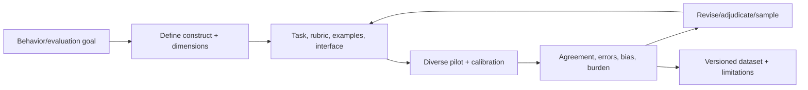

# Human-Feedback Specialist

> [!abstract] Mission
> Design human judgment tasks, rubrics, examples, calibration, sampling, quality systems and feedback datasets so model training/evaluation reflects a clear construct—with disagreement and uncertainty preserved.

## Responsibilities

- Translate desired behavior or research question into observable constructs, dimensions, task types and labels.
- Write rubrics, decision rules, examples/counterexamples, rationale expectations, uncertainty and escalation.
- Design representative/adversarial sampling, rater qualification, blinded/randomized assignment, gold/attention checks and adjudication.
- Pilot interfaces/instructions; measure agreement, calibration, throughput, fatigue, harmful exposure, slice bias and guide ambiguity.
- Analyze feedback validity and dataset lineage; version releases and document limitations, demographics/context where lawful/ethical, transformations and use restrictions.
- Partner with researchers/engineers, domain experts, [[Data Annotator and AI Rater]], [[AI Data Operations Manager]], safety/privacy and product.

## Boundaries

- Raters execute tasks; human-feedback specialists design and validate the measurement/learning system.
- Research scientists may design learning algorithms; this role specializes in eliciting reliable human signal and operations, with varying coding depth.
- “RLHF” is one family of uses; feedback can support supervised fine-tuning, reward/preference modeling, evaluation, red teaming, routing, retrieval and product quality.

## Levels

| Level | Scope | Evidence |
|---|---|---|
| Analyst | Rubric drafts, pilot analysis, QA | Clear rules, calibrated sample and documented errors |
| Specialist | End-to-end task/dataset | Valid construct, representative sampling, quality/limitations |
| Senior | Multi-domain/high-stakes/subjective feedback programs | Disagreement modeling, bias/welfare, experiment rigor |
| Lead | Feedback platform, standards, research/ops strategy | Reusable methodology and audited lineage at scale |

## Prerequisites and competencies

- Measurement/psychometrics basics, experimental design, sampling, descriptive/inferential statistics, qualitative analysis, survey/task design, data ethics/privacy, operations and facilitation.
- SQL/Python helpful; understand training/eval pipelines, preference data, model graders and human calibration.
- Agreement metric choice depends on design and prevalence; high agreement can reflect trivial tasks or conformity, and low agreement can expose genuine pluralism.
- Protect raters from unnecessary harmful content, coercive monitoring, impossible speed/quality targets and opaque feedback; worker conditions affect data quality and ethics.

## Study sequence

1. Define one construct and distinguish it from adjacent dimensions and proxies.
2. Create rubric with positive/negative/boundary examples and uncertainty/escalation.
3. Pilot with 3–5 raters; randomize, capture time/rationale and collect instruction feedback.
4. Compute agreement/confusion by item/dimension/slice; qualitatively code disagreements.
5. Revise guide/interface/sampling; adjudicate without erasing principled disagreement.
6. Publish dataset card: purpose, composition, collection, raters, QA, lineage, limitations, permitted/prohibited use.

## Tools

- **Free-first:** Label Studio/Doccano/CVAT, Python/R/Jupyter, pandas/scikit-learn/stats packages, spreadsheets, Git/DVC, Obsidian, survey/form tools, Mermaid.
- **Paid:** Labelbox/Scale-style platforms, Prolific/panels, secure workforce systems, data versioning/catalogs, model evaluation platforms, specialist adjudication.

## Knowledge check

1. What is construct validity?
2. Why can majority vote be wrong?
3. What is rater drift?
4. Name four sources of disagreement.
5. Why document prohibited dataset uses?

> [!success]- Answers
> 1. Whether a task/score actually represents the intended concept. 2. Majority may lack expertise, share bias, follow ambiguous guidance, or erase valid minority/contextual judgment. 3. Interpretation/performance changes over time due to fatigue, memory, model/data changes, feedback or cultural adaptation. 4. Guide ambiguity, true ambiguity/plural values, missing context, expertise differences, fatigue, interface bug, language/culture, malicious behavior—any four. 5. To prevent invalid/high-risk reuse outside the population, context, consent, quality or construct supported by collection.

## Flashcards

Construct validity:: Degree to which evidence supports interpreting a measure as the intended concept.
Rater calibration:: Training/practice/feedback process aligning application of a rubric while preserving legitimate uncertainty.
Rater drift:: Change in judgment pattern over time or across batches.
Adjudication:: Authorized evidence-based resolution or characterization of disagreements.
Dataset card:: Documentation of purpose, composition, collection, processing, uses, limitations and stewardship.
Plural label:: Representation of multiple legitimate judgments rather than collapsing them into one forced answer.

## Interview preparation

- Design a rubric for “helpfulness” and show why it must be decomposed.
- Diagnose low agreement without immediately removing raters.
- Explain when model-based grading can supplement—not silently replace—human judgment.
- Bring construct map, guide, pilot, agreement/error analysis, revision, adjudication log and dataset card.

## Suggested projects

- **Beginner:** rubric/pilot for 50 public responses with three dimensions, two raters and disagreement analysis.
- **Intermediate:** preference-data study comparing pairwise ranking and absolute scoring; analyze order bias, expertise, agreement, time and rationale quality.
- **Advanced:** high-stakes feedback program design with expert/generalist roles, representative/adversarial sampling, plural labels, worker welfare, privacy, secure lineage, continuous calibration, model-grader validation and audit plan.

## Sources

Checked **2026-08-12**.

- [NIST — AI Resource Center](https://airc.nist.gov/) — testing/evaluation and human-testing resources.
- [NIST — AI RMF 1.0](https://doi.org/10.6028/NIST.AI.100-1).
- [Anthropic — Demystifying evals for AI agents](https://www.anthropic.com/engineering/demystifying-evals-for-ai-agents) — current primary vendor engineering perspective; compare with independent/domain methods.
