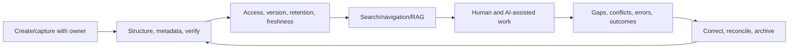

# Knowledge Manager

> [!abstract] Mission
> Ensure people and AI-supported systems can find, understand, trust, use, update and retire the right organizational knowledge with appropriate access and provenance.

## Responsibilities

- Identify critical knowledge, decisions, experts, users, source systems, risks and gaps.
- Design lifecycle: create/capture, verify, approve, structure/metadata, access, publish, discover, reuse, update, retain and archive/delete.
- Establish owners/stewards, source-of-truth rules, templates, taxonomies, versioning, review dates, records/privacy/security and conflict resolution.
- Improve search and AI retrieval through chunk/structure, metadata, access-aware indexing, freshness, citation/provenance and answerability with [[Taxonomist and Ontology Specialist]].
- Evaluate findability, task success, grounded answer quality, permission leakage, stale/conflicting sources, feedback and knowledge reuse.
- Build communities and capture practice/decisions without turning every conversation into ungoverned records.

## Boundaries

- Document management controls files; records management controls legally/business-required records; knowledge management connects people, practice, content and reuse. They overlap and require specialist partners.
- [[AI Content Designer]] shapes user-facing content; knowledge manager owns the broader source/lifecycle ecosystem.
- RAG engineering selects/indexes/retrieves; knowledge management ensures sources are authorized, meaningful, current, owned and usable.

## Levels

| Level | Scope | Evidence |
|---|---|---|
| Coordinator / analyst | Repository hygiene, metadata, publishing, support | Improved findability and current ownership |
| Knowledge manager | Domain lifecycle and community | Measurable task/retrieval improvement and source quality |
| Senior | Enterprise cross-system, governance and AI retrieval | Access/freshness/conflict/provenance controls at scale |
| Head | Knowledge strategy, culture, platform and accountability | Critical knowledge resilience and business outcome |

## Prerequisites and competencies

- Information architecture, content/records/document/data governance, search/retrieval, taxonomy/metadata, facilitation/community, change, analytics, privacy/security and lifecycle operations.
- AI literacy: embeddings/vector/hybrid search, chunking, retrieval, context windows, citation, evaluation, prompt injection from content, permissions and deletion.
- Can distinguish authoritative source, convenient copy, draft, decision record, tacit practice and generated synthesis.
- A chatbot over a content swamp creates confident access to stale/conflicting knowledge; source remediation precedes scale.

## Study sequence

1. Interview users and inventory critical knowledge, repositories, owners, flows, queries, failures and risks.
2. Define information architecture, metadata/taxonomy, source hierarchy, templates, access and lifecycle states.
3. Clean a small corpus: deduplicate, verify, split/structure, label, assign owner/review/retention.
4. Baseline search; build retrieval pilot with access checks/citations and test known-answer, missing, conflicting, stale and malicious cases.
5. Add feedback/correction, review alerts, incident, archive/delete and retrieval regression process.
6. Measure task success/time, findability, answer correctness/citation, permission leakage, stale rate and adoption; iterate.

## Tools

- **Free-first:** Obsidian, MkDocs/Docusaurus, Git/GitHub, OpenSearch/Elasticsearch community, PostgreSQL/pgvector, Apache Tika, OpenRefine, local models, spreadsheets, SKOS tools.
- **Paid:** SharePoint/Confluence/Notion enterprise, knowledge-base/CMS/DAM, enterprise search, data catalog, graph/vector platforms, model APIs, Microsoft/Google/ServiceNow knowledge and AI products.
- Product plan and enterprise controls vary; verify access indexing, training use, logs, retention, region, deletion, exports and API limits.

## Knowledge check

1. Why is “single source of truth” often too simple?
2. What is access-aware retrieval?
3. Why can chunking change meaning?
4. Name four retrieval evaluation cases beyond normal questions.
5. What is a knowledge owner accountable for?

> [!success]- Answers
> 1. Different authoritative systems may govern different facts/times/contexts; define source hierarchy and reconciliation instead of duplicating everything. 2. Retrieval enforces the requesting identity’s permissions before context reaches the model. 3. Splitting can detach qualifiers, dates, exceptions, tables, headings, definitions or provenance. 4. Missing answer, conflicting sources, stale version, unauthorized source, malicious instructions, ambiguous query, long-tail terminology—any four. 5. Accuracy/authority, approval, access classification, lifecycle/review, correction and retirement for a defined knowledge set.

## Flashcards

Knowledge lifecycle:: Creation/capture, verification, organization, access/use, review/update and retention/archive/deletion.
Source of truth:: Designated authoritative source for a particular fact, record or decision within scope and time.
Knowledge provenance:: Origin, authority, contributors, approvals, version, transformations and citations.
Access-aware retrieval:: Search/retrieval that preserves source authorization for the requesting person/system.
Freshness SLO:: Measurable target for review/update/propagation of knowledge appropriate to its volatility and risk.
Tacit knowledge:: Practice-based know-how difficult to fully encode in documents; communities, mentoring and observation may be required.

## Interview preparation

- Diagnose a retrieval assistant with high citation rate but wrong answers from stale/conflicting pages.
- Explain deletion and access propagation from source through index/cache/model logs.
- Choose what not to capture from a community or meeting and why.
- Bring inventory, information architecture, governance matrix, cleaned corpus, retrieval eval, feedback/correction workflow and outcome dashboard.

## Suggested projects

- **Beginner:** clean and govern 50 public notes with templates, metadata, owner/review, taxonomy and search test.
- **Intermediate:** access-aware retrieval prototype using public/synthetic roles, with citations and tests for known/missing/conflict/stale/injection cases.
- **Advanced:** enterprise knowledge operating model: source hierarchy, records/privacy/security, taxonomy/ontology, ownership/freshness, ingestion/index permissions, retrieval evaluation, feedback/correction, incident/deletion, communities and value dashboard.

## Sources

Checked **2026-08-12**.

- [W3C — SKOS Reference](https://www.w3.org/TR/skos-reference/) — vocabulary/knowledge organization model.
- [NIST — AI RMF 1.0](https://doi.org/10.6028/NIST.AI.100-1).
- [NIST — Generative AI Profile](https://doi.org/10.6028/NIST.AI.600-1) — risks including data/privacy/security and information integrity.
- [NIST — AI Resource Center](https://airc.nist.gov/) — testing/evaluation resources.
