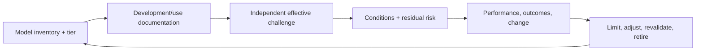

# Model Risk Manager

> [!abstract] Mission
> Ensure model risk is identified, independently challenged, proportionately validated, controlled, monitored, and accepted by authorized people throughout the model lifecycle.

> [!warning] 2026 banking guidance scope
> On April 17, 2026, the Federal Reserve, OCC, and FDIC issued revised interagency guidance that superseded SR 11-7 and SR 21-8 for relevant banking organizations. The published guidance says generative and agentic AI models are **outside its scope**, while noting that governance practices should guide controls for out-of-scope tools. Do not claim SR 26-2 directly governs every GenAI system or every industry.

## Responsibilities

- Define model scope, tiering, inventory, ownership, lifecycle standards, validation requirements, change/materiality and issue taxonomy.
- Challenge conceptual soundness, data, assumptions, implementation, limitations, intended/use consistency, performance, uncertainty and outcomes.
- Ensure appropriate independence and competence of validation; track findings, compensating controls, use restrictions, approvals and remediation.
- Oversee ongoing monitoring, overrides/adjustments, vendor models, model changes, incidents, aggregation/concentration and retirement.
- Report risk to senior management/board and coordinate developers, users, validators, audit, compliance and business.
- Adapt practice to institution, model and use—not all models present equal risk.

## Boundaries

- Model developer builds; validator independently evaluates; model risk manager designs/oversees the risk system and effective challenge.
- [[AI Governance Specialist]] covers all AI use and organizational decision processes; model risk is deeper for systems meeting the institution’s model definition.
- [[AI Auditor and Assurance Specialist]] audits governance/validation; it should not own the controls it later audits.

## Levels

| Level | Scope | Evidence |
|---|---|---|
| Analyst | Inventory, documentation review, testing/findings support | Accurate reproducible workpapers and issue follow-up |
| Manager | Portfolio/tier and validation decisions | Proportionate challenge, use conditions and monitoring |
| Senior / director | Enterprise framework, aggregation, vendor and board reporting | Independent stature, resource prioritization and systemic risk view |
| Chief model risk officer | Risk appetite and enterprise accountability | Effective lifecycle discipline and challenge despite commercial pressure |

## Prerequisites and competencies

- Quantitative/statistical literacy, validation/testing, risk/internal controls, banking/sector/domain knowledge where applicable, data governance, documentation, independence and executive communication.
- Understand bias/variance, overfitting, sampling, performance metrics, calibration, uncertainty, stability/drift, benchmarking, sensitivity, outcomes analysis and implementation verification.
- For generative/agentic systems, supplement applicable internal model definitions and governance with GenAI-specific evaluation/security/human-impact expertise; do not force-fit SR 26-2 scope.
- Vendor opacity does not remove responsibility: understand conceptual basis, data, design, intended use, performance, limitations, monitoring and contract/access sufficient for risk.

## Study sequence

1. Read SR 26-2 primary text and compare its explicit scope/supersession to older SR 11-7.
2. Draft model definition, inventory schema and risk-tier factors for a fictional institution.
3. Review model-development documentation and reproduce selected tests/data lineage.
4. Write validation plan covering conceptual soundness, implementation, performance/outcomes and use.
5. Run monitoring/drift/override and vendor-change scenarios; draft findings and use conditions.
6. Build portfolio/board report covering aggregate exposure, overdue findings, exceptions, incidents and resources.

## Tools

- **Free-first:** Python/R/Jupyter, SQL, Git, statistical/testing libraries, spreadsheets, Obsidian, NIST AIRC, Federal Reserve/OCC/FDIC primary guidance.
- **Paid:** model inventory/risk platforms, data catalogs, validation/monitoring and MLOps tools, GRC/audit systems, market/benchmark data, specialist validation services.

## Knowledge check

1. What replaced SR 11-7 in April 2026?
2. Does SR 26-2 include generative/agentic AI in scope?
3. What is effective challenge?
4. Distinguish validation from ongoing monitoring.
5. Why validate a vendor model?

> [!success]- Answers
> 1. Revised interagency model-risk guidance referenced by Federal Reserve SR 26-2, with OCC/FDIC issuance. 2. The guidance explicitly says generative and agentic AI models are outside scope; governance practices should still address tools not covered. 3. Objective, informed critical analysis by people with competence, influence, authority and incentives to identify limits and require action. 4. Validation provides periodic/initial independent assessment; monitoring continually checks performance/use/conditions and triggers action. 5. Outsourcing does not remove risk; the organization must understand fitness, limitations, implementation and outcomes for its use.

## Flashcards

Model risk:: Potential adverse consequences from decisions based on incorrect or misused model outputs.
Effective challenge:: Independent, competent and influential critical review of model development, use, validation and governance.
Conceptual soundness:: Whether theory, design, assumptions, variables/data and methods are appropriate for purpose.
Outcome analysis:: Comparison of model estimates/decisions with actual outcomes or other relevant benchmarks.
Model overlay:: Human adjustment to model output; it requires rationale, governance, monitoring and outcome analysis.
Use restriction:: Documented condition limiting population, purpose, exposure, automation or circumstances in which a model may operate.

## Interview preparation

- Explain SR 26-2’s applicability and GenAI exclusion precisely.
- Challenge a high-performing vendor model with poor documentation and strong business pressure.
- Draft a finding with condition, criteria, cause, risk, evidence, severity, recommendation and owner response.
- Bring inventory/tiering, validation plan/workpapers, monitoring dashboard, vendor review, finding and board summary.

## Suggested projects

- **Beginner:** compare SR 11-7 and SR 26-2; build a precise supersession/scope memo and terminology cards.
- **Intermediate:** validate a public predictive model: conceptual review, data, implementation reproduction, metrics/slices, sensitivity, limitations, use conditions and monitoring.
- **Advanced:** model-risk framework for a fictional bank including traditional/non-generative AI plus a separate governance interface for out-of-scope GenAI/agentic tools; include inventory, tiering, independence, vendor review, overlays, findings, board reporting and internal audit.

## Sources

Checked **2026-08-12**.

- [Federal Reserve — SR 26-2 Revised Guidance on Model Risk Management](https://www.federalreserve.gov/supervisionreg/srletters/SR2602.htm) — issued April 17, 2026; supersedes SR 11-7 and SR 21-8.
- [Federal Reserve — published revised guidance text](https://www.federalreserve.gov/frrs/guidance/supervisory-guidance-on-model-risk-management.htm) — includes scope note for generative/agentic AI.
- [NIST — AI Resource Center](https://airc.nist.gov/) — supplementary AI evaluation resources, not banking supervisory guidance.
