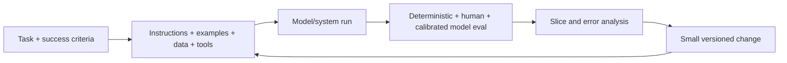

# Prompt and Context Engineer

> [!info] October 13, 2026 update
> Use [[US Career and Governance Update — October 2026]] for current U.S. evidence and a role-family work-product exercise. Pair it with [[Model and Agent Lifecycle Management]] to explain how a technical change affects users, risk, cost, and communication. Older profile claims retain their original verification dates.

> [!abstract] Mission
> Engineer the instructions, examples, retrieved knowledge, tool definitions, memory, constraints, and evaluations that make a model-supported system perform a defined task reliably enough for its context.

> [!warning] Title ambiguity
> “Prompt engineer” can mean a temporary task inside another job, a content/conversation specialty, an evaluation role, or a technical production role. “Context engineer” usually signals broader ownership of the full information and tool environment, often requiring coding. Do not infer seniority or a durable standalone occupation from the title. Search for the actual artifacts: prompts, schemas, retrieval, tools, datasets, evals, traces, and production improvement.

## Responsibilities

- Formalize task, user, inputs/outputs, constraints, edge cases, failure severity, and success rubric.
- Design system/developer/user instructions, examples, structured schemas, retrieved context, tool descriptions, memory boundaries, and refusal/escalation.
- Build versioned representative/adversarial datasets; run regression and error/slice analysis across models and configurations.
- Debug the full system: source quality, retrieval, context assembly, prompt, model, tool, post-processing, UX, and policy.
- Optimize quality, safety, latency, token/cost, maintainability, and portability.
- Document decisions and collaborate with [[Conversation Designer]], [[AI Content Designer]], product, engineering, and domain reviewers.

## Boundaries

- [[Conversation Designer]] owns human dialogue experience; prompt/context work owns model instruction/environment and behavioral evaluation.
- [[AI Automation Specialist]] connects operational workflow and systems; prompt/context engineering may be one component.
- A prompt library without test cases and results is not engineering evidence.

## Levels

| Level | Scope | Evidence |
|---|---|---|
| Practitioner | Bounded task, manual testing | Versioned prompt plus representative cases and error log |
| Engineer/specialist | Retrieval/tools/schemas and automated eval | Reproducible gains without hidden regressions |
| Senior | Multi-step/agentic/high-stakes context and grader systems | Calibrated evaluation, security, observability, migration |
| Lead | Standards, context platform, eval infrastructure | Teams improve reliably and reduce brittle prompt debt |

## Prerequisites and competencies

- Clear writing and task analysis; JSON/schema, APIs, Python or JavaScript basics, Git, data handling, basic statistics, experimentation, and model architecture vocabulary.
- Master instruction hierarchy, examples, decomposition, output validation, retrieval selection, tool contracts, context budgeting, prompt injection defense, and evaluation design.
- Know that chain-of-thought exposure is not required for good results; ask for concise answers or verifiable intermediate artifacts appropriate to the task.
- Never optimize to a tiny benchmark, accept a model grader without human calibration, or paste private data into an unapproved system.

## Study sequence

1. Define one narrow task and 50 cases before intensive prompt tuning.
2. Establish simple baseline; add instructions, examples, schema, and validation one change at a time.
3. Add retrieval; measure relevance, groundedness, completeness, citation correctness, and malicious context handling.
4. Add tools; validate input/output, permissions, errors, confirmation, and idempotency.
5. Calibrate human rubric and model grader; analyze slices and confidence intervals where meaningful.
6. Run multi-model migration, latency/cost optimization, and documented release/rollback.

## Tools

- **Free/local:** Git/GitHub, Python/Jupyter, Ollama, promptfoo, DeepEval, OpenAI Evals or similar open tooling, Pydantic/JSON Schema, Ragas-style retrieval eval, Phoenix/OpenTelemetry.
- **Paid/managed:** OpenAI/Anthropic/Google APIs and consoles; Microsoft Foundry/Vertex AI; LangSmith, Braintrust, Humanloop, Arize; managed vector stores.
- Start with official model/provider guidance, but treat every claimed prompting technique as a hypothesis to test on your task.

## Knowledge check

1. Why write evaluation cases before optimizing prompts?
2. What is context engineering broader than prompting?
3. Why can few-shot examples harm performance?
4. How do you calibrate a model grader?
5. Name five layers that can cause a “prompt failure.”

> [!success]- Answers
> 1. It prevents anecdotal optimization and creates a stable measure of progress/regression. 2. It manages instructions, examples, retrieved data, memory, tools, schemas, permissions, and context assembly. 3. They can encode wrong patterns/biases, dominate context, misrepresent distribution, or encourage overfitting. 4. Compare against blinded human judgments on representative slices; measure disagreement, inspect errors, refine, and keep periodic human audit. 5. Source, retrieval, assembly, instructions/examples, model, tool, validation/post-processing, UX/policy—any five.

## Flashcards

Prompt regression:: A previously passing behavior fails after an instruction, model, context, tool, or system change.
Context window:: The bounded input/output token capacity available to a model call; usable attention and quality are task-dependent.
Few-shot example:: An input-output demonstration included in context to shape behavior.
Structured-output validation:: Checking generated data against a schema and business rules before use.
Prompt injection:: Untrusted content attempts to alter instructions, reveal data, or misuse tools.
Context provenance:: Traceable origin, version, permission, and transformation of information supplied to a model.

## Interview preparation

- Improve a failing prompt live, but begin by asking for cases, rubric, error distribution, and system layers.
- Explain a gain that disappeared on a new slice and how you corrected the evaluation.
- Threat-model a retrieval-and-tool agent against injection and excessive agency.
- Bring Git history, dataset, rubric, runs, error taxonomy, grader calibration, cost/latency, and release notes.

## Suggested projects

- **Beginner:** prompt benchmark with 50 cases, rubric, baseline, three controlled iterations, and failure analysis.
- **Intermediate:** retrieval assistant with source permissions, citations, adversarial context, structured output, human-calibrated eval, and migration comparison.
- **Advanced:** tool-using context system with least privilege, confirmation, memory policy, injection tests, trace/eval pipeline, model routing, cost/latency optimization, and rollback.

## Sources

Checked **2026-08-12**.

- [OpenAI — Prompting guidance](https://help.openai.com/en/articles/6654000-guidelines-for-prompting-large-language-models).
- [Anthropic — Prompting tools and evaluation](https://platform.claude.com/docs/en/build-with-claude/prompt-engineering/prompting-tools).
- [Anthropic — Demystifying evals for AI agents](https://www.anthropic.com/engineering/demystifying-evals-for-ai-agents).
- [Google Cloud — Prompt design strategies](https://cloud.google.com/vertex-ai/generative-ai/docs/learn/prompts/prompt-design-strategies).
- [Microsoft Foundry — Evaluate generative AI apps](https://learn.microsoft.com/azure/ai-foundry/how-to/evaluate-generative-ai-app).
