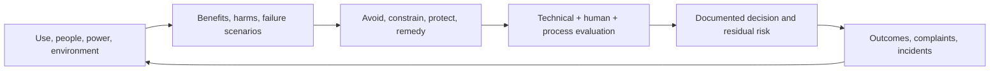

# Responsible AI Specialist

> [!abstract] Mission
> Identify who may be helped or harmed by an AI use, turn socio-technical risk into design and operating safeguards, evaluate their effectiveness, and keep affected people visible in decisions.

## Responsibilities

- Map intended use, foreseeable misuse, affected users/non-users, benefits, harms, severity, scale, reversibility, distribution, and uncertainty.
- Facilitate impact assessment and red-team/tabletop work with domain experts and affected communities.
- Translate concerns into product/process requirements: exclusions, data changes, UX controls, human authority, evaluation slices, transparency, appeal/recourse, monitoring, and incident response.
- Examine accessibility, harmful bias, privacy, safety/security, validity/reliability, transparency, accountability, and human autonomy in context.
- Define residual-risk ownership and dissent; monitor complaints, disparate outcomes, workarounds, near misses, and unexpected uses.
- Partner with [[AI Governance Specialist]], [[AI UX Researcher]], legal/privacy/security, product, engineering, domain and operations.

## Boundaries

- Unlike [[AI Ethics Researcher]], this role operationalizes questions into controls and evidence inside delivery/operations.
- Unlike [[AI Compliance and Privacy Specialist]], it examines harms beyond current legal minimums and does not provide legal conclusions.
- Unlike generic “AI safety” titles focused on frontier-model technical research, responsible AI often covers deployed socio-technical systems and institutional impact.

## Levels

| Level | Scope | Evidence |
|---|---|---|
| Analyst | Research, assessment support, test cases, documentation | Traceable affected-party and failure analysis |
| Specialist | Own assessment/safeguard plan for use case | Requirements and evidence change the design/deployment |
| Senior | High-stakes/ambiguous portfolio and stakeholder conflict | Proportional safeguards, monitoring, recourse, residual-risk decisions |
| Lead | Methods, review standards, community/accountability system | Repeatable practice and measurable improvement across products |

## Prerequisites and competencies

- Socio-technical systems, risk/impact assessment, human-centered research/design, accessibility, basic statistics/fairness measurement, policy/legal literacy, facilitation, ethics, and conflict handling.
- AI lifecycle/data/evaluation/security knowledge sufficient to connect harms to causal mechanisms and tests.
- Avoid “bias metric shopping”: define the decision, reference population, groups, harm, legal/domain context, tradeoffs, and intervention first.
- Participation must be accessible, safe, compensated where appropriate, and connected to real influence—not extractive consultation.

## Study sequence

1. Map context, actors, affected non-users, power, history, baseline process, and existing harms.
2. Create benefit/harm taxonomy and scenarios across lifecycle, misuse, failures, and downstream effects.
3. Prioritize by evidence, severity, scale, reversibility, exposure, inequity, and uncertainty—not a single score alone.
4. Design hierarchy of responses: avoid use, narrow it, change data/model, change workflow/UX, add oversight/recourse, monitor.
5. Test with model evals, usability/error-detection studies, process/control tests, and outcome slices.
6. Document residual risk, approval/dissent, monitoring thresholds, incident/complaint path, and reassessment triggers.

## Tools

- **Free-first:** NIST AI RMF/GenAI Profile/AIRC, impact canvases, Obsidian, spreadsheets/Python, fairness/evaluation libraries, Mermaid, accessible participatory methods.
- **Paid:** model evaluation/red-team and observability tools, user research platforms, GRC/case management, accessibility audits, domain expert/community engagement, legal review.

## Knowledge check

1. Why include affected non-users?
2. Distinguish fairness metric from fairness judgment.
3. What is residual risk?
4. Why is recourse different from an explanation?
5. Name the stronger-to-weaker hierarchy of responses to a serious risk.

> [!success]- Answers
> 1. Systems can change opportunities, burdens, or conditions for people who never operate them. 2. A metric quantifies a selected relationship; a judgment chooses relevant harm, population, threshold, tradeoff and remedy in context. 3. Risk remaining after safeguards, with uncertainty and authorized ownership documented. 4. Explanation informs; recourse offers a usable path to challenge, correct, appeal, obtain human review or remedy. 5. Avoid/prohibit; narrow/substitute; redesign source/system/workflow; protective controls/human authority; warnings/training/monitoring—context determines combination.

## Flashcards

Socio-technical system:: People, institutions, incentives, data, technology, environment, and processes whose interaction produces outcomes.
Affected non-user:: Someone materially affected without directly using the AI interface.
Impact assessment:: Structured, participatory examination of benefits, harms, affected people, safeguards, evidence, and accountability.
Residual risk:: Remaining risk after controls, including uncertainty and control limitations.
Recourse:: An accessible process to challenge, correct, appeal, receive review, or obtain remedy.
Risk externality:: A cost or harm shifted to people who did not choose or benefit proportionately from the system.

## Interview preparation

- Analyze an AI hiring or healthcare support case without declaring one metric “fair.”
- Explain a time a safer answer was to narrow or remove the AI feature.
- Respond to “we have a human reviewer, so risk is handled.”
- Bring actor/impact map, scenarios, participatory plan, safeguard requirements, eval results, residual-risk record and monitoring/recourse design.

## Suggested projects

- **Beginner:** impact map for a public AI use including non-users, benefits, harms, evidence gaps and design changes.
- **Intermediate:** full responsible-AI assessment for AI-assisted employment screening with accessibility, bias, human authority, notice, recourse, evaluation slices and monitoring.
- **Advanced:** participatory assessment and safeguard validation for a consequential multi-stakeholder system, including dissent, cumulative/downstream effects, incident/complaint cases, reassessment triggers and executive decision memo.

## Sources

Checked **2026-08-12**.

- [NIST — AI RMF 1.0](https://doi.org/10.6028/NIST.AI.100-1).
- [NIST — Generative AI Profile](https://doi.org/10.6028/NIST.AI.600-1).
- [NIST — Identifying and Managing Bias in AI](https://doi.org/10.6028/NIST.SP.1270).
- [EEOC — Artificial Intelligence and the ADA](https://www.eeoc.gov/eeoc-disability-related-resources/artificial-intelligence-and-ada).
- [U.S. Department of Labor — AI & Inclusive Hiring Framework](https://www.dol.gov/newsroom/releases/odep/odep20240924).
