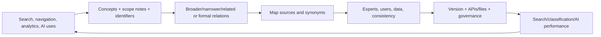

# Taxonomist and Ontology Specialist

> [!info] October 13, 2026 update
> Use [[US Career and Governance Update — October 2026]] for current U.S. evidence and a role-family work-product exercise. Pair it with [[Model and Agent Lifecycle Management]] to explain how a technical change affects users, risk, cost, and communication. Older profile claims retain their original verification dates.

> [!abstract] Mission
> Create and govern shared concepts, labels, relationships, identifiers and constraints so people and systems can classify, find, connect, exchange and reason over information consistently.

## Responsibilities

- Gather use cases, queries, data, domain language, standards and stakeholder perspectives.
- Define concepts—not just words—with preferred/alternative/hidden labels, definitions/scope notes, stable identifiers and provenance.
- Build taxonomy/thesaurus/polyhierarchy or formal ontology with classes, properties, relations, constraints and mappings as required.
- Resolve synonyms, homonyms, granularity, overlaps, deprecated terms, multilingual/accessibility and contested concepts.
- Validate with domain experts, users, competency questions, sample data, consistency/reasoning and search/classification outcomes.
- Publish/version/govern change requests, impact, mappings, deprecations and downstream adoption with [[Knowledge Manager]] and engineering/data teams.

## Boundaries

- Taxonomy usually organizes concepts in hierarchical/associative systems; ontology can formally define entities, relations, axioms and constraints. Actual job titles often blur them.
- Data modeling describes structures for data storage/use; ontology models domain meaning, with overlap.
- Prompt tags or folder trees are not automatically governed taxonomies.

## Levels

| Level | Scope | Evidence |
|---|---|---|
| Junior / metadata analyst | Terms, tagging, research and QA | Consistent concepts/labels with documentation |
| Taxonomist | Domain taxonomy and search/classification integration | User/domain validation and performance improvement |
| Ontology specialist | Formal semantic model/knowledge graph | Competency questions, constraints, mappings and reasoning validation |
| Lead | Enterprise semantic strategy and governance | Reuse/interoperability, change control and measurable adoption |

## Prerequisites and competencies

- Library/information science, linguistics/terminology, domain analysis, information architecture, metadata, research/facilitation, change governance.
- For ontology depth: RDF, RDFS, OWL, SKOS, SPARQL, identifiers/URIs, graph databases, shapes/validation and basic logic.
- W3C SKOS represents concept schemes, concepts, preferred/alternative/hidden labels and broader/narrower/related relations; SKOS is not a formal knowledge representation language equivalent to OWL.
- Generated term suggestions require expert/user evidence; models can reproduce inconsistent or harmful classifications.

## Study sequence

1. Define users/use cases and collect a representative term/query/document corpus.
2. Create concept records with labels, definitions, examples, exclusions, sources and owner.
3. Build hierarchy/associations and test polyhierarchy, granularity, synonyms and homonyms.
4. Encode a SKOS subset; query it and validate integrity conventions.
5. Add formal ontology only if competency questions require richer semantics; test with data/reasoner/shapes.
6. Publish version, mapping/deprecation policy, change process and search/classification evaluation.

## Tools

- **Free-first:** OpenRefine, Protégé, SKOSMOS, VocBench community options, Apache Jena/RDFLib, SPARQL endpoints, Neo4j community, Git, Obsidian, spreadsheets.
- **Paid:** PoolParty, TopBraid, enterprise graph databases, data catalog/MDM/search platforms, terminology/localization tools.
- Tool sophistication cannot resolve contested meaning without domain governance and intended-use clarity.

## Knowledge check

1. Distinguish term from concept.
2. What is polyhierarchy?
3. How does SKOS differ from OWL?
4. What is a competency question?
5. Why use stable identifiers?

> [!success]- Answers
> 1. A term is a label/string; a concept is a unit of meaning that can have multiple labels and relations. 2. A concept has more than one broader parent because multiple valid perspectives/use paths exist. 3. SKOS is a lightweight model for knowledge organization systems; OWL supports formal ontology axioms and reasoning. 4. A natural-language question the semantic model must be able to answer, used to drive scope and validation. 5. Labels and definitions change; stable identifiers preserve reference, mapping, lineage and integration.

## Flashcards

Preferred label:: Designated primary human-readable label for a concept in a language within a scheme.
Scope note:: Usage guidance clarifying a concept’s intended meaning, inclusion, exclusion or context.
Broader relation:: Direct hierarchical connection from a narrower concept to a more general concept in SKOS convention.
Ontology:: Explicit formal specification of concepts/entities, relationships and constraints in a domain.
Competency question:: Testable question the ontology/knowledge graph should support.
Semantic drift:: Change or divergence in meaning/use over time or across communities/systems.

## Interview preparation

- Normalize a messy list live; explain concept versus label and retain evidence.
- Defend polyhierarchy or a contested concept with user/domain use cases.
- Explain when a taxonomy is sufficient and OWL would be unnecessary complexity.
- Bring concept scheme, SKOS/ontology files, queries, validation, stakeholder decisions, governance and outcome measures.

## Suggested projects

- **Beginner:** 100-concept AI career taxonomy with labels, definitions, broader/narrower/related, scope notes and sources.
- **Intermediate:** SKOS vocabulary for a domain with multilingual/synonym mappings, integrity checks, SPARQL queries, version/deprecation and search evaluation.
- **Advanced:** ontology/knowledge graph driven by competency questions, mapped to external vocabularies, with SHACL-style validation, provenance, contested-concept governance, retrieval/classification integration and performance study.

## Sources

Checked **2026-08-12**.

- [W3C — SKOS Reference](https://www.w3.org/TR/skos-reference/).
- [W3C — SKOS Primer](https://www.w3.org/TR/skos-primer/).
- [W3C — SKOS home](https://www.w3.org/2004/02/skos/) — current specification links.
