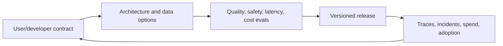

# Technical AI Product Manager

> [!info] October 13, 2026 update
> Use [[US Career and Governance Update — October 2026]] for current U.S. evidence and a role-family work-product exercise. Pair it with [[Model and Agent Lifecycle Management]] to explain how a technical change affects users, risk, cost, and communication. Older profile claims retain their original verification dates.

> [!abstract] Mission
> Own an AI product or platform outcome while making credible decisions across models, data, APIs, evaluations, reliability, security, and cost.

## Operating loop

### Responsibilities

- Define platform capabilities, APIs, data contracts, service levels, quotas, versioning, and developer experience.
- Translate application needs into model, retrieval, tool-use, guardrail, observability, and infrastructure requirements.
- Design evaluation and release systems with engineering: datasets, graders, human calibration, regression, red-team cases, and thresholds.
- Manage latency-quality-cost-reliability tradeoffs and vendor/model dependency.
- Make privacy, security, abuse, and data-governance requirements visible in product decisions.
- Maintain technical roadmap, deprecation/migration plans, and incident learning.

## Boundaries and aliases

- More technical than [[AI Product Manager]]; not the primary implementer like an ML/platform engineer.
- More product- and lifecycle-oriented than [[AI Solutions Architect]], who usually designs for a customer or implementation.
- “AI platform PM” may focus on shared internal capabilities; “technical ML PM” may cover training/serving; always inspect the system layer and customers.

## Levels

| Level | Scope | Readiness signal |
|---|---|---|
| Associate / transitioner | API requirements, test cases, developer research | Can call an API, interpret traces, and write an explicit contract |
| PM | Own service/capability with SLOs and evals | Releases with regression, cost model, documentation, and adoption data |
| Senior | Multi-model/platform decisions, reliability, migration | Leads incidents and cross-stack tradeoffs using evidence |
| Lead | Platform strategy, standards, investment, portfolio | Establishes reusable paved roads and deprecation/governance system |

## Prerequisites and competencies

- Product fundamentals plus HTTP/APIs, JSON/schema, authentication, data lifecycle, SQL basics, cloud concepts, queues/caching, model inference, embeddings/vector search, retrieval, tool calling, agents, and observability.
- **API product:** versioned contracts, error semantics, rate limits, SDK/docs, backward compatibility.
- **AI evaluation:** representative datasets, deterministic checks, human judgment, model graders with calibration, slice/error analysis.
- **Systems judgment:** throughput, tail latency, availability, graceful degradation, rollback, dependency failure, and unit economics.
- **Security/risk:** least privilege, prompt injection/tool abuse, sensitive-data controls, audit logs, incident response.
- You need not train frontier models, but you must ask engineers precise questions and understand experimental evidence.

## Study sequence

1. Call two model APIs and one local model; capture request/response, tokens, latency, errors, and costs.
2. Build a retrieval prototype; test missing, conflicting, stale, and malicious context.
3. Add a structured-output schema and tool; test validation, permissions, idempotency, timeouts, and irreversible actions.
4. Construct automated and human evals, calibrate one model-based grader, and run regression across model versions.
5. Design an SLO, dashboards, budget alerts, rollout/rollback, data flow, and threat model.
6. Write a platform product strategy with users, contracts, paved-road capabilities, build/buy logic, and migration plan.

## Tools

- **Free/local:** curl/HTTPie, Postman free tier, VS Code, Git/GitHub, Python/Jupyter, SQLite/PostgreSQL, Docker, Ollama, promptfoo/DeepEval, OpenTelemetry, Mermaid.
- **Paid/managed:** model APIs; cloud AI platforms; API gateways; vector databases; LangSmith/Arize/Phoenix; Datadog/Grafana Cloud; Jira/Productboard.
- Paid access is not competence. Preserve vendor-neutral requirements and test portability.

## Knowledge check

1. Why is average latency an incomplete launch measure?
2. What belongs in an AI API contract beyond endpoint and schema?
3. What makes a model-based grader unsafe to trust blindly?
4. Why design graceful degradation?
5. Distinguish model versioning from prompt/context versioning.

> [!success]- Answers
> 1. Tail latency and timeouts determine many users’ experience and capacity. 2. Auth, permissions, limits, error/retry semantics, idempotency, data handling, observability, versioning, SLOs, and deprecation. 3. It can share biases, be prompt-sensitive, fail on slices, or prefer style over correctness; calibrate against human labels. 4. Dependencies fail and budgets/limits are reached; the product needs safe reduced functionality. 5. The underlying model can change, while instructions/retrieved context/tool definitions can change independently; version and test all.

## Flashcards

SLO:: A measurable reliability target for a service, such as availability or tail latency over a period.
Tail latency:: High-percentile response time, such as p95 or p99, representing slower user experiences.
Structured output:: Model output constrained and validated against an explicit schema.
Idempotency:: Repeating an operation has no additional effect after the first successful execution.
Regression evaluation:: Re-running a stable test suite to detect behavior changes after any system component changes.
Paved road:: A supported, reusable path that makes the safe and reliable implementation easier for product teams.

## Interview preparation

- Diagram an AI platform request from identity to model/tool to logs; state trust boundaries and failure modes.
- Compare two models with a decision matrix grounded in task evals, latency, cost, safety, support, and exit risk.
- Explain an incident in which a dependency changed. Use detection → containment → communication → recovery → prevention.
- Defend when **not** to expose an agentic action and how you would stage authorization.

## Suggested projects

- **Beginner:** API comparison harness with structured outputs, latency/token log, 25-case eval, and decision memo.
- **Intermediate:** retrieval-and-tool prototype with schemas, citations, permissions, adversarial cases, traces, and rollback behavior.
- **Advanced:** internal AI platform PRD covering personas, APIs, SLOs, eval service, observability, security, cost allocation, model routing, version/deprecation, and migration.

## Sources

Checked **2026-08-12**.

- [NIST — Generative AI Profile](https://doi.org/10.6028/NIST.AI.600-1).
- [OpenAI — API documentation](https://developers.openai.com/api/docs/).
- [Anthropic — Tool use overview](https://platform.claude.com/docs/en/agents-and-tools/tool-use/overview).
- [Google Cloud — Prompt design strategies](https://cloud.google.com/vertex-ai/generative-ai/docs/learn/prompts/prompt-design-strategies).
- [Microsoft Foundry — Evaluations](https://learn.microsoft.com/azure/ai-foundry/how-to/evaluate-generative-ai-app).
