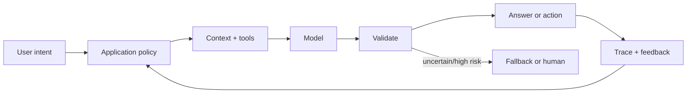

# AI Engineer

> [!info] October 13, 2026 update
> Practice focus: **Whether a provider migration preserves the product contract**. Produce **Paired evaluation and release memo** and answer: Which regression blocks release despite a better mean?
> Use [[Technical Role Practice Workbook — October 2026]] and [[October 2026 Research Refresh]]. This checkpoint does not reverify every older market/tool claim in this profile.

> [!abstract] Mission
> Deliver dependable AI-powered product behavior by combining models, retrieval, tools, software, evaluations, guardrails, and operational feedback into one coherent system.

## Responsibilities

- Clarify the task, user experience, unacceptable outcomes, and when deterministic software is better than a model.
- Select and compare hosted or open-weight models; design prompts, structured outputs, retrieval, and tool interfaces.
- Build application logic, APIs, data flows, caching, fallbacks, human review, and permission boundaries.
- Create task-specific evaluations and traces; measure quality, safety, latency, cost, and regressions.
- Operate the system, learn from production feedback, and coordinate with security, product, data, legal, and domain teams.

## Title reality

“AI Engineer” can mean almost anything from classical [[ML Engineer]] to foundation-model application developer. In 2026 usage, many postings emphasize integrating APIs or open models, retrieval, agents, and evals. Determine whether the role owns model training, application/backend code, data, customer solutions, or platform infrastructure. “Prompt engineer” duties are usually one component, not a durable substitute for engineering and evaluation skills.

## Work anatomy

> [!info] What the role owns
> AI engineers turn an ambiguous product need into dependable model-enabled behavior. The job ends later than a demo: the engineer owns the contract, application boundary, evaluation evidence, permissions, observability, and a credible path for failure.

### Operating loop

1. Translate a user outcome into a bounded task, unacceptable outcomes, latency/cost limits, and an escalation policy.
2. Choose the simplest sufficient mechanism: deterministic code, search, a small model, a foundation model, retrieval, a tool, or a human step.
3. Build an inspectable service contract with schemas, timeouts, retries, idempotency, access checks, and traceable inputs.
4. Evaluate representative cases and risk slices before tuning the prompt or swapping the model.
5. Ship with monitoring, feedback taxonomy, rollback/fallback behavior, and a written decision record.

### Inputs → outputs

| Inputs | Owned work product | Evidence a reviewer should inspect |
|---|---|---|
| Product requirement, user journeys, risk constraints | AI feature contract and architecture decision | Scope, exclusions, deterministic baseline, and tradeoff log |
| Documents, user state, tools, model responses | Context pipeline and validated application behavior | Retrieval/tool traces, schema failures, permission tests, and citations |
| Evals, production traces, incidents | Release decision and improvement loop | Slice results, latency/cost distribution, failure taxonomy, rollback plan |

### Decisions and interfaces

The hardest decisions are quality versus latency/cost, autonomy versus user control, hosted convenience versus vendor portability, and model flexibility versus deterministic auditability. The role interfaces with product/design on intended behavior, backend/platform on reliability, data/knowledge on inputs, security/privacy on trust boundaries, and operations/support on incident learning.

### Evidence of competence

A strong project has a clear baseline, a versioned service, a representative eval set, trace inspection, authorization outside the model, operational limits, and a post-launch decision memo. The framework in [[Technical Role Deep Dive Framework]] is the review checklist.

### Research anchors

The workflow is consistent with [OpenAI Agents SDK](https://openai.github.io/openai-agents-python/) tool/guardrail/tracing primitives, [NIST's Generative AI Profile](https://doi.org/10.6028/NIST.AI.600-1), and [OWASP's LLM application risks](https://owasp.org/www-project-top-10-for-large-language-model-applications/). Practice the adaptation and permission decisions in [[Case - Prompt RAG Fine-Tune]] and [[Case - Agent Permissions]].
## 2026 technique overlay

> [!tip] Practice this now · 2026-08-24
> Build a contract-first AI feature, validate structured output outside the model, trace model/retrieval/tool steps with redaction, and gate release on representative quality, safety, latency, and cost evidence. Compare a free/open path with a managed path using [[AI Tools and Practices Update — 2026-08-24]].

> [!info] Edge/web platform deep dive
> Build the same typed AI feature through Cloudflare Workers AI/AI Gateway and Vercel AI SDK 7/AI Gateway. Compare model routing, structured output, streaming, state, sandboxing, provider terms, and exit evidence in [[Cloudflare and Vercel AI]].

## Level ladder

| Level | Expected ownership |
|---|---|
| Junior | Implement a bounded model integration with tests and established patterns. |
| AI engineer | Own a feature from task definition through evals, deployment, and feedback. |
| Senior | Design multi-component AI systems, resolve ambiguity, and lead reliability/security tradeoffs. |
| Staff / principal | Set architecture and evaluation standards across products and vendors. |
| Lead / manager | Own AI engineering strategy, portfolio risk, platform choices, and team development. |

## Prerequisites

- Strong software engineering in Python or TypeScript, APIs, databases, asynchronous work, testing, and cloud deployment.
- Working knowledge of transformers, tokens/context, embeddings, retrieval, tool use, fine-tuning, and model limitations.
- Evaluation literacy: datasets, rubrics, stochastic sampling, graders, human review, regression gates.
- Security and privacy basics, especially untrusted content, secrets, authorization, data retention, and supply chain.

## Knowledge and skills

| Area | Demonstrable capability |
|---|---|
| Architecture | Decide among deterministic code, search, small models, foundation models, and human workflow. |
| Model integration | Structured outputs, streaming, retries, idempotency, routing, caching, rate limits, fallbacks. |
| Context engineering | Select, transform, rank, and budget instructions, user state, retrieved evidence, and tool results. |
| Evaluation | Build representative tasks, assertions, rubrics, pairwise/human review, and release thresholds. |
| Safety/security | Treat model output as untrusted; enforce permissions outside the model; defend prompt/data/tool boundaries. |
| Operations | Trace calls, attribute latency/cost, monitor failure taxonomies, and support rollback or vendor substitution. |

## Study sequence

1. Build a conventional API-backed application with authentication, database, tests, and observability.
2. Add an LLM for a bounded transformation using schemas, retries, and deterministic validation.
3. Create a task-specific eval set before optimizing prompts; record quality, latency, and cost.
4. Add retrieval and citations, then measure retrieval separately from answer generation.
5. Add one least-privilege tool with approval for consequential actions and adversarial tests.
6. Compare models/vendors or local models, implement fallback, and run a production-like incident drill.

## Tools

| Need | Free / open-first | Paid or managed |
|---|---|---|
| Models | Hugging Face Transformers, Ollama/llama.cpp-compatible runtimes, vLLM | OpenAI, Anthropic, Google, AWS, Azure hosted models |
| App/runtime | FastAPI, Pydantic, Node.js, OpenAI Agents SDK, LangGraph | Managed agent/application platforms |
| Retrieval | PostgreSQL + pgvector, Qdrant, Weaviate, Elasticsearch basic options | Pinecone and managed vector/search services |
| Evals/tracing | pytest, MLflow, OpenTelemetry, OpenAI Evals, promptfoo | LangSmith, Braintrust, Arize Phoenix managed offerings |
| Deployment | Docker, Kubernetes, serverless free tiers where offered | Cloud application and model hosting |

## Quiz

1. Why must model output be treated as untrusted input?
2. When should a task use deterministic code instead of an LLM?
3. What makes an evaluation set representative?
4. Distinguish model routing from fallback.
5. Why is “the prompt worked five times” weak evidence?
6. Where should authorization for a model-requested action be enforced?

> [!question]- Answer key
> 1. It is probabilistic and can be influenced by untrusted context, so downstream rendering, queries, code, and actions can be unsafe. 2. When rules are well specified and deterministic behavior is cheaper, faster, auditable, or required. 3. It covers real task frequencies plus important rare/risk cases, plausible inputs, slices, and expected outputs or review criteria without tuning leakage. 4. Routing deliberately selects a model based on request/context; fallback activates after failure, low confidence, policy, or degraded service. 5. Sampling is tiny and cherry-pickable, behavior is stochastic, and the cases may not reflect production. 6. In trusted application/tool code with authenticated identity, explicit policy, least privilege, and audit logs—not in the model's prose decision alone.

## Flashcards

Structured output:: Model output constrained or validated against a machine-readable schema.

Context engineering:: Selecting and organizing the instructions, state, evidence, and tool results supplied for a model decision.

Fallback:: A defined alternative path after failure, uncertainty, policy trigger, or unavailable dependency.

Model routing:: Selecting among models or paths according to task, risk, quality, latency, or cost.

Prompt injection:: Untrusted content attempting to override instructions or influence tools/data access.

Grounding:: Connecting a generated response to supplied evidence or authoritative sources; it does not guarantee correctness.

Regression eval:: A stable test suite used to detect behavioral deterioration after model, prompt, retrieval, or code changes.

Human-in-the-loop:: A designed human decision or review point with clear authority, context, and escalation—not a vague safety slogan.

## Interview preparation

- Design an AI feature from user need through architecture, evals, permissions, latency, cost, and failure handling.
- Implement schema-validated model calls with retries, timeouts, and tests.
- Diagnose a quality regression across prompt, model, retrieval, tool, and application layers.
- Threat-model prompt injection, data leakage, unsafe rendering, excessive agency, and vendor dependency.
- Explain when to use prompting, retrieval, fine-tuning, or deterministic logic.
- Present production evidence, not only a demo: distributions, failure taxonomy, tradeoffs, and monitoring.

## Suggested projects

### Beginner — Validated document transformer

Build a structured extraction or classification service. Add schema validation, retry/fallback, a 100-case eval, latency/cost report, and adversarial inputs.

### Intermediate — Cited domain assistant

Create an ingestion and hybrid-retrieval pipeline, answer with source spans, evaluate retrieval and generation separately, and include access-control filtering and freshness tests.

### Advanced — Production-grade AI workflow

Build a multi-step workflow with two models, a permissioned tool, approval, idempotency, traces, regression gates, load testing, budget controls, and an incident/rollback playbook.

## Job-search aliases

Search `AI engineer`, `generative AI engineer`, `applied AI engineer`, `AI product engineer`, `software engineer AI`, `AI application engineer`, and domain-specific variants.

## Boundaries

- [[ML Engineer]] more often trains and operates predictive models with governed feature/data pipelines.
- [[LLM Engineer]] is a specialization with deeper foundation-model adaptation, serving, and evaluation.
- [[Agentic AI Engineer]] specializes in long-horizon tool use, state, orchestration, and permissions.
- [[RAG and Knowledge Engineer]] owns retrieval quality, corpora, ranking, provenance, and knowledge freshness.

## Sources

- [OpenAI Agents SDK](https://openai.github.io/openai-agents-python/) — tools, handoffs, guardrails, sessions, and tracing; accessed 2026-08-12.
- [OpenAI Agents SDK — Agents](https://openai.github.io/openai-agents-python/agents/) — current runtime boundaries and orchestration patterns; accessed 2026-08-12.
- [NIST AI RMF Generative AI Profile](https://doi.org/10.6028/NIST.AI.600-1) — lifecycle risks and suggested actions; published 2024-07-26, page updated 2026-04-08, accessed 2026-08-12.
- [OWASP GenAI Security Project / LLM Top 10](https://owasp.org/www-project-top-10-for-large-language-model-applications/) — application threat categories; current project page accessed 2026-08-12.
- [OpenAI careers search](https://openai.com/careers/search/) — current Applied AI Engineering and agent-product title evidence; accessed 2026-08-12.
