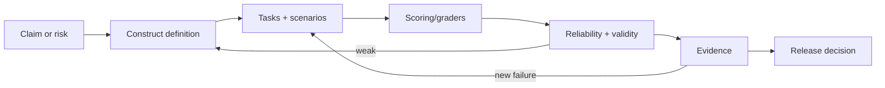

# AI Evaluation Engineer

> [!abstract] Mission
> Create trustworthy, reproducible evidence about what an AI system can do, where it fails, how risks manifest, and whether a change is good enough to release.

## Responsibilities

- Translate capabilities, user needs, policies, and hazards into measurable constructs and testable scenarios.
- Build and version evaluation datasets, environments, simulators, graders, rubrics, and human-review workflows.
- Validate measurement reliability, construct/content validity, contamination controls, uncertainty, and subgroup coverage.
- Run development, assurance, adversarial, field, regression, and production evaluations as appropriate.
- Analyze failures, communicate limits, set decision gates with accountable owners, and maintain continuous evaluation.

## Title reality

Evaluation work appears as Evals Engineer, Research Engineer—Evals/Environments, Model Behavior, AI Quality, Safety Evaluation, TEVV, or Applied Scientist. Some roles build harness infrastructure; others invent measurements or coordinate domain experts. QA testing is adjacent but AI evaluation adds stochastic behavior, construct ambiguity, model-graded evidence, contamination, and socio-technical field effects.

## Work anatomy

> [!info] What the role owns
> Evaluation engineers make claims about models and systems testable. They are not merely scorekeepers: they decide what should count as evidence, how reliable the measurement is, and what action follows a result.

### Operating loop

1. Turn a capability, quality, safety, or reliability question into a measurable claim and decision threshold.
2. Build a task set with realistic distributions, important rare cases, held-out data, and documented provenance.
3. Choose human, automated, model-based, or hybrid graders; define rubrics and disagreement handling.
4. Estimate coverage, variance, reliability, sensitivity, and failure slices—not only a headline average.
5. Publish the result, gate a release or training run, and continuously refresh the suite as behavior and threats change.

### Inputs → outputs

| Inputs | Owned work product | Evidence a reviewer should inspect |
|---|---|---|
| Product claims, risk hypotheses, model versions | Evaluation specification and benchmark | Claim-to-test traceability, exclusions, sampling plan, and rubric |
| Prompts, trajectories, annotations, graders | Reproducible evaluation pipeline | Versioned cases, grader calibration, held-out protection, and variance |
| Results and failures | Decision memo and regression gate | Error taxonomy, confidence/uncertainty, threshold rationale, and next action |

### Decisions and interfaces

The central tradeoffs are realism versus cost, automated scale versus human validity, benchmark stability versus freshness, and broad coverage versus deep investigation. Evaluation engineers work with research on measurement design, product on decision thresholds, safety/security on risk cases, and infrastructure/data on reproducible execution.

### Evidence of competence

A credible portfolio separates development from held-out evaluation, reports slices and uncertainty, audits grader agreement, and demonstrates how a failure becomes a regression test. Explain what the benchmark cannot measure and which decision it should not be used to make.

### Research anchors

The practice follows [NIST AI TEVV](https://www.nist.gov/ai-test-evaluation-validation-and-verification-tevv), the [NIST ARIA pilot report](https://doi.org/10.6028/NIST.AI.700-2), and the current [OpenAI Frontier Evals and Environments role](https://openai.com/careers/research-engineer-frontier-evals-and-environments-san-francisco/), which emphasizes measurement reliability, variance, graders, environments, and continuous evaluation. Practice a ship-or-stop gate in [[Case - Evaluation Harness]].
## 2026 technique overlay

> [!tip] Practice this now · 2026-08-24
> Turn a claim into a TEVV measurement tree, version the dataset and grader, calibrate model judging against blinded human ratings, repeat stochastic runs, and publish uncertainty plus failure slices. Use the current evaluation and observability practices in [[AI Tools and Practices Update — 2026-08-24]].

> [!info] Microsoft delivery deep dive
> Map Foundry evaluation targets, traces, graders, held-out datasets, and **azd ai eval** command versions to an Azure Pipelines gate in [[Microsoft Azure DevOps and Foundry]]. The command-surface caveat is part of reproducibility: record **azd --version** and installed extensions with every run.

> [!info] Evaluation as a delivery gate
> Use [[AI DevOps and Cloud Engineering — 2026-08-24]] to connect evaluator identity, dataset/prompt/model/tool hashes, critical slices, safety blocks, cost/latency budgets, protected promotion, trace evidence, and rollback. Your artifact is a release decision that another team can reproduce, not only a score.

## Level ladder

| Level | Expected ownership |
|---|---|
| Junior | Implement cases/graders, run evaluations, inspect failures, and maintain reproducibility. |
| Evaluation engineer | Own one construct's task suite, validation, pipeline, analysis, and reporting. |
| Senior | Design multi-method evaluation and influence training/product release decisions. |
| Staff / principal | Set measurement architecture, evidence standards, and evaluation portfolio across systems. |
| Lead | Own evaluation governance, independence, domain partnerships, disclosure, and decision integration. |

## Prerequisites

- Python/data engineering/testing, APIs, experiment tracking, statistics, and visualization.
- Measurement and experimental design: constructs, sampling, reliability, validity, uncertainty, bias, and human factors.
- ML/LLM and system architecture; task environments and sandboxing for tool-using agents.
- Domain and risk expertise or the skill to recruit/structure qualified expert review.

## Knowledge and skills

| Area | Demonstrable capability |
|---|---|
| Measurement | Define construct/claims, measurement trees, metrics, decision thresholds, and limits. |
| Evaluation design | Representative and stress cases, held-out/secret sets, scenario and field testing, anti-contamination. |
| Graders | Exact/programmatic/rubric/model/human scoring; validate agreement, bias, variance, and gaming. |
| Statistics | Sampling, repeated stochastic trials, confidence/uncertainty, paired comparisons, power and multiple testing. |
| Infrastructure | Immutable versions, scalable runners, sandbox environments, traces, replay, failure recovery. |
| Communication | Disaggregate results, preserve uncertainty, distinguish capability from impact, and support decisions. |

## Study sequence

1. Evaluate a deterministic classifier; learn confusion, calibration, slices, bootstrap intervals, and test leakage.
2. Build an LLM task suite with exact and rubric scoring; repeat samples and manually inspect disagreements.
3. Validate a model judge against blinded human ratings; test position/style/self-preference and adversarial gaming.
4. Add agent environments and trajectory scoring for success, safety, efficiency, and recovery.
5. Design development, assurance, red-team, and field components for one product risk using a measurement tree.
6. Implement continuous regression gates, secret-set handling, result lineage, and a decision-facing report.

## Tools

| Need | Free / open-first | Paid or managed |
|---|---|---|
| Evals | OpenAI Evals, lm-evaluation-harness, promptfoo, Inspect AI options, custom pytest | Vendor dashboard evals, Braintrust, LangSmith |
| Tracking | MLflow, OpenTelemetry, DuckDB, Jupyter/Quarto | Weights & Biases, commercial observability |
| Human review | Label Studio, custom blinded review UI | Managed labeling/evaluation services |
| Statistics | SciPy, statsmodels, R, scikit-learn | Enterprise statistical platforms |
| Environments | containers, sandboxes, browser/task simulators | Managed agent/code/browser sandbox services |

## Quiz

1. Distinguish reliability from validity.
2. Why can benchmark saturation be misleading?
3. What biases can affect an LLM judge?
4. Why repeat stochastic model evaluations?
5. What is contamination-resistant evaluation design?
6. How do model testing, red teaming, and field testing differ?

> [!question]- Answer key
> 1. Reliability is consistency; validity is whether evidence supports the intended interpretation/use. A measure can be reliably wrong. 2. Near-ceiling scores reduce discrimination and may reward benchmark-specific tuning rather than real task progress. 3. Position/order, verbosity/style, self/model-family preference, reference leakage, domain weakness, and prompt sensitivity. 4. One sample hides outcome variance and changes rankings near thresholds; repetitions estimate distributions. 5. Hold back secret/versioned cases, control access, detect duplicates/exposure, separate development from assurance, and rotate tasks without changing the construct silently. 6. Structured component behavior, exploratory/adversarial failure discovery, and system behavior/impact in realistic use contexts.

## Flashcards

Construct:: The underlying capability, quality, or risk a measurement intends to represent.

Reliability:: Consistency across raters, items, runs, or conditions as relevant.

Construct validity:: Evidence that score interpretations reflect the intended construct rather than a confound or shortcut.

Assurance evaluation:: Evaluation conducted with greater independence and controlled datasets for a governance/release decision.

Model-graded eval:: A model applies a scoring rubric; its judgments require validation against trustworthy reference evidence.

Trajectory grader:: Scorer examining intermediate actions/tool use/state, not only a final response.

Benchmark saturation:: Scores approach a ceiling, reducing power to distinguish meaningful progress.

Measurement tree:: Decomposition of a broad validity or risk claim into measurable subclaims and evidence.

## Interview preparation

- Convert “make the assistant trustworthy” into constructs, scenarios, metrics, and a measurement tree.
- Critique an eval for leakage, unrepresentative sampling, weak graders, hidden variance, or invalid aggregation.
- Design and validate human and model graders under time/cost constraints.
- Analyze paired stochastic model results and communicate uncertainty.
- Build a scalable, versioned eval runner with secret data and reproducible environments.
- Explain a case where a metric improved while user/system behavior worsened.

## Suggested projects

### Beginner — Evaluation validity audit

Create a 200-case task suite, two scorers, repeated runs, bootstrap uncertainty, slice/error analysis, and blinded human validation. Document intended and invalid score uses.

### Intermediate — Agent trajectory benchmark

Build versioned tasks and sandbox tools. Score completion, forbidden side effects, steps, latency, cost, and recovery; validate graders and test reward hacking.

### Advanced — Multi-method assurance dossier

For one realistic AI application, build a NIST-style measurement tree and combine model tests, structured red-team scenarios, field/user study simulation, independent review, release thresholds, and continuous monitoring.

## Job-search aliases

Search `AI evaluation engineer`, `AI evals engineer`, `model evaluation engineer`, `research engineer evals`, `frontier evaluations`, `AI TEVV`, `model behavior engineer`, and `AI quality engineer`.

## Boundaries

- [[AI Red Teamer]] explores adversarial failures; evaluation engineers turn risks/capabilities into repeatable measurements. Teams overlap.
- [[AI Safety and Alignment Researcher]] develops theories/interventions for intended behavior and may invent evals.
- [[Applied Scientist]] owns a product/model outcome; evaluation owns reusable evidence quality and gates.
- Traditional QA emphasizes specified deterministic behavior; AI eval adds statistical, construct, and emergent-behavior challenges.

## Sources

- [NIST — AI TEVV](https://www.nist.gov/ai-test-evaluation-validation-and-verification-tevv) — U.S. federal measurement/evaluation program context; accessed 2026-08-12.
- [NIST ARIA Pilot Evaluation Report, AI 700-2](https://doi.org/10.6028/NIST.AI.700-2) — model testing, red teaming, field testing, annotations, questionnaires, and measurement trees; published 2025-11-13, accessed 2026-08-12.
- [OpenAI — Research Engineer, Frontier Evals & Environments](https://openai.com/careers/research-engineer-frontier-evals-and-environments-san-francisco/) — current responsibilities for environments, measurement reliability/variance, and continuous evaluation; accessed 2026-08-12.
- [OpenAI Evals repository](https://github.com/openai/evals) — framework and benchmark registry; accessed 2026-08-12.
- [Google — Evaluate model and system for safety](https://ai.google.dev/responsible/docs/evaluation) — development, assurance, red-team, external evaluation, and held-out set guidance; accessed 2026-08-12.
