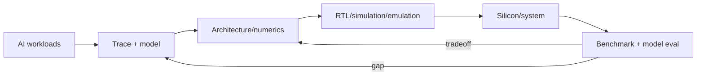

# AI Hardware and Accelerator Engineer

> [!info] October 13, 2026 update
> Practice focus: **Which resource limits dominate the workload**. Produce **Memory/bandwidth/compute budget and measured bottleneck** and answer: Is the optimization useful end to end or only in a kernel?
> Use [[Technical Role Practice Workbook — October 2026]] and [[October 2026 Research Refresh]]. This checkpoint does not reverify every older market/tool claim in this profile.

> [!abstract] Mission
> Design and validate hardware, architecture, numerics, interconnect, memory, or hardware–software co-design that makes AI training and inference more capable, efficient, reliable, and manufacturable.

## Responsibilities

- Characterize evolving AI workloads and translate them into architecture, PPA, memory, interconnect, numerical, and system requirements.
- Design or verify RTL, accelerators, SoCs, memory subsystems, networking/interconnect, firmware, or boards depending on specialty.
- Build simulators/emulators and performance/roofline models; compare predictions with silicon/system measurements.
- Co-design data types, quantization/compression, kernels, compilers, runtime, sharding, and model architecture.
- Validate correctness, numerical quality, timing, power, thermals, reliability, security, and production/manufacturing readiness.

## Title reality

This is a family, not one job: microarchitecture, RTL, design verification, physical design, performance modeling, compiler/kernel, firmware, boards/systems, networking, signal/power integrity, manufacturing test, and hardware–ML co-design. Some “ML Accelerator Engineer” roles are software/kernel roles; others design silicon. Current U.S. hardware co-design postings bridge Python/C++/Triton/CUDA, PyTorch/JAX, low-precision numerics, performance models, and optional RTL.

## Work anatomy

> [!info] What the role owns
> Hardware and accelerator engineers translate AI workload behavior into better compute systems. Depending on the team, the owned artifact may be an architecture model, RTL block, compiler/kernel path, firmware layer, or a co-designed system that improves performance per watt without breaking numerical behavior.

### Operating loop

1. Characterize real workloads: operators, tensor shapes, memory traffic, precision, batch/sequence distributions, and utilization.
2. Locate the bottleneck with a roofline, simulator, profiler, or hardware counter rather than intuition.
3. Choose the intervention: architecture, data movement, kernel, compiler, quantization, scheduling, or memory hierarchy.
4. Validate correctness and measure power, performance, and area across representative workloads.
5. Bring the change through verification, integration, and regression against software and model quality.

### Inputs → outputs

| Inputs | Owned work product | Evidence a reviewer should inspect |
|---|---|---|
| Model graphs, kernels, traces, constraints | Workload characterization and bottleneck model | Reproducible traces, shape coverage, and a defensible baseline |
| Architecture or implementation hypothesis | RTL, kernel, compiler, or simulator artifact | Correctness tests, PPA/performance deltas, and assumptions |
| Integration feedback | Co-design recommendation | Quality/precision impact, thermal/power envelope, and next validation step |

### Decisions and interfaces

The recurring tradeoffs are flexibility versus efficiency, precision versus quality, compute versus memory bandwidth, peak speed versus tail behavior, and specialization versus software longevity. Interfaces include model/research teams, compiler/runtime engineers, verification, firmware, manufacturing, and datacenter operations.

### Evidence of competence

Show a benchmark harness, a bottleneck diagnosis, one change, and a before/after result with reproducible workload definitions. Strong evidence explains why the optimization transfers beyond one kernel and what it costs in power, area, precision, or maintainability.

### Research anchors

The role combines the U.S. hardware duties in [BLS Computer Hardware Engineers](https://www.bls.gov/ooh/architecture-and-engineering/computer-hardware-engineers.htm), the workload/PPA/co-design scope in [OpenAI's hardware co-design posting](https://openai.com/careers/ml-research-engineer-hardware-codesign-san-francisco/), and the implementation/profiling constraints in [CUDA documentation](https://docs.nvidia.com/cuda/index.html).
## 2026 technique overlay

> [!tip] Practice this now · 2026-08-24
> Benchmark representative prompt lengths and concurrency, then separate memory, kernel, batching, time-to-first-token, throughput, quality, and cost effects. Compare quantized and baseline models on the same safety/quality set and record a rollback artifact; see [[AI Tools and Practices Update — 2026-08-24]].

## Level ladder

| Level | Expected ownership |
|---|---|
| Junior | Implement/verify a bounded block, benchmark, simulation component, or test under established methodology. |
| Hardware/accelerator engineer | Own a block or co-design study through specifications, verification, and measured evidence. |
| Senior | Design across workload, architecture, RTL/software, and system tradeoffs; lead closure/debug. |
| Staff / principal | Set architecture or methodology across chips/systems and multi-generation roadmaps. |
| Lead | Own product/pathfinding choices, cross-functional execution, risk, vendors, manufacturing and evidence. |

## Prerequisites

- Computer/electrical engineering foundation: digital logic, circuits, computer architecture, operating systems, networking, probability, and numerical representation.
- Specialty tools: Verilog/SystemVerilog/VHDL and verification for RTL; C++/Python and CUDA/Triton/compiler IR for co-design/performance.
- ML workloads: tensors, convolutions/attention/MoE, training versus inference, precision, sparsity, parallelism, memory/communication.
- Lab/simulation rigor, documentation, and cross-functional communication. Some U.S. roles may have export-control eligibility requirements; the employer must determine applicability.

## Knowledge and skills

| Area | Demonstrable capability |
|---|---|
| Architecture | Pipelines, caches/SRAM/HBM, memory bandwidth, NoC/interconnect, parallelism, scheduling, reliability. |
| Numerics | Floating/fixed point, rounding, accumulation, overflow/underflow, quantization, compression, model-quality impact. |
| Modeling | Roofline/queueing/performance simulation, workload traces, PPA estimates, sensitivity and confidence. |
| Design/verification | RTL, synthesis/timing basics, assertions, constrained-random/formal options, emulation, coverage and debug. |
| Software co-design | Kernels, compiler/runtime mapping, collectives, sharding, operator fusion, hardware enablement. |
| Product validation | Benchmarks, power/thermal, stress/reliability, firmware, manufacturing/test and documentation as relevant. |

## Study sequence

1. Build digital logic and CPU/cache/memory projects; use HDL simulation and assertions.
2. Implement matrix multiply/systolic or vector accelerator RTL and compare against a bit-exact reference.
3. Model roofline/PPA sensitivity for transformer workloads; identify memory, compute, or interconnect limits.
4. Write optimized CPU/GPU/Triton kernels and connect tensor operations to hardware behavior.
5. Explore low-precision numerics; run model evaluations to quantify efficiency–quality tradeoffs.
6. Complete an end-to-end co-design study from workload traces through architecture, verification evidence, software mapping, and measured/simulated gaps.

## Tools

| Need | Free / open-first | Paid or managed |
|---|---|---|
| HDL/simulation | Verilator, Icarus Verilog, GHDL, cocotb, GTKWave | Synopsys, Cadence, Siemens EDA suites |
| Architecture | gem5, QEMU, SCALE-Sim/Timeloop-like research tools, custom roofline models | Commercial architecture/emulation platforms |
| FPGA | Yosys/nextpnr for supported devices, vendor free editions | Xilinx/AMD Vivado, Intel Quartus paid tiers, FPGA clouds |
| Kernels/software | C/C++, CUDA, Triton, ROCm, PyTorch/JAX | Vendor enterprise SDK/support and cloud accelerators |
| Profiling | Nsight tools, Linux `perf`, vendor profilers | Commercial lab and performance-analysis suites |

## Quiz

1. What does a roofline model relate?
2. Why can lower-precision arithmetic harm a model even without overflow?
3. Distinguish latency, throughput, and PPA.
4. Why compare performance simulation to measured hardware?
5. What is verification coverage not proof of?
6. How does memory bandwidth constrain transformer workloads?

> [!question]- Answer key
> 1. Attainable performance to peak compute and memory bandwidth as a function of arithmetic intensity. 2. Rounding, accumulation error, underflow, quantization scale/outliers, and changed ordering can alter probabilities and rare behaviors. 3. Time for one operation, operations per time, and power/performance/area design tradeoffs. 4. Models omit effects and contain assumptions; residual gaps reveal bottlenecks, bugs, or invalid abstraction. 5. Absence of all design bugs or correctness outside the sampled/formally proven state space. 6. Attention, weights, activations, and KV-cache movement can require more bytes per useful operation than the memory system supplies, leaving compute units idle.

## Flashcards

PPA:: Power, performance, and area—the central hardware design tradeoff set.

Roofline model:: Bound on performance from peak arithmetic rate and memory bandwidth versus arithmetic intensity.

Arithmetic intensity:: Operations per byte transferred across a specified memory boundary.

RTL:: Register-transfer level description of synchronous digital logic and data movement.

Synthesis:: Transforming RTL into a gate/netlist implementation under technology and constraint assumptions.

Systolic array:: Regular processing-element structure that rhythmically moves and reuses data for operations such as matrix multiplication.

HBM:: High Bandwidth Memory, stacked memory providing high aggregate bandwidth near accelerators.

Co-design:: Jointly optimizing model/workload, numerics, software, architecture, and implementation rather than fixing each independently.

## Interview preparation

- Analyze caches/memory, pipelines, parallel speedup, arithmetic intensity, and roofline bottlenecks.
- Design or verify a small accelerator/RTL block; discuss assertions, tests, coverage, timing and corner cases.
- Connect transformer operators and sharding to compute, memory, and interconnect traffic.
- Explain floating-point/quantization and design a model-quality validation for new numerics.
- Diagnose a gap between simulated and measured performance.
- Present a PPA or hardware–software tradeoff with explicit assumptions, uncertainty, and downstream model impact.

## Suggested projects

### Beginner — Bit-exact accelerator block

Implement an HDL dot-product/MAC or matrix tile, create a Python bit-exact reference, use assertions/random tests, synthesize with an open flow where supported, and report timing/resource estimates.

### Intermediate — Transformer roofline co-design

Trace a small transformer, model compute/memory/interconnect across batch/sequence sizes and precisions, validate with profiler measurements, and recommend one architecture/software change.

### Advanced — Low-precision accelerator study

Prototype numerical RTL or an FPGA/kernel emulator, integrate with a model path, verify bit-level correctness, measure PPA/performance proxies and model task slices, explain simulation–measurement gaps, and produce a design handoff.

## Job-search aliases

Search `AI accelerator engineer`, `ML accelerator engineer`, `AI hardware engineer`, `AI silicon engineer`, `hardware software codesign`, `SoC architect AI`, `RTL engineer accelerator`, `GPU/TPU kernel engineer`, and `performance modeling AI hardware`.

## Boundaries

- [[Inference and Performance Engineer]] optimizes software/runtime and may write kernels; accelerator engineers own hardware or deep co-design.
- [[Research Engineer]] may study model/algorithm changes without hardware implementation responsibility.
- General computer hardware engineers design/test broad systems; this track specializes in AI workload demands.
- Verification, physical design, firmware, compiler, and board roles are distinct specialties within the hardware lifecycle.

## Sources

- [BLS — Computer Hardware Engineers](https://www.bls.gov/ooh/architecture-and-engineering/computer-hardware-engineers.htm) — U.S. duties, education, and occupational context; modified 2026-05-15, accessed 2026-08-12.
- [OpenAI — ML Research Engineer, Hardware Codesign](https://openai.com/careers/ml-research-engineer-hardware-codesign-san-francisco/) — current U.S. workload modeling, low-precision, kernels, model evals, RTL, and PPA scope; accessed 2026-08-12.
- [OpenAI hardware careers](https://openai.com/careers/search/?c=ef55fc21-b92d-49ae-a9b0-32a7fdc153f2) — current role family across SoC, RTL, firmware/network, kernel, and systems; accessed 2026-08-12.
- [CUDA Toolkit documentation](https://docs.nvidia.com/cuda/index.html) — CUDA 13.3 programming, architecture, compiler, profiling, and compatibility references; updated 2026, accessed 2026-08-12.
- [Anthropic jobs](https://www.anthropic.com/careers/jobs) — current U.S. ML Accelerator, GPU Performance, and TPU Kernel title evidence; accessed 2026-08-12.
