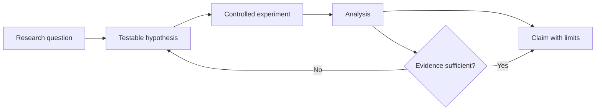

# AI/ML Research Scientist

> [!info] October 13, 2026 update
> Practice focus: **Whether a claimed contribution survives fair comparison**. Produce **Reproducible experiment and compute-normalized baseline** and answer: Are tuning budgets and selection procedures comparable?
> Use [[Technical Role Practice Workbook — October 2026]] and [[October 2026 Research Refresh]]. This checkpoint does not reverify every older market/tool claim in this profile.

> [!abstract] Mission
> Produce new, defensible knowledge about learning systems: formulate a consequential question, design controlled experiments, analyze uncertainty and failure, and communicate results so others can reproduce or build on them.

## Responsibilities

- Define hypotheses about architectures, objectives, data, optimization, reasoning, multimodality, agents, robustness, interpretability, or alignment.
- Derive or adapt methods; implement baselines and ablations; run experiments at an appropriate scale.
- Diagnose confounding, contamination, measurement error, and variance rather than treating a benchmark score as proof.
- Write research artifacts—papers, technical reports, model cards, datasets, or internal decision memos—and review others' work.
- Partner with [[Research Engineer]], [[AI Evaluation Engineer]], domain experts, and product or infrastructure teams.

## Title reality

“Research scientist” is not standardized. At a university or frontier lab it can mean publication-led, agenda-setting research and often favors a PhD or equivalent record. In an applied lab it may include substantial engineering and product work. Some employers combine “Research Engineer/Research Scientist” in one posting; inspect whether success is judged by novel findings, production impact, or both.

## Work anatomy

> [!info] What the role owns
> An AI/ML research scientist owns a scientific question and a defensible claim about it. The deliverable may be a paper, method, benchmark, analysis, or research artifact; a production feature is not required, but the claim must survive controls, ablations, and attempts to falsify it.

### Operating loop

1. Select a question whose answer would change understanding, capability, or a research decision.
2. State a falsifiable hypothesis, define baselines, choose data, and identify confounders and compute limits.
3. Implement the smallest experiment that can distinguish competing explanations.
4. Run ablations, robustness checks, error analysis, and independent or repeated trials.
5. Package the code, data/provenance, limitations, and claim so another researcher can reproduce or challenge it.

### Inputs → outputs

| Inputs | Owned work product | Evidence a reviewer should inspect |
|---|---|---|
| Open problem, literature, prior results | Hypothesis and experiment plan | Clear novelty, assumptions, baselines, and falsification criteria |
| Data, models, compute, collaborators | Research artifact and results | Ablations, variance/uncertainty, contamination checks, and logs |
| Findings and limitations | Paper, technical report, or decision memo | Claim-to-evidence map, scope limits, and reproducibility package |

### Decisions and interfaces

Research judgment lives in novelty versus reliability, exploration versus exploitation, benchmark movement versus real-world meaning, and a beautiful method versus a tractable experiment. The role interfaces with research engineers on implementation, data teams on provenance, product/applied scientists on relevance, and safety/evals on measurement and risk.

### Evidence of competence

A strong study includes a discrepancy ledger: what was expected, what happened, why the result may be wrong, and what test would resolve it. Reproducing a paper with an honest discrepancy analysis is often better evidence than an unexamined “new” model.

### Research anchors

The operating pattern reflects [BLS Computer and Information Research Scientists](https://www.bls.gov/ooh/computer-and-information-technology/computer-and-information-research-scientists.htm), current [OpenAI research role expectations](https://openai.com/careers/research-engineerresearch-scientist-rlreasoning-san-francisco/), [PyTorch's modeling and profiling stack](https://docs.pytorch.org/docs/stable/), and [NIST TEVV](https://www.nist.gov/ai-test-evaluation-validation-and-verification-tevv).
## 2026 technique overlay

> [!tip] Practice this now · 2026-08-24
> Make experiments reproducible, state one hypothesis per change, preserve data/model lineage, run ablations, report uncertainty, and distinguish benchmark gains from intended-use gains. Use the research evidence and release-card pattern in [[AI Tools and Practices Update — 2026-08-24]].

## Level ladder

| Level | Expected ownership |
|---|---|
| Research assistant / resident | Reproduce results, implement baselines, maintain experiment hygiene, contribute analysis under supervision. |
| Scientist | Own a scoped question from literature review through credible result; communicate limitations. |
| Senior scientist | Define multi-experiment agendas, mentor researchers, allocate compute, and influence model or product decisions. |
| Staff / principal | Set a durable research direction across teams; establish methods and evidence standards. |
| Research lead | Align people, compute, risk, and external communication around a portfolio of research bets. |

## Prerequisites

- Strong Python and at least one deep-learning framework; debugging distributed experiments is increasingly useful.
- Linear algebra, probability, statistics, calculus, optimization, and experimental design.
- Ability to read papers critically and reconstruct unstated assumptions.
- Graduate study is common, not an absolute rule. Equivalent evidence means unusually strong publications, open research, or recognized technical contributions—not merely course completion.

## Knowledge and skills

| Area | Be able to do |
|---|---|
| ML theory and methods | Explain objectives, inductive biases, optimization dynamics, generalization assumptions, and failure modes. |
| Empirical science | Pre-register key hypotheses when useful; select baselines; run ablations; quantify uncertainty; avoid post-hoc storytelling. |
| Data and evaluation | Audit provenance and leakage; build held-out tests; distinguish construct validity from convenient metrics. |
| Systems | Estimate compute and memory; make runs reproducible; debug numerical and distributed failures. |
| Scholarship | Search literature, position novelty honestly, write precise claims, and release usable artifacts when permitted. |
| Responsible research | Threat-model release and dual-use risk; document limits; follow institutional review and data rules. |

## Study sequence

1. **Foundations:** implement linear/logistic regression, backpropagation, optimizers, and uncertainty estimates without high-level trainers.
2. **Deep learning:** train and diagnose CNNs and transformers; understand normalization, attention, regularization, scaling, and distributed training.
3. **Research literacy:** read one subfield survey and 20–30 primary papers; maintain a claim/evidence matrix.
4. **Reproduction:** reproduce a published result with locked dependencies, seeds, confidence intervals, and a discrepancy log.
5. **Independent question:** identify a real gap, define falsifiable hypotheses, budget experiments, and include strong baselines and ablations.
6. **Research communication:** write a conference-style paper and a one-page plain-language limitations and risk summary.

## Tools: free first, paid second

| Need | Free / open-first | Paid or managed options |
|---|---|---|
| Modeling | PyTorch, JAX, scikit-learn, Hugging Face Transformers | Managed training on AWS SageMaker, Google Vertex AI, Azure ML |
| Experiments | MLflow, TensorBoard, Git, DVC | Weights & Biases, Neptune, Comet |
| Compute | Local CPU/GPU, university/community grants, Kaggle/Colab free tiers where available | Cloud GPU/TPU instances, managed clusters |
| Papers | arXiv, Semantic Scholar, Zotero | Publisher access or institutional databases |
| Reproducibility | containers, `uv`/Conda, Make, Hydra | Managed artifact registries and enterprise platforms |

> [!warning] Free tiers change
> Verify quotas and licensing before designing a course or research plan around any hosted service. Never upload restricted data or unpublished model artifacts without authorization.

## Quiz

1. Why is a higher benchmark score insufficient evidence of a better method?
2. What does an ablation test establish?
3. Distinguish statistical significance, effect size, and practical significance.
4. Name three routes by which evaluation contamination can enter a result.
5. When should a failed reproduction still be published internally or externally?
6. What separates a research question from an engineering task?

> [!question]- Answer key
> 1. The comparison may differ in data, compute, tuning budget, implementation, samples, or metric validity; uncertainty and baselines matter. 2. It estimates the contribution of a component by changing or removing it while controlling other factors. 3. Significance concerns compatibility with a null model, effect size is magnitude, and practical significance is whether the effect matters under real constraints. 4. Pretraining exposure, tuning on the test set, benchmark-specific prompt/model selection, or duplicate records. 5. When the method is important and the discrepancy is rigorously documented; it prevents repeated waste and may expose boundary conditions. 6. Research seeks uncertain generalizable knowledge; engineering primarily seeks a working artifact under stated constraints, although one project can contain both.

## Flashcards

Construct validity:: Whether an evaluation actually measures the concept its conclusions claim to measure.

Ablation:: A controlled removal or alteration used to estimate a component's contribution.

Data contamination:: Information from an evaluation set influencing training, selection, prompting, or tuning.

Baseline:: A credible reference method against which the proposed method is compared under fair conditions.

Power analysis:: Planning sample size or repetitions to detect an effect of meaningful magnitude with a chosen error rate.

Reproducibility:: Obtaining consistent results using the same data, code, and procedure; terminology varies by field, so define it.

Calibration:: Agreement between predicted confidence and observed frequency under specified conditions.

Negative result:: Evidence that a plausible method or hypothesis did not work under documented conditions; not the same as “nothing was learned.”

## Interview preparation

Be ready to:

- Present one project as **question → hypothesis → method → controls → result → uncertainty → next test**.
- Derive a familiar loss or attention operation and explain numerical or optimization failure modes.
- Critique an experimental table: missing baselines, unequal budgets, multiple comparisons, leakage, weak uncertainty, or unjustified conclusions.
- Design an evaluation for a behavior that lacks a perfect label.
- Debug a loss curve and separate data, implementation, optimization, and capacity hypotheses.
- Discuss a paper you disagree with without overstating the evidence.

Prepare a 15-minute research talk, a two-minute version, and a whiteboard reproduction plan. Keep a story about changing your mind after contradictory evidence.

## Suggested projects

### Beginner — Reproduction with a discrepancy ledger

Reproduce a small published classification or language-model result. Deliver code, exact environment, dataset provenance, five seeds, uncertainty, and a table explaining every discrepancy from the paper.

### Intermediate — Controlled method comparison

Test two adaptation or retrieval methods under matched data, compute, and tuning budgets. Include power reasoning, ablations, error slices, and a model/system card.

### Advanced — Original research artifact

Propose a falsifiable question in evaluation, robustness, efficiency, alignment, or a modality domain. Release a paper-quality report, reusable implementation, artifacts permitted by license, and an explicit dual-use/release assessment.

## Job-search aliases

Search: `AI research scientist`, `machine learning research scientist`, `research scientist generative AI`, `researcher reinforcement learning`, `research scientist multimodal`, `research scientist interpretability`, and the subfield name. Also inspect combined `research engineer/research scientist` listings.

## Boundaries with adjacent roles

- [[Research Engineer]] emphasizes research velocity, implementation, tooling, and scale; this role emphasizes the scientific claim. Strong teams blur the boundary.
- [[Applied Scientist]] usually optimizes a real product or business outcome while retaining scientific rigor.
- [[ML Engineer]] owns production reliability and lifecycle more consistently than novel generalizable findings.
- [[AI Safety and Alignment Researcher]] is a problem-domain specialization; it may be scientist- or engineer-shaped.

## Sources

- [BLS — Computer and Information Research Scientists](https://www.bls.gov/ooh/computer-and-information-technology/computer-and-information-research-scientists.htm) — U.S. duties and education context; modified 2025-04-18, accessed 2026-08-12.
- [OpenAI — Research Engineer/Research Scientist, RL/Reasoning](https://openai.com/careers/research-engineerresearch-scientist-rlreasoning-san-francisco/) — current combined-title evidence and responsibilities; accessed 2026-08-12.
- [OpenAI — Researcher, Alignment](https://openai.com/careers/researcher-alignment-san-francisco/) — hypothesis-to-experiment expectations; accessed 2026-08-12.
- [PyTorch documentation](https://docs.pytorch.org/docs/stable/) — current modeling, distributed, compiler, and profiler reference; accessed 2026-08-12.
- [NIST — AI TEVV](https://www.nist.gov/ai-test-evaluation-validation-and-verification-tevv) — measurement and evaluation context; accessed 2026-08-12.
