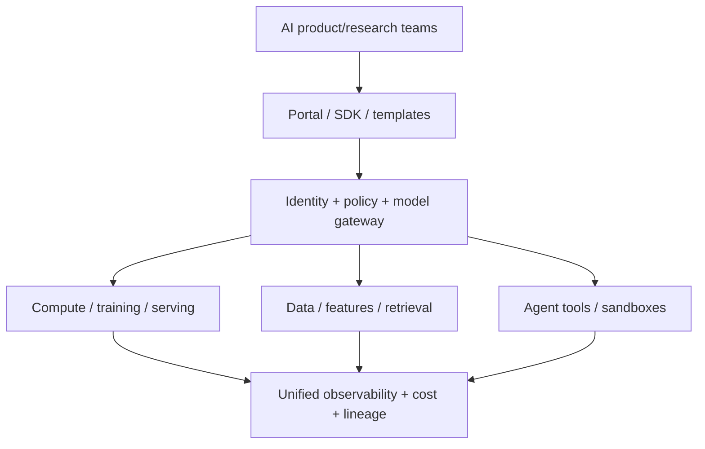

# AI Platform Engineer

> [!info] October 13, 2026 update
> Practice focus: **Which identity and capacity defaults teams inherit**. Produce **Tenant contract, quotas, negative tests** and answer: Can a valid caller select another user's delegated identity?
> Use [[Technical Role Practice Workbook — October 2026]] and [[October 2026 Research Refresh]]. This checkpoint does not reverify every older market/tool claim in this profile.

> [!abstract] Mission
> Give many AI teams a secure, reliable, observable, cost-aware paved road for data access, experimentation, models, retrieval, agents, deployment, and governance.

## Responsibilities

- Discover recurring developer journeys and turn them into self-service APIs, templates, SDKs, portals, and documentation.
- Operate shared compute, model gateways, registries, feature/retrieval services, agent tools, secrets, and observability.
- Enforce identity, policy, network/data boundaries, quotas, provenance, and audit by default.
- Manage multi-tenancy, capacity, accelerators, vendor abstraction, reliability, upgrades, and cost attribution.
- Measure adoption, lead time, reliability, user satisfaction, and reduction in duplicated engineering—not only platform uptime.

## Title reality

This role overlaps cloud platform, developer platform, [[MLOps Engineer]], ML infrastructure, and internal product engineering. Some positions focus on GPU clusters and training; others on model gateways, RAG/agent tooling, or enterprise governance. “Platform” should imply reusable multi-team capabilities and an internal product mindset, not simply administering one vendor console.

## Work anatomy

> [!info] What the role owns
> AI platform engineers build the paved roads that let multiple teams develop, deploy, evaluate, and operate AI systems safely. The product is the platform: APIs, templates, compute, identity, observability, documentation, and sensible defaults that reduce repeated toil without hiding important controls.

### Operating loop

1. Gather team workflows, tenancy needs, SLOs, compliance constraints, and recurring failure patterns.
2. Define platform primitives and interfaces: projects, model endpoints, registries, secrets, datasets, traces, and deployment paths.
3. Ship a secure self-service path with reference implementations, guardrails, quotas, and escape hatches.
4. Measure adoption, developer lead time, reliability, cost, and incident patterns.
5. Improve the platform through feedback, capacity planning, upgrades, and deprecation discipline.

### Inputs → outputs

| Inputs | Owned work product | Evidence a reviewer should inspect |
|---|---|---|
| Team needs and organizational constraints | Platform architecture and service contracts | Tenancy, identity, SLO, quota, and ownership model |
| Models, workloads, environments | Paved-road templates and APIs | One-command deployment, observability, policy checks, and docs |
| Usage and incidents | Platform roadmap and reliability work | Adoption, lead-time, incident, capacity, and cost evidence |

### Decisions and interfaces

The key tradeoffs are standardization versus team flexibility, managed convenience versus control, central policy versus local autonomy, and feature breadth versus platform reliability. Interfaces include ML/AI engineers, MLOps, security, cloud/networking, finance, and developer experience.

### Evidence of competence

Demonstrate a platform path used by two different workloads, with identity isolation, quotas, traces, runbooks, upgrade strategy, and a measured reduction in delivery friction. A cluster alone is infrastructure; a platform exposes an opinionated, supportable developer workflow.

### Research anchors

The role's workload and scaling primitives align with [Kubernetes workloads and autoscaling](https://kubernetes.io/docs/concepts/workloads/autoscaling/), lifecycle/lineage practices in [MLflow](https://www.mlflow.org/docs/latest/), and secure artifact practices in [NIST SP 800-218A](https://doi.org/10.6028/NIST.SP.800-218A).
## 2026 technique overlay

> [!tip] Practice this now · 2026-08-24
> Expose a paved road with identity, quotas, versioned model/tool interfaces, OpenTelemetry-compatible traces, cost attribution, safe defaults, and a documented escape hatch. Measure developer lead time and adoption as well as uptime; study [[AI Tools and Practices Update — 2026-08-24]].

> [!info] Microsoft delivery deep dive
> In [[Microsoft Azure DevOps and Foundry]], practice separating the Azure Pipelines WIF identity, Foundry project managed identity, and hosted-agent runtime identity. The platform artifact is not “an Azure resource”; it is a supportable path from Board work item → reviewed Repo change → gated evaluation → protected environment → traceable rollback.

> [!info] Edge/web platform deep dive
> Compare Cloudflare’s Workers/Agents/Durable Objects/AI Gateway/AI Search stack with Vercel’s AI SDK 7/AI Gateway/WorkflowAgent/Sandbox/Fluid Compute stack in [[Cloudflare and Vercel AI]]. Practice one identity matrix, one trace correlation ID, one recovery test, and one exit plan across both platforms.

> Expand beyond hosting with [[MCP Deep Dive — 2026-08-24]] for stateless Streamable HTTP, gateway routing, OAuth, multi-replica state, registry provenance, conformance, and budgets. Use [[AI Expansion Atlas — 2026-08-24]] for agent identity/interoperability, AI SRE, on-device/cloud routing, provenance/AIBOM, inference economics, and sustainable capacity. Use [[OWASP and AI Security — 2026]] to turn platform permissions, MCP, supply chain, sandbox, and incident controls into evidence.

> [!info] AI × DevOps/cloud operating loop
> Use [[AI DevOps and Cloud Engineering — 2026-08-24]] to turn the platform into a delivery product: versioned model/prompt/tool bundles, OIDC/WIF, protected environments, evaluation gates, OpenTelemetry/MCP traces, Kubernetes or edge runtime choices, cost attribution, and an incident/exit drill.

## Level ladder

| Level | Expected ownership |
|---|---|
| Junior | Implement a platform component, module, integration, test, or documentation path. |
| Platform engineer | Own a service and its API, reliability, security, adoption, and user support. |
| Senior | Design cross-service journeys and lead multi-tenant reliability or migration. |
| Staff / principal | Set platform architecture, boundaries, standards, and build/buy strategy. |
| Lead | Own platform product strategy, capacity/cost, governance, roadmap, and organization interfaces. |

## Prerequisites

- Distributed/backend systems, APIs/SDKs, cloud, containers/Kubernetes, networking, IAM, secrets, IaC, CI/CD, and observability.
- ML/LLM lifecycle enough to design abstractions without blocking experimentation or hiding critical behavior.
- Platform product skills: user research, golden paths, service catalog, documentation, versioning, adoption and deprecation.
- Security, privacy, multi-tenancy, capacity, FinOps, and incident leadership.

## Knowledge and skills

| Area | Demonstrable capability |
|---|---|
| Platform design | Stable APIs, control/data planes, tenancy, versioning, extensibility, self-service, and escape hatches. |
| AI primitives | Compute scheduling, model/data registries, gateways, evals, feature/retrieval, agent/tool registries. |
| Reliability | SLOs, capacity, rate limiting, isolation, graceful degradation, backup/recovery, safe upgrades. |
| Security/governance | Federated identity, least privilege, policy as code, network/data boundaries, provenance and audit. |
| Economics | Unit costs, showback/chargeback, GPU utilization, caching/routing, egress, vendor commitments. |
| Developer experience | Time-to-first-success, documentation, templates, support, migration, feedback, and adoption evidence. |

## Study sequence

1. Build and operate a conventional multi-tenant service with IaC, IAM, CI/CD, SLOs, and cost metrics.
2. Add a self-service model deployment path with registry, standard telemetry, canary, and rollback.
3. Build a model gateway for authentication, routing, quotas, policy, caching, and vendor abstraction.
4. Add data/retrieval or agent-tool primitives with per-tenant access and lineage.
5. Run load/failure/security tests; design capacity and disaster recovery for accelerators and dependencies.
6. Conduct developer research, measure lead time/adoption, version/deprecate an API, and publish a platform roadmap.

## Tools

| Need | Free / open-first | Paid or managed |
|---|---|---|
| Orchestration | Kubernetes, Kueue/Volcano options, Ray, Slurm | Managed Kubernetes and GPU platforms |
| Lifecycle | MLflow, Kubeflow, KServe, Feast | Databricks, SageMaker, Vertex AI, Azure ML |
| Gateway | Envoy/Kong options, LiteLLM, OpenTelemetry | Cloud API/model gateways and commercial AI gateways |
| IaC/delivery | OpenTofu/Terraform, Helm, Argo CD | Enterprise IaC/CI/CD suites |
| Portal/observability | Backstage, Prometheus, Grafana, OpenTelemetry | Datadog and commercial internal-developer platforms |

## Quiz

1. Why separate control plane and data plane?
2. What is a paved road with an escape hatch?
3. How should a platform measure success beyond uptime?
4. What risks does a model gateway centralize?
5. Why is GPU utilization alone an incomplete efficiency measure?
6. What makes multi-tenant AI isolation difficult?

> [!question]- Answer key
> 1. Configuration, policy, and lifecycle have different scaling/failure/security properties from high-volume workload data. 2. A supported default path covers common needs while documented extension points allow justified exceptions without forks. 3. Adoption, task success, lead time, reliability of user systems, support burden, cost, satisfaction, and reduced duplication. 4. Credentials, sensitive prompts/outputs, policy enforcement, routing, availability, vendor dependence, and a large blast radius. 5. Useful throughput, queue time, latency, memory, energy/cost, failed jobs, and quality determine value. 6. GPUs/caches/storage/network and model/data artifacts can leak across tenants; workloads are large, long-lived, dynamic, and often privileged.

## Flashcards

Control plane:: Components that define desired state, policy, configuration, and lifecycle.

Data plane:: Components that handle workload traffic, model execution, or data movement.

Paved road:: Supported default workflow that makes the safe/reliable path easy for common cases.

Escape hatch:: Governed extension mechanism for needs the default platform does not cover.

Model gateway:: Shared mediation layer for model access, authentication, routing, policy, telemetry, quotas, and sometimes caching.

Multi-tenancy:: Multiple teams/customers share infrastructure while requiring isolation, fairness, attribution, and independent policy.

Showback:: Reporting resource use/cost to teams without necessarily billing them.

Platform as product:: Managing internal infrastructure around user needs, outcomes, lifecycle, and feedback rather than tickets alone.

## Interview preparation

- Design a secure multi-tenant AI platform and draw control/data planes, trust boundaries, and failure domains.
- Compare build versus managed services for a specific organization, skill set, scale, and regulatory need.
- Capacity-plan training and inference with quotas, priorities, preemption, and cost attribution.
- Design model gateway routing/fallback without hiding model-specific evaluation needs.
- Lead a migration or breaking API change with compatibility and deprecation.
- Present platform adoption/lead-time evidence and a user tradeoff, not only infrastructure metrics.

## Suggested projects

### Beginner — Self-service model deployment template

Create an IaC/template path from registered model to endpoint with IAM, health checks, metrics, canary, rollback, documentation, and a measured time-to-first-success.

### Intermediate — Multi-provider model gateway

Implement identity, tenant quotas, policy, routing, retries, circuit breakers, redacted traces, cost attribution, and provider failover. Test prompt/data isolation and failure modes.

### Advanced — Mini internal AI platform

Combine portal/SDK, model registry, training/serving, retrieval or tool registry, policy as code, unified observability, GPU/tenant scheduling simulation, disaster recovery, adoption study, and cost model.

## Job-search aliases

Search `AI platform engineer`, `ML platform engineer`, `machine learning platform engineer`, `AI infrastructure engineer`, `GenAI platform engineer`, `ML infrastructure engineer`, and `GPU platform engineer`.

## Boundaries

- [[MLOps Engineer]] centers model lifecycle automation and operation; AI platform is broader and explicitly multi-team/product-shaped.
- [[Inference and Performance Engineer]] optimizes runtimes and workload performance rather than the whole developer platform.
- [[ML Data Engineer]] owns model-ready data products and semantics.
- Cloud/platform/SRE roles may own the substrate without AI-specific abstractions or evaluation workflows.

## Sources

- [Kubernetes workloads](https://kubernetes.io/docs/concepts/workloads/) — workload abstractions and 2026 ML-oriented scheduling developments; modified 2026-04-27, accessed 2026-08-12.
- [Kubernetes autoscaling](https://kubernetes.io/docs/concepts/workloads/autoscaling/) — workload and node scaling concepts; accessed 2026-08-12.
- [MLflow documentation](https://www.mlflow.org/docs/latest/) — current ML and LLM/agent lifecycle primitives; accessed 2026-08-12.
- [Databricks Model Serving](https://docs.databricks.com/aws/en/machine-learning/model-serving) — managed serving, governance, APIs, autoscaling; updated 2026-06-30, accessed 2026-08-12.
- [NIST SP 800-218A](https://doi.org/10.6028/NIST.SP.800-218A) — secure AI artifact and development practices; published 2024-07-26, accessed 2026-08-12.
