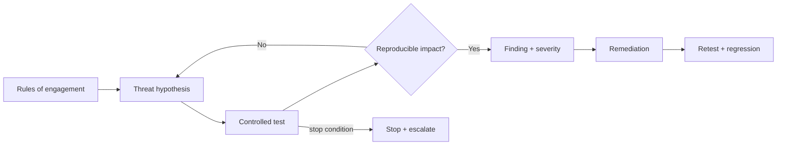

# AI Red Teamer

> [!danger] Authorization is part of the profession
> Test only systems, data, accounts, models, and environments for which you have explicit written authorization and rules of engagement. Stop on unsafe impact, preserve evidence securely, and coordinate disclosure/remediation.

> [!abstract] Mission
> Adversarially test AI models and end-to-end systems to discover realistic failure paths, validate impact, produce reproducible evidence, and help owners implement and verify durable fixes.

## Responsibilities

- Define scope, objectives, threat actors, prohibited actions, data handling, stop conditions, and escalation before testing.
- Explore model behavior and system attack paths across applications, identity, infrastructure, data, retrieval, tools, agents, and supply chains.
- Reproduce and validate findings; distinguish curiosity, policy failure, reliability bug, and exploitable security vulnerability.
- Communicate prerequisites, steps at an appropriate internal sensitivity, impact, evidence, severity, and remediation options.
- Turn discoveries into regression tests and verify fixes; protect sensitive findings from enabling abuse.

## Title reality

AI red teaming has at least three shapes: security penetration testing of model-integrated systems; safety/behavior red teaming for harmful outputs and misuse; and frontier-capability research with specialist domains. Some roles combine them, but expertise and evidence standards differ. Current postings also distinguish Offensive Security Engineer, Frontier Red Team Research Engineer, Adversarial Model Research, and safety evaluator. Clarify whether you are testing system vulnerabilities, model policies/capabilities, or both.

## Work anatomy

> [!info] What the role owns
> AI red teamers conduct authorized adversarial testing to discover how a model or AI system can fail, be misused, or cross a trust boundary. The output is actionable evidence: a reproducible finding, impact, severity, affected conditions, and a retestable remediation path.

### Operating loop

1. Confirm scope, authorization, safety limits, data handling, and escalation contacts.
2. Build a threat model and attack hypotheses from the system's assets, tools, users, and likely misuse.
3. Explore adaptively across prompts, data, tools, interfaces, model settings, and multi-step sequences.
4. Preserve evidence without expanding harm; reproduce the smallest reliable exploit.
5. Report impact and remediation, then retest the fix and convert durable cases into evaluations or controls.

### Inputs → outputs

| Inputs | Owned work product | Evidence a reviewer should inspect |
|---|---|---|
| System map, threat model, authorization | Test plan and attack hypotheses | Scope, safety controls, assumptions, and coverage rationale |
| Prompts, tools, data, model behavior | Reproducible finding | Minimal reproduction, impact, preconditions, and evidence |
| Fixes and regression cases | Retest and risk decision | Fix verification, residual risk, and regression test |

### Decisions and interfaces

The hardest choices are breadth versus depth, realism versus safe containment, exploit impact versus reproducibility, and disclosure detail versus unnecessary exposure. Red teamers hand off to security engineering, product, model/evals, legal/privacy, and incident response.

### Evidence of competence

A credible portfolio uses a sandbox and benign target, keeps an authorization record, demonstrates a finding-to-fix loop, and explains what was not tested. The goal is not a dramatic jailbreak screenshot; it is evidence that changes a system's risk posture.

### Research anchors

The practice follows [NIST AI 100-2](https://csrc.nist.gov/news/2025/nist-ai-100-2-adversarial-machine-learning-taxonom), [Google's evaluation/red-team distinction](https://ai.google.dev/responsible/docs/evaluation), and current [OpenAI offensive security role scope](https://openai.com/careers/offensive-security-engineer-agent-products-remote-us/).
## 2026 technique overlay

> [!tip] Practice this now · 2026-08-24
> Test prompt injection, poisoned retrieval, MCP/tool abuse, excessive permissions, data exfiltration, unsafe output handling, and recovery paths. Preserve reproducible traces and map each finding to a control, owner, residual risk, and regression case using [[AI Tools and Practices Update — 2026-08-24]].

## Level ladder

| Level | Expected ownership |
|---|---|
| Apprentice / junior | Execute authorized cases, collect clean evidence, and learn reporting/remediation under supervision. |
| Red teamer | Own a scoped assessment from rules of engagement through retest. |
| Senior | Lead complex chained assessments, automate high-value coverage, and influence design. |
| Staff / principal | Set red-team methodology, sensitive testing programs, and cross-product strategy. |
| Lead | Own portfolio risk prioritization, expert partnerships, disclosure, safety, and remediation accountability. |

## Prerequisites

- For security red teams: strong web/API/cloud/IAM/container/OS security, code review, scripting, and reporting before AI specialization.
- For behavior/safety red teams: evaluation, experimental design, domain expertise, policy interpretation, and human-subject/content handling as relevant.
- ML/LLM, RAG, agents, tool interfaces, model serving, stochastic sampling, and system architecture.
- Ethics, legal scope, operational security, sensitive-data handling, and professional communication.

## Knowledge and skills

| Area | Demonstrable capability |
|---|---|
| Engagement safety | Written authorization, scope, deconfliction, prohibited actions, stop/escalation, evidence handling. |
| Threat research | Actor goals/capabilities, attack trees, abuse cases, model/system composition, realistic assumptions. |
| Testing | Manual creativity plus automation, model variation, indirect content, identity/tool/infrastructure paths. |
| Evidence | Repeatability across seeds/sessions/versions, exact conditions, impact validation, false-positive control. |
| Reporting | Clear narrative, affected assets, severity rationale, minimal necessary sensitive detail, actionable fixes. |
| Closure | Owner partnership, remediation design, retest, regression, metrics, and lessons fed into threat models. |

## Study sequence

1. Build core security or safety-evaluation depth and practice only in purpose-built local labs/CTFs or explicitly authorized programs.
2. Threat-model a toy LLM/RAG system; enumerate direct, indirect, data, output, identity, and resource abuse cases.
3. Create a safe test harness with request/response traces, versioning, repeated trials, stop controls, and benign canaries.
4. Assess a sandboxed tool-using agent; test permissions and recovery using mock resources, never real third-party targets.
5. Write professional findings and implement/verify fixes; convert every confirmed issue into a regression test.
6. Run a team exercise with scoped roles, deconfliction, incident communications, evidence protection, and retrospective.

## Tools

| Need | Free / open-first | Paid or managed |
|---|---|---|
| AI test harness | PyRIT, Garak, promptfoo, custom scripts/evals | Commercial AI red-team/testing platforms |
| Security lab | OWASP Juice Shop/WebGoat, local containers, Burp Community, ZAP | Burp Professional and enterprise security platforms |
| Evidence | Markdown/templates, encrypted storage, Git in isolated repo, OpenTelemetry | Case/vulnerability-management systems |
| Modeling | Threat Dragon, attack trees, NIST/OWASP taxonomies | Commercial threat modeling/GRC |
| Automation | Python, pytest, isolated CI, safe mock APIs | Managed authorized attack-surface platforms |

## Quiz

1. What must rules of engagement include?
2. Why is a one-off jailbreak not automatically a security vulnerability?
3. How should stochastic findings be reproduced?
4. What is impact validation?
5. Why can automated prompt mutation produce poor red-team value?
6. When should testing stop immediately?

> [!question]- Answer key
> 1. Written authority, scope/assets/accounts, objectives, dates, allowed/prohibited techniques, data handling, contacts, stop/escalation, and disclosure/reporting. 2. It may be policy behavior without crossing a system trust boundary or causing unauthorized impact; still report it in the correct safety channel. 3. Record versions/config/context, run multiple independent samples, estimate rate/conditions, and preserve minimal sufficient evidence. 4. Safely establishing that a weakness can produce a material authorized effect, without unnecessary harm. 5. It optimizes volume and superficial bypasses, duplicates cases, misses system context, and may not reflect realistic actors or consequences. 6. On prohibited access/action, unexpected real impact, sensitive-data exposure beyond rules, safety/health risk, loss of control, or instruction from the authorized contact.

## Flashcards

Rules of engagement:: Written authority and operational constraints governing an assessment.

Deconfliction:: Coordinating testing so defenders/operators can distinguish authorized activity and respond to emergencies.

Attack chain:: Sequence of conditions and actions that connects an initial foothold/input to impact.

Exploitability:: Practical ability to trigger a weakness under realistic access, prerequisites, reliability, and controls.

Severity:: Prioritized risk assessment based on impact, likelihood/exploitability, exposure, and context—not shock value.

Regression test:: Repeatable test ensuring a confirmed weakness does not return after remediation or change.

Safety red teaming:: Adversarial exploration of harmful capabilities, misuse, or behavior, distinct from but sometimes overlapping security testing.

Responsible disclosure:: Coordinated communication that gives affected owners evidence and remediation opportunity while limiting avoidable harm.

## Interview preparation

- Write rules of engagement for a model-integrated application and explain stop conditions.
- Threat-model an agent across frontend, API, identity, cloud, tools, model, retrieval, and outputs.
- Triage a finding: reliability, policy, security, privacy, or safety—and select the right owner/evidence.
- Demonstrate a sanitized assessment report with reproducibility, impact reasoning, and fix verification.
- Explain how you balance creative manual testing with automation and coverage metrics.
- Describe a time remediation changed after partnering with the system owner.

## Suggested projects

### Beginner — Local AI security assessment

Assess only a deliberately vulnerable local toy app. Write rules of engagement, threat model, benign test cases, findings, fixes, and regression suite; keep any dangerous details out of public artifacts.

### Intermediate — Sandboxed agent assessment

Test a mock agent with synthetic documents and fake tools for injection, scope/identity, side effects, loop/resource, data isolation, and recovery. Measure attack success under stated conditions and verify structural controls.

### Advanced — Purple-team evaluation program

Create an authorized lab campaign combining expert hypotheses, automated cases, defender telemetry, severity rubric, remediation SLAs, retesting, secret regressions, and a disclosure/sensitivity plan. Report improved detection and reduced exploitability.

## Job-search aliases

Search `AI red teamer`, `AI red team engineer`, `model red team researcher`, `generative AI red team`, `frontier red team`, `offensive security AI`, `adversarial model researcher`, and `AI safety evaluator`.

## Boundaries

- [[AI Security Engineer]] builds and operates defenses; red teams independently challenge them and validate fixes.
- [[AI Evaluation Engineer]] builds repeatable measurements; red teams explore open-ended adversarial failures that can later become evals.
- [[AI Safety and Alignment Researcher]] studies and trains intended behavior; safety red teams provide adversarial evidence.
- Penetration testing requires security depth and authorization; prompt experimentation alone is not equivalent.

## Sources

- [OpenAI — Offensive Security Engineer, Agent Products](https://openai.com/careers/offensive-security-engineer-agent-products-remote-us/) — current U.S. end-to-end agent product penetration-testing scope and remediation; accessed 2026-08-12.
- [OpenAI — Offensive Security Agent Engineer](https://openai.com/careers/offensive-security-agent-engineer-remote-us/) — current automation, human control, eval, and vulnerability-lifecycle scope; accessed 2026-08-12.
- [Anthropic — Frontier threats red teaming](https://www.anthropic.com/news/frontier-threats-red-teaming-for-ai-safety) — specialist-domain red-team and information-security considerations; published 2023, accessed 2026-08-12.
- [NIST AI 100-2](https://csrc.nist.gov/news/2025/nist-ai-100-2-adversarial-machine-learning-taxonom) — standardized adversarial-ML attack/mitigation taxonomy; finalized 2025-03-24, accessed 2026-08-12.
- [Google — Evaluate model and system for safety](https://ai.google.dev/responsible/docs/evaluation) — distinction among structured evaluation, red teaming, and external evaluation; accessed 2026-08-12.
