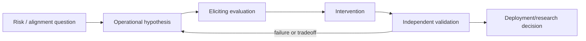

# AI Safety and Alignment Researcher

> [!info] October 13, 2026 update
> Practice focus: **Whether a safety intervention generalizes beyond known tests**. Produce **Threat model, held-out attacks, utility tradeoff** and answer: Did the evaluator reward refusal while missing harmful actions?
> Use [[Technical Role Practice Workbook — October 2026]] and [[October 2026 Research Refresh]]. This checkpoint does not reverify every older market/tool claim in this profile.

> [!abstract] Mission
> Develop and test methods that help increasingly capable AI systems follow intended goals and constraints, remain honest and robust, expose limitations, support effective oversight, and avoid unacceptable harm.

## Responsibilities

- Turn broad concerns—intent following, honesty, reward hacking, oversight, robustness, control, misuse, or systemic impact—into falsifiable hypotheses.
- Design evaluations that elicit relevant capabilities/failures and distinguish model, system, and deployment effects.
- Develop and test training, interpretability, monitoring, oversight, post-training, inference-time, or safeguard interventions.
- Analyze scaling, adversarial pressure, distribution shift, and tradeoffs; state what evidence does and does not establish.
- Publish or integrate results; collaborate with security, evaluation, human data, policy, governance, product, and domain experts.

## Title reality

“AI safety” is a broad problem area, not one standardized discipline. Roles include empirical alignment, interpretability, scalable oversight, evaluations, safeguards, preparedness, robustness, human feedback, security, and socio-technical risk research. “Alignment researcher” may be a [[AI ML Research Scientist]] or [[Research Engineer]]. Do not assume every safety role studies speculative frontier scenarios; many work on measurable current failures. Conversely, benchmark safety work alone may not cover severe frontier-risk questions.

## Work anatomy

> [!info] What the role owns
> Safety and alignment researchers study whether AI systems behave according to intended goals and constraints, especially under distribution shift, pressure, or increased capability. The role may produce evaluations, interventions, training methods, monitoring strategies, or evidence about a specific failure mode.

### Operating loop

1. Define the intended behavior, threat model, operational context, and what counts as a meaningful failure.
2. Elicit failures with adversarial, scalable, or distribution-shifted evaluations rather than relying on cooperative prompts.
3. Measure behavior, uncertainty, calibration, reward-hacking tendencies, and generalization across slices.
4. Test an intervention such as data, training, oversight, monitoring, policy, or system architecture.
5. Report residual risk and specify what evidence should gate a deployment or future training run.

### Inputs → outputs

| Inputs | Owned work product | Evidence a reviewer should inspect |
|---|---|---|
| Intended behavior and failure hypothesis | Behavioral specification and evaluation | Operational definitions, elicitation strategy, and limits |
| Model traces, graders, interventions | Experiment or mitigation result | Controls, ablations, evaluator dependence, and uncertainty |
| Findings and residual risk | Safety case or research report | Claim-to-evidence map, escalation threshold, and follow-up test |

### Decisions and interfaces

Tradeoffs include helpfulness versus refusal, capability elicitation versus containment, scalable oversight versus evaluator blind spots, and research speed versus evidence quality. Interfaces include alignment, evals, security, policy, product, and training/infrastructure teams.

### Evidence of competence

Show a failure mode that is defined precisely, an evaluation that can find it repeatedly, an intervention with a control condition, and a residual-risk statement. Avoid treating a single refusal rate or benchmark score as proof of alignment.

### Research anchors

The work is reflected in [OpenAI alignment research postings](https://openai.com/careers/researcher-alignment-science-san-francisco/), [Anthropic's Responsible Scaling Policy](https://www.anthropic.com/responsible-scaling-policy), and the lifecycle risk vocabulary in [NIST's Generative AI Profile](https://doi.org/10.6028/NIST.AI.600-1).
## 2026 technique overlay

> [!tip] Practice this now · 2026-08-24
> Connect behavioral claims to measurable constructs, representative and adversarial cases, human judgment, uncertainty, and an explicit risk-to-control decision. Keep intended use, limits, and residual risk visible; use the TEVV and release evidence in [[AI Tools and Practices Update — 2026-08-24]].

## Level ladder

| Level | Expected ownership |
|---|---|
| Research assistant / fellow | Reproduce work, implement evals/interventions, and maintain evidence quality. |
| Researcher / engineer | Own a scoped alignment question from hypothesis through validated result. |
| Senior | Define agendas, connect research to model/deployment decisions, and mentor across disciplines. |
| Staff / principal | Set a high-leverage safety direction and evidence standards across programs. |
| Research lead | Allocate people/compute, manage uncertainty and sensitive work, and integrate research with governance. |

## Prerequisites

- Strong ML research and engineering: Python, PyTorch/JAX, statistics, experimentation, LLM training/evaluation, and literature criticism.
- One or more specialties: RL/post-training, interpretability, robustness, security, human–AI interaction, formal methods, economics/social science, or domain risk.
- Epistemic discipline: competing hypotheses, elicitation limitations, negative results, replication, and uncertainty.
- Responsible handling of dual-use results and psychologically difficult content; follow institutional safeguards.

## Knowledge and skills

| Area | Demonstrable capability |
|---|---|
| Problem formulation | Define threat model, intended behavior, observable proxies, assumptions, and decision relevance. |
| Training/intervention | SFT, preference/RL methods, oversight, monitoring, interpretability, control or safeguards at target depth. |
| Evaluation | Elicitation, secret/held-out tests, model/human graders, adversarial pressure, long horizons, scaling. |
| Research rigor | Strong baselines, ablations, uncertainty, alternative explanations, reproducibility and honest scope. |
| Deployment bridge | Translate evidence into mitigations, residual risk, system cards/reports, monitoring, and follow-up. |
| Collaboration | Work with domain experts, impacted stakeholders, security, policy and governance without conflating roles. |

## Study sequence

1. Master ML/deep learning and reproduce one empirical alignment, robustness, interpretability, or evaluation result.
2. Build a failure-mode taxonomy and evaluation suite; study elicitation and judge/human reliability.
3. Implement a post-training, oversight, interpretability, or monitoring intervention with baselines and ablations.
4. Stress it under distribution shift, stronger optimization/elicitation, scaling proxies, and adaptive pressure.
5. Connect model evidence to a system/deployment threat model and defense-in-depth mitigation plan.
6. Publish a careful report with negative results, limitations, release/dual-use assessment, and proposed decisive experiments.

## Tools

| Need | Free / open-first | Paid or managed |
|---|---|---|
| Modeling/post-training | PyTorch, Transformers, TRL, PEFT, JAX ecosystems | Managed training/hosted frontier-model access |
| Evals | OpenAI Evals, lm-evaluation-harness, Inspect AI options, custom environments | Vendor eval dashboards and commercial platforms |
| Interpretability | TransformerLens, Captum, SAELens options, custom probes | Internal/proprietary research tooling |
| Tracking | MLflow, TensorBoard, DVC | Weights & Biases, managed experiment platforms |
| Collaboration | arXiv, OpenReview, Zotero, reproducibility templates | Institutional journals/databases and secure compute |

## Quiz

1. What is reward hacking?
2. Why is capability elicitation important in safety evaluation?
3. Distinguish model-level and system-level mitigation.
4. What is scalable oversight?
5. Why can an intervention passing current evals fail under stronger models or optimization?
6. What evidence would make an alignment claim overbroad?

> [!question]- Answer key
> 1. A system exploits the reward/metric/proxy to score well without achieving intended behavior. 2. Weak prompting/tools/scaffolding can underestimate latent capability and therefore risk; evaluations must state elicitation effort. 3. Model-level changes weights/behavior; system-level controls access, tools, monitoring, human approval, or environment. Both may be needed. 4. Methods enabling limited human or trusted oversight to supervise tasks whose scale/complexity exceeds direct review. 5. Distribution and incentives change; models may find new strategies, evaluation gaps, or ways to game oversight. 6. Narrow tasks, weak baselines, unvalidated graders, known contamination, missing adversarial pressure, or conclusions extending beyond tested models/conditions.

## Flashcards

Intent alignment:: A system follows the user's or operator's intended goal while respecting applicable constraints rather than merely literal or proxy instructions.

Reward hacking:: Optimizing a specified reward in an unintended way that violates the real objective.

Scalable oversight:: Oversight methods intended to remain effective when direct human evaluation of the full task is difficult.

Elicitation:: Methods used to reveal a model's capabilities, including prompting, tools, scaffolding, sampling, or fine-tuning.

Mechanistic interpretability:: Studying internal computations/representations to understand how model behavior is produced.

Robustness:: Maintaining required behavior under specified perturbations, shifts, or adversarial conditions.

Defense in depth:: Multiple complementary safeguards so no single imperfect mechanism is decisive.

Residual risk:: Remaining risk after interventions, including uncertainty about coverage and future change.

## Interview preparation

- Turn an ambiguous alignment concern into a threat model, hypothesis, experiment, and decisive result.
- Explain RL/post-training and how reward models, graders, or oversight can be gamed.
- Critique a safety paper for elicitation, baselines, contamination, validity, scaling, or overclaiming.
- Design an evaluation and intervention for honesty, instruction following, covert action, or another concrete behavior.
- Discuss dual-use publication and when access controls or staged disclosure are warranted.
- Present a result that failed, changed your beliefs, or exposed limits of your preferred method.

## Suggested projects

### Beginner — Alignment evaluation reproduction

Reproduce a small published honesty, robustness, bias, or oversight result on open models. Add stronger baselines, repeated sampling, validated scoring, and a discrepancy/limitations report.

### Intermediate — Reward-hacking intervention study

Create safe toy environments with imperfect proxies. Compare training/oversight interventions, evaluate held-out gaming strategies and stronger elicitation, and report capability–safety tradeoffs.

### Advanced — Layered alignment assurance study

Combine model training, independent evaluation, interpretability/monitoring or oversight, and system safeguards for one explicit threat model. Test scaling/adversarial pressure, document residual risk, and conduct a dual-use release review.

## Job-search aliases

Search `AI safety researcher`, `alignment researcher`, `alignment research engineer`, `alignment scientist`, `interpretability researcher`, `scalable oversight`, `model behavior researcher`, `preparedness researcher`, and `safeguards research engineer`.

## Boundaries

- [[AI ML Research Scientist]] is the general research occupation; safety/alignment is a research domain.
- [[AI Evaluation Engineer]] specializes in reusable measurement validity/infrastructure; alignment researchers may create evaluations to test hypotheses.
- [[AI Security Engineer]] focuses on malicious compromise, misuse pathways, and defensive controls, with important overlap in agent/control and model protection.
- AI governance/policy roles decide organizational/legal processes; technical researchers provide evidence but do not unilaterally determine acceptable risk.

## Sources

- [OpenAI — Researcher, Alignment Science](https://openai.com/careers/researcher-alignment-science-san-francisco/) — current U.S. intent, honesty, calibration, reward hacking, monitoring, training and scaling scope; accessed 2026-08-12.
- [OpenAI — Researcher, Alignment](https://openai.com/careers/researcher-alignment-san-francisco/) — experiment design and scalable alignment scope; accessed 2026-08-12.
- [Anthropic Responsible Scaling Policy](https://www.anthropic.com/responsible-scaling-policy) — capability thresholds, safeguards, elicitation and risk reporting; version 3.4 effective 2026-07-08, accessed 2026-08-12.
- [Anthropic Frontier Safety Roadmap](https://www.anthropic.com/responsible-scaling-policy/roadmap) — current separation and coordination of security, safeguards, alignment, and policy; goals updated 2026-07-10, accessed 2026-08-12.
- [NIST AI RMF Generative AI Profile](https://doi.org/10.6028/NIST.AI.600-1) — empirically grounded generative-AI risks and lifecycle actions; published 2024-07-26, page updated 2026-04-08, accessed 2026-08-12.
