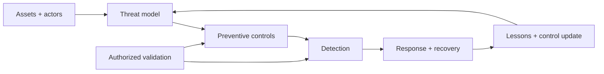

# AI Security Engineer

> [!info] October 13, 2026 update
> Practice focus: **Whether identity, tool, memory, and egress controls hold**. Produce **Threat-to-control-to-test matrix** and answer: Which enforcement point exists outside the model?
> Use [[Technical Role Practice Workbook — October 2026]] and [[October 2026 Research Refresh]]. This checkpoint does not reverify every older market/tool claim in this profile.

> [!abstract] Mission
> Prevent, detect, contain, and recover from attacks and failures across AI data, models, training, retrieval, agents, applications, infrastructure, and supply chains while enabling legitimate use.

## Responsibilities

- Threat-model the full system and lifecycle: actors, assets, trust boundaries, misuse cases, attack paths, likelihood, impact, and assumptions.
- Design controls for identity, access, data/model artifacts, provenance, isolation, network, tools, supply chain, monitoring, and incident response.
- Secure training and inference infrastructure, model gateways, RAG, plugins/tools, agents, and output consumers.
- Test defenses and partner with [[AI Red Teamer]]; prioritize findings and verify durable remediation.
- Map controls/evidence to organizational risk processes and current guidance such as NIST AI RMF, NIST SP 800-218A, and applicable secure-development practices.

## Title reality

AI Security Engineer may mean application/product security for AI features, adversarial ML, model-weight protection, agent sandboxing, cloud security for training, detection/response, or security research. Security of AI (protecting AI systems) differs from AI for security (using models to assist defenders), though roles can combine them. Current “Agent Security” roles strongly emphasize identity, isolation, networks, telemetry, and secure services—not only prompt attacks.

## Work anatomy

> [!info] What the role owns
> AI security engineers apply security engineering to model, data, tool, identity, infrastructure, and supply-chain boundaries. They design preventive and detective controls and make the system resilient when model output, retrieved content, users, tools, or dependencies are hostile.

### Operating loop

1. Inventory assets, identities, model/data flows, tools, dependencies, and trust boundaries.
2. Threat-model abuse cases such as prompt injection, data poisoning, sensitive-data leakage, excessive agency, model theft, and supply-chain compromise.
3. Choose controls: isolation, least privilege, validation, secrets management, allowlists, provenance, monitoring, and incident response.
4. Test controls with red-team cases and adversarial regression suites.
5. Operate telemetry, investigate incidents, patch or contain, and document residual risk.

### Inputs → outputs

| Inputs | Owned work product | Evidence a reviewer should inspect |
|---|---|---|
| Architecture and asset inventory | AI-specific threat model | Trust boundaries, abuse paths, assumptions, and risk ranking |
| Threats and control requirements | Secure design and control set | Authorization outside the model, isolation, validation, and logging |
| Events and findings | Detection/response playbook | Alert quality, containment steps, evidence preservation, and recovery |

### Decisions and interfaces

The recurring tradeoffs are user friction versus control strength, centralized policy versus product autonomy, isolation versus performance, and visibility versus privacy. Interfaces include AI/application engineers, platform/cloud, privacy/legal, red teams, incident response, and governance.

### Evidence of competence

A strong project diagrams data and tool boundaries, demonstrates a real control in a sandbox, tests bypass attempts, records telemetry, and explains blast radius and recovery. A threat list without a control owner or retest plan is incomplete.

### Research anchors

Use [NIST AI 100-2](https://csrc.nist.gov/news/2025/nist-ai-100-2-adversarial-machine-learning-taxonom), [NIST SP 800-218A](https://doi.org/10.6028/NIST.SP.800-218A), [CISA/NCSC secure AI development guidance](https://www.cisa.gov/news-events/alerts/2023/11/26/cisa-and-uk-ncsc-unveil-joint-guidelines-secure-ai-system-development), and current [OpenAI agent-security scope](https://openai.com/careers/security-engineer-agent-security-san-francisco/). Pair with [[Case - Agent Permissions]] for write-tool controls.
## 2026 technique overlay

> [!tip] Practice this now · 2026-08-24
> Treat models, retrieved content, tools, tokens, logs, and model artifacts as security boundaries. Enforce least privilege, OAuth metadata/audience checks, short-lived credentials, secret isolation, allowlists, redaction, and revocation outside the model; review [[AI Tools and Practices Update — 2026-08-24]].

> [!info] Edge/web platform deep dive
> Threat-model Cloudflare AI Gateway guardrails/DLP/rate-spend limits, Agents/MCP/Browser/Sandbox, and Vercel AI Gateway, Connect, OIDC, Sandbox, and project environments. Test tenant isolation, generated-code escape, fallback policy, credential scope, and trace redaction in [[Cloudflare and Vercel AI]].

> Treat [[MCP Deep Dive — 2026-08-24]] as the protocol security lab: review tool poisoning, indirect injection, OAuth issuer/audience checks, token passthrough, SSRF/DNS rebinding, path isolation, task replay, registry provenance, and conformance. Pair it with [[OWASP and AI Security — 2026]] as the current security study layer: LLM Top 10, Agentic Top 10, GenAI Data Security, secure MCP, AIBOM, COMPASS, and incident-response evidence. Work [[Case - OWASP Agentic Security Review]] as a ship/stop assessment, then use [[AI Expansion Atlas — 2026-08-24]] for privacy-preserving AI, provenance, on-device boundaries, AI SRE, and supply-chain practice.

> [!info] Cloud delivery threat model
> Use [[AI DevOps and Cloud Engineering — 2026-08-24]] to test the control plane around the model: OIDC/WIF trust claims, fork/issue workflow injection, IaC and image provenance, Kubernetes admission, tool/MCP scopes, telemetry redaction, budget abuse, and pause/rollback/key-rotation evidence.

## Level ladder

| Level | Expected ownership |
|---|---|
| Junior | Implement/test controls, analyze alerts, or remediate bounded findings with review. |
| Security engineer | Own threat model and controls for one AI product/service through operation. |
| Senior | Design cross-layer defenses, lead incidents, and influence architecture and release. |
| Staff / principal | Set security architecture and standards across AI platforms and model lifecycles. |
| Lead | Own strategy, risk prioritization, assurance partnerships, response readiness, and security culture. |

## Prerequisites

- Core security first: networks, operating systems, web/API/app security, cloud/IAM, containers/Kubernetes, cryptography concepts, secure SDLC, logging and incident response.
- Strong software/systems engineering in Python and optionally Go/Rust/C/C++.
- ML/LLM lifecycle: data, training, artifacts, serving, retrieval, tool use, agents, evaluation, and failure modes.
- Risk communication and authorized testing discipline; know where legal/privacy/compliance specialists must decide.

## Knowledge and skills

| Area | Demonstrable capability |
|---|---|
| Threat modeling | Define assets, actors, trust boundaries, abuse cases, attack trees, residual risk, and evidence. |
| AI-specific threats | Evasion, poisoning, privacy, extraction, model/data supply chain, prompt injection, tool abuse, excessive agency. |
| Architecture | Identity-based controls, least privilege, isolation, egress, secrets, provenance/signing, secure gateways and sandboxes. |
| Detection/response | High-signal telemetry, behavioral detections, artifact integrity, containment, forensics, recovery and learning. |
| Secure development | Security requirements, design review, code/dependency/model checks, evaluation gates, patching and retirement. |
| Validation | Partner on penetration/adversarial tests, measure control effectiveness, reproduce and verify remediation. |

## Study sequence

1. Build a secure conventional API: authn/authz, secrets, input/output handling, dependency controls, telemetry, and incident runbook.
2. Learn ML lifecycle and reproduce safe adversarial-ML examples in a local toy environment.
3. Threat-model an LLM/RAG app across data, prompt, retrieval, model, output, and infrastructure; implement layered controls.
4. Add a tool-using agent with sandbox, identity, scoped credentials, egress policy, approval, audit, and injection tests.
5. Protect model/data artifacts with lineage, access, integrity verification, environment isolation, and recovery.
6. Run an authorized tabletop plus technical exercise; measure time to detect/contain/recover and verify fixes.

## Tools

| Need | Free / open-first | Paid or managed |
|---|---|---|
| Threat modeling | OWASP Threat Dragon, diagrams, attack trees, NIST/MITRE references | Commercial threat-modeling/GRC tools |
| App/cloud security | Semgrep, CodeQL availability subject to terms, Trivy, Falco, OPA, cloud-native tools | Snyk, Wiz, Prisma and enterprise CNAPP/AppSec suites |
| AI testing | Garak, PyRIT, promptfoo, counterfit-like research tools where maintained | Commercial AI security testing/posture platforms |
| Isolation | containers, seccomp, gVisor, Firecracker-based systems | Managed sandboxes and confidential-compute offerings |
| Detection | OpenTelemetry, Sigma, osquery, Elastic/OpenSearch | Managed SIEM/XDR/SOAR platforms |

## Quiz

1. Distinguish prompt injection from model poisoning.
2. Why must agent authorization live outside the model?
3. What does defense in depth mean here?
4. Why are model weights and checkpoints security-critical artifacts?
5. What is a confused-deputy risk in an AI agent?
6. Why is blocking known jailbreak strings inadequate?

> [!question]- Answer key
> 1. Injection manipulates runtime instructions/context; poisoning corrupts training/fine-tuning/data or learned behavior. 2. The model is probabilistic and manipulable; trusted code must bind authenticated identity to explicit policy and least privilege. 3. Independent preventive, detective, limiting, and recovery controls reduce reliance on any one fallible safeguard. 4. They contain valuable IP/capabilities, can be maliciously replaced, may leak training information, and determine deployed behavior. 5. A model/tool with legitimate authority is tricked by untrusted content into using it for an unauthorized party/purpose. 6. Attacks vary semantically, encode/obfuscate, use indirect content, and exploit surrounding tools/data; controls need structural permissions and continuous testing.

## Flashcards

Adversarial ML:: Study/practice of attacks and mitigations targeting ML data, models, algorithms, or lifecycle systems.

Evasion attack:: Adversarial manipulation at inference intended to cause incorrect or unsafe behavior.

Poisoning:: Malicious influence on training, fine-tuning, feedback, or knowledge data to alter behavior.

Model extraction:: Unauthorized replication or recovery of model behavior/parameters through access or compromise.

Prompt injection:: Untrusted content influencing an instruction-following model contrary to application intent.

Confused deputy:: A privileged component is induced to misuse its authority on another party's behalf.

Least privilege:: Grant only necessary permissions, scope, duration, and data access for a task.

Residual risk:: Risk remaining after controls, stated with assumptions and accountable acceptance.

## Interview preparation

- Threat-model a multi-tenant RAG/agent product and identify assets, boundaries, paths, controls, telemetry, and residual risk.
- Design sandbox, identity, network egress, secrets, and approval for code/tool execution.
- Explain NIST adversarial-ML categories and classic application/cloud risks in one lifecycle.
- Prioritize findings by exploitability, impact, reachability, and control gaps; propose verifiable fixes.
- Design detection and response for model artifact theft or poisoned data.
- Describe a security tradeoff and how you measured control effectiveness and usability.

## Suggested projects

### Beginner — Secure LLM application threat model

Build a local toy app. Document assets/data flows, test untrusted input/output, enforce schemas and authorization, add secrets hygiene, redacted traces, dependency scan, and remediation evidence.

### Intermediate — Agent security reference implementation

Create a sandboxed mock operations agent with scoped identity, deny-by-default egress, read/write separation, approval, idempotency, audit, malicious document tests, and incident runbook.

### Advanced — AI lifecycle security lab

In an isolated authorized environment, protect dataset/model artifacts, registry, training and serving; simulate benign poisoning/integrity and credential events; add detections, containment, recovery, control mapping, and measured validation.

## Job-search aliases

Search `AI security engineer`, `ML security engineer`, `agent security engineer`, `AI product security engineer`, `adversarial ML engineer`, `model security engineer`, and `AI infrastructure security`.

## Boundaries

- [[AI Red Teamer]] finds exploitable failures under authorized scope; security engineering designs and operates defenses.
- [[AI Safety and Alignment Researcher]] studies intended model behavior and systemic/model risks beyond malicious compromise.
- [[Agentic AI Engineer]] owns workflow functionality but shares responsibility for secure execution.
- Traditional AppSec/cloud/security engineering remains foundational; AI specialization adds model/data/tool threats rather than replacing it.

## Sources

- [NIST AI 100-2 — Adversarial ML taxonomy](https://csrc.nist.gov/news/2025/nist-ai-100-2-adversarial-machine-learning-taxonom) — predictive/generative evasion, poisoning, privacy, and misuse categories; finalized 2025-03-24, accessed 2026-08-12.
- [NIST SP 800-218A](https://doi.org/10.6028/NIST.SP.800-218A) — secure development practices for generative AI/foundation models; published 2024-07-26, accessed 2026-08-12.
- [CISA/NCSC — Guidelines for Secure AI System Development](https://www.cisa.gov/news-events/alerts/2023/11/26/cisa-and-uk-ncsc-unveil-joint-guidelines-secure-ai-system-development) — secure design, development, deployment, and operation; released 2023-11-26, accessed 2026-08-12.
- [OpenAI — Security Engineer, Agent Security](https://openai.com/careers/security-engineer-agent-security-san-francisco/) — current U.S. identity, isolation, network, telemetry, and cloud-security scope; accessed 2026-08-12.
- [OWASP GenAI Security Project](https://owasp.org/www-project-top-10-for-large-language-model-applications/) — current LLM/application threat categories; accessed 2026-08-12.
