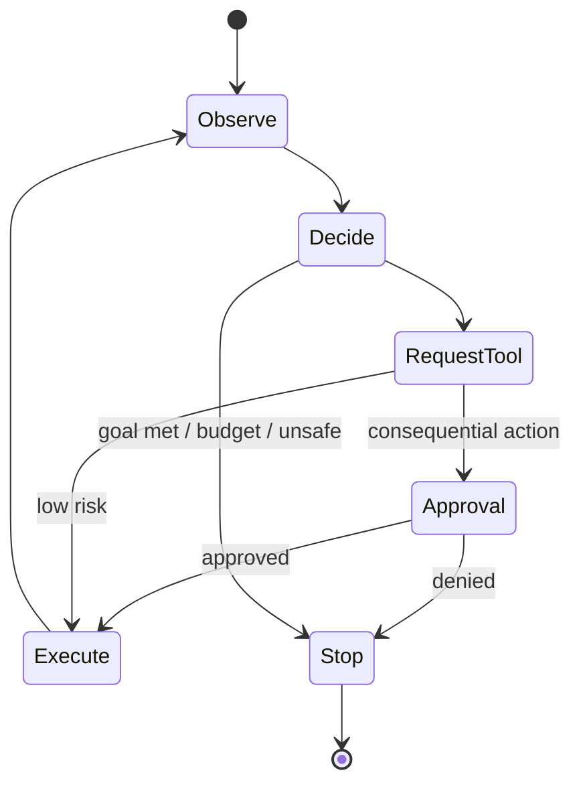

# Agentic AI Engineer

> [!info] October 13, 2026 update
> Practice focus: **What the agent may remember and execute**. Produce **State machine, action policy, replay tests** and answer: What survives a crash or malicious memory write?
> Use [[Technical Role Practice Workbook — October 2026]] and [[October 2026 Research Refresh]]. This checkpoint does not reverify every older market/tool claim in this profile.

> [!abstract] Mission
> Build AI systems that can plan, use tools, manage state, and complete multi-step work while remaining observable, permission-bounded, recoverable, and measurably useful.

## Responsibilities

- Decide whether a workflow needs agentic decisions or a deterministic state machine.
- Design the model loop, tools, schemas, state/memory, routing or handoffs, stopping conditions, and human approvals.
- Isolate execution and enforce authentication, authorization, budgets, rate limits, and idempotency outside the model.
- Build task environments, trajectory graders, traces, replay, fault injection, and long-horizon evals.
- Operate workflows under partial failure, changing tools, stale state, prompt injection, and model/vendor changes.

## Title reality

“Agentic AI Engineer” is emerging and highly ambiguous. It can mean an [[AI Engineer]] using an agent SDK, a research engineer training tool-use models, a workflow/backend engineer, or an agent-security specialist. A chat interface with one function call is not necessarily an agent system. Look for ownership of long-horizon behavior, tools, state, evaluation, and permissions.

## Work anatomy

> [!info] What the role owns
> Agentic AI engineers build systems that choose and execute multi-step actions across tools, state, and sometimes other agents. The hard part is controlled delegation: keeping the system useful while making permissions, stopping conditions, recovery, and evidence explicit.

### Operating loop

1. Define the task boundary, authorized actions, user confirmation points, time/cost budget, and unacceptable outcomes.
2. Design the state model, tool contracts, handoffs, memory, and deterministic checks before adding autonomy.
3. Implement the run loop with timeouts, idempotency, retries, tracing, and human approval for consequential actions.
4. Evaluate both final outcomes and trajectories: tool choice, arguments, unnecessary steps, recovery, and policy adherence.
5. Operate with replayable traces, incident taxonomy, kill switches, and regression cases.

### Inputs → outputs

| Inputs | Owned work product | Evidence a reviewer should inspect |
|---|---|---|
| User goal, policy, tools, state | Agent graph or run configuration | Tool schemas, permissions, stop conditions, and state transitions |
| Runs and trajectories | Agent evaluation suite | Task/step success, unsafe action tests, cost, and recovery cases |
| Failures and approvals | Operational control loop | Replayable traces, escalation path, rollback, and human authority |

### Decisions and interfaces

Tradeoffs include autonomy versus control, planning versus deterministic workflows, one agent versus multiple specialists, memory versus privacy, and richer tools versus larger attack surface. Interfaces include product, platform, security, evals, data/knowledge, and human operations.

### Evidence of competence

A strong project is approval-bound, uses least privilege, has a read-only mode, captures trajectories, and shows what happens when a tool fails or the model is uncertain. A multi-agent demo without a control model is not evidence of production readiness.

### Research anchors

The operating model follows [OpenAI Agents SDK](https://openai.github.io/openai-agents-python/), [OpenAI's running-agent guidance](https://openai.github.io/openai-agents-python/running_agents/), [NIST COSAiS use cases](https://csrc.nist.gov/projects/cosais/use-cases), and current [frontier agent evaluation work](https://openai.com/careers/research-engineer-frontier-evals-and-environments-san-francisco/). Rehearse write-tool controls in [[Case - Agent Permissions]].
## 2026 technique overlay

> [!tip] Practice this now · 2026-08-24
> Draw an explicit state machine, constrain handoffs, make side effects idempotent, cap retries/time/permissions, require approvals for irreversible actions, and replay failures with provider-neutral tests. Add trace IDs and tool-level evidence using [[AI Tools and Practices Update — 2026-08-24]].

> [!info] Microsoft delivery deep dive
> Study Foundry hosted agents and versioned Toolboxes in [[Microsoft Azure DevOps and Foundry]]. Use the Azure DevOps MCP Server in read-only mode first; never let the model approve its own PR, change branch policy, or deploy production. Rehearse the trust boundary in [[Case - Azure DevOps Foundry Release Gate]].

> [!info] Edge/web platform deep dive
> Compare Cloudflare Agents + Durable Objects + Workflows with Vercel AI SDK 7 + WorkflowAgent + Sandbox in [[Cloudflare and Vercel AI]]. Rehearse approval replay, state recovery, MCP/Connect scopes, generated-code isolation, provider fallback, and tool-level traces in [[Case - Edge AI Platform Choice]].

> Study [[MCP Deep Dive — 2026-08-24]] for protocol-era migration, primitives, MRTR, Tasks, tool contracts, OAuth, conformance, and server operations. Then study the current OWASP LLM/Agentic boundary in [[OWASP and AI Security — 2026]]. Map goal hijack, tool misuse, identity/privilege abuse, supply chain, code execution, memory poisoning, inter-agent communication, cascading failure, human trust, and rogue-agent behavior to tests in [[Case - OWASP Agentic Security Review]]. Use [[AI Expansion Atlas — 2026-08-24]] for A2A, agent identity, AI SRE, realtime interaction, and coding-agent practice.

> [!info] From agent demo to production service
> Use [[AI DevOps and Cloud Engineering — 2026-08-24]] to rehearse an agent release: typed tools and approvals, immutable prompt/model/tool bundles, CI evaluation, OIDC/WIF, sandbox and runner isolation, OpenTelemetry traces, budget/circuit-breaker controls, canary, and recovery.

## Level ladder

| Level | Expected ownership |
|---|---|
| Junior | Add a typed tool, trace, or bounded workflow step with tests. |
| Agent engineer | Own one multi-step workflow, task eval, permission model, and operational feedback loop. |
| Senior | Design durable orchestration, state, recovery, and safety across tools and models. |
| Staff / principal | Set agent platform patterns, evaluation standards, and trust boundaries across products. |
| Lead | Own the portfolio of autonomous use cases, risk appetite, platform investment, and incident readiness. |

## Prerequisites

- Strong backend/distributed-systems engineering: APIs, queues, state, concurrency, retries, idempotency, transactions, and observability.
- Foundation-model behavior, structured tool calls, context/state management, and evaluation.
- Application security: untrusted input/output, OAuth/IAM, least privilege, sandboxing, audit, secrets, and data boundaries.
- Workflow and product judgment: autonomy must earn its complexity through measured value.

## Knowledge and skills

| Area | Demonstrable capability |
|---|---|
| Orchestration | Choose a state machine, manager, agents-as-tools, or handoffs; define termination and budgets. |
| Tools | Design narrow schemas, validate inputs/outputs, make safe operations idempotent, surface typed failures. |
| State/memory | Separate authoritative application state from model context; version and expire memory deliberately. |
| Evaluation | Score outcomes and trajectories; test recovery, side effects, policy, efficiency, and nondeterminism. |
| Security | Enforce permissions outside the model; isolate code/browser work; resist indirect prompt injection. |
| Operations | Trace decisions/tools, replay incidents, compensate partial actions, cap loops, and degrade safely. |

## Study sequence

1. Build a deterministic workflow with explicit states, typed errors, retries, and audit logs.
2. Replace one decision with a model using structured output and a tight evaluation set.
3. Add a read-only tool, then a write tool with least privilege, preview, approval, idempotency key, and rollback/compensation.
4. Add persistence and resumability; distinguish conversational history, task state, and long-term user memory.
5. Build adversarial task environments and trajectory graders; measure success, unsafe action rate, steps, latency, and cost.
6. Test model/tool changes, concurrency, timeouts, corrupted results, injection, and human denial before production.

## Tools

| Need | Free / open-first | Paid or managed |
|---|---|---|
| Agent runtime | OpenAI Agents SDK, LangGraph, PydanticAI, AutoGen | Hosted agent builders and managed runtimes |
| Tools/protocol | JSON Schema/OpenAPI, MCP SDKs, FastAPI | Commercial connectors and workflow APIs |
| Durable workflow | Temporal community edition, Celery, queues/databases | Temporal Cloud, cloud workflow/orchestration services |
| Sandboxing | containers, Linux isolation, gVisor/Firecracker-based projects | Managed code/browser sandboxes |
| Evaluation/tracing | OpenTelemetry, MLflow, promptfoo, custom replay | LangSmith, Braintrust, vendor trace/eval suites |

## Quiz

1. When is a deterministic workflow better than an agent loop?
2. Why must authoritative state live outside model context?
3. What makes a tool operation idempotent?
4. What should a trajectory evaluation measure beyond final success?
5. How does indirect prompt injection reach an agent?
6. What is a compensating action?

> [!question]- Answer key
> 1. When steps and transitions are knowable and predictability, auditability, speed, or safety outweigh adaptive planning. 2. Context can be truncated, manipulated, stale, or generated; databases and workflow engines provide validation, concurrency, and durability. 3. Repeating the request with the same key does not create additional side effects and returns/recovers the original result. 4. Unsafe attempts, unnecessary steps, tool choice, policy compliance, recovery, side effects, latency, cost, and human intervention. 5. Untrusted documents, webpages, emails, or tool outputs contain instructions that the model treats as authoritative. 6. A new operation that semantically reverses or mitigates an already committed distributed side effect when atomic rollback is unavailable.

## Flashcards

Agent loop:: Repeated model observation, decision, tool/action, and updated observation until a stop condition.

Handoff:: Transfer of control and context from one agent to another specialist.

Agent-as-tool:: A manager invokes a specialist as a bounded tool and retains overall control.

Authoritative state:: Validated application data that determines reality; model context is not authoritative storage.

Idempotency key:: A request identifier used to prevent duplicated side effects across retries.

Indirect prompt injection:: Malicious instructions embedded in content an agent retrieves or observes rather than in the user's direct message.

Trajectory eval:: Assessment of the intermediate decisions, tool calls, state changes, and recovery path—not only the final output.

Autonomy budget:: Explicit limits on steps, time, tokens/cost, tools, privileges, or side effects allowed for a run.

## Interview preparation

- Design an agent that updates a consequential system; show identity, permission, preview, approval, idempotency, audit, and compensation.
- Explain manager versus handoff versus deterministic routing and choose for a scenario.
- Debug looping, state loss, duplicate actions, stale observations, or tool-call cascades.
- Create long-horizon evals with reproducible environments and anti-cheating controls.
- Threat-model direct/indirect injection, confused deputy, data exfiltration, and excessive agency.
- Present evidence that agentic complexity outperformed a simpler workflow.

## Suggested projects

### Beginner — Read-only research agent

Build an agent with two narrow read-only tools, typed outputs, strict step budget, full traces, and 50 task cases. Compare it with a deterministic baseline.

### Intermediate — Approval-bound operations agent

Create a ticket or calendar workflow using mock systems. Add scopes, preview, human approval, idempotency, resumability, timeouts, compensation, injection tests, and trajectory metrics.

### Advanced — Durable multi-agent benchmark

Build a sandboxed multi-agent workflow for a complex task. Version environments, test handoffs versus manager orchestration, simulate tool/model failure, validate graders, and publish success–risk–cost frontiers.

## Job-search aliases

Search `agentic AI engineer`, `AI agent engineer`, `agent platform engineer`, `autonomous systems AI engineer`, `software engineer agents`, `tool-use research engineer`, and `computer-use engineer`.

## Boundaries

- [[AI Engineer]] is the broader application role; many AI features do not need an agent loop.
- [[LLM Engineer]] may adapt or serve models without owning workflow autonomy.
- [[AI Platform Engineer]] may provide shared agent runtime, tool registry, secrets, and observability.
- [[AI Security Engineer]] defines and implements trust boundaries; agent engineers must still own secure-by-design execution.

## Sources

- [OpenAI Agents SDK](https://openai.github.io/openai-agents-python/) — agent loop, tools, handoffs, guardrails, sessions, human involvement, and tracing; accessed 2026-08-12.
- [OpenAI Agents SDK — Agents](https://openai.github.io/openai-agents-python/agents/) — manager and handoff patterns; accessed 2026-08-12.
- [OpenAI Agents SDK — Running agents](https://openai.github.io/openai-agents-python/running_agents/) — concurrency, approvals, tracing, and run configuration; accessed 2026-08-12.
- [NIST COSAiS use cases](https://csrc.nist.gov/projects/cosais/use-cases) — single- and multi-agent security-control use cases; updated 2026-01-08, accessed 2026-08-12.
- [OpenAI — Research Engineer, Frontier Evals & Environments](https://openai.com/careers/research-engineer-frontier-evals-and-environments-san-francisco/) — current agent environment, grader, and long-horizon scope; accessed 2026-08-12.
