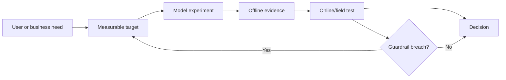

# Applied Scientist

> [!info] October 13, 2026 update
> Practice focus: **Which hypothesis explains the measured gain**. Produce **Controlled ablation and error analysis** and answer: What alternative explanation remains?
> Use [[Technical Role Practice Workbook — October 2026]] and [[October 2026 Research Refresh]]. This checkpoint does not reverify every older market/tool claim in this profile.

> [!abstract] Mission
> Use scientific modeling and experimentation to improve a consequential real-world outcome, balancing novelty with product constraints, data reality, and measurable impact.

## Responsibilities

- Translate a product or operational problem into estimands, objectives, labels, evaluation sets, and decision criteria.
- Develop or adapt models; run offline experiments, simulations, online tests, or causal analyses.
- Analyze errors by user, task, and risk-relevant slice; recommend whether and how to ship.
- Work with [[ML Engineer]], product, design, domain, and policy partners to turn evidence into behavior.
- Communicate tradeoffs and monitor whether offline gains survive real use.

## Title reality

Applied Scientist is especially common in large technology companies and varies by organization. It can resemble product-focused [[AI ML Research Scientist]], highly quantitative [[Data Scientist - AI ML]], or senior [[ML Engineer]]. Some postings require a PhD or a master's plus experience; others prioritize an equivalent record. Look for expected outputs: papers and novel algorithms, production models, causal decisions, or all three.

## Work anatomy

> [!info] What the role owns
> Applied scientists connect modeling and experimentation to a real product, operational, or business decision. The role is scientific in method but accountable for whether an intervention improves the target outcome under the actual constraints of the organization.

### Operating loop

1. Frame the decision, user, intervention, outcome, baseline, and practical constraints.
2. Build a data and measurement plan that separates correlation, prediction, and causal claims.
3. Run controlled experiments or observational analyses with uncertainty and meaningful slices.
4. Translate model or experiment output into a decision recommendation, not just a score.
5. Validate launch impact and monitor whether the result transfers outside the development sample.

### Inputs → outputs

| Inputs | Owned work product | Evidence a reviewer should inspect |
|---|---|---|
| Product question and decision context | Metric tree and experiment design | Baseline, estimand, assumptions, power or uncertainty plan |
| Data, models, interventions | Analysis/model and result | Leakage checks, slices, robustness, and comparison to baseline |
| Findings and constraints | Decision memo or launch recommendation | Expected impact, limits, risks, and monitoring rule |

### Decisions and interfaces

The important tradeoffs are predictive accuracy versus interpretability, offline lift versus online impact, model complexity versus operational cost, and short-term optimization versus durable user value. Interfaces include product, engineering, data, research, design, domain, and governance teams.

### Evidence of competence

Show a real decision, a pre-specified baseline, uncertainty or causal reasoning, and a recommendation that includes what would change your mind. A model without a decision owner or adoption path is analysis, not applied science.

### Research anchors

This pattern is grounded in [BLS Data Scientist duties](https://www.bls.gov/ooh/math/data-scientists.htm), current [Amazon Applied Scientist scope](https://www.amazon.jobs/en/jobs/2954617/applied-scientist-agi), [MLflow model evaluation](https://mlflow.org/docs/latest/ml/evaluation), and [NIST AI RMF measurement guidance](https://airc.nist.gov/airmf-resources/airmf/5-sec-core/).
## 2026 technique overlay

> [!tip] Practice this now · 2026-08-24
> Start from the product decision and baseline, design an experiment with slices and uncertainty, and report quality, safety, latency, cost, and user-impact tradeoffs together. Keep the smallest reproducible artifact and decision memo described in [[AI Tools and Practices Update — 2026-08-24]].

## Level ladder

| Level | Expected ownership |
|---|---|
| Associate / junior | Execute scoped analyses and modeling with review; maintain experiment quality. |
| Applied scientist | Own a product question, model comparison, and recommendation end to end. |
| Senior | Frame ambiguous opportunities, design robust experiments, and influence roadmap decisions. |
| Principal | Set scientific strategy across product areas and establish measurement standards. |
| Science lead / manager | Build the team, portfolio, review system, and partnership model for applied science. |

## Prerequisites

- Python, SQL, statistics, probability, experimental design, and modern ML.
- Ability to build credible offline tests and understand online experiments or causal inference.
- Product judgment: choose a metric users actually experience and identify unacceptable harms.
- Domain expertise may be decisive in ads, recommendations, healthcare, finance, logistics, or security.
- Advanced degrees are common in postings but not universal; verify each employer's baseline qualifications.

## Knowledge and skills

| Area | Be able to do |
|---|---|
| Problem formulation | Connect user need, decision, target, loss, metric, and guardrails without proxy confusion. |
| Modeling | Select strong baselines, adapt modern models, tune fairly, and perform structured error analysis. |
| Experimentation | Design A/B tests or quasi-experiments; reason about power, interference, novelty, and multiple metrics. |
| Product measurement | Reconcile offline and online metrics; define launch, rollback, and monitoring criteria. |
| Communication | Write decision memos for technical and nontechnical stakeholders; state uncertainty and alternatives. |
| Responsible deployment | Evaluate harmful slices, privacy, misuse, and operational failure before recommending launch. |

## Study sequence

1. Master statistics, SQL, exploratory analysis, predictive modeling, and calibration.
2. Learn controlled experiments, power, sequential decisions, and core causal-inference assumptions.
3. Implement deep-learning and foundation-model adaptation with rigorous baselines.
4. Turn one vague product goal into a metric tree with a primary outcome, diagnostics, and guardrails.
5. Run an offline-to-online simulation: show when ranking/model improvements can worsen the product metric.
6. Produce a launch memo, monitoring plan, and post-launch analysis for a portfolio system.

## Tools

| Need | Free / open-first | Paid or managed |
|---|---|---|
| Analysis | Python, pandas/Polars, SciPy, statsmodels, R, DuckDB | Databricks, Snowflake, managed notebooks |
| Modeling | scikit-learn, XGBoost, PyTorch, Transformers | SageMaker, Vertex AI, Azure ML |
| Experiments | MLflow, Evidently, custom notebooks | Weights & Biases, commercial experimentation platforms |
| Product analytics | PostHog open source, Superset, Metabase | Amplitude, Mixpanel, Looker |
| Serving | FastAPI, Docker, Kubernetes | Managed model endpoints and feature stores |

## Quiz

1. Why can optimizing an offline metric reduce product value?
2. What is a guardrail metric?
3. When is an A/B test unable to identify the desired effect?
4. What is selection bias in model training data?
5. Why should launch criteria be defined before inspecting final results?
6. How does calibration influence a downstream decision threshold?

> [!question]- Answer key
> 1. The metric may be a weak proxy, omit latency or user adaptation, reward harmful behavior, or differ from the production distribution. 2. A metric that must remain within an acceptable range while optimizing the primary outcome. 3. Examples include interference between units, poor randomization/compliance, inadequate power, changing treatment, or an outcome outside the observation window. 4. Included examples differ systematically from the deployment population in a way related to features or outcomes. 5. It reduces cherry-picking and clarifies the decision rule, uncertainty, and risk tolerance. 6. If probabilities are calibrated, a threshold can reflect expected cost/benefit; miscalibration makes the nominal threshold misleading.

## Flashcards

North-star metric:: A primary measure intended to represent durable product or user value; it still needs diagnostics and guardrails.

Guardrail metric:: A measure constrained to prevent improvement of one objective at unacceptable cost elsewhere.

Proxy metric:: An observable measure used in place of a harder-to-measure construct; its validity must be tested.

Interference:: One experimental unit's treatment affects another unit's outcome, violating a common causal assumption.

Offline–online gap:: A difference between benchmark improvement and field impact caused by distribution, interaction, system, or metric effects.

Minimum detectable effect:: The smallest effect an experiment is designed with adequate power to detect.

Calibration:: Correspondence between predicted probabilities and empirical outcome frequencies.

Decision memo:: A concise artifact connecting evidence, uncertainty, alternatives, risks, and a recommended action.

## Interview preparation

- Frame an ambiguous product request as a measurable scientific problem.
- Derive and choose metrics for ranking, classification, generation, or forecasting; discuss failure incentives.
- Design an experiment under low traffic, network effects, delayed outcomes, or safety constraints.
- Diagnose why an offline gain failed online.
- Whiteboard a model and data pipeline, including leakage defenses and monitoring.
- Present a decision you influenced, including the counterfactual, uncertainty, and stakeholder tradeoff.

Practice one product case, one statistical case, one modeling deep dive, SQL/Python, and a research presentation. Avoid claiming causality from a predictive association.

## Suggested projects

### Beginner — Metric tree and baseline

Choose a public product dataset. Define the decision, primary metric, guardrails, baseline, slices, and a reproducible analysis; explain why accuracy alone is inadequate.

### Intermediate — Ranking or recommendation experiment

Build a candidate/ranking system with offline counterfactual limitations, calibration or ranking metrics, latency measurement, and a simulated A/B-test plan with power analysis.

### Advanced — Generative-AI launch dossier

Develop a domain assistant or model feature. Create task-specific evals, human-review protocol, safety/privacy tests, cost/latency analysis, launch thresholds, monitoring, rollback, and an executive decision memo.

## Job-search aliases

Search `applied scientist`, `applied AI scientist`, `applied machine learning scientist`, `product research scientist`, `decision scientist machine learning`, plus domains such as `recommendation`, `forecasting`, `generative AI`, or `computer vision`.

## Boundaries

- [[AI ML Research Scientist]] prioritizes generalizable novelty; applied science begins with a real decision or product problem.
- [[Data Scientist - AI ML]] may focus more on analysis, experimentation, and stakeholder decisions and less on novel model development.
- [[ML Engineer]] owns robust implementation and operation more consistently; applied scientists own scientific formulation and evidence.
- [[AI Evaluation Engineer]] builds reusable measurement systems rather than owning one product outcome.

## Sources

- [Amazon — Applied Scientist, AGI](https://www.amazon.jobs/en/jobs/2954617/applied-scientist-agi) — current U.S. example spanning algorithms, experiments, cross-functional work, and applied impact; accessed 2026-08-12.
- [Amazon Applied AI team](https://amazon.jobs/content/en/teams/e-commerce-foundation/applied-ai) — applied science in product context; accessed 2026-08-12.
- [BLS — Data Scientists](https://www.bls.gov/ooh/math/data-scientists.htm) — U.S. analytical, modeling, communication, and education context; accessed 2026-08-12.
- [NIST ARIA Pilot Evaluation Report, AI 700-2](https://doi.org/10.6028/NIST.AI.700-2) — model testing, red teaming, field testing, and measurement trees; published 2025-11-13, accessed 2026-08-12.
- [NIST AI RMF Core](https://airc.nist.gov/airmf-resources/airmf/5-sec-core/) — Govern, Map, Measure, Manage lifecycle; AI RMF 1.0 published 2023, accessed 2026-08-12.
