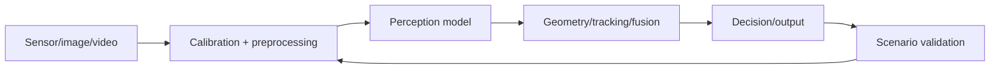

# Computer Vision Engineer

> [!abstract] Mission
> Build systems that derive useful, tested representations or decisions from images and video across variation in sensors, environments, people, motion, and deployment hardware.

## Responsibilities

- Define classification, detection, segmentation, tracking, OCR, depth, pose, generation, or multimodal tasks.
- Specify data capture and annotation; audit sensor, lighting, geography, demographic, temporal, and scene coverage.
- Train/adapt models; use augmentation and pretraining; analyze errors by object scale, occlusion, class, environment, and sequence.
- Build image/video preprocessing, geometry, tracking, post-processing, and model-serving pipelines.
- Optimize and validate on target devices; monitor camera/sensor and environmental drift.

## Title reality

Computer Vision Engineer may be model-focused, real-time C++/edge-focused, image-processing-focused, or research-heavy. “Machine vision” often signals industrial inspection and optics. Autonomous systems roles may combine vision with [[Robotics and Embodied AI Engineer]]. Multimodal foundation-model roles may appear under [[LLM Engineer]] or Research Scientist.

## Work anatomy

> [!info] What the role owns
> Computer vision engineers make visual perception reliable under the camera, lighting, motion, geography, and safety conditions where the system will operate. Their boundary runs from image/video acquisition and labeling through model behavior, deployment, and error feedback.

### Operating loop

1. Define the visual decision, label ontology, operating conditions, latency budget, and costly errors.
2. Build representative data splits and annotation guidance; inspect coverage before selecting a model.
3. Establish a simple baseline, train or adapt the model, and analyze errors by object, scene, condition, and subgroup.
4. Validate robustness, calibration, temporal behavior, and runtime constraints before integration.
5. Monitor drift, false positives/negatives, data quality, and field failures; feed them into the next dataset/model revision.

### Inputs → outputs

| Inputs | Owned work product | Evidence a reviewer should inspect |
|---|---|---|
| Images/video, ontology, operating envelope | Dataset and annotation specification | Coverage, label agreement, leakage controls, and slice definitions |
| Data and model hypotheses | Perception model/pipeline | Baseline, mAP/F1/IoU, calibration, latency, and failure taxonomy |
| Field feedback and drift signals | Release and retraining decision | Robustness evidence, rollback trigger, and data-refresh policy |

### Decisions and interfaces

Tradeoffs include detector versus segmentation, accuracy versus latency, augmentation versus real data, centralized model versus edge deployment, and performance on average versus safety-critical slices. Interfaces include product/domain, data labeling, robotics/embedded, inference, and security/privacy.

### Evidence of competence

A strong project includes a label guide, data card, baseline, slice report, visual error gallery, runtime benchmark, and a decision about what the model must abstain from. One leaderboard score is not enough to show field readiness.

### Research anchors

Use [Hugging Face object detection](https://huggingface.co/docs/transformers/tasks/object_detection), [Hugging Face image classification](https://huggingface.co/docs/transformers/main/tasks/image_classification), [OpenCV](https://docs.opencv.org/), and [NVIDIA TensorRT](https://developer.nvidia.com/tensorrt) alongside the adjacent robotics evidence in [O*NET](https://www.onetonline.org/link/details/17-2199.08). Learn the task vocabulary in [[Vision and Multimodal Systems]] first, then the slice contract in [[Case - Vision Field Slice]].
## 2026 technique overlay

> [!tip] Practice this now · 2026-08-24
> Maintain modality-specific data and annotation contracts, test calibration and error slices, measure latency/memory on target hardware, and include unsafe or ambiguous visual cases. Record provenance and deployment limits with [[AI Tools and Practices Update — 2026-08-24]].

## Level ladder

| Level | Expected ownership |
|---|---|
| Junior | Prepare data, implement augmentations/evaluation, or integrate a model under guidance. |
| Vision engineer | Own one perception task from capture/labels through target deployment. |
| Senior | Design multi-stage or real-time systems and lead scenario/error analysis. |
| Staff / principal | Set sensor, data, model, runtime, and evaluation architecture across products. |
| Lead | Direct perception strategy, safety evidence, data programs, and hardware/software tradeoffs. |

## Prerequisites

- Python; C++ for many real-time/embedded roles; Git, testing, APIs, and Linux.
- Linear algebra, probability, optimization; image coordinates, transformations, camera models, and signal basics.
- CNNs, vision transformers, transfer learning, detection/segmentation metrics, and video/temporal methods.
- Data annotation, privacy/biometric concerns, edge deployment, and scenario-based evaluation.

## Knowledge and skills

| Area | Demonstrable capability |
|---|---|
| Imaging/geometry | Color spaces, sampling, calibration, projection, distortion, transforms, and multi-view basics. |
| Modeling | Classification, detection, segmentation, embeddings, multimodal models, augmentation, transfer learning. |
| Evaluation | IoU, AP, class/slice metrics, tracking metrics, calibration, latency, scenario and open-set failures. |
| Data | Capture strategy, annotation QA, imbalance, near duplicates, temporal/geographic leakage, provenance. |
| Deployment | ONNX/runtime conversion, quantization, batching/streaming, memory, camera throughput, target-device tests. |
| Safety/privacy | False-positive/negative consequences, biometric/privacy constraints, human review, fail-safe behavior. |

## Study sequence

1. Implement image transforms and classical features; learn camera projection and coordinate conventions.
2. Fine-tune an image classifier and report confusion, calibration, and distribution slices.
3. Train a detector or segmenter; inspect annotation quality and object-size/occlusion errors.
4. Add video tracking or temporal smoothing; measure identity switches and end-to-end latency.
5. Export and optimize on a target CPU/GPU/edge device, rechecking accuracy after every transform.
6. Build a scenario test set and monitoring plan for sensor degradation, environmental shift, and privacy.

## Tools

| Need | Free / open-first | Paid or managed |
|---|---|---|
| Imaging | OpenCV, Pillow, scikit-image | Commercial machine-vision SDKs |
| Models | PyTorch/torchvision, Transformers, timm, Ultralytics options subject to license review | Managed vision APIs/training suites |
| Annotation | CVAT, Label Studio | Labelbox, Scale, Roboflow and managed labeling |
| Deployment | ONNX Runtime, OpenVINO, TensorRT developer tools, TFLite | Cloud/edge enterprise runtimes and device platforms |
| Evaluation | COCO tools, TorchMetrics, FiftyOne core/community options | Managed visual-data and observability platforms |

## Quiz

1. Why can random image splits leak information?
2. Distinguish IoU and average precision.
3. Why evaluate by object size and occlusion?
4. What can change when exporting or quantizing a model?
5. Why is camera calibration part of ML system quality?
6. What is open-set recognition risk?

> [!question]- Answer key
> 1. Near-duplicate frames, the same subject/location, or sequential captures can enter both train and test. 2. IoU measures overlap for one prediction/target; AP summarizes precision–recall over detections, commonly across confidence and sometimes IoU thresholds. 3. Aggregate scores can conceal systematic failures on small or hidden objects that dominate real risk. 4. Operator implementations, precision, preprocessing, dynamic shapes, post-processing, and numerical outputs can differ. 5. Incorrect intrinsics/extrinsics or distortion corrupt geometry, fusion, measurement, and labels regardless of model score. 6. The model encounters classes or conditions outside training and confidently maps them to known labels or unsafe actions.

## Flashcards

IoU:: Intersection over union, the overlap area divided by union area for regions or boxes.

Average precision:: Area/summarization of a precision–recall curve under a specified matching protocol.

Non-maximum suppression:: Post-processing that removes overlapping lower-scored detections according to a rule.

Camera intrinsics:: Parameters mapping camera coordinates to pixels, including focal lengths and principal point.

Extrinsics:: Rotation and translation relating one coordinate frame to another.

Data augmentation:: Label-preserving transformations intended to improve coverage or invariance; validity is task-dependent.

Domain randomization:: Simulation variation intended to help models generalize across real-world conditions.

Open set:: Deployment conditions include classes or phenomena not represented as known training classes.

## Interview preparation

- Explain a detector/segmenter pipeline, loss, matching, metrics, and post-processing.
- Work through camera projection or coordinate transforms.
- Diagnose good offline AP but unsafe video behavior or poor edge-device performance.
- Design data collection and splitting for cameras across sites and time.
- Estimate memory/throughput and discuss export, quantization, and accuracy validation.
- Present visual error galleries and how they changed data, model, or product behavior.

## Suggested projects

### Beginner — Robust image classifier

Fine-tune a public model; prevent duplicate leakage; add calibration, augmentations, class/slice metrics, visual error gallery, and model card.

### Intermediate — Real-time detection pipeline

Train a detector, validate annotation QA, add tracking, export to a target runtime, report AP by size/scene plus end-to-end latency and dropped frames.

### Advanced — Scenario-tested perception system

Build multi-camera or simulated perception with calibration, fusion or depth, domain shift tests, fault injection, privacy controls, runtime optimization, and a safety-oriented limitations report.

## Job-search aliases

Search `computer vision engineer`, `vision AI engineer`, `perception engineer`, `machine vision engineer`, `image processing engineer`, `video ML engineer`, and task/domain terms such as autonomy, medical imaging, inspection, or multimodal.

## Boundaries

- [[Robotics and Embodied AI Engineer]] owns perception-to-action integration and physical-system behavior.
- [[AI ML Research Scientist]] develops new vision methods and generalizable findings.
- [[Inference and Performance Engineer]] optimizes runtime and hardware across models.
- [[Synthetic Data Engineer]] may build simulation/generation pipelines but does not necessarily own the deployed perception model.

## Sources

- [Hugging Face Transformers — Object detection](https://huggingface.co/docs/transformers/tasks/object_detection) — current detection task, data, and fine-tuning workflow; accessed 2026-08-12.
- [Hugging Face Transformers — Image classification](https://huggingface.co/docs/transformers/main/tasks/image_classification) — current transfer-learning workflow; accessed 2026-08-12.
- [OpenCV documentation](https://docs.opencv.org/) — image/video processing and geometry APIs; accessed 2026-08-12.
- [NVIDIA TensorRT](https://developer.nvidia.com/tensorrt) — current model optimization and vision deployment ecosystem; accessed 2026-08-12.
- [O*NET — Robotics Engineers](https://www.onetonline.org/link/details/17-2199.08) — adjacent U.S. sensor/vision and robotics duties; updated 2026, accessed 2026-08-12.
