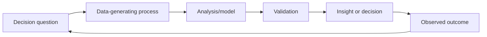

# Data Scientist — AI/ML

> [!abstract] Mission
> Turn data into reliable decisions by defining the question, measuring the right quantities, testing explanations, building appropriate predictive models, and communicating uncertainty and action.

## Responsibilities

- Clarify the decision, population, outcome, causal or predictive goal, and cost of error.
- Acquire, clean, join, explore, and validate data; document provenance and sampling.
- Build descriptive, inferential, causal, forecasting, predictive, or segmentation analyses.
- Design experiments; evaluate models and policies; communicate uncertainty and limitations.
- Work with [[ML Engineer]] for production systems and with domain/product partners on adoption and measurement.

## Title reality

U.S. “Data Scientist” roles range from analytics and experimentation to production ML or research. Read the mix of SQL, causal inference, dashboards, model training, deployment, and stakeholder work. A role requiring on-call model services may be closer to [[ML Engineer]]; one creating novel algorithms may be [[Applied Scientist]]. BLS treats Data Scientist as a distinct occupation but company titles remain broad.

## Work anatomy

> [!info] What the role owns
> A data scientist in AI/ML owns decision quality: turning messy data and uncertainty into a recommendation, model, experiment, or monitoring insight that another stakeholder can act on. The role may build models, but the decision and its limits are the center of gravity.

### Operating loop

1. Define the decision, population, outcome, unit of analysis, time horizon, and cost of errors.
2. Audit data-generating processes, missingness, leakage, sampling, and the meaning of the label.
3. Establish a simple baseline, fit appropriate models, and quantify uncertainty and subgroup behavior.
4. Communicate the result with assumptions, tradeoffs, and a recommended action.
5. Monitor whether the decision, data distribution, and model usefulness remain stable.

### Inputs → outputs

| Inputs | Owned work product | Evidence a reviewer should inspect |
|---|---|---|
| Business/domain question and data | Metric tree and analysis plan | Decision owner, estimand, baseline, and data-quality audit |
| Features, labels, experiments | Model or analytical result | Validation design, uncertainty, slices, calibration, and leakage checks |
| Results and stakeholder constraints | Decision memo/dashboard | Clear action, limitations, monitoring trigger, and follow-up |

### Decisions and interfaces

Tradeoffs include prediction versus causal explanation, precision versus recall, complexity versus interpretability, statistical significance versus practical significance, and model lift versus operational adoption. Interfaces include product, domain, data engineering, ML engineering, finance, and governance.

### Evidence of competence

Show the question before the model, a baseline, a data audit, a result with uncertainty, and a recommendation that a stakeholder can execute. Explain what the analysis cannot establish; that boundary is part of the skill.

### Research anchors

The role is anchored by [BLS Data Scientists](https://www.bls.gov/ooh/math/data-scientists.htm), [O*NET Data Scientists](https://www.onetonline.org/link/details/15-2051.00), [MLflow evaluation](https://mlflow.org/docs/latest/ml/evaluation), and the measure/manage cycle in [NIST AI RMF](https://airc.nist.gov/airmf-resources/airmf/5-sec-core/).
## 2026 technique overlay

> [!tip] Practice this now · 2026-08-24
> Check leakage and sampling before tuning, report slices and calibration, connect metrics to a business decision, and quantify uncertainty and rework cost. Include a reproducible dataset card and decision record using [[AI Tools and Practices Update — 2026-08-24]].

## Level ladder

| Level | Expected ownership |
|---|---|
| Junior / analyst-to-DS | Produce correct scoped analyses, features, and baseline models with review. |
| Data scientist | Own a decision problem, analysis/model, validation, and stakeholder recommendation. |
| Senior | Frame ambiguous questions, design experiments, and influence roadmap or operations. |
| Staff / principal | Set measurement and modeling strategy across product or business domains. |
| Lead / manager | Build the science portfolio, review quality, stakeholder system, and team capability. |

## Prerequisites

- SQL, Python or R, data visualization, Git, and reproducible notebooks/scripts.
- Probability, statistics, linear algebra, experiment design, regression/classification, and model evaluation.
- Communication: write a decision memo and explain assumptions without hiding uncertainty.
- Domain knowledge and data ethics/privacy; production software depth depends on the posting.

## Knowledge and skills

| Area | Demonstrable capability |
|---|---|
| Problem framing | Separate descriptive, predictive, causal, and optimization questions; define population and estimand. |
| Data | Audit missingness, selection, leakage, measurement error, time, joins, and provenance. |
| Statistics | Sampling, uncertainty, regression, experiments, multiple testing, power, calibration, causal assumptions. |
| ML | Strong baselines, cross-validation appropriate to structure, error slices, threshold/cost analysis. |
| Communication | Visualize honestly, distinguish evidence from inference, recommend action and measurement. |
| Responsible practice | Privacy, fairness relevant to context, reproducibility, documentation, and stakeholder challenge. |

## Study sequence

1. Learn SQL, tidy/tabular data, visualization, probability, and estimation using messy public data.
2. Implement regression/classification, validation, leakage defenses, calibration, and threshold selection.
3. Design and analyze experiments; study observational causal assumptions and common failure modes.
4. Build a metric tree and a forecasting, recommendation, or segmentation case with domain constraints.
5. Turn a notebook into a reproducible pipeline/report; add tests and a data dictionary.
6. Create a decision portfolio: executive memo, technical appendix, counterarguments, and follow-up measurement.

## Tools

| Need | Free / open-first | Paid or managed |
|---|---|---|
| Query/analysis | SQL, DuckDB, pandas/Polars, R/tidyverse | Snowflake, BigQuery, Databricks |
| Statistics/ML | SciPy, statsmodels, scikit-learn, XGBoost | Managed AutoML and statistical platforms |
| Visualization | Matplotlib, seaborn, Plotly, Altair, Superset/Metabase | Tableau, Power BI, Looker |
| Experiments | statsmodels, DoWhy/EconML where appropriate, custom simulation | Commercial experimentation platforms |
| Reproducibility | Jupyter/Quarto, Git, DVC, MLflow | Managed notebooks and experiment platforms |

## Quiz

1. Distinguish prediction from causal inference.
2. What is collider bias?
3. Why can cross-validation still leak information?
4. When is accuracy a poor metric?
5. What does a confidence interval not mean?
6. Why inspect missingness as a process rather than simply fill values?

> [!question]- Answer key
> 1. Prediction estimates outcomes from observed patterns; causal inference estimates what would change under an intervention and needs additional assumptions/design. 2. Conditioning on a common effect of two variables can create a spurious association. 3. Preprocessing, feature selection, duplicated/grouped/time-related records, or target-derived transformations may cross folds. 4. Imbalanced classes, unequal error costs, probability decisions, or subgroup performance make it misleading. 5. In frequentist use, it does not assign a probability that the fixed true parameter lies in this already-computed interval. 6. Missingness may encode collection, access, behavior, or outcome processes; naive filling can bias analysis and hide failures.

## Flashcards

Estimand:: The precise quantity a study seeks to estimate for a defined population and intervention/exposure.

Confounder:: A cause or proxy of both exposure/treatment and outcome that can bias an observational effect estimate.

Collider:: A variable caused by two other variables; conditioning on it can induce association.

Calibration:: Agreement between predicted probabilities and observed frequencies under specified conditions.

Data leakage:: Information unavailable at decision time or from evaluation data improperly influences training.

Power:: Probability that a test rejects a specified null when a particular alternative effect is true.

Selection bias:: Included observations differ systematically from the target population in outcome-relevant ways.

Sensitivity analysis:: Testing how conclusions change under plausible assumptions, specifications, or unmeasured bias.

## Interview preparation

- Solve SQL joins/window/aggregation tasks and explain duplicate-grain hazards.
- Frame a product question and choose metrics, experiment, sample, and decision threshold.
- Explain a model with calibration, errors, and business costs—not only feature importance.
- Diagnose selection, leakage, survivorship, Simpson's paradox, or confounding.
- Present a visualization and concise recommendation to a nontechnical audience.
- Describe when you refused an invalid analysis or changed a conclusion after new evidence.

## Suggested projects

### Beginner — Decision-ready analysis

Use a public U.S. dataset. Define unit/population, audit missingness and joins, estimate uncertainty, build honest visuals, and write a one-page recommendation plus data dictionary.

### Intermediate — Prediction with decision costs

Build baseline and improved models using grouped/time-aware validation, calibration, subgroup/error analysis, threshold cost curves, reproducible code, and a model card.

### Advanced — Experiment or causal portfolio study

Design an A/B test or defensible quasi-experiment, state estimand and assumptions, simulate power, analyze heterogeneity, conduct sensitivity checks, and pair it with a deployment/measurement decision memo.

## Job-search aliases

Search `data scientist`, `machine learning data scientist`, `product data scientist`, `decision scientist`, `experimentation scientist`, `quantitative scientist`, and domain terms. Read duties to separate analytics, ML, and engineering variants.

## Boundaries

- [[Applied Scientist]] more often develops advanced models and product-facing algorithms.
- [[ML Engineer]] owns production model software and operations.
- [[ML Data Engineer]] owns reliable model-ready data products and pipelines.
- Data analyst roles often emphasize recurring reporting and descriptive decisions with less modeling; the boundary varies.

## Sources

- [BLS — Data Scientists](https://www.bls.gov/ooh/math/data-scientists.htm) — U.S. duties, skills, and education context; accessed 2026-08-12.
- [BLS — Math occupations](https://www.bls.gov/ooh/math/home.htm) — 2024–2034 U.S. occupational context; modified 2025-08-28, accessed 2026-08-12.
- [O*NET — Data Scientists, 15-2051.00](https://www.onetonline.org/link/details/15-2051.00) — U.S. task/skill context; accessed 2026-08-12.
- [NIST AI RMF Core](https://airc.nist.gov/airmf-resources/airmf/5-sec-core/) — mapping, measurement, management, and governance; accessed 2026-08-12.
- [MLflow model evaluation](https://mlflow.org/docs/latest/ml/evaluation) — current classification/regression evaluation and validation workflows; accessed 2026-08-12.
