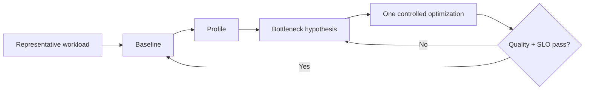

# Inference and Performance Engineer

> [!abstract] Mission
> Increase useful model throughput and reduce latency, memory, energy/cost, and operational risk through measurement-led changes to models, compilers, kernels, runtimes, serving, and hardware placement—without silently sacrificing required quality.

## Responsibilities

- Define representative workloads and service-level targets; build statistically sound benchmarks.
- Profile host, device, network, storage, compilation, scheduling, kernels, memory, and queueing.
- Optimize batching, caching, parallelism, placement, quantization, sparsity, distillation, compilation, and decoding.
- Implement or tune C++/CUDA/Triton/other accelerator kernels and integrate inference runtimes where required.
- Capacity-plan, load test, detect regressions, and validate model quality after every transformation.

## Title reality

Roles range from application serving and capacity engineering to compiler, kernel, GPU, or hardware/software co-design. “Performance engineer” outside AI may be CPU/network/database focused. Current U.S. lab postings include inference systems, GPU performance, TPU kernels, and model inference. Determine the required depth in C++, CUDA/ROCm, compilers, distributed systems, and model architecture.

## Work anatomy

> [!info] What the role owns
> Inference and performance engineers optimize the path from a model artifact to predictable service behavior. They reason across model graphs, compilers, kernels, batching, memory, hardware, scheduling, and capacity while protecting task quality.

### Operating loop

1. Define the workload distribution and service envelope: model, shapes, sequence lengths, concurrency, latency, throughput, and quality floor.
2. Profile end to end to locate compute, memory, synchronization, compilation, or queuing bottlenecks.
3. Apply one controlled optimization—graph, kernel, precision, batching, cache, runtime, or hardware placement.
4. Re-measure representative workloads and quality parity, including tail latency and failure behavior.
5. Ship through canary/capacity testing and document the new operating envelope and rollback trigger.

### Inputs → outputs

| Inputs | Owned work product | Evidence a reviewer should inspect |
|---|---|---|
| Model graph, traces, workload distribution | Benchmark and bottleneck model | Reproducible harness, profiler evidence, and shape/concurrency coverage |
| Optimization hypothesis | Runtime/kernel/config change | Before/after p50/p95, throughput, memory, cost, and quality delta |
| Capacity and incident data | Serving recommendation | SLO, scaling policy, failure mode, and rollback plan |

### Decisions and interfaces

Tradeoffs include latency versus throughput, precision versus quality, batching versus responsiveness, portability versus hardware specialization, and peak utilization versus tail stability. Interfaces include LLM/ML/model teams, hardware, compiler/runtime, platform, SRE, and finance.

### Evidence of competence

Show the bottleneck before the optimization, isolate the change, report distributions rather than one timing, and explain how the result behaves under load. A faster microbenchmark that worsens real queueing or quality is not a win.

### Research anchors

Use [PyTorch compiler troubleshooting](https://docs.pytorch.org/docs/stable/user_guide/torch_compiler/torch.compiler_troubleshooting.html), [CUDA documentation](https://docs.nvidia.com/cuda/index.html), [NVIDIA TensorRT-LLM](https://developer.nvidia.com/tensorrt-llm), and current [Anthropic performance/inference role evidence](https://www.anthropic.com/careers/jobs). Practice the capacity napkin in [[Case - Serving Capacity]] and the bits trade in [[Quantization]].
## 2026 technique overlay

> [!tip] Practice this now · 2026-08-24
> Profile queue, model, tool, and network time separately; measure p50/p95, time-to-first-token, throughput, memory, cache hits, retries, and cost per successful task. Validate optimizations against quality and safety, not speed alone; use [[AI Tools and Practices Update — 2026-08-24]].

## Level ladder

| Level | Expected ownership |
|---|---|
| Junior | Reproduce benchmarks, profile components, implement bounded optimizations and correctness tests. |
| Performance engineer | Own a model/runtime/workload optimization and production regression suite. |
| Senior | Optimize across model, compiler, runtime, service, and hardware boundaries. |
| Staff / principal | Set performance architecture, benchmark methodology, and capacity strategy across fleets. |
| Lead | Direct performance roadmap, hardware/vendor choices, economics, and cross-team prioritization. |

## Prerequisites

- Python plus strong C++ for low-level roles; Linux, concurrency, networking, distributed systems, and benchmarking.
- Computer architecture: caches, memory hierarchy/bandwidth, SIMD/SIMT, accelerators, interconnects, roofline reasoning.
- Deep-learning computation, transformers, numerical precision, parallelism, and serving.
- Profilers and careful experimental design; performance claims require exact hardware/software/workload conditions.

## Knowledge and skills

| Area | Demonstrable capability |
|---|---|
| Metrics | Throughput, latency distributions, TTFT, inter-token latency, utilization, memory, energy/cost, quality. |
| Profiling | Separate queueing, CPU, transfer, kernel, communication, memory, compile, and I/O time. |
| Model optimization | Quantization, pruning/sparsity, distillation, speculative decoding, KV cache, sequence/batch shaping. |
| Parallel systems | Data/tensor/pipeline/expert parallelism, collective communication, placement, disaggregated serving. |
| Compilers/kernels | Graph capture/breaks, fusion, code generation, operator numerics, kernel launch and memory access. |
| Production | Load shape, admission control, autoscaling, warmup, multi-tenancy, failure, observability, regressions. |

## Study sequence

1. Benchmark CPU/GPU operations correctly: warmup, synchronization, repetitions, distributions, pinned versions and hardware.
2. Profile a PyTorch model and optimize data transfer, precision, compilation, and batch shape one variable at a time.
3. Serve a model under open-loop and closed-loop load; measure queueing, tails, throughput, memory, and quality.
4. Quantize or distill, then run a task/slice evaluation—not only perplexity—before claiming success.
5. Implement and profile a fused operation or Triton/CUDA kernel against a tested reference.
6. Scale across devices/nodes, model placement and failure; write a capacity/economics recommendation.

## Tools

| Need | Free / open-first | Paid or managed |
|---|---|---|
| Profiling | PyTorch Profiler, Nsight Systems/Compute, Linux `perf`, ROCm profilers | Cloud/vendor observability suites |
| Compilers/kernels | `torch.compile`, Triton language, CUDA/ROCm, XLA/OpenXLA | Vendor compiler/support offerings |
| Serving | vLLM, SGLang, Triton Inference Server, TGI, llama.cpp | Managed inference endpoints, NVIDIA NIM/enterprise |
| Optimization | ONNX Runtime, TensorRT developer tools, OpenVINO, bitsandbytes options | Managed optimization/compilation services |
| Load testing | Locust, k6, Vegeta, custom token workload replay | Commercial load/performance platforms |

## Quiz

1. Why is average latency insufficient?
2. Distinguish compute-bound from memory-bandwidth-bound work.
3. Why can batching improve throughput while harming latency?
4. What is a graph break and why might it matter?
5. Why synchronize devices when timing GPU operations?
6. What must accompany a quantization speedup claim?

> [!question]- Answer key
> 1. Tail latency and distribution shape determine many user/SLO failures and can be hidden by the mean. 2. Performance is limited primarily by arithmetic capacity versus moving data through memory. 3. Requests wait to form batches and individual service time may grow even as hardware utilization improves. 4. Execution leaves a captured/compiled graph, reducing fusion/optimization and possibly causing recompilation/overhead. 5. GPU launches are asynchronous; host timing can stop before device work finishes. 6. Exact hardware/software/workload, baseline parity, warmup/load method, latency distributions/throughput/memory, and task/slice quality changes.

## Flashcards

TTFT:: Time to first token, request arrival to first generated token.

Inter-token latency:: Delay between generated tokens after the first response token.

Arithmetic intensity:: Operations performed per byte moved, used in roofline-style bottleneck reasoning.

Kernel fusion:: Combining operations to reduce launches and intermediate memory traffic.

Continuous batching:: Dynamically scheduling sequences into shared model steps as requests arrive/finish.

Tensor parallelism:: Splitting tensor computations and parameters across devices within model layers.

Quantization:: Lower-precision representation/computation requiring quality and numerical validation.

Closed-loop load test:: Each virtual user waits for a response before issuing another request, unlike fixed-rate open-loop arrival.

## Interview preparation

- Estimate transformer training/inference memory, FLOPs, KV cache, and communication at a useful order of magnitude.
- Interpret a profiler trace and propose the next discriminating measurement.
- Design a benchmark that prevents warmup, synchronization, caching, or load-shape errors.
- Explain quantization, batching, parallelism, compilation, and speculative decoding tradeoffs.
- Implement/optimize a vector or GPU kernel and verify numerical correctness.
- Design admission control/autoscaling for bursty inference with tail-latency targets.

## Suggested projects

### Beginner — Reproducible inference benchmark

Benchmark a model across batch/sequence sizes and precisions. Include warmup, synchronization, latency percentiles, throughput, memory, profiler traces, environment, and task-quality parity.

### Intermediate — Optimized LLM service

Serve an open model with streaming, continuous batching, prefix/KV-cache experiments, quantization, load shapes, admission control, and a quality–latency–throughput frontier.

### Advanced — Kernel-to-fleet optimization

Implement/fuse a kernel, integrate it into a runtime, test numerics/dynamic shapes, profile multi-GPU serving, simulate failures and multi-tenancy, and produce a capacity/cost decision document.

## Job-search aliases

Search `inference engineer`, `inference systems engineer`, `ML performance engineer`, `GPU performance engineer`, `AI compiler engineer`, `CUDA engineer AI`, `kernel engineer`, and `model serving engineer`.

## Boundaries

- [[AI Platform Engineer]] owns the broad developer/operations platform; this role goes deeper on runtime efficiency.
- [[LLM Engineer]] owns model adaptation and task quality as well as serving at a broader level.
- [[AI Hardware and Accelerator Engineer]] designs hardware/architecture; performance engineers expose bottlenecks and optimize software to it.
- [[Research Engineer]] optimizes research velocity; exact performance work may overlap on frontier training teams.

## Sources

- [Anthropic jobs](https://www.anthropic.com/careers/jobs) — current U.S. Performance Engineer, GPU, Inference Systems, ML Accelerator, and TPU Kernel title evidence; accessed 2026-08-12.
- [OpenAI careers search](https://openai.com/careers/search/) — current model inference, GPU enablement, kernel performance, and hardware co-design roles; accessed 2026-08-12.
- [PyTorch `torch.compile` troubleshooting](https://docs.pytorch.org/docs/stable/user_guide/torch_compiler/torch.compiler_troubleshooting.html) — graph breaks, recompilation, traces, and profiling; updated 2025-12-03, accessed 2026-08-12.
- [CUDA Toolkit documentation](https://docs.nvidia.com/cuda/index.html) — CUDA 13.3 programming, architecture, compiler, debug, and profiling references; updated 2026, accessed 2026-08-12.
- [NVIDIA TensorRT-LLM](https://developer.nvidia.com/tensorrt-llm) — current LLM inference runtime and optimization concepts; accessed 2026-08-12.
