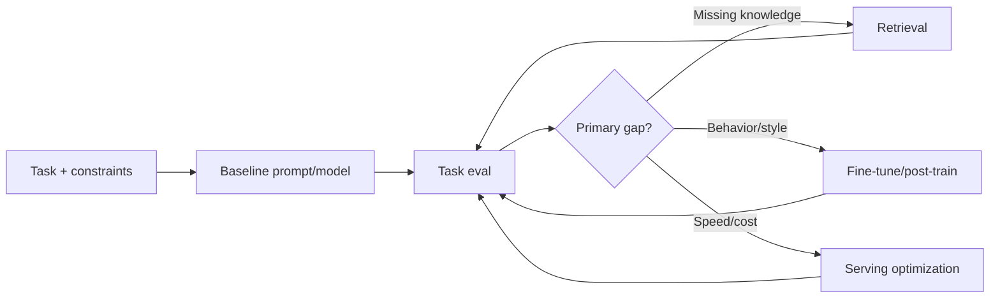

# LLM Engineer

> [!info] October 13, 2026 update
> Practice focus: **Prompt/retrieval/adaptation tradeoff under a budget**. Produce **Ablation table and exact configuration** and answer: What evidence rules out a simpler intervention?
> Use [[Technical Role Practice Workbook — October 2026]] and [[October 2026 Research Refresh]]. This checkpoint does not reverify every older market/tool claim in this profile.

> [!abstract] Mission
> Adapt, evaluate, serve, and integrate language models so a defined set of language tasks works reliably, safely, and efficiently under production conditions.

## Responsibilities

- Select model and architecture based on task, data rights, privacy, quality, latency, cost, and deployment constraints.
- Design prompting, structured generation, retrieval, tool use, supervised or preference data, and parameter-efficient/full fine-tuning when justified.
- Build evaluation datasets and graders; measure factuality, instruction following, safety, robustness, latency, and cost.
- Optimize batching, quantization, caching, context, and serving; monitor model and system regressions.
- Document data/model provenance, licenses, intended use, limitations, and release criteria.

## Title reality

The title may describe application integration, post-training, pretraining, or inference systems. Some roles are essentially [[AI Engineer]]; frontier roles may resemble [[Research Engineer]] or [[Inference and Performance Engineer]]. Ask whether you will own weights, data, retrieval, serving, or only API integration. “LLM” can also encompass multimodal foundation models.

## Work anatomy

> [!info] What the role owns
> LLM engineers improve task behavior and operating characteristics of language models across prompting, retrieval, adaptation, serving, and evaluation. The core skill is selecting the right intervention and proving that it improved the intended behavior without creating a hidden regression.

### Operating loop

1. Define the task, users, risk, quality rubric, context limits, and operational envelope.
2. Establish a baseline model/prompt/system and a representative evaluation set.
3. Compare prompt/context changes, retrieval, tool use, PEFT/fine-tuning, model routing, or deterministic controls.
4. Validate behavior, safety, latency, cost, and data/provenance constraints across slices.
5. Package the chosen model or adapter with a card, serving configuration, regression suite, and monitoring plan.

### Inputs → outputs

| Inputs | Owned work product | Evidence a reviewer should inspect |
|---|---|---|
| Task examples, constraints, models | Baseline and intervention plan | Why this intervention beats simpler alternatives |
| Data, prompts, adapters, retrieval | Model/system artifact | Held-out evals, contamination checks, safety slices, and cost |
| Results and production traces | Release decision and regression suite | Error taxonomy, rollback path, and model/data lineage |

### Decisions and interfaces

Tradeoffs include prompting versus retrieval versus fine-tuning, hosted versus open-weight control, context length versus latency/cost, and benchmark score versus real user value. Interfaces include AI/application engineering, data/knowledge, inference, evals, safety/security, and product.

### Evidence of competence

A strong project compares at least two interventions against a baseline, includes held-out and adversarial cases, records model/data versions, and explains why a simpler solution was rejected or retained.

### Research anchors

The role is grounded in [Hugging Face PEFT](https://huggingface.co/docs/peft/index), [Transformers PEFT integration](https://huggingface.co/docs/transformers/peft), [PyTorch](https://docs.pytorch.org/docs/stable/), [TensorRT-LLM](https://developer.nvidia.com/tensorrt-llm), and [NIST's Generative AI Profile](https://doi.org/10.6028/NIST.AI.600-1). Rehearse the intervention choice in [[Case - Prompt RAG Fine-Tune]], the serving napkin in [[Case - Serving Capacity]], and the decoding/bits knobs in [[Sampling and Decoding]] and [[Quantization]].
## 2026 technique overlay

> [!tip] Practice this now · 2026-08-24
> Choose among prompting, structured outputs, retrieval, adaptation, routing, and fine-tuning with a fixed eval set. Track context provenance, cache retention, tool contracts, judge calibration, and rollback evidence; practice the sequence in [[AI Tools and Practices Update — 2026-08-24]].

> [!info] Edge/web platform deep dive
> Compare Workers AI model catalog and AI Gateway controls with Vercel AI SDK provider normalization and gateway routing. Measure quality, fallback behavior, embeddings/retrieval, latency, token cost, and model identity using [[Cloudflare and Vercel AI]].

## Level ladder

| Level | Expected ownership |
|---|---|
| Junior | Implement prompts, data transforms, tests, or inference components within a defined system. |
| LLM engineer | Own one task's model/data/eval/serving loop and production integration. |
| Senior | Choose adaptation strategy, lead failure analysis, and optimize quality–latency–cost tradeoffs. |
| Staff / principal | Establish foundation-model architecture, evaluation, data, and serving strategy across products. |
| Lead | Direct model portfolio, build/buy decisions, compute/data investment, risk, and team interfaces. |

## Prerequisites

- Strong Python and software engineering; PyTorch and Transformers for weight-level roles.
- Transformer architecture, tokenization, attention, training objectives, decoding, embeddings, context limits, and post-training concepts.
- Data curation, evaluation, distributed-compute basics, and production APIs.
- Security: prompt injection, untrusted outputs, model/data supply chain, secrets, privacy, and permissions.

## Knowledge and skills

| Area | Demonstrable capability |
|---|---|
| Adaptation choice | Compare prompt/context changes, RAG, PEFT, full fine-tuning, distillation, and deterministic code. |
| Data | Curate, deduplicate, filter, format, mix, and audit training/eval data; prevent contamination. |
| Post-training | Understand SFT, preference optimization, reward models, RL variants, and their failure modes at role-appropriate depth. |
| Evaluation | Build task/risk suites, repeat stochastic runs, validate graders, analyze slices, and set gates. |
| Serving | Token-level latency, time to first token, throughput, KV cache, batching, quantization, parallelism. |
| Governance | Model/system cards, licenses, data rights, provenance, incident and rollback plans. |

## Study sequence

1. Implement a tokenizer exercise and small transformer; explain attention and autoregressive loss.
2. Establish prompt-only baselines and task-specific evals using more than one model.
3. Build retrieval with citations and separately evaluate retrieval recall/ranking and answer support.
4. Fine-tune a small open model with PEFT; compare against prompt/RAG baselines under matched evaluation.
5. Serve locally, load test, profile time-to-first-token and inter-token latency, then quantize and assess quality change.
6. Add safety/security tests, provenance, release gates, monitoring, and a build-vs-buy decision memo.

## Tools

| Need | Free / open-first | Paid or managed |
|---|---|---|
| Models/training | PyTorch, Transformers, PEFT, TRL, Accelerate | Hosted fine-tuning and managed training platforms |
| Serving | vLLM, llama.cpp, SGLang, TGI | Managed model endpoints, NVIDIA NIM/enterprise offerings |
| Data | Hugging Face Datasets, NeMo Curator, DVC | Managed labeling, data curation, and lakehouse platforms |
| Evaluation | OpenAI Evals, lm-evaluation-harness, MLflow, promptfoo | Braintrust, LangSmith, Arize, vendor eval platforms |
| Tracking | MLflow, TensorBoard | Weights & Biases, Databricks |

## Quiz

1. When is RAG preferable to fine-tuning?
2. Why does lower perplexity not guarantee a better assistant?
3. Define time to first token and inter-token latency.
4. What quality risks can quantization introduce?
5. Why is LLM-as-judge validation necessary?
6. What is evaluation contamination in post-training?

> [!question]- Answer key
> 1. When the gap is factual/current/private knowledge that must be updated or cited without changing weights. 2. Perplexity measures next-token prediction on a distribution, not instruction following, usefulness, truthfulness, safety, or system behavior. 3. Delay until the first generated token and delay/rate for subsequent tokens. 4. Changed probabilities and rare-task degradation, instability, calibration shifts, and hardware/kernel-specific behavior. 5. Judges can be biased, position-sensitive, style-sensitive, inconsistent, contaminated, or weak on the target domain; compare to qualified human labels. 6. Evaluation examples or answers influence SFT/preference data, prompt/model selection, or repeated tuning, inflating apparent generalization.

## Flashcards

PEFT:: Parameter-efficient fine-tuning that updates a small set of added or selected parameters instead of all model weights.

SFT:: Supervised fine-tuning on input–desired-output examples.

Preference optimization:: Training that uses comparative or preference signals to shape model behavior.

KV cache:: Stored attention keys and values reused during autoregressive decoding to avoid recomputing prior tokens.

Quantization:: Representing weights or activations at lower precision to reduce memory/compute, requiring measured quality validation.

Time to first token:: Elapsed time from request to the first generated token, a key interactive-latency measure.

Context window:: The token span a model can process in one invocation; usable quality may degrade before the nominal maximum.

Data mixture:: The relative composition and weighting of datasets supplied during training or post-training.

## Interview preparation

- Explain a transformer forward pass and memory use during training versus autoregressive inference.
- Choose prompting, RAG, PEFT, or full training for a concrete case and defend the experiment that would decide.
- Design an eval suite for factuality, instruction following, refusal behavior, and tool use.
- Diagnose hallucination across retrieval, context construction, decoding, data, and policy layers.
- Estimate serving capacity from tokens, concurrency, latency targets, memory, and batching assumptions.
- Discuss data provenance, licensing, contamination, and a model-release failure.

## Suggested projects

### Beginner — Model comparison harness

Compare two open or free-access models on a 150-case task suite. Use structured outputs, repeated samples, human-validated rubric, error taxonomy, latency, and resource/cost proxy.

### Intermediate — PEFT versus RAG study

For one domain task, implement prompt-only, RAG, and PEFT variants. Match data and evaluation, measure support/citations, robustness, latency, and document which gap each method solves.

### Advanced — Efficient governed model service

Serve an open model with batching, streaming, caching, quantization, autoscaling simulation, adversarial evals, trace sampling, model/system card, release gate, and rollback. Report quality changes for every optimization.

## Job-search aliases

Search `LLM engineer`, `foundation model engineer`, `generative AI engineer`, `post-training engineer`, `language model engineer`, `LLM inference engineer`, and `applied AI engineer`; inspect responsibilities carefully.

## Boundaries

- [[AI Engineer]] is broader and often application-first.
- [[NLP Engineer]] covers language systems beyond generative foundation models, including structured linguistic tasks.
- [[RAG and Knowledge Engineer]] specializes in retrieval, corpora, knowledge quality, and citations.
- [[Inference and Performance Engineer]] specializes in runtime, compiler, kernels, and capacity efficiency.

## Sources

- [Hugging Face Transformers — PEFT integration](https://huggingface.co/docs/transformers/peft) — adapter concepts and current integration; accessed 2026-08-12.
- [Hugging Face PEFT](https://huggingface.co/docs/peft/index) — adaptation methods and integrations; accessed 2026-08-12.
- [PyTorch documentation](https://docs.pytorch.org/docs/stable/) — modeling, distributed, compiler, quantization, and profiler reference; accessed 2026-08-12.
- [NVIDIA TensorRT-LLM](https://developer.nvidia.com/tensorrt-llm) — current LLM inference optimization concepts; accessed 2026-08-12.
- [NIST AI RMF Generative AI Profile](https://doi.org/10.6028/NIST.AI.600-1) — generative-AI risk and lifecycle actions; published 2024-07-26, page updated 2026-04-08, accessed 2026-08-12.
