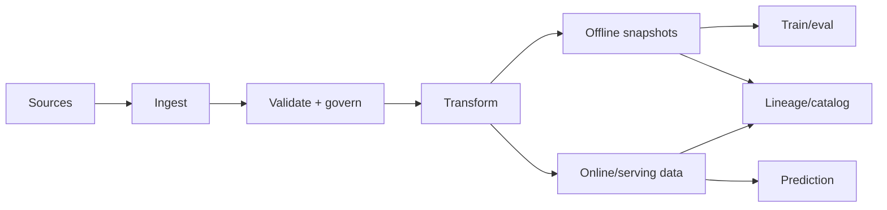

# ML Data Engineer

> [!abstract] Mission
> Deliver trustworthy, reproducible, governed, model-ready data—at the right historical point, freshness, quality, and scale—for training, evaluation, retrieval, and inference.

## Responsibilities

- Design batch/stream ingestion, canonical schemas, storage layouts, and transformations for ML workloads.
- Implement data contracts, lineage, validation, deduplication, time semantics, privacy, retention, and access controls.
- Create training/evaluation datasets, feature pipelines, online features, embeddings, or multimodal corpora.
- Prevent point-in-time leakage and training-serving skew; support backfills and reproducible snapshots.
- Monitor data freshness, completeness, distribution, and pipeline reliability; operate incidents and cost.

## Title reality

This role may be called Data Engineer on an ML team, Feature Platform Engineer, Training Data Engineer, or AI Data Engineer. Some postings emphasize warehouse/lakehouse pipelines; frontier-model roles emphasize massive multimodal corpora, deduplication, tokenization, and high-throughput loaders. [[Synthetic Data Engineer]] generates data; this role makes all data reliably usable.

## Work anatomy

> [!info] What the role owns
> ML data engineers make data products trustworthy enough for training, evaluation, and serving. The job is not simply moving files: it is preserving meaning, time correctness, lineage, access policy, quality, and reproducibility as data changes.

### Operating loop

1. Define the data contract, consumers, labels/features, freshness, privacy, and acceptable failure modes.
2. Ingest and transform data with explicit schemas, provenance, versioning, and point-in-time semantics.
3. Validate completeness, validity, duplication, drift, leakage, and access controls before publication.
4. Serve snapshots, features, or streams to training/evaluation/online systems with lineage.
5. Monitor quality and freshness, investigate incidents, and make backfills or schema changes safely.

### Inputs → outputs

| Inputs | Owned work product | Evidence a reviewer should inspect |
|---|---|---|
| Raw events, documents, labels, metadata | Versioned dataset/feature product | Contract, lineage, quality checks, and provenance |
| Consumer requirements and time semantics | Training/serving data path | Point-in-time joins, reproducible snapshots, and access policy |
| Drift and incident signals | Quality report and remediation | Detection thresholds, backfill plan, and downstream impact |

### Decisions and interfaces

Tradeoffs include batch versus streaming, strict schemas versus evolution, freshness versus cost, central governance versus team velocity, and maximum data versus minimization. Interfaces include data science, ML engineering, MLOps, privacy/security, domain owners, and platform.

### Evidence of competence

Show a dataset contract, automated quality checks, a reproducible snapshot, lineage from source to model/eval, and a simulated late or corrected event. “The pipeline ran” is not evidence that the data was temporally correct or fit for purpose.

### Research anchors

The role maps directly to [Databricks Feature Store concepts](https://docs.databricks.com/aws/en/machine-learning/feature-store/concepts), [MLflow dataset tracking](https://mlflow.org/docs/latest/ml/tracking/), [AWS SageMaker Pipelines](https://docs.aws.amazon.com/sagemaker/latest/dg/pipelines-overview.html), and [NIST SP 800-218A](https://doi.org/10.6028/NIST.SP.800-218A).
## 2026 technique overlay

> [!tip] Practice this now · 2026-08-24
> Make datasets products: schema, owner, lineage, ACL, freshness, deduplication, drift, deletion, and quality gates. Preserve source IDs for retrieval and feedback loops, and demonstrate the data card and poisoned/stale-data tests in [[AI Tools and Practices Update — 2026-08-24]].

## Level ladder

| Level | Expected ownership |
|---|---|
| Junior | Implement tested transformations and pipeline components with defined schemas. |
| ML data engineer | Own a model-ready data product, freshness/quality SLOs, and incident response. |
| Senior | Design across batch, stream, training, and online serving; lead backfills and migrations. |
| Staff / principal | Set data architecture, governance, lineage, and platform standards across AI programs. |
| Lead | Own data roadmap, cost, privacy, reliability, and producer–consumer operating model. |

## Prerequisites

- Advanced SQL, Python, data modeling, files/table formats, distributed processing, and testing.
- Databases, object storage, batch and streaming semantics, orchestration, schema evolution, and observability.
- ML lifecycle basics: labels/features, time-aware splits, embeddings, training loaders, evaluation immutability.
- Security/privacy: classification, least privilege, encryption, deletion/retention, consent and licensing.

## Knowledge and skills

| Area | Demonstrable capability |
|---|---|
| Modeling/storage | Choose grains, keys, partitions, formats, indexes, and table contracts for access patterns. |
| Distributed data | Reason about shuffle, skew, late events, watermarks, retries, exactly-once claims, and backpressure. |
| ML semantics | Point-in-time joins, dataset snapshots, negative sampling, label maturity, feature freshness, online/offline parity. |
| Quality/lineage | Schema/content checks, anomaly detection, provenance, owners, impact analysis, reproducible backfills. |
| Performance/cost | Profile I/O and compute, compact/partition, cache deliberately, and budget storage/egress. |
| Governance | Access, retention/deletion, data rights, sensitive fields, audit, and downstream propagation. |

## Study sequence

1. Master SQL, relational/data modeling, file formats, object storage, and idempotent Python pipelines.
2. Build a batch pipeline with orchestration, tests, data contracts, lineage, and reproducible snapshots.
3. Add streaming ingestion with event time, late data, replay, deduplication, and backpressure.
4. Create point-in-time correct features and compare offline versus online computation.
5. Support embeddings or multimodal data, high-throughput training reads, privacy deletion, and dataset versioning.
6. Run backfill/schema/freshness incidents and publish SLOs, dashboards, runbooks, and cost analysis.

## Tools

| Need | Free / open-first | Paid or managed |
|---|---|---|
| Processing | SQL, DuckDB, Spark, Flink, Beam, Polars | Databricks, cloud data processing/warehouses |
| Storage/table | PostgreSQL, object storage, Parquet, Iceberg/Delta/Hudi options | Managed lakehouse/warehouse services |
| Orchestration | Airflow, Dagster, Prefect | Managed orchestration services |
| Quality/catalog | Great Expectations, Soda Core, OpenLineage, DataHub/OpenMetadata | Monte Carlo, Collibra, commercial catalogs |
| Features | Feast, custom point-in-time pipelines | Databricks Feature Store, Tecton, cloud feature stores |

## Quiz

1. What is a point-in-time correct feature join?
2. Why are pipeline retries dangerous without idempotency?
3. Distinguish event time from processing time.
4. How can a backfill silently corrupt training data?
5. What does a data contract cover beyond schema?
6. Why can “exactly once” be misleading end to end?

> [!question]- Answer key
> 1. It uses only feature values that would have been available at each historical prediction timestamp. 2. They may duplicate writes/events or produce inconsistent side effects. 3. Event time is when the source event occurred; processing time is when the system handled it. 4. Changed code/reference data, nonversioned sources, current-state joins, duplicate keys, or different time zones can rewrite history. 5. Semantics, grain/keys, ownership, quality/freshness expectations, compatibility, security, and change policy. 6. A framework can guarantee a boundary while external sources/sinks, side effects, and consumers do not; define the exact scope and deduplication semantics.

## Flashcards

Data grain:: What one row or record represents.

Point-in-time join:: Historical join constrained to information available at the relevant event or decision time.

Watermark:: A streaming estimate that events earlier than a threshold are unlikely to arrive, enabling window completion policy.

Backfill:: Recomputing historical data for a time range under a controlled code/source/version policy.

Data contract:: Producer–consumer agreement on structure, semantics, quality, ownership, security, and change.

Training-serving skew:: Difference between data or transformation behavior in training and production inference.

Lineage:: Trace of data from sources through transformations to downstream datasets, features, models, and decisions.

Idempotent pipeline:: Reprocessing the same logical input produces the same intended state without duplicate side effects.

## Interview preparation

- Model data for training and low-latency features; explain keys, time, partitioning, and retention.
- Write SQL for slowly changing data or point-in-time joins without duplicates.
- Design a batch/stream pipeline with replay, late data, schema evolution, and SLOs.
- Diagnose training degradation caused by a data change.
- Plan a petabyte-scale backfill or privacy deletion with lineage and verification.
- Explain cost/performance tradeoffs in file size, partitioning, shuffle, and feature freshness.

## Suggested projects

### Beginner — Versioned training dataset

Ingest two public sources, define grain/contracts, validate and deduplicate, create an immutable snapshot, generate a data dictionary/lineage graph, and test idempotent reruns.

### Intermediate — Point-in-time feature pipeline

Build offline features and a simulated online store. Verify time correctness, parity, freshness, late-event replay, schema migration, and reproducible model training.

### Advanced — Governed multimodal data platform

Create batch/stream ingestion for text/images/audio, license/consent metadata, content hashes, deduplication, access/deletion propagation, high-throughput training reads, SLOs, fault injection, and cost study.

## Job-search aliases

Search `ML data engineer`, `machine learning data engineer`, `AI data engineer`, `training data engineer`, `feature platform engineer`, `data engineer machine learning`, and `research data engineer`.

## Boundaries

- General data engineering may serve BI/operations broadly; this track specializes in ML time, reproducibility, features, and training access patterns.
- [[MLOps Engineer]] owns model pipelines, releases, and operations more than core data products.
- [[Synthetic Data Engineer]] creates generated records and evaluates utility/privacy.
- [[RAG and Knowledge Engineer]] owns retrieval relevance, document semantics, and answer grounding beyond ingestion reliability.

## Sources

- [Databricks Feature Store](https://docs.databricks.com/aws/en/machine-learning/feature-store/) — current lineage, point-in-time joins, online features, and training-serving consistency; updated 2026-07-17, accessed 2026-08-12.
- [Databricks Feature Store concepts](https://docs.databricks.com/aws/en/machine-learning/feature-store/concepts) — training/serving feature workflow; updated 2026-06-12, accessed 2026-08-12.
- [MLflow Tracking — datasets](https://mlflow.org/docs/latest/ml/tracking/) — dataset inputs, runs, metrics, and artifacts; accessed 2026-08-12.
- [AWS SageMaker Pipelines overview](https://docs.aws.amazon.com/sagemaker/latest/dg/pipelines-overview.html) — data processing, evaluation, registration, and DAG dependencies; accessed 2026-08-12.
- [NIST SP 800-218A](https://doi.org/10.6028/NIST.SP.800-218A) — secure practices for AI model/system artifacts; published 2024-07-26, accessed 2026-08-12.
