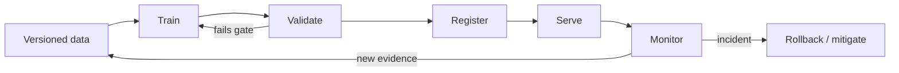

# ML Engineer

> [!info] October 13, 2026 update
> Practice focus: **Whether a model change generalizes to deployment data**. Produce **Split manifest, baseline, slice report** and answer: What happens under training/serving skew?
> Use [[Technical Role Practice Workbook — October 2026]] and [[October 2026 Research Refresh]]. This checkpoint does not reverify every older market/tool claim in this profile.

> [!abstract] Mission
> Build, deploy, and continuously improve machine-learning systems that produce useful predictions under real constraints for data quality, latency, scale, cost, reliability, security, and change.

## Responsibilities

- Convert a product requirement into an ML task, baseline, data contract, service interface, and measurable acceptance criteria.
- Build training and inference pipelines; version code, configuration, features, data, and models.
- Test model logic and surrounding software; deploy safely with shadow, canary, or staged strategies.
- Monitor data, service, model, and outcome health; investigate drift and incidents; roll back when necessary.
- Collaborate with [[Data Scientist - AI ML]], [[ML Data Engineer]], [[MLOps Engineer]], product, and domain owners.

## Title reality

Some companies use ML Engineer for model development; others mean an infrastructure or software engineer embedded with data science. Read for ownership of features, training, evaluation, serving, and on-call. Foundation-model application roles may instead be titled [[AI Engineer]] or [[LLM Engineer]].

## Work anatomy

> [!info] What the role owns
> ML engineers turn a validated modeling approach into a reliable product or decision system. Their center of gravity is the full model lifecycle: data and features, training, evaluation, packaging, deployment, monitoring, and the next controlled change.

### Operating loop

1. Translate the product decision into a model contract, baseline, data split, and operational constraints.
2. Build reproducible data/features and training code with tracked configurations and artifacts.
3. Evaluate task quality, calibration, robustness, fairness or safety slices, and operational behavior.
4. Package and deploy the model with versioning, health checks, rollback, and monitoring.
5. Use production evidence to prioritize retraining, threshold changes, data fixes, or model replacement.

### Inputs → outputs

| Inputs | Owned work product | Evidence a reviewer should inspect |
|---|---|---|
| Product decision and labeled data | Baseline and training pipeline | Split rationale, lineage, reproducibility, and error analysis |
| Model candidates and constraints | Versioned model artifact/service | Model card, validation, calibration, latency, and rollback |
| Online behavior and incidents | Lifecycle improvement | Drift/quality signal, retraining trigger, and postmortem |

### Decisions and interfaces

Tradeoffs include bespoke versus managed models, offline versus online parity, accuracy versus latency/cost, model complexity versus maintainability, and automation versus human review. Interfaces include data science, data engineering, MLOps, platform, product, domain, security, and operations.

### Evidence of competence

A strong project can be rebuilt from a clean environment, compares against a simple baseline, exposes lineage, tests failure slices, and shows how deployment and monitoring change the engineering decision.

### Research anchors

Use [BLS software developer duties](https://www.bls.gov/ooh/computer-and-information-technology/software-developers.htm), [BLS data scientist context](https://www.bls.gov/ooh/math/data-scientists.htm), [MLflow Tracking](https://mlflow.org/docs/latest/ml/tracking/), [AWS Model Registry](https://docs.aws.amazon.com/sagemaker/latest/dg/model-registry.html), and [Databricks Feature Store](https://docs.databricks.com/aws/en/machine-learning/feature-store/). Rehearse honest splits in [[Case - Split Integrity]] and the loop in [[The Training Loop]].
## 2026 technique overlay

> [!tip] Practice this now · 2026-08-24
> Establish a deterministic baseline, version data/model/code, test leakage and slices, validate calibration, and carry the same cases through deployment and monitoring. Compare model quality with latency, cost, and rollback evidence using [[AI Tools and Practices Update — 2026-08-24]].

## Level ladder

| Level | Expected ownership |
|---|---|
| Junior | Implement features, tests, training jobs, or endpoints with an established pattern. |
| ML engineer | Own one model/system lifecycle, including deployment and monitoring. |
| Senior | Design across data/model/service boundaries and lead ambiguous launches or incidents. |
| Staff / principal | Set architecture, standards, reliability, and reuse across multiple ML systems. |
| Lead / manager | Align roadmap, platform, staffing, model risk, and operational accountability. |

## Prerequisites

- Production-quality Python, SQL, Git, Linux, APIs, testing, containers, and basic cloud concepts.
- Statistics and ML: validation, leakage, class imbalance, feature engineering, calibration, and error analysis.
- Data modeling, batch/stream fundamentals, service design, observability, and CI/CD.
- One deployable end-to-end project is stronger evidence than many disconnected notebooks.

## Knowledge and skills

| Area | Demonstrable capability |
|---|---|
| Problem/data | Define labels and data contracts; prevent leakage; use time-aware or grouped splits when required. |
| Modeling | Establish simple baselines, tune responsibly, calibrate, slice errors, and choose thresholds from costs. |
| Software | Package inference code, test preprocessing parity, design APIs, handle failure and backward compatibility. |
| Lifecycle | Track lineage, register models, automate gates, deploy incrementally, monitor and roll back. |
| Reliability | Set SLOs, load test, detect skew/drift, design runbooks, and learn from incidents. |
| Security | Least privilege, secret management, dependency/model provenance, input validation, and auditability. |

## Study sequence

1. Build strong Python/SQL/software engineering and a tested prediction API.
2. Master classical ML and evaluation on tabular data before adding deep learning.
3. Create a reproducible pipeline with data validation, feature transformations, tracking, and registry.
4. Containerize and deploy batch and online inference; ensure training-serving preprocessing parity.
5. Add CI/CD, quality gates, canary or shadow testing, metrics, alerts, and rollback.
6. Run failure drills for stale features, schema changes, skew, latency saturation, and bad model release.

## Tools

| Need | Free / open-first | Paid or managed |
|---|---|---|
| Modeling | scikit-learn, XGBoost, PyTorch, Transformers | Managed AutoML/training services |
| Data/quality | SQL, DuckDB, Spark, Great Expectations, Pandera | Databricks, Snowflake, cloud data services |
| Lifecycle | MLflow, DVC, Airflow/Dagster, Feast | SageMaker, Vertex AI, Azure ML, commercial feature stores |
| Serving | FastAPI, BentoML/KServe, Docker, Kubernetes | Managed endpoints and serverless serving |
| Observability | OpenTelemetry, Prometheus, Grafana, Evidently | Datadog, Arize, WhyLabs, Fiddler |

## Quiz

1. Distinguish data drift, concept drift, training-serving skew, and model decay.
2. Why is a random split dangerous for some time-dependent problems?
3. What belongs in a model release gate?
4. When is batch inference preferable to online inference?
5. Why can a feature store reduce—not eliminate—training-serving skew?
6. What should happen when labels arrive weeks after predictions?

> [!question]- Answer key
> 1. Input distribution changes; relationship between inputs and target changes; feature computation differs; and observed performance degrades over time, respectively. 2. It can train on future information or ignore temporal regime change. 3. Reproducible artifact identity, code/data tests, offline thresholds and slices, security/license checks, operational performance, approval, and rollback readiness. 4. When freshness and per-request latency are not required and throughput/cost/reproducibility favor scheduled scoring. 5. Shared definitions and lineage help, but time semantics, transformations outside the store, stale data, and misuse can still create skew. 6. Monitor leading service/data proxies, preserve prediction–outcome joins, evaluate when labels mature, and define delayed alarms and retraining decisions.

## Flashcards

Training-serving skew:: A difference between feature or model behavior during training and production inference.

Data drift:: A change in the distribution of observed inputs; it does not alone prove performance loss.

Concept drift:: A change in the relationship between inputs and the target or desired decision.

Shadow deployment:: A candidate receives copied production traffic but its outputs do not control user behavior.

Canary deployment:: A candidate serves a limited portion of real traffic before wider rollout.

Model registry:: A governed catalog of versioned model artifacts, metadata, lineage, status, and approvals.

Point-in-time correct join:: A feature join that uses only values available at the prediction timestamp.

SLO:: A measurable reliability target for a service, such as latency or availability over a defined window.

## Interview preparation

- Implement a clean feature/training pipeline and reason about leakage and edge cases.
- Design real-time and batch prediction architectures with freshness, scale, consistency, and recovery tradeoffs.
- Explain model selection beyond accuracy: calibration, cost curves, slices, latency, and maintainability.
- Debug a post-deployment accuracy decline or latency regression from telemetry.
- Describe artifact lineage and a safe release/rollback process.
- Present an incident or project with quantified impact and what you changed systemically.

## Suggested projects

### Beginner — Reproducible classifier service

Train a baseline and improved model, package preprocessing, expose an API, add unit/integration tests, calibration, model card, and Docker image.

### Intermediate — Full ML lifecycle

Orchestrate data validation, training, evaluation, registry, and deployment. Add a release gate, shadow comparison, drift dashboard, and rollback runbook.

### Advanced — Hybrid batch/online system

Build point-in-time feature generation, offline and online stores, low-latency inference, delayed-label evaluation, canary release, load tests, fault injection, and an incident review.

## Job-search aliases

Search `machine learning engineer`, `production ML engineer`, `software engineer machine learning`, `ML systems engineer`, `modeling engineer`, and domain variants such as ranking, fraud, forecasting, or personalization.

## Boundaries

- [[Data Scientist - AI ML]] focuses more on analysis, experimentation, and decision insight.
- [[MLOps Engineer]] owns the reusable release/operation system across models rather than one model's full product outcome.
- [[AI Platform Engineer]] builds shared infrastructure and paved roads for many AI teams.
- [[AI Engineer]] commonly integrates foundation models into software and may train little or no model from scratch.

## Sources

- [BLS — Software Developers, QA Analysts, and Testers](https://www.bls.gov/ooh/computer-and-information-technology/software-developers.htm) — U.S. software role context; accessed 2026-08-12.
- [BLS — Data Scientists](https://www.bls.gov/ooh/math/data-scientists.htm) — modeling and analytical context; accessed 2026-08-12.
- [MLflow Tracking](https://mlflow.org/docs/latest/ml/tracking/) — experiment, dataset, model, and artifact tracking; accessed 2026-08-12.
- [AWS SageMaker Model Registry](https://docs.aws.amazon.com/sagemaker/latest/dg/model-registry.html) — versioning, lineage, approval, deployment, and CI/CD; accessed 2026-08-12.
- [Databricks Feature Store](https://docs.databricks.com/aws/en/machine-learning/feature-store/) — lineage, point-in-time joins, and online serving; updated 2026-07-17, accessed 2026-08-12.
