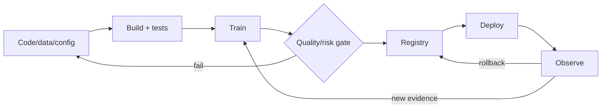

# MLOps Engineer

> [!abstract] Mission
> Make model development, release, observation, recovery, and governance repeatable and safe across teams, from reproducible training through production retirement.

## Responsibilities

- Build CI/CD/continuous-training pipelines, artifact stores, registries, environments, and approval gates.
- Standardize packaging, deployment, traffic shifting, rollback, lineage, access, and audit.
- Observe data, model, infrastructure, service, cost, and outcome health; connect delayed labels.
- Automate retraining only with explicit triggers, validation, and accountable promotion—not blind schedules.
- Own model-platform incidents, reliability, capacity, disaster recovery, and developer documentation.

## Title reality

MLOps may be a dedicated role, a responsibility of [[ML Engineer]], or part of [[AI Platform Engineer]]. Some jobs are primarily DevOps/cloud; others require deep model monitoring and data semantics. Determine whether you own shared platform capabilities, one product's deployment, or managed vendor configuration. “LLMOps” adds foundation-model prompts, retrieval, traces, and evals but retains the same lifecycle discipline.

## Work anatomy

> [!info] What the role owns
> MLOps engineers make model delivery repeatable, observable, and recoverable across teams. The owned product is a lifecycle system: pipelines, registries, gates, deployment patterns, telemetry, runbooks, and standards that keep model changes from becoming one-off operations work.

### Operating loop

1. Map the model lifecycle and define ownership, promotion rules, SLOs, audit needs, and failure classes.
2. Standardize data/model/run metadata, tests, registries, environments, and reproducible execution.
3. Automate evaluation gates, deployment, canaries, rollback, and scheduled or event-driven retraining.
4. Observe quality, drift, latency, cost, availability, and pipeline health after release.
5. Lead incident learning and improve the platform, templates, or controls rather than patching only one model.

### Inputs → outputs

| Inputs | Owned work product | Evidence a reviewer should inspect |
|---|---|---|
| Model/data lifecycle and policy | Pipeline and promotion contract | Ownership, gates, provenance, and environment parity |
| Runs, artifacts, evals, approvals | Registry/deployment path | Versioned release, canary, rollback, and audit trail |
| Production and pipeline events | Runbook and reliability improvement | SLOs, alert quality, recovery drill, and postmortem |

### Decisions and interfaces

Tradeoffs include central standards versus team autonomy, strict gates versus delivery speed, build versus managed service, and rich telemetry versus cost/privacy. Interfaces include ML engineers, data engineers, platform/SRE, security, governance, and product operations.

### Evidence of competence

Demonstrate a model change that moves from commit to gated deployment, then simulate a regression and recover. Include lineage, alerting, rollback, and a measure of lead time or change-failure improvement.

### Research anchors

The lifecycle is represented in [MLflow Tracking](https://mlflow.org/docs/latest/ml/tracking/), [AWS SageMaker Model Registry](https://docs.aws.amazon.com/sagemaker/latest/dg/model-registry.html), [AWS SageMaker Pipelines](https://docs.aws.amazon.com/sagemaker/latest/dg/pipelines-overview.html), [Kubernetes autoscaling](https://kubernetes.io/docs/concepts/workloads/autoscaling/), and [NIST SP 800-218A](https://doi.org/10.6028/NIST.SP.800-218A).
## 2026 technique overlay

> [!tip] Practice this now · 2026-08-24
> Put model and agent changes behind reproducible CI evaluation, OpenTelemetry-compatible traces, SLOs, canaries, cost budgets, drift/incident alerts, and rollback. Keep evaluator, dataset, prompt, and artifact versions together; see [[AI Tools and Practices Update — 2026-08-24]].

> [!info] Microsoft delivery deep dive
> Use [[Microsoft Azure DevOps and Foundry]] to rehearse Azure Pipelines WIF, **azd** version pinning, Foundry evaluation gates, staging/production environments, hosted-agent identity, App Insights traces, and rollback. The worked [[Case - Azure DevOps Foundry Release Gate]] is the MLOps practice case.

> [!info] Edge/web platform deep dive
> Use [[Cloudflare and Vercel AI]] to compare gateway routing/fallbacks, model/provider identity, Durable Object/Workflow recovery, WorkflowAgent upgrades, Sandbox limits, Fluid Compute budgets, and cross-vendor traces. The worked [[Case - Edge AI Platform Choice]] is the MLOps practice case.

> Use [[MCP Deep Dive — 2026-08-24]] for conformance CI, catalog/version drift, modern/legacy rollout, OpenTelemetry traces, budgets, task recovery, and multi-replica tests. Use [[AI Expansion Atlas — 2026-08-24]] to practice AI SRE, inference-time budgets, on-device/cloud routing, provenance/AIBOM, document-ingestion drift, privacy evidence, and energy-aware capacity. Use [[OWASP and AI Security — 2026]] and [[Case - OWASP Agentic Security Review]] for security regression, supply-chain, MCP, incident, and rollback gates.

> [!info] AI × DevOps/cloud release loop
> Study [[AI DevOps and Cloud Engineering — 2026-08-24]] for the full promotion contract: code/image/model/prompt/tool/index/evaluator versions, CI evaluation and security gates, OIDC/WIF, canary/rollback, AI SLOs, OTel telemetry, Kubernetes capacity, supply-chain attestations, and quality-adjusted cost.

## Level ladder

| Level | Expected ownership |
|---|---|
| Junior | Add pipeline steps, infrastructure modules, tests, dashboards, or runbooks. |
| MLOps engineer | Own release/operation workflow for a model family with SLOs and recovery. |
| Senior | Design multi-environment lifecycle and lead incidents, migrations, and governance automation. |
| Staff / principal | Set platform architecture and operating standards across many teams/models. |
| Lead | Own reliability, cost, platform roadmap, adoption, risk interfaces, and team capability. |

## Prerequisites

- Linux, Python/shell, Git, CI/CD, containers, networking, IAM, secrets, infrastructure as code, and cloud/Kubernetes basics.
- ML lifecycle, data/model versioning, evaluation, batch/online inference, drift/skew, and delayed outcomes.
- Observability and SRE concepts: metrics/logs/traces, SLI/SLO, alerting, incident response, capacity, recovery.
- Secure supply chain and governed change management.

## Knowledge and skills

| Area | Demonstrable capability |
|---|---|
| Reproducibility | Bind code, environment, configuration, data, features, metrics, and artifacts to a run. |
| Delivery | Build staged pipelines, approvals, immutable artifacts, canary/shadow, rollback, and compatibility tests. |
| Operations | Define SLOs, telemetry, alerts, runbooks, on-call, postmortems, and disaster recovery. |
| Model health | Track quality, calibration, slices, drift/skew, freshness, label delay, and business outcomes. |
| Infrastructure | IaC, orchestration, autoscaling, quotas, GPUs, storage, network, and multi-environment controls. |
| Governance/security | RBAC, secrets, audit, signing/provenance, vulnerability/license checks, retention and retirement. |

## Study sequence

1. Build CI for tested Python, container images, IaC, and a conventional web service.
2. Add a versioned training pipeline with data validation, experiment tracking, and immutable artifacts.
3. Add registry, evaluation gates, approval, staging, canary/shadow, and one-command rollback.
4. Instrument service, infrastructure, data, and model metrics; connect delayed labels and SLOs.
5. Simulate bad releases, corrupt data, region/node failure, quota exhaustion, and dependency compromise.
6. Create a self-service template with documentation, security defaults, cost attribution, and adoption metrics.

## Tools

| Need | Free / open-first | Paid or managed |
|---|---|---|
| Lifecycle | MLflow, DVC, Kubeflow, Flyte | SageMaker, Vertex AI, Azure ML, Databricks |
| Orchestration | Airflow, Dagster, Argo Workflows | Managed workflow services |
| Delivery/IaC | GitHub Actions/GitLab CI options, Terraform/OpenTofu, Helm, Argo CD | Enterprise CI/CD and IaC platforms |
| Serving | KServe, BentoML, Seldon Core options, Kubernetes | Managed endpoints/model serving |
| Observability | OpenTelemetry, Prometheus, Grafana, Evidently | Datadog, Arize, WhyLabs, Fiddler |

## Quiz

1. Why are immutable model artifacts important?
2. What is the difference between an SLI, SLO, and SLA?
3. When should drift trigger retraining?
4. Why can automatic rollback based only on latency be unsafe?
5. What makes a training run reproducible enough for release?
6. How should secrets be handled in pipelines and model containers?

> [!question]- Answer key
> 1. They make identity, audit, rollback, and reproducibility possible and prevent silent mutation. 2. An SLI is a measurement, an SLO an internal target for it, and an SLA a formal commitment with consequences. 3. Only when drift is relevant to performance/decision risk and a validated replacement improves the required gates; drift alone is not proof. 4. A fast previous version may have correctness/security issues, and rollback itself can face schema/state incompatibility. 5. Exact code/config/environment/artifact identity, versioned data/feature logic, seeds and nondeterminism documentation, metrics, and rerunnable procedure. 6. Inject at runtime from a managed secret store with least privilege, rotate/audit, avoid images/logs/artifacts, and prevent model/tool exposure.

## Flashcards

CI/CD/CT:: Automated integration, delivery/deployment, and controlled training workflows with validation gates.

Immutable artifact:: A content-addressed or otherwise protected version that is never silently changed after creation.

Model registry:: Governed system for versioned model artifacts, lineage, evaluation, approvals, and lifecycle status.

SLI:: A measured indicator of service behavior, such as successful request proportion or latency distribution.

SLO:: Target range for an SLI over a stated time window.

Error budget:: Allowed unreliability implied by an SLO, used to balance delivery and reliability work.

Shadow deployment:: Candidate execution on copied traffic without controlling the production outcome.

Rollback:: Restoring a known compatible prior state; it must include code, model, config, schema, and dependencies as needed.

## Interview preparation

- Design a model delivery platform from commit through monitored production and retirement.
- Explain artifact identity, lineage, environment promotion, approval, and rollback.
- Diagnose an incident spanning stale features, model drift, service latency, and missing labels.
- Choose Kubernetes versus managed endpoints for an explicit workload and team.
- Design multi-tenant IAM, secrets, network boundaries, quotas, and cost attribution.
- Present a postmortem and the systemic control it produced.

## Suggested projects

### Beginner — Gated model pipeline

Automate tests, training, evaluation, MLflow logging, image build, registry, and local staging. Fail promotion on quality or schema regression and document rollback.

### Intermediate — Observable canary system

Deploy baseline/candidate, route a canary, collect service/data/model metrics, join delayed labels, alert on SLOs, and automate a safe compatible rollback with runbook.

### Advanced — Self-service MLOps platform

Create reusable IaC/templates for batch and online models with RBAC, signed artifacts, approval, lineage, cost tags, disaster recovery, fault injection, and developer-experience metrics.

## Job-search aliases

Search `MLOps engineer`, `machine learning operations engineer`, `ML platform engineer`, `model operations engineer`, `LLMOps engineer`, `DevOps machine learning`, and `ML infrastructure engineer`.

## Boundaries

- [[ML Engineer]] owns model/product logic and may use the MLOps system.
- [[AI Platform Engineer]] owns a broader developer platform including compute, gateways, retrieval, agent tooling, and shared services.
- [[ML Data Engineer]] owns upstream/online data products and time correctness.
- Site reliability/platform engineers may share most systems duties without model-specific evaluation or lifecycle knowledge.

## Sources

- [MLflow Tracking](https://mlflow.org/docs/latest/ml/tracking/) — runs, datasets, models, experiments, and artifacts; accessed 2026-08-12.
- [AWS SageMaker Model Registry](https://docs.aws.amazon.com/sagemaker/latest/dg/model-registry.html) — lifecycle, lineage, approvals, deployment, and CI/CD; accessed 2026-08-12.
- [AWS SageMaker Pipelines overview](https://docs.aws.amazon.com/sagemaker/latest/dg/pipelines-overview.html) — gated DAG workflow; accessed 2026-08-12.
- [Kubernetes autoscaling workloads](https://kubernetes.io/docs/concepts/workloads/autoscaling/) — horizontal, vertical, event-driven, and node scaling concepts; accessed 2026-08-12.
- [NIST SP 800-218A](https://doi.org/10.6028/NIST.SP.800-218A) — secure AI-model/system development artifacts and practices; published 2024-07-26, accessed 2026-08-12.
