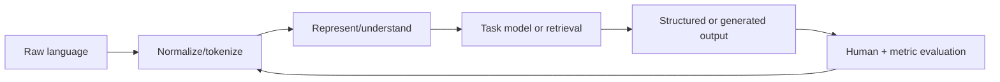

# NLP Engineer

> [!abstract] Mission
> Build language systems that transform, classify, extract, retrieve, translate, or generate text accurately across real linguistic variation and operational constraints.

## Responsibilities

- Define language tasks, annotation guidelines, label taxonomies, and evaluation slices.
- Build rule-based, statistical, transformer, retrieval, or hybrid pipelines appropriate to the problem.
- Handle tokenization, normalization, multilingual variation, ambiguity, long documents, and domain terminology.
- Train/adapt models; analyze errors by language, dialect, entity, length, genre, and risk-relevant group.
- Package and operate pipelines with latency, privacy, drift, and human-review requirements.

## Title reality

NLP can mean classic tasks such as NER, parsing, search, and classification or modern foundation-model work. Some NLP roles are now labeled [[LLM Engineer]], [[RAG and Knowledge Engineer]], or Applied Scientist. “Computational linguist” may emphasize language resources, grammar, morphology, and annotation rather than production software. Inspect modality, languages, research expectations, and ownership of deployment.

## Work anatomy

> [!info] What the role owns
> NLP engineers build language-processing systems whose unit of work may be a token, span, document, conversation, or language-specific behavior. They care about linguistic validity, annotation meaning, distribution coverage, model behavior, and the integration path into a product.

### Operating loop

1. Define the linguistic task, ontology, languages, context, label policy, and costly errors.
2. Build or audit annotated data and a simple rules/statistical baseline.
3. Train or adapt the pipeline, then analyze errors by entity, language, domain, length, and ambiguity.
4. Integrate the model with preprocessing, postprocessing, confidence, latency, and fallback behavior.
5. Monitor drift, annotation changes, multilingual quality, and downstream decision impact.

### Inputs → outputs

| Inputs | Owned work product | Evidence a reviewer should inspect |
|---|---|---|
| Text, language/domain, label policy | Corpus and annotation guide | Agreement, edge cases, provenance, and split design |
| Features/models/configuration | NLP pipeline/model | Baseline, span/class metrics, calibration, and error taxonomy |
| Product feedback and drift | Release and update plan | Language/domain slices, regression suite, and fallback policy |

### Decisions and interfaces

Tradeoffs include rules versus learned models, precision versus recall, generic versus domain-specific representations, multilingual breadth versus depth, and model quality versus latency. Interfaces include data labeling, LLM/application, search/knowledge, product, and evaluation teams.

### Evidence of competence

A strong project shows the ontology and label guide, baseline, confusion/error examples, slice results, and how the pipeline behaves on ambiguity or unsupported language. A model score without linguistic inspection hides the real work.

### Research anchors

Use [spaCy pipeline architecture](https://spacy.io/usage/processing-pipelines), [spaCy training](https://spacy.io/usage/training), [Hugging Face Transformers](https://huggingface.co/docs/transformers/index), and [BLS Data Scientists](https://www.bls.gov/ooh/math/data-scientists.htm) for the modeling/communication context.
## 2026 technique overlay

> [!tip] Practice this now · 2026-08-24
> Treat tokenization, language coverage, data provenance, human labels, safety cases, and latency as first-class interfaces. Evaluate rare language and style slices, calibration, grounding, and graceful abstention with [[AI Tools and Practices Update — 2026-08-24]].

## Level ladder

| Level | Expected ownership |
|---|---|
| Junior | Prepare text data, implement pipeline components, and evaluate a bounded task. |
| NLP engineer | Own one language system from annotation/data through deployment and error analysis. |
| Senior | Design multilingual/domain solutions and lead data–model–product tradeoffs. |
| Staff / principal | Set language architecture, evaluation, and reuse across products and markets. |
| Lead | Direct language technology portfolio, data strategy, risk, and specialist collaboration. |

## Prerequisites

- Python, text processing, Unicode, regular expressions, data structures, SQL, APIs, and testing.
- Probability/statistics and ML; sequence models, attention, transformers, embeddings, and retrieval.
- Linguistic basics: morphology, syntax, semantics, pragmatics, discourse, and sociolinguistic variation.
- Data annotation design and inter-annotator analysis; production and privacy fundamentals.

## Knowledge and skills

| Area | Demonstrable capability |
|---|---|
| Text/data | Normalize without destroying meaning; create annotation guides; audit imbalance, leakage, and licensing. |
| Linguistics | Explain how segmentation, ambiguity, context, dialect, and domain language affect a system. |
| Modeling | Compare rules, classical features, encoder models, generative models, retrieval, and hybrids. |
| Evaluation | Choose token/span/sequence/ranking/generation metrics; inspect exact errors and human disagreement. |
| Production | Batch/stream processing, model packaging, latency, versioned vocabulary/schema, drift monitoring. |
| Responsible use | Privacy, harmful bias, accessibility, language coverage, and safe human escalation. |

## Study sequence

1. Implement tokenization, normalization, n-grams, TF-IDF, and a classical classifier.
2. Build spaCy components for NER or entity linking and analyze annotation disagreement.
3. Fine-tune an encoder model; compare with the classical baseline under matched splits.
4. Build semantic/hybrid retrieval and evaluate recall, ranking, and language/domain slices.
5. Add a generative model only where necessary; measure factual support and structured-output validity.
6. Deploy and monitor text distribution, language coverage, latency, privacy, and review queues.

## Tools

| Need | Free / open-first | Paid or managed |
|---|---|---|
| Pipelines | spaCy, NLTK, Stanza, regex | Cloud language APIs |
| Models | PyTorch, Transformers, sentence-transformers | Hosted foundation-model APIs and managed training |
| Search | Elasticsearch/OpenSearch, PostgreSQL/pgvector, Qdrant | Managed search/vector services |
| Annotation | Label Studio, doccano, Prodigy limited/trial availability varies | Labelbox, Scale and other managed services |
| Evaluation | scikit-learn, seqeval, sacreBLEU, evaluate, custom human review | Commercial eval/observability platforms |

## Quiz

1. Why can Unicode normalization change meaning or identifiers?
2. When is span-level F1 more useful than token accuracy?
3. What does inter-annotator disagreement reveal?
4. Why can a language-model tokenizer disadvantage some languages?
5. When should rules and models be combined?
6. What is label leakage in document classification?

> [!question]- Answer key
> 1. Some characters or compatibility forms are intentionally distinct, and identifiers/code may require exact preservation. 2. Extraction succeeds or fails on entity boundaries and types, while high token accuracy can be dominated by non-entity tokens. 3. Ambiguous guidelines, subjective constructs, difficult cases, annotator variance, or a ceiling on deterministic labels. 4. A language may require more tokens per unit meaning, raising context use, latency, and cost and weakening representation. 5. When precise known patterns need deterministic handling and models cover variable or ambiguous cases, with conflict rules and evaluation. 6. Features reveal the outcome or post-outcome information, such as a disposition phrase added after the true decision.

## Flashcards

Tokenization:: Segmenting text into model units; the choice affects meaning, sequence length, and cross-language efficiency.

NER:: Named-entity recognition, which finds spans and assigns entity types.

Entity linking:: Mapping a mention in text to a specific entity in a knowledge base.

Macro F1:: Average F1 across classes with equal class weight, useful when minority classes matter.

Sequence labeling:: Assigning a label to each token or span while respecting sequence context.

Pragmatics:: Meaning derived from speaker intent and context beyond literal semantics.

Annotation guideline:: Operational rules and examples defining how humans should label a construct.

Domain shift:: Deployment language differs from training language in topic, genre, population, time, or other conditions.

## Interview preparation

- Explain tokenization and transformer representations, including multilingual and long-context tradeoffs.
- Design labels and metrics for an ambiguous extraction or classification task.
- Debug an NER system with excellent aggregate F1 but poor user experience.
- Compare rules, encoder fine-tuning, prompting, and retrieval for a domain task.
- Code text preprocessing without data leakage and discuss Unicode/PII safety.
- Present error slices and how linguistic insight changed the model or annotation guide.

## Suggested projects

### Beginner — Domain NER pipeline

Create an annotation guide, label a small corpus, measure agreement, compare rules and a statistical/model baseline, report span/type errors, and package a tested API.

### Intermediate — Multilingual text classifier

Train a model across at least three language varieties. Report per-language token length, calibration, macro metrics, robustness to spelling/code-switching, and privacy/licensing notes.

### Advanced — Hybrid language intelligence system

Build entity extraction, linking, hybrid retrieval, and grounded generation for long documents. Evaluate each stage, add human adjudication, monitor domain shift, and publish a system card.

## Job-search aliases

Search `NLP engineer`, `natural language processing engineer`, `computational linguist`, `language AI engineer`, `text ML engineer`, `information extraction engineer`, and task-specific terms such as search, translation, or entity linking.

## Boundaries

- [[LLM Engineer]] centers foundation-model adaptation and serving; NLP includes non-generative and linguistic pipelines.
- [[RAG and Knowledge Engineer]] owns retrieval, corpus lifecycle, provenance, and grounded answers.
- [[Data Scientist - AI ML]] may analyze text without operating a language product.
- [[AI ML Research Scientist]] seeks new generalizable language methods rather than primarily delivering a system.

## Sources

- [spaCy 101](https://spacy.io/usage/spacy-101) — language pipeline components and core data structures; accessed 2026-08-12.
- [spaCy processing pipelines](https://spacy.io/usage/processing-pipelines) — component architecture and processing behavior; accessed 2026-08-12.
- [spaCy training](https://spacy.io/usage/training) — annotation conversion, configuration, and model training; accessed 2026-08-12.
- [Hugging Face Transformers documentation](https://huggingface.co/docs/transformers/index) — current transformer tasks and APIs; accessed 2026-08-12.
- [BLS — Data Scientists](https://www.bls.gov/ooh/math/data-scientists.htm) — adjacent U.S. modeling and communication context; accessed 2026-08-12.
