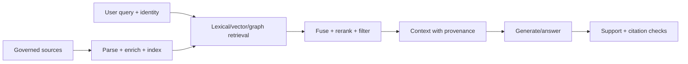

# RAG and Knowledge Engineer

> [!info] October 13, 2026 update
> Practice focus: **Whether retrieved evidence is relevant and authorized**. Produce **Retrieval/generation error decomposition** and answer: Can a revoked document still appear in cache?
> Use [[Technical Role Practice Workbook — October 2026]] and [[October 2026 Research Refresh]]. This checkpoint does not reverify every older market/tool claim in this profile.

> [!abstract] Mission
> Deliver relevant, authorized, current, traceable knowledge to AI systems and users by engineering corpora, retrieval, ranking, context, citations, and feedback as measurable subsystems.

## Responsibilities

- Inventory sources; define authority, access, freshness, provenance, version, deletion, and content parsing.
- Build ingestion, deduplication, chunking/structure, metadata, embeddings, lexical/vector indexes, and entity/graph links where justified.
- Engineer query understanding, filters, hybrid retrieval, fusion, reranking, context selection, and citation mapping.
- Evaluate retrieval independently from answer generation; diagnose missing, wrong, stale, unauthorized, or unsupported evidence.
- Operate index updates, ACL propagation, latency/cost, feedback, observability, and incident response.

## Title reality

This work may be titled RAG Engineer, Search Engineer, Retrieval Engineer, Knowledge Engineer, Information Retrieval Engineer, or [[AI Engineer]]. Traditional knowledge engineering may emphasize ontologies, rules, and knowledge graphs; RAG may be vector-search-heavy. Strong systems use whatever retrieval approach fits the corpus and queries, not “a vector database” by default.

## Work anatomy

> [!info] What the role owns
> RAG and knowledge engineers own the evidence supply that a downstream answer or decision relies on. Their work spans source governance, parsing, chunking, indexing, retrieval, ranking, provenance, access control, freshness, and grounded answer evaluation.

### Operating loop

1. Define the information need, authoritative sources, access rules, freshness expectation, and answer-support contract.
2. Ingest and normalize documents or records with provenance, versioning, metadata, and deletion/update behavior.
3. Establish lexical/vector/hybrid retrieval and reranking baselines; inspect misses, duplicates, and irrelevant context.
4. Evaluate retrieval separately from generation, then test citation coverage, groundedness, refusal, and access control.
5. Refresh indexes safely, monitor drift and source health, and feed failed questions into corpus or ranking improvements.

### Inputs → outputs

| Inputs | Owned work product | Evidence a reviewer should inspect |
|---|---|---|
| Sources, policies, documents, permissions | Governed corpus and ingestion contract | Provenance, freshness, deletion, and access filters |
| Queries and relevance judgments | Retrieval/index/ranking system | Recall@k, precision@k, nDCG, latency, and failure examples |
| Retrieved evidence and answers | Grounding/citation policy | Citation support, abstention behavior, and answer-eval split |

### Decisions and interfaces

Tradeoffs include lexical versus vector versus hybrid search, chunk size versus context quality, reranking cost versus relevance, freshness versus index cost, and recall versus access-control strictness. Interfaces include data engineering, NLP/LLM, application, security/privacy, domain experts, and evaluation.

### Evidence of competence

Show the corpus contract, retrieval baseline, relevance set, failed-query gallery, access-control test, citation policy, and a refresh or deletion scenario. A polished answer is not evidence if the retriever supplied the wrong evidence.

### Research anchors

The practice follows [Elastic hybrid search](https://www.elastic.co/docs/solutions/search/hybrid-search), [Elastic semantic search](https://www.elastic.co/guide/en/elasticsearch/reference/8.19/semantic-search.html), [Weaviate hybrid search](https://docs.weaviate.io/weaviate/search/hybrid), and [MLflow model evaluation](https://mlflow.org/docs/latest/ml/evaluation). Work the authority/packing autopsy in [[Case - Retrieval Failure Autopsy]].
## 2026 technique overlay

> [!tip] Practice this now · 2026-08-24
> Store source URI/version/ACL/chunk IDs, measure retrieval separately from generation, test stale and poisoned documents, enforce access before ranking, and make citations and abstention observable. Build the evidence-backed slice in [[AI Tools and Practices Update — 2026-08-24]].

## Level ladder

| Level | Expected ownership |
|---|---|
| Junior | Implement ingestion, metadata, retrieval experiments, or evaluation cases. |
| RAG/knowledge engineer | Own one corpus-to-answer pipeline, retrieval quality, access, freshness, and telemetry. |
| Senior | Design hybrid/multi-stage retrieval and resolve cross-source authority and scale. |
| Staff / principal | Set enterprise knowledge architecture, evaluation, and governance standards. |
| Lead | Own knowledge platform roadmap, source partnerships, risk, economics, and organizational adoption. |

## Prerequisites

- Python/TypeScript, SQL, APIs, document parsing, data modeling, search systems, and production engineering.
- Information retrieval: inverted indexes/BM25, embeddings, approximate nearest neighbors, hybrid fusion, reranking, relevance metrics.
- LLM context/generation and evaluation; authorization, privacy, provenance, and data lifecycle.
- Domain taxonomy and content-owner collaboration; search relevance is a data/measurement discipline.

## Knowledge and skills

| Area | Demonstrable capability |
|---|---|
| Corpus | Parse structure, preserve provenance, deduplicate, version, assign authority/freshness, propagate ACLs/deletion. |
| Retrieval | Lexical, dense/sparse vector, filters, hybrid fusion, multi-query, graph/entity, reranking. |
| Context | Chunk/section selection, token budgeting, redundancy control, source diversity, citation alignment. |
| Evaluation | Recall@k, precision@k, MRR/nDCG as appropriate; answer support/completeness; negative and access tests. |
| Operations | Incremental indexing, freshness SLO, query/index latency, capacity, embedding/model migrations, rollback. |
| Security | Query-time identity, tenant/source ACLs, injection-resistant handling, minimal context, audit and redaction. |

## Study sequence

1. Build a BM25/inverted-index baseline and a relevance judgment set before embeddings.
2. Add dense retrieval; compare lexical, vector, and hybrid by query category.
3. Add reranking and structured chunking/metadata; measure marginal gain and latency.
4. Connect generation with source-span citations; separately score retrieval, support, and answer utility.
5. Add per-document authorization, freshness/versioning, deletion, adversarial documents, and audit traces.
6. Run embedding/index migration, failure/rebuild, load, cost, and regression tests; write a source-authority policy.

## Tools

| Need | Free / open-first | Paid or managed |
|---|---|---|
| Search/vector | Elasticsearch/OpenSearch, PostgreSQL/pgvector, Qdrant, Weaviate | Pinecone, managed Elastic/search/vector services |
| Embeddings/rerank | sentence-transformers, Transformers, open rerankers | Hosted embedding/rerank APIs |
| Pipelines | Python, LlamaIndex, LangChain components, Apache Tika/Unstructured options | Managed document AI/RAG platforms |
| Evaluation | ranx/trec_eval options, Ragas/DeepEval with validation, custom judgments | Commercial RAG eval/observability |
| Knowledge graph | RDFLib, Neo4j community options, Apache Jena | Managed graph databases |

## Quiz

1. Why evaluate retrieval separately from generation?
2. When can lexical search beat vector search?
3. What does reciprocal rank fusion do?
4. Why is chunk size not a universal hyperparameter?
5. Where must document authorization be enforced?
6. Distinguish a citation's presence from citation correctness.

> [!question]- Answer key
> 1. A good generator cannot cite missing evidence and poor answers can occur despite good retrieval; separation localizes failure. 2. Exact names, identifiers, rare terms, quoted phrases, code, and out-of-domain terms often favor lexical matching. 3. It combines ranked lists using reciprocal functions of rank without requiring comparable raw scores. 4. Structure, task, model, query, evidence span, and context constraints determine the useful unit; arbitrary chunks can sever meaning. 5. Before or during retrieval/context construction using authenticated identity and authoritative ACLs—not by asking the model to hide results. 6. A response may include a source marker that does not support the claim or points to the wrong span/version.

## Flashcards

BM25:: A lexical ranking family using term frequency, document frequency, and length normalization.

Dense retrieval:: Retrieval by similarity between learned dense vector representations.

Hybrid retrieval:: Combining lexical and semantic/vector retrieval into one ranked result.

RRF:: Reciprocal rank fusion, combining lists based on rank positions rather than raw score scales.

Reranker:: A more expensive model or rule that reorders an initial candidate set.

Recall@k:: Fraction of relevant items found within the first k results under a defined relevance set.

nDCG:: Ranking metric rewarding relevant items near the top, normalized against an ideal ordering.

Groundedness/support:: Degree to which answer claims are justified by the supplied evidence under a stated rubric.

## Interview preparation

- Design RAG for multi-tenant documents with freshness, citations, and deletion.
- Explain inverted indexes, embeddings, ANN, fusion, reranking, and ranking metrics.
- Diagnose unsupported answers across source, parse, index, query, retrieval, rerank, context, and generator.
- Build a relevance judgment/eval strategy with sparse labels and changing content.
- Plan embedding or index migrations without downtime or silent score changes.
- Threat-model malicious documents, ACL leakage, query exfiltration, and stale authority.

## Suggested projects

### Beginner — Search baseline laboratory

Create 100 queries and relevance judgments for a public corpus. Compare BM25 and dense retrieval by query type with recall@k, MRR/nDCG, latency, and error examples.

### Intermediate — Cited hybrid RAG

Implement structure-aware ingestion, hybrid retrieval with RRF, reranking, answer citations to source spans, separate retrieval/support evals, and freshness/version tests.

### Advanced — Governed enterprise knowledge system

Simulate tenants and ACLs, multiple authority levels, incremental updates/deletion, malicious documents, graph/entity links where useful, index migration, observability, load testing, and a source-governance runbook.

## Job-search aliases

Search `RAG engineer`, `retrieval augmented generation engineer`, `information retrieval engineer`, `search relevance engineer`, `AI knowledge engineer`, `semantic search engineer`, and `knowledge graph engineer AI`.

## Boundaries

- [[AI Engineer]] owns the full product workflow; RAG/knowledge owns evidence supply and relevance deeply.
- [[NLP Engineer]] owns language processing/modeling tasks beyond retrieval.
- [[ML Data Engineer]] owns reliable data transport and snapshots; RAG owns semantic structure, ranking, and answer support.
- [[AI Evaluation Engineer]] provides broader measurement systems; RAG engineers must still own retrieval-specific evals.

## Sources

- [Elastic — Hybrid search](https://www.elastic.co/docs/solutions/search/hybrid-search) — lexical/vector combination and RRF recommendation; accessed 2026-08-12.
- [Elastic — Semantic search](https://www.elastic.co/guide/en/elasticsearch/reference/8.19/semantic-search.html) — dense/sparse/semantic query workflows; accessed 2026-08-12.
- [Weaviate — Hybrid search](https://docs.weaviate.io/weaviate/search/hybrid) — configurable vector/BM25 fusion; accessed 2026-08-12.
- [MLflow model API](https://mlflow.org/docs/latest/api_reference/python_api/mlflow.models.html) — retriever precision@k, recall@k, and nDCG evaluation outputs; accessed 2026-08-12.
- [OpenAI careers search](https://openai.com/careers/search/?q=Research+Engineer) — current `Research Engineer, Retrieval & Search` and knowledge-title evidence; accessed 2026-08-12.
