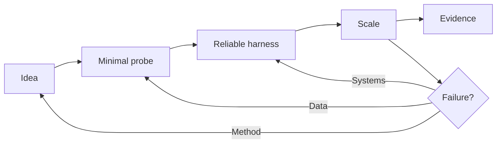

# Research Engineer

> [!abstract] Mission
> Turn uncertain research ideas into trustworthy experimental systems quickly: implement methods, create training and evaluation infrastructure, debug at scale, and generate evidence researchers can rely on.

## Responsibilities

- Translate a paper, sketch, or hypothesis into tested model and data code.
- Build experiment harnesses, distributed training pipelines, datasets, environments, graders, and observability.
- Profile and remove bottlenecks without invalidating experimental comparisons.
- Diagnose numerical instability, data corruption, nondeterminism, distributed failures, and silent metric errors.
- Co-design experiments and sometimes originate research; contribute papers, open-source systems, or deployed capabilities.

## Title reality

This is one of the widest AI titles. At a frontier lab it can mean research-level ML plus exceptional systems work. Elsewhere it may resemble an [[ML Engineer]] supporting a research team. Combined “Research Engineer/Research Scientist” postings show that some teams care more about complementary strengths than a hard boundary. Ask what fraction of work is new experiments, shared infrastructure, paper authorship, and productionization.

## Work anatomy

> [!info] What the role owns
> Research engineers convert ideas into reliable experimental leverage. They may invent methods, but their distinctive value is making difficult research executable: environments, training/evaluation systems, data pipelines, instrumentation, distributed runs, and reusable tools that let scientists learn faster.

### Operating loop

1. Translate a research hypothesis into an executable experiment with interfaces, constraints, and success criteria.
2. Build the minimum reliable system, including data/model configs, tests, logging, checkpoints, and reproducible environments.
3. Scale or automate the run while protecting correctness, observability, and experiment comparability.
4. Analyze failures across code, data, systems, and scientific assumptions; iterate with the researcher.
5. Package the artifact, results, and operational instructions so the next experiment starts from a stronger baseline.

### Inputs → outputs

| Inputs | Owned work product | Evidence a reviewer should inspect |
|---|---|---|
| Hypothesis, paper, model idea | Experiment implementation | Clear interfaces, tests, config, and baseline |
| Runs, environments, data, compute | Research system and telemetry | Checkpoints, failure recovery, throughput, and reproducibility |
| Results and discrepancies | Reusable artifact or handoff | Analysis, limitations, documentation, and next experiment |

### Decisions and interfaces

Tradeoffs include research speed versus abstraction, prototype versus durable system, automation versus scientific visibility, and scaling a flawed experiment versus validating the premise. Interfaces include scientists, data, infrastructure, evaluation, safety, and productization engineers.

### Evidence of competence

Show a paper reproduction or research environment with a discrepancy ledger, resumable runs, tracked artifacts, and a short explanation of what was made reusable. Research velocity is measurable in time-to-reliable-result, not commits alone.

### Research anchors

The current [OpenAI Frontier Evals role](https://openai.com/careers/research-engineer-frontier-evals-and-environments-san-francisco/) explicitly combines environments, graders, continuous evaluation, large-scale runs, and cross-functional execution; pair it with [PyTorch compiler guidance](https://docs.pytorch.org/docs/stable/user_guide/torch_compiler/torch.compiler_faq.html) and [MLflow Tracking](https://mlflow.org/docs/latest/ml/tracking/).
## 2026 technique overlay

> [!tip] Practice this now · 2026-08-24
> Make the experiment or system runnable by someone else: pin dependencies, capture config and traces, isolate variables, profile bottlenecks, and publish failures and limits. Connect research artifacts to a release or replication decision with [[AI Tools and Practices Update — 2026-08-24]].

## Level ladder

| Level | Expected ownership |
|---|---|
| Assistant / resident | Reproduce methods, add tests, run bounded experiments, document failures. |
| Research engineer | Own a research subsystem or experiment suite and deliver reliable results. |
| Senior | Design scalable harnesses, unblock ambiguous research, and mentor across modeling and systems. |
| Staff / principal | Set research-engineering architecture and experimental standards across programs. |
| Lead | Shape portfolio execution, compute strategy, staffing, and scientist–engineer collaboration. |

## Prerequisites

- Excellent Python, software design, testing, Git, Linux, and debugging.
- Deep-learning fundamentals and practical PyTorch or JAX.
- Data pipelines, GPUs/accelerators, profiling, and distributed systems at a depth appropriate to target teams.
- Enough probability and experimental design to know when an implementation result is not credible.
- C++/CUDA/Triton is optional for general roles and central for low-level performance teams.

## Knowledge and skills

| Area | Demonstrable capability |
|---|---|
| Research implementation | Reconstruct algorithms from papers, identify ambiguities, validate against toy cases and baselines. |
| Training systems | Checkpointing, mixed precision, sharding/parallelism, reproducible configuration, failure recovery. |
| Evaluation systems | Dataset versioning, graders, repeat sampling, statistical summaries, contamination defenses. |
| Performance | Profile first; reason about compute, memory, communication, input pipelines, and cost. |
| Reliability | Unit/property/integration tests, invariants, artifact lineage, monitoring, incident learning. |
| Collaboration | Reduce an ambiguous research question to milestones without prematurely freezing exploration. |

## Study sequence

1. Build tested Python packages, typed interfaces, CI, containers, and reproducible environments.
2. Implement and train a transformer; inspect gradients, activations, memory, throughput, and checkpoints.
3. Reproduce a paper and create golden toy cases before launching expensive runs.
4. Run multi-GPU training; simulate worker failure and resume without losing lineage.
5. Build an evaluation harness with immutable datasets, repeated sampling, graders, and confidence intervals.
6. Contribute to an open research codebase or publish a reusable research tool with benchmarks.

## Tools

| Need | Free / open-first | Paid or managed |
|---|---|---|
| Modeling | PyTorch, JAX, Transformers | Managed foundation-model and training platforms |
| Configuration/tracking | Hydra, MLflow, TensorBoard, DVC | Weights & Biases, Databricks |
| Distributed execution | `torch.distributed`, Ray, Slurm, Kubernetes | SageMaker, Vertex AI, Azure ML, managed GPU clusters |
| Performance | PyTorch Profiler, Nsight tools, `nvidia-smi` | Cloud profiling/observability suites |
| Quality | pytest, Hypothesis, Ruff, mypy, pre-commit | Enterprise CI and code-quality platforms |

## Quiz

1. Why create a tiny overfit test before a large training run?
2. What must a checkpoint contain for faithful resumption?
3. Distinguish data parallelism, tensor parallelism, and pipeline parallelism.
4. Why can increasing throughput invalidate a research comparison?
5. How would you detect silent label corruption?
6. What makes a benchmark harness “load-bearing”?

> [!question]- Answer key
> 1. It cheaply validates data flow, loss, gradients, capacity, and optimization. 2. Model and optimizer state, scheduler/scaler state, step/epoch, RNG state, data position or sampler state, configuration, code/data identity, and relevant distributed metadata. 3. They shard examples, tensor operations/parameters, and model stages respectively. 4. It may change effective batch size, numerical precision, sequence packing, data order, or optimization dynamics. 5. Schema/range checks, label-distribution monitoring, sampled human review, cross-source reconciliation, and performance on controlled sentinels. 6. Many decisions depend on it, so versioning, tests, reproducibility, capacity, and failure visibility must be stronger than for a disposable script.

## Flashcards

Golden test:: A small, stable input and expected output used to detect behavioral regressions.

Numerical stability:: Resistance of a computation to harmful error from finite precision, scaling, or operation ordering.

Effective batch size:: Samples contributing to one optimizer update across devices and gradient-accumulation steps.

Checkpoint lineage:: The trace from weights to code, configuration, data, optimizer state, and parent artifacts.

Collective operation:: Distributed coordination such as all-reduce, all-gather, reduce-scatter, or broadcast.

Determinism:: Repeatability under fixed conditions; it can cost performance and does not replace statistical replication.

Profiler:: A tool that measures where time, memory, or resources are consumed instead of relying on intuition.

Research velocity:: Credible learning per unit time or compute—not simply jobs launched per day.

## Interview preparation

- Implement a training/evaluation component with tests while explaining invariants and failure handling.
- Debug NaNs, diverging loss, GPU underutilization, data-loader stalls, or distributed deadlock from evidence.
- Design a harness for thousands of expensive, stochastic model evaluations.
- Explain how you would reproduce an underspecified paper.
- Estimate memory for parameters, gradients, optimizer state, activations, and KV cache.
- Present a project where infrastructure changed the rate or quality of research conclusions.

Expect coding, ML fundamentals, system design, and a research discussion. Practice communicating the smallest experiment that distinguishes competing failure hypotheses.

## Suggested projects

### Beginner — Paper-to-package reproduction

Implement a small paper as a tested package. Add toy invariants, configuration, seeded runs, baseline comparison, and an honest discrepancy report.

### Intermediate — Resumable training service

Build a multi-GPU-capable training harness with atomic checkpoints, experiment tracking, automated evaluation, failure injection, and a reproducibility test.

### Advanced — Evaluation environment platform

Create scalable environments and graders for a tool-using model. Version tasks, sandbox execution, quantify grader reliability and variance, trace failures, and publish a throughput/cost-quality study.

## Job-search aliases

Search `research engineer machine learning`, `ML research engineer`, `research software engineer AI`, `research engineer pretraining`, `research engineer post-training`, `research engineer evals`, and combined `research engineer/research scientist`.

## Boundaries

- [[AI ML Research Scientist]] owns scientific questions and claims more consistently; research engineers may do both but are selected heavily for implementation and systems leverage.
- [[ML Engineer]] more often owns a durable production prediction system and service-level objectives.
- [[Inference and Performance Engineer]] specializes in serving, kernels, compilers, or hardware efficiency rather than the whole experiment loop.
- [[AI Evaluation Engineer]] specializes in measurement validity and evaluation infrastructure.

## Sources

- [OpenAI — Research Engineer/Research Scientist, RL/Reasoning](https://openai.com/careers/research-engineerresearch-scientist-rlreasoning-san-francisco/) — research plus large-codebase expectations; accessed 2026-08-12.
- [OpenAI — Research Engineer, Frontier Evals & Environments](https://openai.com/careers/research-engineer-frontier-evals-and-environments-san-francisco/) — environment, grader, continuous-evaluation, and research-system scope; accessed 2026-08-12.
- [Anthropic jobs](https://www.anthropic.com/careers/jobs) — live U.S. title variants across pretraining, RL, interpretability, knowledge, and systems; accessed 2026-08-12.
- [PyTorch — `torch.compile` FAQ](https://docs.pytorch.org/docs/stable/user_guide/torch_compiler/torch.compiler_faq.html) — training and distributed compiler behavior; updated 2026-04-23, accessed 2026-08-12.
- [MLflow Tracking](https://mlflow.org/docs/latest/ml/tracking/) — run, model, dataset, and artifact tracking; accessed 2026-08-12.
