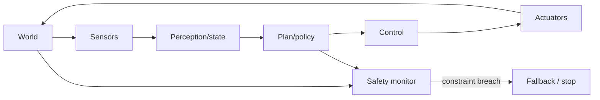

# Robotics and Embodied AI Engineer

> [!abstract] Mission
> Create physical agents that perceive, estimate state, plan, learn, and act reliably in the real world while respecting hardware limits and human safety.

## Responsibilities

- Integrate sensors, perception, localization/state estimation, planning, control, learned policies, and actuators.
- Build simulation, data collection, calibration, teleoperation, replay, and hardware-in-the-loop test systems.
- Train or adapt perception/control/policy models and manage sim-to-real or domain-shift gaps.
- Profile real-time compute and communication; diagnose failures across mechanical, electrical, firmware, networking, and ML layers.
- Define operational design domains, safety constraints, fallback states, test coverage, and incident procedures.

## Title reality

This track spans industrial robotics, autonomous vehicles, drones, manipulation, humanoids, and embodied foundation-model research. Many jobs specialize: perception engineer, controls engineer, localization engineer, motion-planning engineer, robot-learning researcher, or robotics software engineer. O*NET's U.S. Robotics Engineers occupation includes design, sensor interpretation, debugging, building, and testing; an “embodied AI” posting may be much more research-heavy.

## Work anatomy

> [!info] What the role owns
> Robotics and embodied-AI engineers own closed-loop behavior in a physical or simulated world. The work joins perception, state estimation, planning, control, hardware interfaces, timing, recovery, and safety; a model that is accurate offline can still fail when the robot moves.

### Operating loop

1. Define the task, environment, safety envelope, success criteria, latency/jitter limits, and recovery or teleoperation policy.
2. Build the simulation, sensor/calibration, middleware, and baseline controller or policy.
3. Integrate perception, localization, planning, and control; test unit, integration, simulation, and hardware-in-loop behavior.
4. Probe scenario coverage, distribution shift, timing faults, collision/near-miss behavior, and degraded sensing.
5. Deploy cautiously, log field behavior, and update the model, controller, scenario set, or safety case.

### Inputs → outputs

| Inputs | Owned work product | Evidence a reviewer should inspect |
|---|---|---|
| Task, robot, sensors, environment | System architecture and safety envelope | ROS graph, assumptions, calibration, and recovery policy |
| Sensor streams and policies/controllers | Perception-to-action system | Scenario matrix, latency/jitter, success, and failure logs |
| Field/simulation evidence | Release or test decision | Hardware-in-loop results, residual risk, and rollback/teleop plan |

### Decisions and interfaces

Tradeoffs include simulation versus real data, learned versus classical control, autonomy versus teleoperation, model capacity versus onboard compute, and task success versus safety margin. Interfaces include mechanical/electrical hardware, vision, planning/control, inference, test, and field operations.

### Evidence of competence

A strong project includes a reproducible simulator, explicit scenario coverage, sensor fault or latency tests, a safety/teleop fallback, and logs that explain why a run failed. A video of one successful run is not sufficient evidence.

### Research anchors

Use [O*NET Robotics Engineers](https://www.onetonline.org/link/details/17-2199.08), [ROS 2 tutorials](https://docs.ros.org/en/ros2_documentation/kilted/Tutorials.html), [ROS 2 managed nodes](https://docs.ros.org/en/ros2_packages/kilted/api/lifecycle/__README.html), and the multidisciplinary context in [BLS research scientists](https://www.bls.gov/ooh/computer-and-information-technology/computer-and-information-research-scientists.htm).
## 2026 technique overlay

> [!tip] Practice this now · 2026-08-24
> Define sensor/data contracts, simulation scenarios, latency and safety envelopes, human override, and sim-to-real validation. Replay failures with traceable actions and preserve a safety case rather than relying on average task success; use [[AI Tools and Practices Update — 2026-08-24]].

## Level ladder

| Level | Expected ownership |
|---|---|
| Junior | Implement/test a node, sensor integration, simulation task, or bounded model component. |
| Robotics engineer | Own one subsystem and its simulation, bench, and field validation. |
| Senior | Design cross-subsystem behavior and lead difficult real-world debugging and safety evidence. |
| Staff / principal | Set architecture and verification strategy across robot platforms or fleets. |
| Lead | Own technical roadmap, operational domain, hardware/software co-design, and safety culture. |

## Prerequisites

- Python and C++; Linux, Git, testing, networking, concurrency, and real-time concepts.
- Linear algebra, probability, calculus, optimization, rigid-body transforms, kinematics/dynamics, estimation, and control.
- Robotics middleware such as ROS 2; sensors, calibration, coordinate frames, simulation, and logging.
- ML for perception and/or policy learning; safety engineering proportional to the physical risk.

## Knowledge and skills

| Area | Demonstrable capability |
|---|---|
| Robotics math | Frames, transforms, kinematics, Jacobians, dynamics, estimation, planning, and feedback control. |
| Perception | Cameras, depth/lidar/IMU, calibration, detection/segmentation, tracking, sensor fusion. |
| Learning | Imitation/RL/foundation policies where appropriate; dataset coverage and offline/online evaluation. |
| Systems | ROS nodes/topics/services/actions, timing, synchronization, logging, simulation, embedded/edge compute. |
| Verification | Unit, simulation, replay, HIL, staged field tests, scenario coverage, fault injection, regression. |
| Safety | Hazard analysis, constraints, independent monitors, emergency stop, fallback behavior, change control. |

## Study sequence

1. Learn transforms, kinematics, PID/control, state estimation, and path planning on a simulator.
2. Build ROS 2 nodes with topics/services/actions, `tf`, launch, logging, and tests.
3. Integrate simulated camera/lidar/IMU; calibrate and fuse signals with timestamp discipline.
4. Add perception or an imitation/RL policy; compare it with a classical baseline and define its operating domain.
5. Run replay, randomized simulation, fault injection, and hardware-in-the-loop or safe small-robot tests.
6. Build a safety case: hazards, constraints, independent monitor, fallback, field protocol, traceability, and incident review.

## Tools

| Need | Free / open-first | Paid or managed |
|---|---|---|
| Middleware | ROS 2, Gazebo, RViz, rosbag | Commercial robotics middleware/support |
| Simulation | Gazebo, MuJoCo, PyBullet, Webots | NVIDIA Isaac Sim and commercial simulators/licensing tiers |
| Perception | OpenCV, PCL, PyTorch | Managed annotation, mapping, and autonomy platforms |
| Controls/planning | MoveIt, Nav2, CasADi, OMPL | Commercial optimization/control toolchains |
| Hardware | Low-cost educational robots and simulated sensors | Industrial robots, autonomous platforms, HIL rigs |

## Quiz

1. Why must coordinate frames and timestamps be explicit?
2. Distinguish open-loop and closed-loop control.
3. What is sim-to-real gap?
4. Why can average task success hide unacceptable safety risk?
5. What should an independent safety monitor depend on?
6. Why is replay testing not enough before field operation?

> [!question]- Answer key
> 1. Sensor and actuator data are meaningful only relative to space and time; errors produce invalid fusion and control. 2. Open loop acts without output feedback; closed loop uses measured state/error to adjust action. 3. Differences between simulation and reality in physics, sensing, appearance, timing, noise, and interaction. 4. Rare catastrophic outcomes can be averaged away; severity and scenario-specific failure probabilities matter. 5. As little as practical on the learned component it constrains, using independently validated sensors/rules and fail-safe design. 6. Logs cover past trajectories and cannot expose every interaction, timing, hardware, environmental, or human response; use staged simulation, HIL, and controlled field tests.

## Flashcards

Kinematics:: Geometry of motion without requiring forces; forward maps joints to pose and inverse seeks joints for a pose.

State estimation:: Inferring latent system state from noisy models and observations.

Sensor fusion:: Combining measurements to estimate state more robustly than one sensor alone under stated assumptions.

Operational design domain:: The conditions, environments, users, and scenarios in which a system is intended to operate.

Hardware-in-the-loop:: Testing real hardware/controllers while some plant or environment components are simulated.

Sim-to-real:: Transfer of behavior learned or tested in simulation to physical operation.

Safety envelope:: Constraints defining allowable states/actions to limit harm.

Emergency stop:: A dedicated means to bring machinery to a safe condition; implementation must follow applicable engineering standards.

## Interview preparation

- Solve coordinate transforms, kinematics, estimation, planning, or control questions at target-role depth.
- Design a ROS-style architecture and explain timing, QoS, failure, and logging.
- Debug oscillation, localization drift, sensor disagreement, or perception-induced unsafe action.
- Compare a learned policy with classical planning/control and define verification evidence.
- Design simulation-to-field rollout with hazard analysis and stop conditions.
- Present a physical-system failure without blaming “the model” before isolating layers.

## Suggested projects

### Beginner — Simulated mobile robot

Create ROS 2 navigation in simulation with mapping/localization, transforms, sensor visualization, tests, and logged performance across obstacle/noise scenarios.

### Intermediate — Learned perception in the loop

Add a detector or depth model to manipulation/navigation. Measure model and task metrics, latency, calibration, failure propagation, and a deterministic fallback.

### Advanced — Embodied policy safety study

Train an imitation or RL policy in simulation, randomize conditions, compare against a classical baseline, add an independent constraint monitor, HIL/replay tests, scenario coverage, and a safety case. Use only safe, authorized hardware tests.

## Job-search aliases

Search `robotics engineer`, `robotics software engineer`, `embodied AI engineer`, `robot learning engineer`, `autonomous systems engineer`, `perception engineer`, `motion planning engineer`, `controls engineer robotics`, and `manipulation engineer`.

## Boundaries

- [[Computer Vision Engineer]] owns perception more deeply; robotics owns the closed perception-to-action system.
- [[AI ML Research Scientist]] may develop robot-learning methods without responsibility for a deployable platform.
- [[Inference and Performance Engineer]] optimizes the compute path; robotics must also satisfy physical timing and safety.
- Traditional controls/mechanical/electrical roles may own subsystems without learned AI; effective robotics teams need all of them.

## Sources

- [O*NET — Robotics Engineers, 17-2199.08](https://www.onetonline.org/link/details/17-2199.08) — U.S. occupation summary, tasks, and titles; updated 2026, accessed 2026-08-12.
- [O*NET robotics updates](https://www.onetonline.org/link/updates/17-2199.08) — 2026 job-title/software/AI-related updates; accessed 2026-08-12.
- [ROS 2 Kilted tutorials](https://docs.ros.org/en/ros2_documentation/kilted/Tutorials.html) — nodes, topics, services, parameters, actions, testing, `tf2`, URDF, and RViz; accessed 2026-08-12 (page notes newer Lyrical docs exist).
- [ROS 2 managed nodes](https://docs.ros.org/en/ros2_packages/kilted/api/lifecycle/__README.html) — lifecycle state-machine concepts; accessed 2026-08-12.
- [BLS — Computer and Information Research Scientists](https://www.bls.gov/ooh/computer-and-information-technology/computer-and-information-research-scientists.htm) — U.S. robotics research context; modified 2025-04-18, accessed 2026-08-12.
