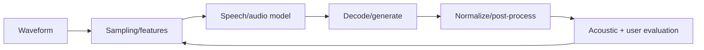

# Speech AI Engineer

> [!abstract] Mission
> Build speech and audio systems—such as recognition, synthesis, speaker, translation, enhancement, or conversational pipelines—that work across speakers, acoustics, languages, devices, and real-time constraints.

## Responsibilities

- Define ASR, TTS, speaker recognition/diarization, translation, voice activity, enhancement, or audio-event tasks.
- Curate audio/transcript data with consent, provenance, sampling, segmentation, text normalization, and annotation QA.
- Train/adapt acoustic, sequence, generative, or audio-language models; build decoding and post-processing.
- Evaluate by speaker/accent, noise, device, language, vocabulary, latency, and user-impact slices.
- Deploy streaming or batch pipelines and manage privacy, voice identity, spoofing, and misuse risks.

## Title reality

Speech roles may specialize in automatic speech recognition (ASR), text-to-speech (TTS), speaker/diarization, conversational audio, or audio foundation models. Some are research-heavy; real-time roles may require C++ and digital signal processing. “Voice AI engineer” may instead be an [[AI Engineer]] integrating commercial speech APIs. Verify whether the work owns models, audio infrastructure, product orchestration, or all three.

## Work anatomy

> [!info] What the role owns
> Speech AI engineers build systems where time, acoustics, language, speaker variation, privacy, and streaming behavior interact. The owned product may be ASR, TTS, diarization, voice activity detection, audio separation, or a speech-language pipeline.

### Operating loop

1. Define the audio conditions, languages, speakers, interaction mode, latency, privacy, and costly errors.
2. Build manifests and preprocessing with sampling-rate, segmentation, speaker, consent, and noise metadata.
3. Establish a baseline, train/adapt or integrate a model, and evaluate by accent, noise, device, speaker, and time.
4. Validate streaming behavior, partial results, endpointing, memory, and failure/abstention paths.
5. Monitor real-world quality, drift, speaker/privacy risk, and cost; feed difficult audio back into data and evaluation.

### Inputs → outputs

| Inputs | Owned work product | Evidence a reviewer should inspect |
|---|---|---|
| Audio, transcripts, speaker/context metadata | Governed corpus and manifest | Consent/provenance, sample-rate, segmentation, and slice coverage |
| Model/configuration and streaming constraints | Speech model/service | WER/CER or task metrics, real-time factor, latency, and error analysis |
| User feedback and audio drift | Release and improvement plan | Accent/noise/device slices, privacy handling, and rollback trigger |

### Decisions and interfaces

Tradeoffs include accuracy versus real-time latency, batch versus streaming, cloud versus on-device privacy, model size versus memory, and broad language coverage versus depth. Interfaces include NLP/LLM, data/labeling, inference, product/UX, accessibility, and security/privacy.

### Evidence of competence

Show a manifest, baseline, slice-level transcript errors, streaming measurement, and a privacy decision. A clean studio benchmark can hide the actual work: far-field audio, overlap, code-switching, accents, interruptions, and device variation.

### Research anchors

Use [OpenAI Whisper](https://github.com/openai/whisper), [Hugging Face ASR guidance](https://huggingface.co/docs/transformers/main/tasks/asr), [TorchAudio pipelines](https://docs.pytorch.org/audio/stable/pipelines.html), and [NIST's Generative AI Profile](https://doi.org/10.6028/NIST.AI.600-1) for privacy, provenance, and information-integrity considerations.
## 2026 technique overlay

> [!tip] Practice this now · 2026-08-24
> Measure word/character error, diarization or turn-taking quality, time-to-first-audio, interruption behavior, privacy/retention, and human recovery. Evaluate accents, noise, code-switching, and unsafe voice actions with [[AI Tools and Practices Update — 2026-08-24]].

## Level ladder

| Level | Expected ownership |
|---|---|
| Junior | Prepare audio/transcripts, run experiments, and evaluate a bounded component. |
| Speech engineer | Own one speech pipeline from data through deployment and slice analysis. |
| Senior | Design streaming, multilingual, or multi-component systems and lead data/model tradeoffs. |
| Staff / principal | Set speech architecture, evaluation, privacy, and runtime strategy across products. |
| Lead | Direct speech portfolio, data rights, safety, compute, and multidisciplinary delivery. |

## Prerequisites

- Python; C++ useful for real-time/embedded systems; Linux, testing, APIs, and streaming fundamentals.
- Digital signal processing: sampling, aliasing, Fourier/STFT, spectrograms, filtering, SNR.
- Sequence modeling, CTC, encoder-decoder/transducer ideas, attention/transformers, decoding, language models.
- Linguistic and phonetic basics plus privacy/consent and voice-misuse awareness.

## Knowledge and skills

| Area | Demonstrable capability |
|---|---|
| Audio | Resample correctly, segment, normalize levels, extract features, diagnose clipping/noise/channel effects. |
| Modeling | ASR/TTS/speaker architectures at target-role depth; adaptation and decoding tradeoffs. |
| Evaluation | WER/CER and normalization policy, diarization or quality/intelligibility metrics, human listening tests, slices. |
| Streaming | Chunking, endpointing, partial hypotheses, buffering, concurrency, real-time factor, tail latency. |
| Data | Consent, transcript conventions, rare vocabulary, speaker leakage, augmentation, provenance and retention. |
| Safety | Voice spoofing, impersonation, watermark/provenance where applicable, abuse monitoring, human escalation. |

## Study sequence

1. Visualize waveforms/spectrograms; implement resampling, framing, STFT, filters, and SNR experiments.
2. Run an open ASR model and compute WER with an explicit normalization policy.
3. Fine-tune or adapt a small speech model; split by speaker and environment to avoid leakage.
4. Build streaming inference with voice activity/endpointing and measure real-time factor and tail latency.
5. Add diarization, punctuation, vocabulary biasing, TTS, or another component and evaluate cascaded errors.
6. Create consent/provenance documentation, accent/noise/device slices, spoof/misuse tests, and deployment monitoring.

## Tools

| Need | Free / open-first | Paid or managed |
|---|---|---|
| Audio | librosa, torchaudio, FFmpeg, SoundFile | Commercial audio SDKs |
| Models | Whisper, Transformers, SpeechBrain, NeMo options | Cloud speech-to-text/text-to-speech APIs |
| Annotation | Label Studio, Audacity, ELAN | Managed speech labeling services |
| Serving | FastAPI/gRPC, ONNX Runtime, Triton, WebRTC libraries | Managed realtime/voice platforms |
| Evaluation | jiwer, pyannote metrics/tools subject to model terms, MOS/listening-test harnesses | Commercial speech analytics and monitoring |

## Quiz

1. Why must sample rate match a model's expected preprocessing?
2. What does WER omit?
3. Why split ASR evaluation by speaker rather than random utterance?
4. Define real-time factor.
5. How can endpointing change both latency and accuracy?
6. Why is a mean opinion score insufficient alone for TTS?

> [!question]- Answer key
> 1. The learned time/frequency representation assumes a sampling scale; mismatch distorts features and timing. 2. Semantic severity, punctuation/casing depending on normalization, latency, speaker fairness, confidence, and task impact. 3. The model may memorize speaker/channel traits, overstating generalization to unseen users. 4. Processing time divided by audio duration; below one means faster than real time, but concurrency and tails still matter. 5. Waiting longer supplies context and may improve recognition but delays response; early cuts can truncate words. 6. It is subjective and aggregate; pair it with intelligibility, speaker similarity where authorized, prosody, artifacts, subgroup/context tests, and listener protocol.

## Flashcards

Sampling rate:: Number of waveform samples per second; it bounds representable frequency under sampling assumptions.

STFT:: Short-time Fourier transform, representing frequency content over successive time windows.

WER:: Word error rate: substitutions plus deletions plus insertions divided by reference words under a stated normalization.

CTC:: Connectionist Temporal Classification, a loss/decoding framework aligning input frames with shorter label sequences without frame-level labels.

Endpointing:: Detecting when a speech segment or user turn has ended.

Real-time factor:: Processing duration divided by audio duration.

Diarization:: Determining who spoke when, distinct from recognizing the words.

MOS:: Mean opinion score from human ratings under a defined listening protocol.

## Interview preparation

- Explain sampling, spectrograms, CTC or encoder-decoder ASR, and decoding.
- Compute/interpret WER and discuss transcript normalization and semantic weighting.
- Design a low-latency streaming ASR/TTS pipeline with backpressure and endpointing.
- Diagnose failures by noise, accent, code-switching, microphone, rare words, or speaker overlap.
- Discuss consent, biometric/voice data, impersonation, and secure retention.
- Present a listening or recognition evaluation with slice-level evidence.

## Suggested projects

### Beginner — Auditable ASR benchmark

Evaluate an open ASR model on public consented data. Document normalization, WER/CER, speaker/noise slices, examples, confidence limitations, and reproducible environment.

### Intermediate — Streaming transcription service

Build chunked ASR with voice activity, endpointing, partial/final hypotheses, backpressure, vocabulary handling, and latency/accuracy/noise tests.

### Advanced — Responsible voice pipeline

Combine ASR, diarization, language understanding, and optionally TTS using licensed/consented data. Add spoof/adversarial tests, privacy controls, human review, load testing, and a system card.

## Job-search aliases

Search `speech AI engineer`, `speech recognition engineer`, `ASR engineer`, `TTS engineer`, `audio ML engineer`, `voice AI engineer`, `speech scientist`, and `conversational AI speech`.

## Boundaries

- [[NLP Engineer]] operates on linguistic representations and text; speech adds acoustics, time, speaker, and streaming.
- [[AI Engineer]] may integrate speech APIs without training or evaluating acoustic models deeply.
- [[Inference and Performance Engineer]] may optimize speech runtimes but not own acoustic/data quality.
- [[AI Security Engineer]] owns platform-level defenses; speech engineers own voice-specific spoofing and data risks within the system.

## Sources

- [OpenAI Whisper repository](https://github.com/openai/whisper) — model approach, tasks, usage, and model tradeoffs; release 2025-06-26 shown at access, accessed 2026-08-12.
- [Hugging Face Transformers — Automatic speech recognition](https://huggingface.co/docs/transformers/main/tasks/asr) — current ASR fine-tuning/inference workflow and sample-rate requirement; accessed 2026-08-12.
- [TorchAudio pipelines](https://docs.pytorch.org/audio/stable/pipelines.html) — ASR, source separation, and audio quality pipelines; accessed 2026-08-12.
- [NIST AI RMF Generative AI Profile](https://doi.org/10.6028/NIST.AI.600-1) — privacy, harmful content, provenance, and information-integrity risk context; published 2024-07-26, accessed 2026-08-12.
- [Anthropic jobs](https://www.anthropic.com/careers/jobs) — current `Research Engineer/Research Scientist, Audio` title evidence; accessed 2026-08-12.
