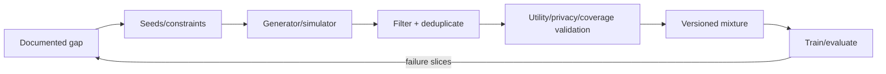

# Synthetic Data Engineer

> [!info] October 13, 2026 update
> Practice focus: **Whether synthetic examples improve held-out real-task performance**. Produce **Provenance, deduplication, utility/privacy assessment** and answer: Did the generator leak evaluation examples into training?
> Use [[Technical Role Practice Workbook — October 2026]] and [[October 2026 Research Refresh]]. This checkpoint does not reverify every older market/tool claim in this profile.

> [!abstract] Mission
> Generate, filter, document, and validate artificial data that fills a defined coverage, scale, privacy, simulation, training, or evaluation need without creating misleading quality, hidden leakage, or unjustified privacy claims.

## Responsibilities

- Define why synthetic data is needed and what real distribution, edge cases, constraints, or privacy properties it must represent.
- Build generation/transformation pipelines using simulators, procedural models, generative models, self-play, perturbation, or teacher models.
- Filter, deduplicate, balance, score, and diversify outputs; preserve generator prompts/models/seeds/configuration and provenance.
- Measure downstream utility, fidelity, coverage, contamination, memorization/privacy, bias, and distribution shift.
- Design human review, release controls, feedback loops, and dataset/system cards; monitor effects on trained models.

## Title reality

The title is emerging. Work may sit under Data Engineer, Research Engineer, Simulation Engineer, Data Scientist, post-training/data curation, or privacy engineering. For robotics/vision, synthetic data may mean physics/rendering; for LLMs, instruction/preference/evaluation data; for tabular systems, statistical generators. “Synthetic” does **not** automatically mean anonymous, private, unbiased, or correct.

## Work anatomy

> [!info] What the role owns
> Synthetic data engineers create generated or transformed data for training, evaluation, simulation, privacy-sensitive development, or coverage expansion. The role is not “make more examples”; it is proving that generated data is fit for a defined use without introducing leakage, bias, artifacts, or false confidence.

### Operating loop

1. Define the target distribution, intended use, exclusions, privacy threat model, and acceptance criteria.
2. Choose a generator or transformation path and specify prompts, conditioning, seeds, provenance, and versioning.
3. Generate, filter, deduplicate, quality-check, and label the data with automated and human review.
4. Measure utility on a genuinely independent real-data or task benchmark, plus fidelity, coverage, diversity, memorization, and privacy risk.
5. Publish a dataset card and release decision; monitor whether synthetic artifacts change downstream behavior.

### Inputs → outputs

| Inputs | Owned work product | Evidence a reviewer should inspect |
|---|---|---|
| Target use, real-data constraints, risk | Generation specification | Distribution assumptions, provenance, privacy, and acceptance rules |
| Generator, prompts, simulator, filters | Versioned synthetic dataset | Seeds/configs, filtering, deduplication, quality and coverage |
| Utility/privacy results | Dataset card and go/no-go memo | Independent benchmark, memorization tests, limitations, and cost |

### Decisions and interfaces

Tradeoffs include scale versus curation, fidelity versus privacy, generator diversity versus consistency, synthetic-only versus mixed data, and cheap automatic filtering versus expensive human review. Interfaces include ML data engineering, research, evaluation, privacy/security, domain experts, and modality/model teams.

### Evidence of competence

Show that a synthetic dataset improves or safely substitutes for a defined task, and also show where it does not. Include provenance, independent validation, subgroup analysis, deduplication, and a privacy/memorization check; otherwise the generator may merely teach the model its own artifacts.

### Research anchors

The workflow aligns with [NVIDIA NeMo Curator synthetic-data guidance](https://docs.nvidia.com/nemo/curator/curate-text/synthetic), [NVIDIA NeMo synthetic-data methods](https://docs.nvidia.com/nemo-framework/user-guide/25.07/datacuration/syntheticdata.html), [NIST's Generative AI Profile](https://doi.org/10.6028/NIST.AI.600-1), and [Hugging Face PEFT](https://huggingface.co/docs/peft/index) for efficient utility experiments.
## 2026 technique overlay

> [!tip] Practice this now · 2026-08-24
> Prove synthetic data utility, privacy, diversity, coverage, and distribution shift against a real-but-controlled reference. Track generator/version/provenance, deduplicate, test label validity, and publish limits with [[AI Tools and Practices Update — 2026-08-24]].

## Level ladder

| Level | Expected ownership |
|---|---|
| Junior | Implement generation/filtering stages, QA samples, and reproducible metrics. |
| Synthetic data engineer | Own one generated dataset's gap definition, pipeline, validation, and release. |
| Senior | Design mixtures, feedback loops, privacy/coverage tests, and scalable generation across tasks. |
| Staff / principal | Set synthetic-data architecture, standards, and evidence thresholds across programs. |
| Lead | Own data strategy, generator/model economics, privacy/risk, domain review, and portfolio impact. |

## Prerequisites

- Python, data engineering, statistics, experimental design, reproducibility, and target-domain ML.
- Generative-model prompting/inference/fine-tuning or simulation/rendering/procedural generation for the chosen modality.
- Dataset evaluation, sampling, deduplication, anomaly detection, provenance, and licensing.
- Privacy/security concepts; differential privacy only if you can state formal mechanism, assumptions, and parameters correctly.

## Knowledge and skills

| Area | Demonstrable capability |
|---|---|
| Gap design | Specify target behavior, missing coverage, constraints, acceptance metrics, and valid downstream use. |
| Generation | Prompt/program/simulate with controlled variation, seeds, parallelism, schema, and failure handling. |
| Curation | Deduplicate, filter, balance, score, diversify, detect artifacts, and preserve lineage. |
| Evaluation | Downstream task lift, real held-out performance, fidelity, diversity/coverage, calibration and slice impact. |
| Privacy/integrity | Membership/memorization and nearest-neighbor audits, PII checks, contamination, poisoning, provenance. |
| Operations | Version generator and outputs, estimate compute/cost, review samples, reproduce and retire mixtures. |

## Study sequence

1. Create rule/procedural augmentations and prove label preservation with targeted tests.
2. Generate a small instruction, tabular, or simulated dataset; version seeds/configuration and manually code failure types.
3. Build filters, deduplication, diversity metrics, and real held-out downstream comparisons.
4. Vary synthetic/real mixture ratios and generator sources; test collapse, artifacts, and subgroup effects.
5. Conduct privacy/memorization/PII and contamination audits; avoid privacy claims unsupported by mechanism/evidence.
6. Scale asynchronously, add reward/verifier scoring with human validation, and publish data/system cards and release gates.

## Tools

| Need | Free / open-first | Paid or managed |
|---|---|---|
| LLM/text generation | NeMo Curator, Transformers, vLLM, open model APIs/runtimes | Hosted model APIs and NVIDIA enterprise offerings |
| Tabular | SDV, SynthCity, custom probabilistic models | Gretel, Mostly AI, Tonic and other commercial platforms |
| Vision/robotics | Blender, Gazebo, MuJoCo, procedural engines | NVIDIA Omniverse/Isaac and commercial simulators |
| Quality | pandas/Polars, scikit-learn, cleanlab options, embedding/dedup tools | Managed data-quality/labeling platforms |
| Privacy | OpenDP, diffprivlib, Presidio for PII discovery | Commercial privacy engineering platforms |

## Quiz

1. Why is synthetic data not automatically private?
2. How should downstream utility be measured?
3. What is model collapse in iterative synthetic-data loops?
4. Why can a reward model or LLM filter worsen a dataset?
5. What is contamination between synthetic training and evaluation data?
6. Why vary synthetic-to-real mixture ratios?

> [!question]- Answer key
> 1. Generators can memorize/reproduce records or enable inference; privacy requires a defined threat model, mechanism, and empirical/formal evidence. 2. Train under controlled mixtures and evaluate on independent representative real held-out data plus relevant slices and operational metrics. 3. Repeated training on generated outputs can narrow diversity and amplify artifacts/errors without fresh real signal and controls. 4. It may encode its own biases, reward superficial style, reject rare correct cases, or be gamed; validate against qualified humans. 5. The same generator seeds/templates/sources or near duplicates influence both training and test, inflating performance. 6. Benefits and artifacts are nonlinear; mixture studies identify where synthetic signal helps versus overwhelms real distribution.

## Flashcards

Synthetic data:: Artificially generated or transformed records intended to approximate, augment, or target aspects of a data need.

Fidelity:: Similarity to a reference distribution under specified measures; high fidelity alone does not prove utility or privacy.

Coverage:: Extent to which required regions, scenarios, classes, or behaviors appear adequately in data.

Utility:: Performance or decision value for a defined downstream task and evaluation distribution.

Memorization:: A generator retains and may reproduce specific training information.

Differential privacy:: A formal stability guarantee limiting how much one record can affect output distributions under stated parameters and mechanism.

Mixture ratio:: Proportion/weight of synthetic versus real or other data sources used in training.

Verifier:: Model, program, or human process that checks or scores generated examples; it must itself be evaluated.

## Interview preparation

- Design synthetic data for a rare/high-risk class without leaking the evaluation set.
- Define fidelity, diversity, utility, and privacy tests and explain why none is sufficient alone.
- Diagnose downstream degradation despite aesthetically plausible generated samples.
- Design scalable generation, retry, deduplication, lineage, and human-review pipelines.
- Explain differential privacy conservatively and distinguish it from de-identification or generation.
- Present mixture ablations and what real held-out evidence changed your decisions.

## Suggested projects

### Beginner — Controlled augmentation study

Create task-valid transformations, test label preservation, compare real-only versus augmented training on untouched real test data, and report class/slice effects and artifacts.

### Intermediate — LLM synthetic instruction pipeline

Generate diverse task examples, preserve prompts/model/seeds, deduplicate/filter, validate a scorer against humans, vary mixture ratios, and audit PII/memorization and eval contamination.

### Advanced — Multi-generator data factory

Combine procedural/simulation and generative sources, active failure-driven generation, verifier ensembles, human sampling, privacy/coverage dashboards, downstream ablations, scalable serving, release gates, and data cards.

## Job-search aliases

Search `synthetic data engineer`, `training data engineer`, `data curation engineer AI`, `generative data engineer`, `simulation data engineer`, `post-training data engineer`, and `research engineer synthetic data`.

## Boundaries

- [[ML Data Engineer]] owns reliable data infrastructure and semantics across real and generated sources.
- [[AI Evaluation Engineer]] builds test evidence; synthetic eval cases need separation and independent validation.
- [[AI ML Research Scientist]] may research generation methods; this role operationalizes validated datasets.
- [[Robotics and Embodied AI Engineer]] or [[Computer Vision Engineer]] may own simulator use as part of a larger physical/perception system.

## Sources

- [NVIDIA NeMo Curator — Synthetic Data Generation](https://docs.nvidia.com/nemo/curator/curate-text/synthetic) — current generation, transformation, declarative pipelines, local inference, and use cases; accessed 2026-08-12.
- [NVIDIA NeMo Framework — Synthetic Data Generation](https://docs.nvidia.com/nemo-framework/user-guide/25.07/datacuration/syntheticdata.html) — generation, reward scoring, filtering/deduplication; updated 2026-01-13, accessed 2026-08-12.
- [NIST AI RMF Generative AI Profile](https://doi.org/10.6028/NIST.AI.600-1) — data privacy, provenance, bias, information integrity, and measurement actions; published 2024-07-26, accessed 2026-08-12.
- [Hugging Face PEFT](https://huggingface.co/docs/peft/index) — efficient downstream model adaptation used for utility experiments; accessed 2026-08-12.
- [Gretel Synthetics repository](https://github.com/gretelai/gretel-synthetics) — open synthetic data generators and differential-privacy-related implementation context; latest listed release 2025-06-24, accessed 2026-08-12.
