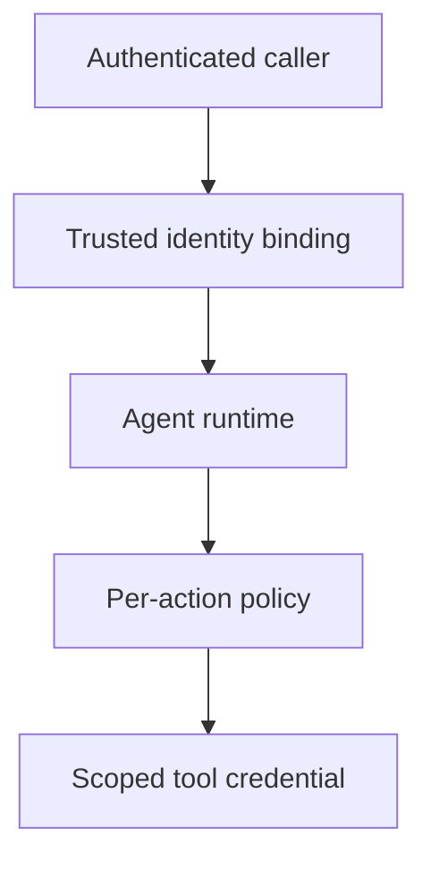

# Cloud AI Operations — October 2026

> [!abstract] Outcome
> Explain where identity, policy, state, and release responsibility live in an AI cloud system. Compare platforms by boundaries and operational obligations, not by counting agent features.

Continue from [[AI DevOps and Cloud Engineering — 2026-08-24]], [[Microsoft Azure DevOps and Foundry]], and [[Cloudflare and Vercel AI]]. This is a scoped update, not a replacement for their underlying concepts.

## Microsoft: a GA portal is not a GA feature blanket

Microsoft's [Foundry availability matrix](https://learn.microsoft.com/en-us/azure/foundry/concepts/general-availability) distinguishes core GA capabilities from previews. Core agents, Toolboxes, and evaluations are GA; individual evaluators can remain preview. Memory and monitoring are preview. Foundry IQ's API is GA while its portal experience is preview. Workflow preview retires **December 1, 2026**; Microsoft points new workflow development toward Microsoft Agent Framework. New-portal agents and evaluations require Microsoft Entra ID.

**Engineering interpretation:** record maturity at the feature, API, region, and project level. “Foundry is GA” is insufficient evidence for a production memory design. A workflow migration must address persisted state and outstanding approvals, not only translate code.

### Azure DevOps identity migration

[Sprint 276 release notes](https://learn.microsoft.com/en-us/azure/devops/release-notes/2026/pipelines/sprint-276-update) schedule retirement of the old Azure DevOps workload-identity issuer for **July 1, 2027**. New connections use the Microsoft Entra issuer. The documented scope is public-cloud connections with single-tenant Entra applications or managed identities; non-public clouds and multi-tenant applications are excluded from this notice.

Study a service connection as a chain: repository → pipeline → service connection → federated credential → cloud principal → resource role. Changing the issuer is not proof that this chain has least privilege.

**Migration evidence:** connection inventory, scope eligibility, issuer/subject/audience comparison, staging deployment, denied wrong-repository test, approved production cutover, and recovery procedure. Do not paste live tokens into a portfolio.

## AWS: inbound and outbound are separate contracts

[AgentCore documentation](https://docs.aws.amazon.com/bedrock-agentcore/latest/devguide/runtime-oauth.html) separates caller authentication from agent access to third-party tools. In its SigV4 path, the delegated `X-Amzn-Bedrock-AgentCore-Runtime-User-Id` header does **not** itself verify the end-user identity. The calling workload and IAM boundary must ensure that value is correct. The documented JWT path validates identity-provider tokens. This is not a claim that every AgentCore request is unverified.

**Engineering interpretation:** never let an arbitrary browser field become an authoritative tenant/user identifier. Bind it to verified identity before obtaining user-scoped credentials. Then authorize each requested resource and action separately.

## Transferable comparison

| Boundary | Question to ask on any cloud | Evidence, not a marketing answer |
|---|---|---|
| Inbound identity | Who may invoke this tenant's agent? | Expired/wrong-audience/cross-tenant denial tests |
| Outbound identity | Whose authority is used on each tool call? | Principal-to-resource mapping and delegated-consent scope |
| Deployment | Who may change the prompt, policy, model, or tool? | Reviewed diff, artifact identity, release approval |
| State | What survives a retry, crash, or migration? | Versioned state, idempotency, recovery and deletion tests |
| Egress | Where can data leave? | Destination restrictions and synthetic-canary tests |
| Capacity | What happens when inference is saturated? | Queue bounds, admission behavior, fallback quality |
| Evaluation | What stops an unsafe release? | Risk-slice thresholds and an enforced stop result |
| Economics | Who pays for retries and background work? | Tenant budget, cost attribution, and kill switch |

Cloudflare admission control and Vercel's Python classifier direction are worked through in [[Case - Routing Quality and Capacity]]. Neither runtime convenience nor a typed result replaces authorization.

## The workday, by role

**Platform engineer:** defines paved-road contracts, provisions identity and tenant isolation, maintains supported versions, and supplies safe defaults. The output is an operable platform with evidence, not a portal screenshot.

**MLOps/DevOps engineer:** versions model/prompt/data artifacts, makes evaluations a release gate, deploys with bounded blast radius, and rehearses rollback. The output is a repeatable release and recovery path.

**Security engineer:** tests confused-deputy behavior, excessive permission, cross-tenant state, data egress, and policy bypass. The output is a control assertion with a reproducible negative test and an owner.

**Application engineer:** handles user intent, valid schemas, safe retries, approval UX, cancellation, and meaningful errors. The output is dependable behavior under partial failure.

## Constructed review exercise

A pipeline can deploy an agent, the agent can read customer files, and a model-generated argument supplies `customer_id`. The team calls the design secure because all calls use OAuth.

**Decision:** reject that argument. OAuth does not establish that the proposed customer matches the authenticated caller. Bind tenant identity in trusted application code, enforce resource permissions at retrieval and tool execution, and test a valid user requesting another customer's object. Also check that a deployer cannot silently widen the agent's tool grants without review.

## Quiz and answers

1. **Does short-lived federation make broad resource permissions safe?** No; credential lifetime and authorization scope solve different problems.
2. **Does successful agent invocation authorize all outbound actions?** No; tool/resource/action checks remain necessary.
3. **What must a workflow migration preserve?** State meaning, approvals, retry/idempotency behavior, audit evidence, and recovery—not only syntax.
4. **What does GA fail to prove?** Account/region availability, fit for a use case, security of the application, or compliance with its obligations.

## Flashcards

Inbound authentication::Establishing which caller may invoke a service.
Outbound authorization::Deciding which external resource/action an agent may access and under whose authority.
Confused deputy::A privileged service being induced to misuse its authority for another party.
Federated credential::A trust configuration that exchanges an external identity assertion for scoped cloud access.
Feature-level maturity::Tracking GA/preview status for the actual capability rather than the product brand.
Identity binding::Deriving tenant and user authority from verified context, not model-generated or untrusted fields.

## Suggested project and interview

Create an offline identity matrix for a synthetic claims agent with four principals, three resources, and read/propose/approve/execute actions. Include expected denials and one migration diagram. A spreadsheet or Markdown table is sufficient; paid cloud deployment is optional.

In an interview, explain why the agent, pipeline, and human approver should not share an all-powerful identity. Then show how you would prove that separation using negative tests.
