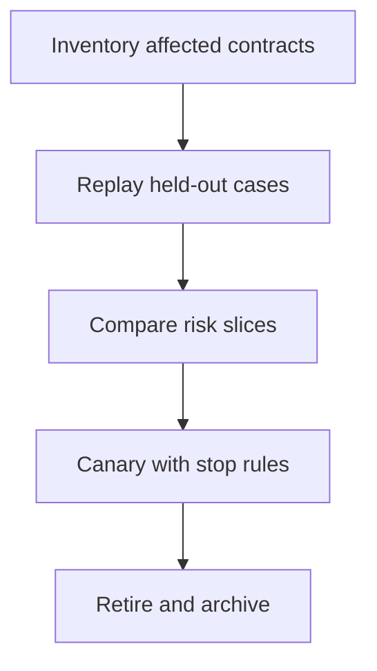

# Model and Agent Lifecycle Management

> [!abstract] The job behind the announcement
> A lifecycle owner turns “this endpoint is going away” into an inventory, tested replacement, user communication, reversible rollout, and completed removal. The work belongs jointly to AI engineers, platform engineers, evaluation engineers, product owners, and procurement—not just whoever edits the model string.

Start with [[October 2026 Research Refresh]]. Use this note to supersede older provider recommendations where they conflict.

## Current lifecycle signals

The following is a **selected action register**, not a complete model catalog. Reopen the source before scheduling work.

| Surface | Verified notice or deadline | Study implication |
|---|---|---|
| OpenAI hosted Evals | Read-only October 31; shutdown November 30, 2026 | Export evaluation assets and preserve evaluator behavior |
| OpenAI Agent Builder | Shutdown November 30, 2026 | Inventory workflows and replacement orchestration |
| OpenAI reusable prompt objects | Shutdown November 30, 2026 | Version prompts with the application |
| OpenAI Sora 2 / Videos API | Sunset September 24, 2026 | Do not propose this API for a new project |
| OpenAI selected older models | Some retire October 23, 2026 | Match exact IDs, not family names |
| OpenAI October 1 model notices | `gpt-5.3-codex`, `gpt-5.4-nano`, `gpt-5.1`: April 1, 2027 | Plan migration before the endpoint disappears |

Source: [OpenAI API deprecations](https://developers.openai.com/api/docs/deprecations), notices through October 13 only. Hosted Evals is **not** the open-source `openai/evals` repository. API lifecycle is **not** a statement about every consumer product with a similar name.

| Provider | Selected current fact | Trap to avoid |
|---|---|---|
| Claude API | Sonnet 4.5 deprecated September 30; retirement November 30, 2026; listed replacement Sonnet 5.5 | “Not sooner than” dates for active models are not announced shutdown dates |
| Gemini API | `gemini-3.7-flash` automatically routes to `gemini-3.8-flash`; the former endpoint is not shutting down | An unchanged request string can still get different model behavior |
| Gemini previews | Several Live/TTS previews list November 17, 2026 shutdowns | Preview lifecycle and migration targets are surface-specific |

Sources: [Claude lifecycle](https://platform.claude.com/docs/en/about-claude/model-deprecations), [Gemini lifecycle](https://ai.google.dev/gemini-api/docs/deprecations). These hosted API notices do not automatically define availability in Bedrock, Azure, Vertex, enterprise contracts, or consumer apps.

## Six different dependencies

| Dependency | Example failure | Evidence to preserve |
|---|---|---|
| Model | Output quality or tool-call behavior changes | Exact requested ID, resolved version if exposed, parameters, baseline results |
| API | Endpoint or streaming event changes | Request/response fixtures, error taxonomy, cancellation tests |
| SDK | Type or retry behavior changes | Lockfile, release notes, integration tests |
| Hosted service | Evaluation or workflow UI shuts down | Dataset export, grader definition, traces, owner and migration plan |
| State | New service cannot read old memory | Schema version, retention/deletion policy, restore test |
| Commercial agreement | Access, region, quota, or terms differ | Account-level confirmation and procurement decision |

“Open source” describes licensing, not free inference. “Free tier” describes a limited entitlement, not a production capacity plan. A paid subscription to an app is not automatically an API credit balance.

## A migration is a controlled experiment

1. **Inventory.** Search application configuration, notebooks, CI secrets references, model routers, hosted prompts, scheduled jobs, and dashboards. Record the business owner and endpoint—not secrets.
2. **Export.** Preserve datasets, rubric versions, failure examples, tool schemas, and legal retention constraints. A screenshot of an overall score is not an evaluation export.
3. **Compare.** Use the same held-out inputs and deterministic validators. Add slices for refusals, structured outputs, multilingual cases, long context, tool permissions, and latency tails where relevant.
4. **Inspect regressions.** A quality mean can rise while a critical slice worsens. Inspect grader disagreement and sample human judgments before trusting automated scores.
5. **Canary.** Define who gets the new path, the observation window, failure budget, traffic limit, and rollback trigger. Do not send sensitive data to a second provider without authorization.
6. **Complete.** Remove dead credentials/configuration and update support material. Test the fallback again after the old endpoint is gone.

## Worked release decision

**Constructed teaching data, 500 paired cases.** Old system passes 455; candidate passes 470. Old-only passes: 12. Candidate-only passes: 27. Both pass: 443. Both fail: 18. The arithmetic reconciles to 500 and a net gain of 15.

The candidate's aggregate gain is 3 percentage points, but 4 of its 12 regressions are unauthorized-action proposals. The policy requires trusted code to block all unauthorized execution. If the old tool gate is bypassed by a changed call shape, the candidate is **not ready**, regardless of average quality. If all proposals are safely blocked, assess refusal quality and user impact separately; do not mislabel a blocked proposal as an executed breach.

A correct decision record separates model behavior, application control, and actual effects. It also states that 500 cases do not prove absence of rare failure.

## Free-first and managed paths

Practice with local JSON/CSV fixtures, Git, a small script, and a mocked model response. Use existing [[Evaluation and Observability]] tools when you need repeated runs. Managed evaluation, tracing, orchestration, and model hosting can reduce operational work but introduce data retention, cost, export, and lifecycle dependencies. This exercise requires no paid account; a real provider comparison may incur charges.

## Quiz

1. Why can replacing a model ID break authorization?
2. Why is “rollback to the old model” incomplete near retirement?
3. What is missing from a dataset export without grader definitions?
4. What does the 3-point improvement above hide?

### Answers

1. Changed output/tool-call structure may bypass assumptions in application validation; identity must stay in trusted code.
2. The old endpoint may no longer exist; retain an independently available safe mode.
3. The measurement procedure, thresholds, and interpretation needed to reproduce results.
4. Paired regressions and their severity; average gain does not settle release safety.

## Flashcards

Deprecation::A lifecycle warning that a supported surface is being phased out; not necessarily immediate shutdown.
Alias drift::A stable request name routing to a changed underlying model.
Paired evaluation::Comparing two systems on the same examples so gains and regressions are visible.
Migration fallback::An available, authorized safe path after both candidate failure and old-service retirement.
Hosted Evals versus open-source evals::A managed platform and a source repository are separate lifecycle dependencies.
Resolved model version::The actual backend version when the provider exposes it, distinct from the requested alias.

## Interview and project

**Interview:** “We have two weeks before a shutdown. What do you cut?” Keep inventory, export, critical negative tests, owner sign-off, and a safe fallback. Reduce feature expansion and low-value tuning first; state residual risk.

**Suggested project:** produce a synthetic migration dossier with 50 cases, two mocked providers, a schema-change regression, paired results, and a one-page go/no-go decision. Do not claim this demonstrates production-scale reliability. Use [[AI Change Impact Review Template]].
