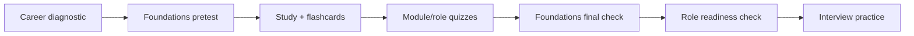

# Assessment Center

> [!info] October 13, 2026 update
> New knowledge checks and answer keys live in [[October 2026 Research Refresh]] and its seven study layers. Use [[Technical Role Practice Workbook — October 2026]] for a role-specific evidence rubric.

Assessments are for routing and retrieval practice, not credentials.

## Start

- [[AI Career Diagnostic]] — interests, working style, and current foundation.
- [[Foundations Pretest]] — 30 questions across the shared curriculum.
- [[Flashcard Index]] — locate foundation, bridge, and role decks.
- [[Quiz Index]] — locate quizzes and answer keys.
- [[Foundations Final Check]] — scenario-based integration.
- [[Role Readiness Check]] — test whether you can explain, decide, and show evidence.
- [[Technical Cumulative Check]] — 20 closed-note items across the frozen 16 concepts; pass ≥ 16/20.
- [[Technical Studio]] — worked decision cases; builders treat two cases as a readiness gate.
- [[AI DevOps and Cloud Engineering — 2026-08-24]] — delivery/operations study track with 20-question quiz and 41-card deck.
- [[Technical Interview Drills]] — timed interview versions of the same cases.
- [[Builder 4-Week Syllabus]] — the calendar that uses the check.

## Assessment rules

1. Answer closed-note first.
2. State why rejected choices are wrong.
3. Use 80% as a routing signal, not proof of mastery.
4. Re-study by concept and failure category, not by memorizing letters.
5. Re-test after time and in a new scenario.

> [!checkpoint] Mastery test
> You can retrieve the idea, explain it at two altitudes, apply it to an unfamiliar case, name a limitation, and recognize when it does not apply.
