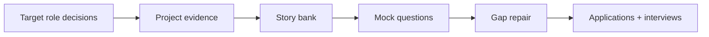

# Interview and Portfolio Hub

Your evidence should mirror the role's real decisions.

- [[Project Selection Guide]] — choose useful project evidence without following a lab.
- [[Project Bank]] — cross-role suggested projects by difficulty.
- [[AI Interview Playbook]] — answer architecture, product, evaluation, governance, creative, and operational questions.
- [[Behavioral Interview Bank]] — build decision-rich stories.
- [[Technical AI Interview Guide]] — coding, ML, systems, evaluation, security, and research.
- [[Technical Interview Drills]] — timed studio decisions with strong/weak answer shapes.
- [[Product and Business AI Interview Guide]] — product sense, strategy, adoption, solutions, economics.
- [[Governance and Responsible AI Interview Guide]] — risk, policy, controls, assurance, ethics.
- [[Creative UX and Human Operations Interview Guide]] — UX, conversation, media, annotation, knowledge, training.

Use [[Project Brief Template]], [[Evaluation Report Template]], [[AI System Card Template]], and [[Decision Record Template]] to structure artifacts.

