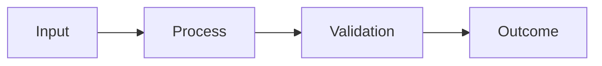

# {{project}}

## Decision and audience

- Target role:
- User/affected group:
- Decision this evidence supports:

## Problem and baseline

## Scope and non-goals

## Constraints

- Data rights/privacy:
- Security/safety:
- Accessibility:
- Cost/time:
- Tools:

## Options and choice

| Option | Evidence for | Evidence against | Decision |
|---|---|---|---|

## Architecture or workflow

## Evaluation plan

- System/version:
- Population/cases:
- Baseline:
- Metrics/rubric:
- Slices:
- Failure severity:
- Release/stop threshold:

## Results and error analysis

## Risks, controls, and residual limits

## Cost/operations/adoption

## Artifacts

- [ ] README/brief
- [ ] data/source record
- [ ] architecture/process map
- [ ] evaluation report
- [ ] decision log
- [ ] demo/sample

## Next decision
