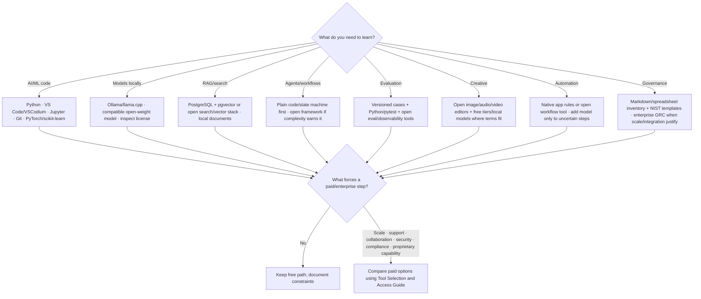

# Free-First Tool Paths

## Principles

1. Learn the workflow on a free/open/local option when practical.
2. Learn a second implementation so your skill is not a button sequence.
3. Use paid products when their evidence supports a real need: capability, integration, governance, support, reliability, or scale.
4. Free tiers have limits and can change; verify current terms and data use.
5. “Open” can describe weights, code, data, or license separately.

Continue at [[AI Tool Atlas]].
