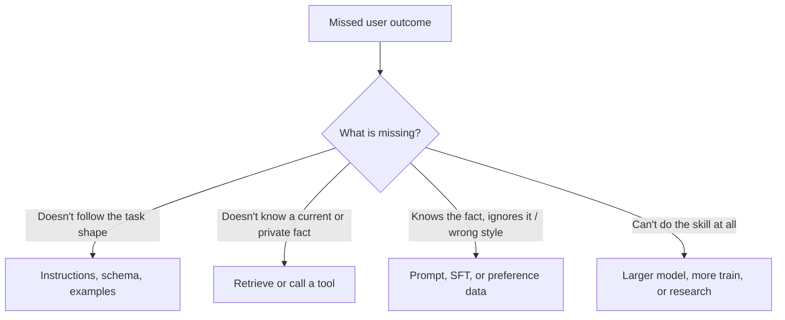

# Adaptation methods

> [!abstract] Plain idea
> A base model is a generalist. **Adaptation** is how you make it do *this* job. The methods are not a ladder you must climb. Each one closes a different **gap**: instructions, knowledge, behavior, or weights. Pick the method that matches the gap, then measure.

## Why this concept exists

Vendors and posts collapse everything into “we fine-tuned it.” That sentence hides four different jobs and four different failure modes. The jargon exists so you can say **what you changed** and **what you expect to improve**.

## The gap map

If you cannot name the gap, you are shopping.

## Jargon

| Term | What you change | Gap it can close | Typical failure |
|---|---|---|---|
| **Prompting / instructions** | Text in the window | Task shape, tone, abstain rules | Cannot add unpublished facts |
| **Few-shot** | Examples in the window | Format and local style | Steals budget; can contaminate |
| **Tool use** | Functions the model may request | Live data, actions | Needs [[Structured Outputs and Contracts]] |
| **RAG** | What you fetch into the window | Current, private, citable knowledge | Index/pack/authority bugs |
| **SFT (supervised fine-tuning)** | Weights, via input→desired-output pairs | Stable format and behavior | Memorizes yesterday; needs clean data |
| **PEFT / LoRA / adapters** | A small extra set of weights | Same as SFT, cheaper | Same conceptual risks as SFT |
| **Preference optimization (DPO etc.)** | Weights, via A-better-than-B pairs | Style, harmlessness, ranking among ok answers | Can chase rater taste, not truth |
| **RLHF / RL with a reward model** | Policy via rewards | Hard-to-write objectives | Reward hacking; expensive |
| **Distillation** | Train a small model to mimic a large one | Cost/latency at similar behavior | Student inherits teacher failures |
| **Pretraining** | Next-token (or similar) on huge data | General capability | Rarely your first lever |

**Post-training** is the umbrella for SFT + preference + RL after pretraining. **Application conditioning** is everything you do at request time (prompt, RAG, tools). Do not call RAG “training.”

## Worked teaching choice

Northline policy assistant (same story as [[Case - Prompt RAG Fine-Tune]]):

- Misses are **current dollar amounts**.
- Handbook changes **40 times a month**.
- You have **180** SFT pairs.

| Method | Verdict |
|---|---|
| Better prompt | Unlikely — instructions already say “cite the section.” |
| RAG + authority filter | **First** — the gap is knowledge that must stay in HR’s system of record. |
| PEFT on 180 pairs | **No this sprint** — you would bake in last month’s handbook (a second source of truth). |
| New pretrained model | Irrelevant to stipend numbers. |

Revisit SFT only if context-hit is high and the model still ignores the packed gold span. Then the gap became **behavior**, and a small attribution-focused SFT set can be justified.

## What to practice saying

- “Name the gap before you name LoRA.”
- “Who owns the system of record after we adapt?”
- “Show the baseline and the held-out slice this method should move.”
- “Fine-tuning is not how documents get updates.”

## Quiz

1. Which gap does RAG close that SFT does not?
2. What is PEFT, in one sentence?
3. When is SFT a better first test than RAG?
4. What is a second source of truth?
5. Why is “we post-trained it” an incomplete status report?

> [!question]- Answer key
> 1. Current, private, or attributable knowledge that must update without changing weights. 2. Training a small set of extra/selected parameters instead of all weights. 3. When the corpus is stable and the miss is format/behavior, not facts. 4. Weights that silently disagree with the living document store. 5. It does not say whether you changed instructions, data, preferences, or rewards — or what eval moved.

## Flashcards

Adaptation:: Changing prompting, retrieval, tools, or weights so a base model serves a job.

Gap:: The missing capability — knowledge, behavior, or serving — an intervention should close.

SFT:: Supervised fine-tuning on input–desired-output pairs.

PEFT:: Parameter-efficient fine-tuning; small added or selected weights.

Preference optimization:: Training from comparative judgments rather than a single target string.

Post-training:: Weight updates after pretraining that shape behavior (SFT, preference, RL).

Application conditioning:: Request-time instructions, context, and tools; not a weight update.

Second source of truth:: Adapted weights that drift from the system of record.

Distillation:: Training a smaller model to mimic a larger one.

## Transfer

- Cases: [[Case - Prompt RAG Fine-Tune]], [[Case - Serving Capacity]].
- Roles: [[LLM Engineer]], [[AI Engineer]], [[ML Engineer]].
- After this spine: work two cases in [[Technical Studio]], then a role profile.
