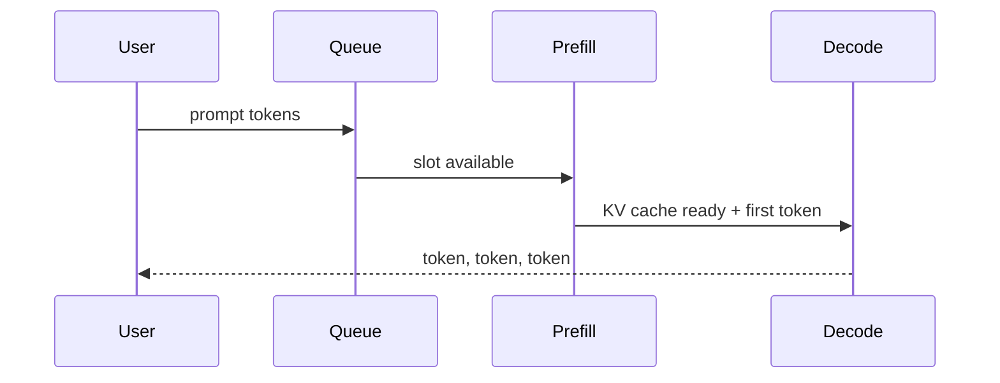

# Attention, memory, and inference

> [!abstract] Plain idea
> A transformer answers “which earlier tokens matter for this one?” using **attention**. That is powerful and expensive. **Inference** (using the model) has two phases: **prefill** reads your prompt; **decode** writes the answer one token at a time. The **KV cache** remembers attention state so decode does not re-read the whole prompt every token. Memory, not just “GPU speed,” usually sets the concurrency limit.

## Why this concept exists

Without this picture, serving looks like magic and capacity planning is a blog number. You need it to understand:

- why the first token waits on the *prompt length*;
- why a long answer is a different bottleneck than a long prompt;
- why 40 users with 4k context can out-of-memory a GPU that “fits the model”;
- why batching changes per-user speed.

You do not need to derive softmax to use this. You do need the jobs of the parts.

## Jargon

| Term | What it names | Why it exists |
|---|---|---|
| **Attention** | A weighted look-up: for this position, mix information from other positions. | So the model can use “stipend” when it later writes a number. |
| **Query / key / value (Q, K, V)** | Three projections of each token. Q asks, K is the label on memory, V is the content. | Vocabulary for the attention formula in [[07 Transformers and Foundation Models]]. |
| **Self-attention** | Tokens attending inside the same sequence. | Default in decoder-only LLMs. |
| **Prefill** | Parallel processing of the prompt to build the first cache. | This dominates **time to first token** when the prompt is long. |
| **Decode** | Generating the next token, then the next, using the cache. | This dominates time-to-final for long answers. |
| **KV cache** | Stored keys and values for tokens already seen. | So token 201 does not recompute tokens 1–200 from scratch. |
| **Time to first token (TTFT)** | Arrival → first streamed token, **including queue**. | Interactive feel. |
| **Inter-token latency** | Gap between later tokens. | “Typing speed” of the stream. |
| **Batching / continuous batching** | Serving several sequences together; sliding new ones in as others finish. | GPU utilization. Lowers per-sequence speed at high load. |
| **Working context** | Context you can actually offer at the target concurrency. | Smaller than the advertised maximum. See [[Case - Serving Capacity]]. |

## A picture of one request

TTFT = queue + prefill (+ a little decode setup).  
Time-to-final ≈ TTFT + (output tokens × inter-token time).

## Worked teaching numbers

> [!warning] Constructed envelope — same family as the serving case

- Prompt 1,200 tokens, prefill 8,000 tok/s → prefill = 1200/8000 = **0.15 s**
- Decode 28 tok/s per sequence at a full batch → 200 output tokens = **7.1 s**
- KV 0.5 MiB/token × 1,400 live tokens × 40 sequences = **28,000 MiB ≈ 27 GiB**

The weights fit. The **cache** is what fills the GPU when many people talk at once. That is why “the model is only 16 GB” is not a capacity plan.

## What to practice saying

- “Is the pain prefill (long prompts) or decode (long answers) or queue (too full)?”
- “Quoted tokens/s at batch=1 is not p95 at 40 users.”
- “I need KV bytes per token before I promise a 4k window at this concurrency.”

## Quiz

1. What does the KV cache store, and why?
2. Why can a short answer to a huge prompt still have a large TTFT?
3. Why does advertised max context shrink under concurrency?
4. What does continuous batching improve, and what does it usually worsen?
5. Name the three parts of p95 TTFT people forget.

> [!question]- Answer key
> 1. Keys and values for prior tokens, so decode does not recompute attention from scratch. 2. Prefill scales with prompt length. 3. KV memory scales with live tokens × number of live sequences. 4. Improves GPU occupancy/throughput; usually lowers per-sequence decode speed. 5. Queueing, prefill, and any admission wait — not only the kernel time.

## Flashcards

Prefill:: Prompt processing that builds the KV cache; usually sets unloaded TTFT.

Decode:: Autoregressive generation of later tokens using the cache.

KV cache:: Stored attention keys/values for tokens already seen.

TTFT:: Time from request arrival to first streamed token, including queue.

Inter-token latency:: Time between subsequent generated tokens.

Working context:: Context available at the target concurrency without OOM.

Continuous batching:: Filling GPU slots with new sequences as others complete.

## Transfer

- Next concept: [[Context Engineering]].
- Case: [[Case - Serving Capacity]].
- Role: [[Inference and Performance Engineer]], [[LLM Engineer]].
