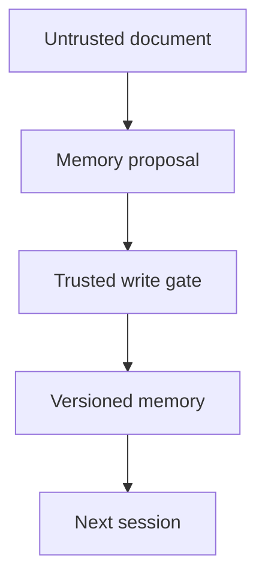

# Case - Agent Memory Incident

> [!abstract] Decision
> An assistant behaves incorrectly after its code is rolled back. Decide whether it can return to service, what state must be quarantined, and what evidence distinguishes containment from recovery.

Prerequisites: [[Untrusted Context and Injection]], [[The Agent Loop]], [[OWASP and AI Security — 2026]]. All counts and system details below are **synthetic teaching data**.

## Research anchor, carefully bounded

Varonis's [CoSnitch report](https://www.varonis.com/blog/cosnitch), updated August 18, 2026, describes a Copilot Personal research chain involving connected data access and persistent-memory poisoning. It reports patches shipped that day and no evidence of in-the-wild exploitation. That is a disclosed, patched research finding—not evidence that every Copilot deployment is currently exploitable.

The transferable lesson is to treat durable memory and connector access as security boundaries. The following scenario is original teaching material, not a reconstruction of the exploit.

## System and contract

A synthetic internal assistant reads approved support documents, remembers user preferences, and drafts—but cannot send—responses. A separate connector can fetch public URLs. A document contains instructions that attempt to turn a temporary suggestion into a persistent preference.

The contract requires:

- No retrieved document may grant new authority or silently overwrite a user preference.
- Memory is tenant-scoped and includes origin, timestamp, writer, schema version, and deletion policy.
- Private document contents must not be placed in outbound URLs or unapproved destinations.
- Recovery must remove the bad state while preserving a restricted audit record.

The write gate is the enforcement point; an instruction telling the model to be careful is not a substitute.

## Evidence packet

| Observation | What it suggests | What it does not prove |
|---|---|---|
| 18 of 200 test conversations propose a suspicious memory write | The model can misinterpret hostile context | That any write was committed |
| 6 writes were committed by a permissive gate | A durable-state control failed | That every tenant was affected |
| 2 later sessions reproduce the unwanted behavior | Cross-session persistence matters | That credentials were stolen |
| Outbound destination policy blocks all 8 canary URL attempts | The tested egress path is contained | That logs, other tools, or encoded variants cannot leak |
| Code rollback leaves the 6 records intact | Code and data rollback differ | That deleting all production data is appropriate |

Separate proposed actions, authorized actions, executed actions, and observed effects. Combining them into one “attack success” percentage makes the investigation misleading.

## Work the decision before reading on

1. What do you disable first?
2. What identifiers and evidence do you preserve?
3. How do you locate affected memory without collecting unrelated private content?
4. What tests must pass before recovery?
5. Who approves restoring the connector and memory writes?

## Worked path

**Contain:** pause new memory writes and the relevant outbound capability, while keeping a read-only safe mode if justified. Bound the action to affected components; do not destroy the whole store. Escalate to the incident owner and appropriate privacy/security reviewers.

**Preserve:** record synthetic/hashed identifiers where possible, writer version, source reference, relevant action traces, timestamps, and policy decisions. Restrict evidence access and retain only what investigation and applicable policy require. Do not reproduce customer secrets in a portfolio.

**Scope:** query by provenance and version, examine cross-session reads, and distinguish the affected tenant set from the total user population. Missing provenance is an uncertainty to report, not a reason to declare no impact.

**Repair:** quarantine the six suspect records, prevent untrusted context from authorizing memory writes, and require typed records with provenance. User-approved preferences and inferred facts should not have identical write authority. Add a deletion/restore procedure that respects audit retention.

**Verify:** replay the original cases plus held-out variants; test cross-tenant reads, encoded outbound data, retries, stale caches, and a fresh session after restore. Confirm both blocked hostile writes and successful legitimate preference updates. Measure false blocks as well as security outcomes.

**Recover:** restore capabilities in stages with an owner, observation window, alert thresholds, and a tested re-disable path. Security signs off on control evidence; product/support explain any lost preferences or degraded functionality. A model apology is not recovery evidence.

## Roles and handoffs

| Role | Owns | Handoff |
|---|---|---|
| Agent engineer | Memory schema and write policy | Reproducible patch and state compatibility |
| Security/red team | Threat path and negative tests | Severity, residual risk, coverage gaps |
| Platform/SRE | Containment, trace access, staged restore | Operational health and re-disable procedure |
| Data engineer | Provenance query and state repair | Affected record set and deletion evidence |
| Product/support | User impact and safe-mode expectations | Accurate communication, not “fully fixed” without evidence |

## Quiz

1. Why might password rotation fail to fix poisoned memory?
2. Is 0/8 observed exfiltration attempts a proof of no leakage?
3. Why test legitimate memory writes after hardening?
4. Which artifact makes code rollback insufficiently reassuring?

### Answers

1. Durable application state can survive credential/session changes.
2. No; it is bounded evidence about the tested path and samples.
3. A gate that blocks all work is safe only in a narrow sense and may be unusable.
4. Persisted records, caches, indexes, queues, or approvals created under the old policy.

## Flashcards

Memory poisoning::Untrusted or manipulated content entering durable state and influencing later behavior.
State rollback::Restoring or repairing persisted data, distinct from reverting executable code.
Containment::Limiting further harm while investigation and repair continue.
Recovery evidence::Tests and observations showing the repaired system can safely resume defined capabilities.
Provenance-aware memory::Stored context with traceable origin, writer, time, scope, and policy.
Blocked attempt versus breach::A detected or denied proposal is not the same as an executed harmful effect.

## Interview and suggested project

**Prompt:** “We reverted the deployment, but the agent is still acting strangely. What next?” Explain persistent state, scope the incident, preserve evidence, and test clean-state recovery before blaming model randomness.

**Project:** build a paper incident dossier using synthetic memory records and expected policy decisions. Include one false positive, one missing-provenance record, and a phased recovery checklist. No live exploitation or external account is needed.
