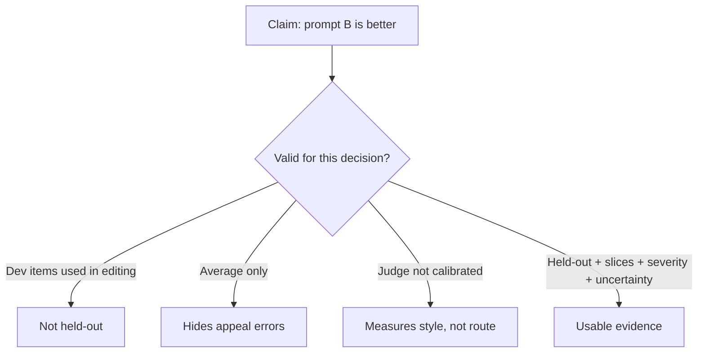

# Case · Evaluation harness — ship or stop

> [!abstract] Decision
> A prompt change raised the headline score. Decide whether that is enough evidence to release, and what the harness must contain before anyone should believe it.

**Roles:** [[AI Evaluation Engineer]] · [[LLM Engineer]] · [[AI Engineer]]
**Foundations:** [[12 Evaluation Testing and Observability]] · [[02 Math and Statistics for AI]] · [[05 Machine Learning]]

## Situation and contract

**Northline Credit — teaching scenario.** The claims-intake classifier assigns each inbound message to `eligibility`, `billing`, `appeal`, or `other`. A prompt rewrite from the product team reports **0.91 accuracy vs 0.84** on the development set of 120 examples they used while editing.

You own the release gate. Shipping writes the prompt into production for 8,000 messages/week. A wrong `appeal` route delays a legally sensitive process.

Contract:

- The decision is **release / hold / rollback plan**, not “which prompt is nicer.”
- You must say what population the number generalizes to.
- You must separate development evidence from held-out evidence.
- You must treat model-as-judge as untrusted until validated.

## Teaching envelope

> [!warning] Constructed numbers
> Use these to practice sample-size and slice reasoning. They are not a published eval.

| Quantity | Value | Why it matters |
|---|---:|---|
| Weekly production volume | 8,000 messages | Prevalence and cost of error |
| Historical class mix | 55 / 20 / 10 / 15 | Accuracy without mix is misleading |
| Dev set used during prompt edits | 120 | Contaminated by construction |
| Proposed held-out set | 300 unlabeled tickets | Not yet labeled |
| Appeal class in the 120 | 9 examples | The sensitive class is undersampled |
| Reported accuracy lift | 0.84 → 0.91 | Headline the team wants to ship on |
| LLM-judge agreement with one rater, n=40 | 0.70 | Unvalidated judge |
| Two-rater human agreement on a 50-case gold | 0.88 | Human reliability ceiling |
| p95 latency old / new | 1.1 s / 1.4 s | Still inside a 3 s SLO |

A Wilson interval around 0.91 on n=120 is wide. Even if the 120 were clean—which they are not—the lift can be noise plus overfitting.

## Closed-note prompt

Write:

1. What decision is this evaluation for?
2. What is wrong with shipping on 0.91?
3. What slices, labels, and graders do you need?
4. What threshold would let you ship, hold, or roll back?
5. How will you detect a silent failure after release?

## Worked path

### 1. Name the decision

“Is prompt B acceptable to replace prompt A for production routing of US inbound claims messages, given appeal delay risk?”

That decision needs:

- a defined population (recent production tickets, not the 120 workshop items);
- a costed error taxonomy (appeal misses are worse than `other` misses);
- a sample that can show the rare class;
- a rollback.

### 2. Why 0.91 is not evidence

| Defect | What it does |
|---|---|
| Dev-set contamination | The prompt was edited against these items; the score is a memory test |
| Tiny appeal slice | 9 items cannot estimate the error you care about |
| Accuracy on imbalanced mix | 0.91 can be “always eligibility-ish” plus a few easy wins |
| No uncertainty | A 7-point lift on n=120 is compatible with no real change |
| Unvalidated judge | 0.70 agreement is too low to replace humans on a release gate |



### 3. Harness you would actually build

**Set construction**

- Freeze the 120 as `dev`. They may be used for debugging, never for the gate.
- Draw 400 recent production tickets, stratified: at least 80 `appeal` by current human route or keyword prefilter, then adjudicate.
- Hold out 100 of those 400 as `private` (not visible to prompt authors).
- Keep 40 known no-route / adversarial items (jailbreak-ish, mixed intent, empty, non-English).

**Labels and graders**

- Two trained raters, rubric with examples for each class and for `unratable`.
- Adjudication on disagreement.
- Deterministic checks first: schema, allowed label set, empty input.
- LLM-judge may shadow the gate; it does not own the gate until agreement with adjudicated gold is ≥ 0.85 on the sensitive class, not only overall.

**Metrics**

| Metric | Role |
|---|---|
| Macro-F1 | Stops eligibility dominance |
| Appeal recall | Safety/process metric |
| Appeal precision | Cost of false appeal load |
| Calibration of abstain/`other` | Escalation quality |
| p95 latency and cost per 1k | Operational envelope |

### 4. Decision rule

Teaching gates—replace with your risk owner’s numbers in real work:

- Hold if private-set appeal recall < 0.90 **or** the Wilson lower bound on appeal recall is below 0.80.
- Hold if macro-F1 does not beat prompt A by more than sampling noise (pre-register: lower bound of the difference > 0).
- Ship only if both pass, latency stays under SLO, and a rollback toggle exists.
- After ship: sample 50 tickets/day for one week, stratified toward appeal.

On the numbers in this envelope, **you hold**. You do not have a clean held-out set yet. The honest output is a 3-day labeling plan, not a release.

### 5. What “good enough” looks like later

A release memo a staff engineer would accept includes: set versions and hashes, rater guide version, agreement, slice table, interval estimates, known exclusions, and the rollback owner. See [[Evaluation Report Template]].

## Inspectable artifact

Minimal spec. Critique the constants; they are teaching choices.

```yaml
# eval_spec.yaml — teaching artifact, not a vendor format
decision: replace_prompt_a_with_b
population: us_inbound_claims_tickets_last_28_days
sets:
  dev: {n: 120, role: debug_only}
  public_eval: {n: 300, role: author_visible}
  private_eval: {n: 100, role: gate, hidden_from_authors: true}
labels:
  classes: [eligibility, billing, appeal, other, unratable]
  raters: 2
  adjudication: required_on_disagree
graders:
  schema: deterministic
  human: primary_gate
  llm_judge: shadow_only
gates:
  appeal_recall_min: 0.90
  macro_f1_delta_lower_bound: 0.0
  p95_latency_s: 3.0
rollback: feature_flag prompt_id
```

## Failure modes and reversal test

- Authors “practice” on private items through slack screenshots → private set is burned; rotate.
- Judge prefers longer, more formal prompts → style bias ships a worse router.
- Production mix shifts after a marketing campaign → yesterday’s prevalence makes accuracy incomparable.
- Appeal recall is fine, billing precision collapses → you optimized the wrong severity.

## Quiz

1. Why can’t the 120-item score be the release gate?
2. Why might accuracy go up while appeal recall falls?
3. When may an LLM judge own a gate?
4. What is the difference between a red-team find and a prevalence estimate?
5. What must a monitoring metric have to be operational?

> [!question]- Answer key
> 1. It was used to edit the prompt, so it is not held-out. 2. The majority class can improve while the rare costly class degrades. 3. After it is validated against adjudicated human labels on the slices that matter, and monitored for drift. 4. A red-team find shows a failure is possible; prevalence needs a sampling design. 5. Meaning, threshold, owner, and a response.

## Flashcards

Held-out set:: Cases not used to edit prompts, models, or retrieval choices for the decision they judge.

Slice metric:: A score on a meaningful subset; it can reverse a headline average.

Severity-weighted error:: An error taxonomy that prices some misses higher than others.

Shadow judge:: A model grader that runs beside the gate without authority until validated.

Contamination:: Evaluation items leaking into development, selection, or training so scores stop estimating generalization.

## Transfer

- Interview: drill 2 in [[Technical Interview Drills]].
- Portfolio: the intermediate “model behavior evaluation harness” in [[Project Bank]], with real items you labeled.
- Adjacent case: [[Case - Prompt RAG Fine-Tune]] for choosing an intervention *after* the harness exists.
