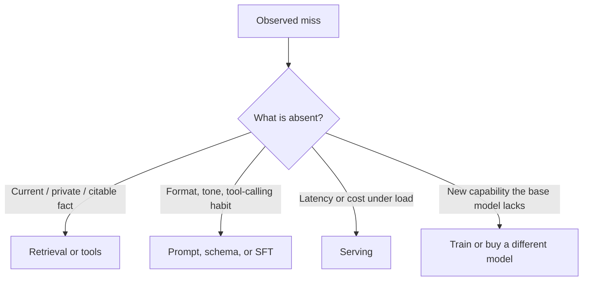

# Case · Prompt vs RAG vs fine-tune

> [!abstract] Decision
> A support assistant is wrong on internal policy. Choose the intervention that closes the actual gap—and prove you did not pick the fashionable one.

**Roles:** [[AI Engineer]] · [[LLM Engineer]] · [[RAG and Knowledge Engineer]]
**Foundations:** [[07 Transformers and Foundation Models]] · [[09 Prompt Context and Tool Use]] · [[10 RAG and Knowledge Systems]] · [[12 Evaluation Testing and Observability]]

## Situation and contract

**Northline Credit — teaching scenario.** The employee support assistant answers questions about the US employee handbook and benefits policy. Users are HR generalists and employees. The product owner wants “higher accuracy” after three visible misses.

Contract you must make explicit:

- Answer only from authorized current policy.
- Cite the policy section used.
- Say *insufficient evidence* when the corpus does not support an answer.
- Do not invent eligibility, dollar amounts, or waiting periods.
- p95 latency under 6 seconds. Monthly model+retrieval budget envelope: $1,800.
- Escalation: HR case ticket, not a model guess, for exceptions and accommodations.

## Teaching envelope

> [!warning] Constructed numbers
> All figures below are internally consistent teaching data, not a measured deployment.

| Quantity | Value | Why it matters |
|---|---:|---|
| Authorized policy corpus | 2,400 pages / 18,000 chunks | Retrieval, not pretraining, owns this knowledge |
| Policy updates | 40 sections / month | Stale weights will drift |
| Monthly questions | 12,000 | Cost and eval sample design |
| Current prompt-only support@gold | 0.61 | Baseline, 200 held-out cases |
| Citation-supported@gold | 0.38 | The real quality hole |
| Abstention when unsupported | 0.22 of no-answer cases | Unsafe guessing |
| Median latency | 2.4 s | Room under the SLO |
| Estimated monthly LLM spend | $640 | Budget is not the binding constraint |
| Available labeled pairs for SFT | 180 | Too small and contaminated with yesterday's prompts |

Gold labels were written by two HR specialists on a 200-case held-out set. Agreement on support (answer is licensed by the cited span) is 0.84.

## Closed-note prompt

Write, then stop:

1. What is the primary gap—behavior, knowledge, or serving?
2. What is the baseline you will beat?
3. What would prompt/context change, RAG, and PEFT each be able to fix?
4. What measurement would convince you?
5. What do you ship this sprint, and what would reverse it?

## Worked path

### 1. Name the gap before naming a method

The misses in the incident log are current eligibility rules and dollar amounts. The model is fluent. Citation-supported@gold is 0.38 while answer-level support@gold is 0.61. That pattern is **missing or unused knowledge**, not a missing style or a serving problem.



### 2. Baseline

Keep the current prompt-only assistant as the official baseline. Do not compare RAG to a hypothetical better prompt you did not run. A one-day prompt pass is allowed **as a cheaper baseline refresh**, not as the destination.

Prompt-only refresh expected to move citation-supported@gold only if the misses are instruction failures (“always quote the section”). The incident examples already include the right instruction. Treat a large jump from prompt wording alone as a red flag for eval leakage.

### 3. Compare interventions against the gap

| Option | Gap it could close | Evidence required | Reject when |
|---|---|---|---|
| Prompt / schema / abstention | Instruction following, citation format, refusal shape | Same 200-case set, no corpus change | Knowledge items stay wrong |
| RAG + citations + ACL filter | Current authorized facts | Retrieval recall@5, citation support, abstention, update lag | Retrieval is fine and the model still ignores evidence |
| PEFT / SFT on 180 pairs | Style, format, maybe some memorized answers | Held-out policies **not** in the 180, plus update test | Policy changes monthly; 180 pairs cannot track 40 edits |
| Full fine-tune / new model | Fundamental capability | Data rights, cost, and a capability eval | The need is attributable current policy |

**PEFT is the fashionable trap here.** 180 pairs will memorize yesterday's handbook voice. Next month's 40 edits will be wrong, and you will have created a second source of truth that HR does not own.

### 4. Measurement that can decide

Split the 200-case set into three slices before looking at a headline:

| Slice | n | Primary metric | Ship gate |
|---|---:|---|---|
| Routine current policy | 120 | citation-supported@gold | ≥ 0.80 |
| Updated in last 30 days | 40 | citation-supported@gold | ≥ 0.75 |
| No-answer / out of corpus | 40 | correct abstention | ≥ 0.85 |

Also report:

- retrieval recall@5 on the gold span;
- p95 latency;
- monthly cost projection at 12,000 questions;
- time from HR publish to searchable chunk.

A system that raises answer-level support by agreeing with the model and citing a nearby but wrong paragraph **fails**. Support without span overlap is not grounding.

### 5. Decision

**Ship this sprint:** hybrid retrieval over the authorized corpus, section-level citations, generation only from retrieved spans, and a hard abstain when no span supports the answer. Keep the existing model. Spend the remaining week on ingestion freshness and access filters, not on adapters.

**Do not ship:** PEFT. Revisit adaptation only if, after retrieval quality is adequate, the model systematically ignores correct spans or cannot produce the required schema.

**Review trigger:** the next policy update window (30 days) or any incident where a cited span does not contain the claimed number.

## Inspectable artifact

A reviewer should be able to read this decision record and operate from it. Critique the thresholds; they are teaching choices.

```markdown
# Decision — Northline policy assistant adaptation
Status: accepted (teaching scenario)
Owner: AI engineer + RAG owner
Review trigger: 2026-09-11 or first citation/span mismatch incident

Decision: retrieval + citation + abstain; no weight update this cycle.

Why not PEFT: monthly corpus edits, 180 labeled pairs, second source of truth.
Why not prompt-only: misses are current facts, not instruction shape.
Baseline: prompt-only citation-supported@gold = 0.38 on 200 held-out cases.
Gates: routine ≥0.80, recent ≥0.75, abstain ≥0.85; p95 < 6s; spend ≤ $1,800.
Rollback: disable generation, return retrieved spans + HR ticket link.
```

## Failure modes and reversal test

- Retrieval returns the right section and the model still contradicts it → the gap became **behavior**; now prompt, schema validation, or a small SFT set on *attribution* is in play.
- Updates take three days to index → the system is a stale handbook; fix ingestion SLO before celebrating eval scores.
- ACL leak: an employee retrieves compensation bands they cannot see → retrieval without authorization is a security incident, not a quality win.
- Eval contamination: the 200 cases were used to tune chunk size all week → freeze a private slice.

## Quiz

1. Why is a higher answer-level score with a lower citation-supported score a warning?
2. When would PEFT be the *first* intervention instead of RAG?
3. What does the “updated in last 30 days” slice detect that the routine slice hides?
4. Where should authorization be enforced?
5. What would make you reopen fine-tuning after shipping RAG?

> [!question]- Answer key
> 1. The system may be fluent and wrong, or citing nearby text that does not license the claim. 2. When the corpus is stable, the missing skill is format/behavior/tool use, and you have rights plus enough clean data. 3. Stale indexes and failed refresh, which average accuracy conceals. 4. In the retrieval/application layer with the authenticated identity—not in the prompt. 5. Retrieval metrics are already at gate, and the remaining errors are systematic evidence-ignoring or schema failures.

## Flashcards

Adaptation gap:: The missing capability—knowledge, behavior, or serving—that an intervention is supposed to close.

Citation-supported answer:: An answer whose claims are licensed by the cited span, not merely accompanied by a link.

Second source of truth:: A fine-tuned weight set that silently disagrees with the system of record.

Abstention:: A designed refusal when evidence is insufficient; it is a quality outcome, not a failure, on no-answer cases.

Baseline refresh:: A cheap re-run of the current method so later gains are not credited to unmeasured prompt drift.

## Transfer

- Interview: drill 1 in [[Technical Interview Drills]].
- Portfolio: do **not** submit this case. Build the intermediate project on [[LLM Engineer]] with your own corpus and measured numbers.
- Adjacent case: [[Case - Retrieval Failure Autopsy]] if you shipped RAG and quality still fails.
