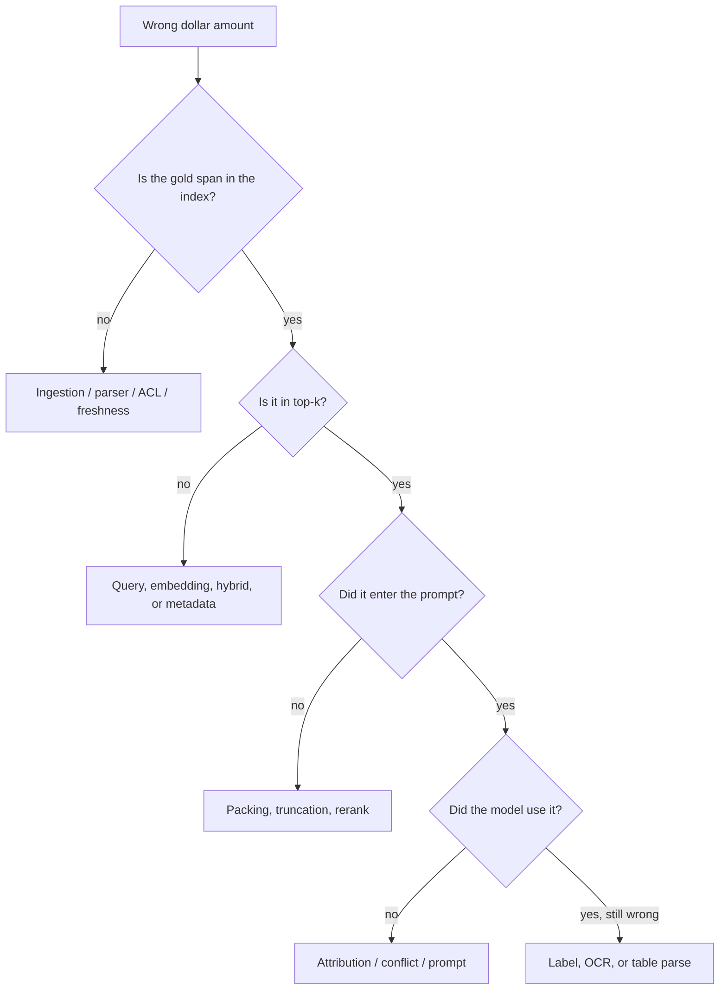

# Case · Retrieval failure autopsy

> [!abstract] Decision
> The assistant is fluent and cites a policy PDF. The dollar amount is wrong. Decide which layer failed and what you will measure before changing the model.

**Roles:** [[RAG and Knowledge Engineer]] · [[AI Evaluation Engineer]] · [[AI Engineer]]
**Foundations:** [[10 RAG and Knowledge Systems]] · [[12 Evaluation Testing and Observability]] · [[09 Prompt Context and Tool Use]]

## Situation and contract

**Northline Credit — teaching scenario.** An employee asks: “What is the 2026 commuter stipend monthly maximum?”

The assistant answers **$130** and cites `benefits-2025.pdf §4.2`. The current authorized source is `benefits-2026-03.pdf`, which says **$175**. The 2025 file is still in the index because “we might need history.”

Contract:

- Current answers must use the effective policy for today’s date.
- Citations must resolve to a span that contains the claimed number.
- Historical files may exist for “what was the rule last year?” questions only.
- Do not start by swapping the model.

## Teaching envelope

> [!warning] Constructed numbers
> One reconstructed trace. Treat it as a bug report, not a benchmark.

| Layer | What the trace shows |
|---|---|
| Query | “2026 commuter stipend monthly maximum” |
| Query rewrite | none |
| Retrieved top 5 | 2025 §4.2 (0.84), 2024 FAQ (0.81), parking policy (0.77), 2026 §4.2 (0.74), glossary (0.70) |
| ACL filter | all five allowed to this user |
| Context packing | first 1,800 tokens: 2025 + 2024 + parking; 2026 truncated |
| Model answer | “$130 per month” |
| Cited file | benefits-2025.pdf §4.2 (span contains $130) |
| Gold | $175 in benefits-2026-03.pdf §4.2, effective 2026-03-01 |
| Ingestion lag | 2026 file indexed 11 days after publish |
| Chunking | 800 tokens, 0 overlap, headers often split from tables |

Retrieval@5 *contains* the right chunk (rank 4). Generation had no chance: the right chunk was packed off the end. Citation-supported-against-cited-span is **true** ($130 is in 2025). Citation-supported-against-current-authority is **false**.

## Closed-note prompt

Write:

1. Is this a model failure, a retrieval failure, a freshness failure, or a packing failure?
2. What metric would have caught it before a user did?
3. What is the smallest fix that restores the contract?
4. What must not be “fixed” by a better prompt alone?
5. How would you keep historical documents without poisoning current answers?

## Worked path

### 1. Decompose before blaming the LLM



On this trace:

- Gold span is in the index → not a missing-file problem *now* (but 11-day lag is a separate SLO break).
- Gold span is in top-5 → not a pure recall@5 miss.
- Gold span did not enter the prompt → **packing / ranking**.
- Cited span licenses $130 → the model did what grounding asked, against the **wrong authority**.

Primary failure: **authority and packing**. Secondary: **freshness SLO**. The generator is the least interesting suspect.

### 2. Metrics that would have caught it

| Metric | This case |
|---|---|
| Recall@5 of gold span | Pass |
| nDCG / rank of current-effective doc | Fail (rank 4, stale docs above) |
| Context-hit: gold span in packed tokens | Fail |
| Citation-supported vs cited span | Pass (misleading) |
| Citation-supported vs effective authority | Fail |
| Publish-to-searchable hours | Fail (11 days vs a 24-hour teaching SLO) |

If you only track “has a citation” or answer-level match against an old gold file, this ships forever.

### 3. Smallest fix

1. **Authority filter.** Default query scope: `effective_date ≤ today ≤ superseded_date` and `doc_type=policy`. History is an explicit operator (“as of 2025”).
2. **Pack current-effective chunks first.** Do not pack by raw embedding score when metadata already identifies the live policy.
3. **Span check.** Reject or abstain if the claimed number does not appear in the cited span *of an effective document*.
4. **Freshness SLO.** Alert when publish-to-searchable exceeds 24 hours.
5. **Chunking.** Keep section headers with their tables; add overlap. That is next, not first.

Do not swap the model. Do not fine-tune $175 into weights.

### 4. What a prompt cannot fix

A prompt that says “prefer 2026” will fail the day the file is named `benefits-final-v3.pdf`. Authority is metadata and policy, not a filename heuristic.

### 5. Decision

Treat this as a retrieval-system incident, not a model-quality incident. Open a defect on ranking/packing and a second ticket on ingestion lag. Add the question to the private eval slice for current-effective amounts. Only if context-hit is high and the model still emits a number absent from the span do you open a generation bug.

## Inspectable artifact

Trace a reviewer can grade.

```text
query: 2026 commuter stipend monthly maximum
filters_applied: none                    # defect
top5:
  1. benefits-2025.pdf §4.2     0.84     # stale authority
  2. benefits-2024-faq.html     0.81     # stale
  3. parking-policy.pdf         0.77     # wrong doc
  4. benefits-2026-03.pdf §4.2  0.74     # gold
  5. glossary.md                0.70
packed_token_budget: 1800
packed_contains_gold: false              # primary fail
answer: $130
cited: benefits-2025.pdf §4.2
span_contains_claimed_number: true
effective_authority_contains_claimed_number: false
publish_to_index_hours: 264              # SLO fail
next_action: filter effective docs + pack by authority, not score
```

## Failure modes and reversal test

- You filter to current docs and break “what was my stipend last year?” → keep an explicit history mode.
- You rerank with an LLM and add 900 ms, blowing [[Case - Serving Capacity]] TTFT.
- OCR of the 2026 table reads 175 as 17 5 split across chunks → packing will still fail; fix parse.
- You remove 2025 from the index and lose audit/history for HR investigations.

## Quiz

1. Why can citation-supported@cited-span pass while the answer is wrong?
2. What does context-hit measure that recall@5 does not?
3. Why is filename “2026” a weak authority signal?
4. When *is* the generator the primary suspect?
5. What two SLOs should be on the RAG dashboard besides answer quality?

> [!question]- Answer key
> 1. The model grounded in a stale or non-authoritative span. 2. Whether the gold evidence was actually present in the prompt. 3. Names change; effective dates and doc ids do not if you store them. 4. When the gold span was packed and the model still contradicts or ignores it. 5. Publish-to-searchable time, and context-hit / effective-authority support.

## Flashcards

Context-hit:: The gold span is present in the packed prompt, not only in the retrieved set.

Effective authority:: The document that is in force for the question’s date and tenant.

Stale-rank failure:: Older documents outscore the live document so packing never sees the truth.

Span license:: The cited text actually contains the claim, especially numbers and eligibility.

Publish-to-searchable:: Time from source-of-truth publish to a successful retrieval of that version.

## Transfer

- Interview: drill 5 in [[Technical Interview Drills]].
- Role: [[RAG and Knowledge Engineer]] intermediate project.
- Pair with [[Case - Prompt RAG Fine-Tune]] so you do not “fix” this autopsy with PEFT.
